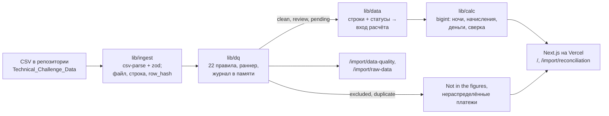
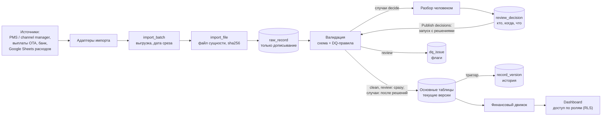

# Финансовая аналитика портфеля вилл

Прототип по тестовому заданию Senior Business Systems Engineer, Finance & Automation ([текст задания](Technical_Challenge_Business_Systems_Engineer.md)). Пять CSV с намеренными ошибками загружаются, проходят 22 правила качества и сводятся в начисления, деньги и сверку. Результат выводится на дашборд с фильтрами.

- **Дашборд:** https://restate-silk.vercel.app
- **Локально:** `npm i && npm run dev`. База, `.env` и секреты не нужны.

## Запуск

Нужен Node.js 22.12+ или 24 (проверено на 24.2; vitest 5 на Node 20 не запускается).

```bash
npm i
npm run dev        # http://localhost:3000
```

## 2. Финансовая методология

Полная спецификация — [PLAN.md, 7](docs/PLAN.md#7-финансовая-методология) и [CALCULATION_MODULE.md](docs/CALCULATION_MODULE.md).

### 2.1 Даты и период

- Даты календарные, без времени и часового пояса. Арифметика идёт в номерах дней от эпохи (UTC), тесты прогоняются в поясах UTC+14 и Лос-Анджелеса.
- Проживание — полуоткрытый интервал `[check_in, check_out)`. Ночь с датой `d` — это ночь с `d` на `d+1`. Выезд одной брони и заезд другой в тот же день не пересекаются.
- **Начисления** относятся к периоду по ночам. Бронь 28.09–04.10 даёт 3 ночи в сентябре и 3 в октябре.
- **Деньги** относятся к периоду по `payment_date`, расходы — по `expense_date`.
- **Сверка** идёт по броням с датой выезда в периоде, поэтому каждая бронь попадает ровно в один период.
- **Дата среза** — 2026-10-15, наибольший `updated_at` в данных (похоже на дату выгрузки). От неё зависят статус «срок не наступил» и правила DQ-16, DQ-20.

### 2.2 Формулы

Все суммы в рупиях (IDR). Цифры «за весь период» посчитаны по всем виллам, записи под вопросом учтены.

**Что попадает в расчёт**

- Только действующие брони, со статусом `confirmed` или `modified`. Отменённые брони выручки не дают ([2.4](#24-отмены-возвраты-modified-комиссия)).
- Стоимость брони делится поровну между её ночами, и в месяц попадают только ночи этого месяца ([2.3](#23-деньги-ночи-и-округление)).
- Записи под вопросом учитываются, пока на дашборде включён переключатель.

#### Путь от брони до собственника

| | Показатель | За весь период | Что это |
|:-:|:--|--:|:--|
| | **Gross bookings** | 1 256 651 523 | стоимость броней |
| − | Refunds | 0 | возвраты гостям |
| − | OTA fees | 183 008 072 | комиссии площадок и маркетинг прямых броней |
| = | **Net rental** | **1 073 643 451** | чистая выручка от аренды |
| − | Management fees | 223 293 180 | комиссия управляющей компании |
| − | Operating expenses | 49 462 041 | расходы виллы |
| = | **Owner balance** | **800 888 230** | что остаётся собственнику (оценка) |

Ниже то же самое по строкам: откуда берётся каждая цифра.

#### Gross bookings — стоимость броней

> **Gross bookings = стоимость брони за ночи, попавшие в период**

Стоимость брони берётся из поля `gross_booking_value`.

За весь период: **1 256 651 523** за 685 ночей.

#### OTA fees — комиссии каналов продаж

> **OTA fees = комиссия площадок + маркетинговый сбор прямых броней**

Обе суммы лежат в одном поле `ota_fee`. Если бронь пришла через площадку (`channel = OTA`), это комиссия площадки. Если бронь прямая (`channel = Direct`), это отчисление в рекламный бюджет собственной сети продаж. Вычитаются обе одинаково.

За весь период: 143 965 529 + 39 042 543 = **183 008 072**.

#### Net rental — чистая выручка от аренды

> **Net rental = Gross bookings − Refunds − OTA fees**

Refunds — возвраты гостям из поля `refund_amount`. Они тоже делятся по ночам.

Net rental одной брони — это ровно та сумма, которая должна прийти за неё на счёт. Поэтому сверка ожидает именно её.

За весь период: 1 256 651 523 − 0 − 183 008 072 = **1 073 643 451**.

#### Management fees — комиссия управляющей компании

> **Management fees = Gross bookings × ставка комиссии виллы**

- Ставка берётся из `commission_rules` той виллы, на дату заезда.
- Комиссия считается от Gross bookings, а не от Net rental, потому что так указано в правилах (`fee_basis`).
- Считается по каждой брони: округляется один раз на всю бронь и только потом делится по ночам.

За весь период: **223 293 180**.

#### Operating expenses — расходы виллы

> **Operating expenses = оплаченные расходы + расходы, ждущие оплаты**

- В период попадает расход, у которого дата расхода (`expense_date`) в этом периоде. Ночи здесь ни при чём.
- Неоплаченные расходы (`pending`) входят, потому что расход уже возник. В блок «Деньги» попадают только оплаченные.

За весь период: 41 079 463 + 8 382 578 = **49 462 041**.

#### Owner balance — что остаётся собственнику

> **Owner balance = Net rental − Management fees − Operating expenses**

За весь период: 1 073 643 451 − 223 293 180 − 49 462 041 = **800 888 230**.

Это оценка, а не точная сумма: в данных нет выплат собственникам, налогов и ещё нескольких вещей ([2.5](#25-почему-owner-balance--оценка)).

#### Деньги — что реально пришло и ушло

Этот блок смотрит только на движение денег. Платёж относится к периоду по дате платежа, расход — по дате расхода.

| | Показатель | За весь период | Что это |
|:-:|:--|--:|:--|
| | **Received** | 511 162 604 | платежи с датой в периоде |
| − | Paid expenses | 41 079 463 | оплаченные расходы с датой в периоде |
| = | **Net cash flow** | **470 083 141** | сколько денег осталось |

Дубли платежей и платежи, исключённые проверками, не считаются.

#### Сверка — всё ли оплачено

> **Difference = Received − Expected payout**

- **Expected payout** — сколько должно прийти за бронь: Gross bookings − OTA fees − Refunds, то есть её Net rental.
- **Received** — все платежи по этой брони, с любой датой.
- В сверку попадают брони, у которых выезд в выбранном периоде. Так каждая бронь сверяется ровно один раз.
- Сравнение точное, до рупии.

За весь период: 511 162 604 − 1 073 643 451 = **−562 480 847**. Минус значит, что денег пришло меньше, чем ожидалось.

| Статус | Когда ставится | Броней за весь период |
|:--|:--|--:|
| Matched | пришло ровно столько, сколько ожидали | 79 |
| Underpaid | пришло меньше, а заезд уже был | 0 |
| Overpaid | пришло больше | 0 |
| Not received | не пришло ничего, а заезд уже был | 58 |
| Not due | денег не хватает, но заезд ещё впереди | 10 |

Вилла оплачивается полностью до заезда. Поэтому всё, что не пришло к заезду, считается долгом, а Not due ставится, только если заезд позже даты среза.

**Почему ожидаем сумму без комиссии.** Все 68 ненулевых платежей в данных ровно равны стоимости брони минус комиссия (`ota_fee`). Значит, площадка перечисляет деньги уже за вычетом своей комиссии. С прямыми бронями так же: маркетинговый сбор удерживается до того, как деньги приходят на счёт.

**Почему Net rental и Received не совпадают.** Это нормально, и разница складывается из двух частей. Либо деньги ещё не пришли, и это долг, который видно в сверке. Либо они пришли в другом месяце, чем прошли ночи, и это разница во времени. Поэтому у каждого блока на дашборде подписано, по какой дате он считается ([2.1](#21-даты-и-период)).

### 2.3 Деньги, ночи и округление

- Суммы хранятся как `bigint` в целых рупиях. На `number` получается, например, `Math.round(50 * 0.29) = 14` вместо 15; разбор таких ошибок — в [CALCULATION_MODULE.md, 3](docs/CALCULATION_MODULE.md#3-почему-не-number).
- Дробная рупия в файле — ошибка формата, а не повод округлять. `10011978.00` допустимо.
- Ставка хранится дробью (`17/100`), без плавающей точки. ESLint запрещает в денежном коде дробные литералы, `Math.round`, `parseFloat` и `toFixed`.
- Комиссия УК округляется один раз на бронь, половина — от нуля (так же округляет `round(numeric)` в Postgres).
- Сумма брони делится по ночам так: каждая ночь получает `floor(A / n)`, остаток раздаётся по 1 IDR первым ночам. Сумма по ночам равна сумме брони до рупии; это проверяет тест-свойство на случайных данных.

### 2.4 Отмены, возвраты, modified, комиссия

- **Отмена:** выручка, OTA и комиссия УК равны 0, ожидаемый платёж тоже 0. Допущение: комиссию OTA при отмене канал возвращает. Во всех 12 отменах возврат равен GBV.
- **Частичный возврат при отмене:** удержанная часть была бы выручкой. В данных таких нет, их ловит DQ-18. Как их учитывать — вопрос финдиректору.
- **Возврат у активной брони** уменьшает выручку. Единственный такой случай, R0072 (статус confirmed, возврат больше GBV), противоречив и исключён.
- **modified:** ссылки на исходную бронь в данных нет. На уровне 1 modified считается актуальной версией с флагом DQ-13. На уровне 2 её принимает человек и сам связывает с исходной.
- **Ставка комиссии** берётся на дату заезда. Если на эту дату у виллы действуют два правила, берётся правило с более поздней `effective_from`, а DQ-22 ставит флаг. Смену ставки внутри проживания помечает DQ-17. В данных у каждой виллы одно правило.

### 2.5 Почему owner balance — оценка

В данных нет:
- выплат собственникам и начального сальдо;
- налогов: PB1 с проживания, PPN с комиссии УК;
- правила, кто несёт комиссию OTA (допущение: собственник);
- базы комиссии УК при возвратах;
- курсов валют.

Этот список показан на дашборде у метки Estimate. Кроме того, в данных нет даты создания брони, поэтому продажи за период по дате бронирования посчитать нельзя.

### 2.6 Политики

Методологические решения собраны в `lib/calc/policies.ts`. Если финдиректор ответит иначе, меняется одна настройка, а не код расчётов. У каждого значения есть тест, который показывает, какие цифры оно меняет.

| Политика | По умолчанию | Другое значение |
|---|---|---|
| `revenueRecognition` | `nights` — по ночам | `checkout` — вся бронь в дату выезда |
| `rounding` | `half-up` — половина от нуля | `half-even` — банковское |
| `reconciliationDate` | `check_out` | `last_night` — тогда начисления и сверка брони в одном периоде |
| `paymentDue` | `check_in` — оплата до заезда | `check_out` |

Дата среза передаётся в запуск проверок отдельно (`npm run dq -- --as-of`).

## 3. Качество данных

Каталог правил с подробностями — [VALIDATION_PLAN.md, 6](docs/VALIDATION_PLAN.md#6-каталог-проверок). Вживую — страница `/import/data-quality`.

### 3.1 Принцип

- **Входящие данные — источник правды.** Мы их не правим: проверки решают, каким записям верить, но значений не меняют.
- **Вердикт по каждой строке.** Каждое правило — отдельная функция. По каждой строке своей области она возвращает `pass`, `fail` или `skip` с причиной. Раннер не примет правило, которое пропустило строку. Поэтому по любой записи видно, какие правила она прошла и какие нет (карточка строки на `/import/data-quality`).
- **Сначала система, потом человек.** Однозначные случаи система решает сама и окончательно (`duplicate`, `excluded`). Человеку остаётся только то, что по данным решить нельзя (`pending`).

| Статус | Что значит | В расчётах | Строк |
|---|---|---|---:|
| `clean` | проблем не найдено | да | 131 |
| `review` | флаг: есть сомнение, но запись правдоподобна | да, с флагом; переключатель может убрать | 87 |
| `pending` | система не может решить сама: пересечение, modified без исходной, разные версии одной записи; платежи таких броней ждут вместе с ними | уровень 1 — как `review`; уровень 2 — после решения человека | 131: 89 броней и 42 платежа |
| `excluded` | запись противоречива или не привязана к объекту | нет, сумма в «Not in the figures» | 6 |
| `duplicate` | точная копия другой строки: тот же ID и то же содержимое | нет | 2 |

Статус выбирается по приоритету: `duplicate` → `excluded` → `pending` → `review` → `clean`. Строку, которую раннее правило уже исключило, остальные правила пропускают, поэтому сумма под вопросом не удваивается.

### 3.2 Исключено автоматически

| Строка | Правило | Причина | Сумма |
|---|---|---|---:|
| R0015, вторая копия | DQ-01 | точный дубль строки | 13 628 994 IDR |
| P0075, вторая копия | DQ-01 | точный дубль строки | 12 211 055 IDR |
| R0034 | DQ-04 | вилла V999 не существует | 14 462 943 IDR |
| P0017 | DQ-04 | вилла V999 (платёж по R0034) | 12 727 390 IDR |
| E0017 | DQ-04 | вилла V777 не существует | 834 779 IDR |
| R0061 | DQ-06 | валюта USD у виллы в IDR: 4 280 874 за 4 ночи — по величине это рупии, а не доллары | 4 280 874.00 USD |
| R0072 | DQ-09 | статус confirmed, возврат 7 970 068 больше GBV 7 070 068 | 7 070 068 IDR |
| P0036 | DQ-05 | нулевой платёж по исключённой R0072 | 0 IDR |

На `/import/reconciliation` P0017 и P0036 показаны как нераспределённые платежи.

### 3.3 Сводка по правилам

Действия: `exclude` и `duplicate` — исключить; `decide` — решает человек (`pending`); `review` — флаг; `info` — справка, статус не меняет. «Под вопросом» — сумма в терминах правила: GBV брони, сумма платежа, недостача к заезду (DQ-16).

| Правило | Проверка | Действие | Провалов | Под вопросом, IDR | Что нашли |
|---|---|---|---:|---:|---|
| DQ-01 | точный дубль строки | duplicate | 2 | 25,8 млн | R0015, P0075 |
| DQ-02 | один ID, разное содержимое | decide | 0 | | |
| DQ-03 | схема и формат: ID `R####`, `V###`, `P####`, `E####`, даты, суммы | exclude | 0 | | |
| DQ-04 | вилла существует | exclude | 3 | 28,0 млн | R0034, P0017 (V999), E0017 (V777) |
| DQ-05 | бронь платежа существует и не исключена | exclude / hold | 43 | 323,9 млн | P0036 исключён; 42 платежа ждут решения по своей брони |
| DQ-06 | валюта совпадает с валютой виллы | exclude | 1 | | R0061, USD |
| DQ-07 | суммы и число ночей положительные | exclude | 0 | | |
| DQ-08 | 0 ≤ OTA ≤ GBV | review | 1 | 3,8 млн | R0102: OTA = −100 000 |
| DQ-09 | возврат ≤ GBV, возврат только у отмены | exclude | 1 | 7,0 млн | R0072 |
| DQ-10 | ставка OTA в пределах 0–25 % | review | 0 | | |
| DQ-11 | «OTA fee» у прямой брони | info | 30 | | 30 броней Direct; это отчисление в рекламный бюджет, вычитается как комиссия |
| DQ-12 | пересечение проживаний на одной вилле | decide | 86 | 801,6 млн | 68 пар, 32 группы, 17 вилл |
| DQ-13 | modified без ссылки на исходную | decide | 8 | 78,3 млн | R0143–R0150 |
| DQ-14 | платёж = ожидаемому | review | 1 | 3,9 млн | P0051: 3 998 667 больше GBV 3 898 667 (из-за R0102) |
| DQ-15 | нулевой платёж со статусом received | info | 7 | | 6 отмен и R0072 |
| DQ-16 | не оплачено к дню заезда | review | 109 | 841,1 млн | 58 из них без единого платежа |
| DQ-17 | правило комиссии на дату заезда, ставка не меняется внутри проживания | review | 0 | | |
| DQ-18 | частичный возврат при отмене | review | 0 | | |
| DQ-19 | вилла платежа = вилла брони | review | 0 | | |
| DQ-20 | событие позже даты среза | review | 51 | 169,3 млн | 22 платежа и 29 расходов датированы после 15.10 |
| DQ-22 | периоды правил комиссии пересекаются | review | 0 | | |
| DQ-23 | платёж позже дня заезда | review | 58 | 439,0 млн | раньше заезда — ни одного, в день заезда — 9 |
| DQ-90 | контрольные суммы по файлу | запуск `failed` | 0 | | все пять файлов сходятся |

Эти числа зафиксированы в `lib/dq/golden.test.ts` и совпадают с первичным анализом данных. Три расхождения (DQ-11, DQ-20, DQ-23) объяснены: строку, уже исключённую или признанную дублем, правило пропускает.

### 3.4 Пересечения периодов

- 68 пар, 86 броней из 135 активных, 32 группы конфликта на 17 виллах. В них 801,6 млн из 1 256,7 млн IDR GBV (64 %).
- Без пересечений остаётся только 49 активных броней. Исключить пересечения значило бы уничтожить большую часть данных, а их массовость говорит о системной проблеме источника, а не о случайных опечатках.
- Виды пересечений:
  - одинаковые даты: R0033 и R0056 на V008. Это не дубль: ID разные, GBV 14,6 и 5,6 млн IDR, платёж только у R0056;
  - пары, где одна бронь modified: 6, похоже на старую и новую версию одной брони;
  - частичные пересечения: 61, двойное бронирование или ошибка дат; пять из них даёт R0102.
- Пересечения собраны в **35 случаев на 18 виллах**: 32 группы конфликта и 3 modified-брони вне групп (R0143, R0144, R0147). В случаях 89 броней и 42 платежа по ним на 323 934 566 IDR. На `/import/data-quality` у каждого случая таймлайн по ночам и флаги каждой брони.
- Автоматически набор броней не выбирается: выбор зависит от фактов вне данных. В самой большой группе (V003) 8 броней, и три из них друг с другом не пересекаются.
- Вилла считается одной единицей размещения: поля «комната» или «юнит» в данных нет. Пересечения считаются по `property_id`.

### 3.5 Платежи: DQ-16 и DQ-23

- Ни один платёж не датирован раньше заезда: 9 приходятся на день заезда, остальные позже. Медиана — на следующий день после выезда. Сумма платежа при этом равна `GBV − OTA`, то есть похожа на выплату канала, а не на деньги гостя.
- Правило бизнеса — оплата 100 % до заезда. По нему это долг: DQ-16 находит 109 броней, не оплаченных к заезду (58 из них без единого платежа), а DQ-23 — 58 платежей позже заезда. Это не исключается, а помечается и выносится в вопросы финдиректору.
- Платежи есть только у броней с чётными ID (75 из 150). Похоже на неполную выгрузку или пакетные выплаты OTA.

### 3.6 Записи под вопросом и переключатель

Переключатель Include records under review убирает все записи `review` и `pending`. Без них остаётся 59 ночей и 136,1 млн из 1 256,7 млн IDR GBV. Таблица по виллам на этот переключатель не смотрит: в её ячейках всегда только чистые записи. Её собственный переключатель Under review (по умолчанию выключен) показывает под каждой цифрой отдельной строкой, сколько добавят записи под вопросом. Под вопросом оказались не только случаи (131 строка `pending`), но и почти все брони с флагом DQ-16 «не оплачено к заезду» и платежи с флагом DQ-23. Получается, что переключатель смешивает два разных сомнения: «была ли бронь» и «вовремя ли оплачена». Поведение оставлено как есть и вынесено в [вопросы](#6-вопросы-финансовому-директору): возможно, переключатель должен убирать только случаи и сомнения в самой записи, а платёжные флаги оставлять.

### 3.7 Контрольные суммы

| Файл | Строк | Сумма в файле | В расчётах | Исключено | Дубли |
|---|---:|---:|---:|---:|---:|
| reservations.csv | 151 | 1 377 977 041 IDR + 4 280 874.00 USD | 1 342 815 036 | 21 533 011 IDR + 4 280 874.00 USD | 13 628 994 |
| payments.csv | 76 | 536 101 049 | 511 162 604 | 12 727 390 | 12 211 055 |
| expenses.csv | 90 | 50 296 820 | 49 462 041 | 834 779 | 0 |
| properties.csv | 20 | | | | |
| commission_rules.csv | 20 | | | | |

- Суммы разных валют не складываются.
- «В расчётах» по броням включает 86 163 513 IDR отмен: они входят в расчёт, но дают ноль выручки.
- Тест читает файлы отдельным `csv-parse` без кода `lib/` и сверяет левую часть. Правую часть он сверяет со входом калькулятора и с отчётом «исключено автоматически».

## 4. Архитектура

### 4.1 Прототип: что работает сейчас



- Каждый слой — отдельный модуль с тестами. Проверки не знают про расчёты, расчёты не знают, откуда пришли данные.
- `lib/data` прячет источник за интерфейсом `DataSource`. Сейчас это `CsvSource`; на уровне 2 его заменит `SupabaseSource`, правила и расчёты останутся прежними.
- Расчёты выполняются на сервере (React Server Components), клиентские компоненты только показывают готовые цифры. `/` и `/import/reconciliation` — частичный пререндер: оболочка статична, цифры по фильтрам стримятся. `/import/data-quality` и `/import/raw-data` собираются при сборке.

### 4.2 Целевая система



Хранилище — Supabase Postgres 17, схема `app`. Декларативная схема уже написана: `supabase/schemas/app/`, миграция `supabase/migrations/20261018195205_data_model.sql`. Код импорта и подключение дашборда к базе — следующий этап (ROADMAP.md, фазы 7–8), в прототипе их нет.

**Повторный импорт без дублей:**
1. Пачка — любой набор из одного–пяти файлов: файлы одной выгрузки приходят в разное время. Если файл совпадает по sha256 с уже загруженным файлом той же сущности, он получает статус `skipped`, строки не читаются. Если пропущены все файлы, пропускается вся пачка.
2. Сырые строки пишутся в `raw_record` только дописыванием, с файлом, номером строки и `row_hash`. Хэш считается по полям нашего формата, поэтому порядок колонок и лишние колонки на него не влияют (тест в `lib/ingest`).
3. При публикации: новый ключ — вставка, версия 1; тот же ключ с другим хэшем — обновление и версия `n + 1`; тот же хэш — строка не трогается, новой версии нет. Точные дубли внутри файла отсекает DQ-01.
4. Если записи нет в новом файле, с ней ничего не делается: файл — не полный снимок. Отмену источник присылает статусом `cancelled`.
5. Проверки идут по действующему набору: строки пачки, затем `pending` прежних пачек, затем опубликованное. Поэтому платёж, пришедший через неделю после брони, находит её в базе.

**Аудит изменений:**
- `raw_record`, `record_version`, `dq_check_result`, `dq_record_verdict`, `review_decision` — таблицы только для дописывания, их защищает триггер `forbid_change`.
- Историю всех основных таблиц пишет один триггер в `record_version`. Для любой версии записи видно, из какой строки какого файла она пришла, каким запуском опубликована и кто её изменил. Правка руками в обход импорта тоже попадает в историю, с `run_id = null`.
- По каждому правилу и каждой строке в журнале `dq_check_result` хранится вердикт. `dq_issue` ведёт проблему между запусками: `open` → `resolved` → `closed`.

**Разбор случаев:**
- Записи без сомнений (`clean`, `review`) публикуются первым же запуском. Ждут человека только брони случаев и платежи по ним.
- Решение по каждой брони: `accept` (в календарь), `finance_only` (только в финансы), `exclude`, `keep_published`. Комментарий обязателен, автор и время сохраняются.
- Календарь занятости `occupancy` с ограничением `EXCLUDE USING gist` не примет пересекающиеся брони: правило «на вилле одна бронь на ночь» держит база, а не код.
- Если по случаю пришли новые данные, он решается заново; прежнее решение видно, но не подставляется.

**Разграничение доступа (проект):**
- Роли: finance — всё; ops — все объекты без owner balance; owner — только свои виллы.
- RLS-политики по `property_id` через таблицу `user_property_access`.
- Схема `app` не публикуется через Data API Supabase. Сервер ходит в базу напрямую через Transaction pooler, publishable key в браузере доступа к данным не даёт.

**Прототип — не защищённая система.** Входа и ролей нет, дашборд открыт всем по ссылке. Это допустимо только потому, что данные синтетические. Модель доступа выше — набросок для рабочей версии.

## 5. Решения и компромиссы

### 5.1 Технологии

| Слой | Выбор | Почему |
|---|---|---|
| Язык | TypeScript, Node 24 | основной стек автора; строгие типы для денег: `bigint` не смешивается с `number` при компиляции |
| Приложение | Next.js 16, App Router | дашборд и серверные расчёты в одном проекте, деплой на Vercel в один шаг |
| Интерфейс | HeroUI 3 + Tailwind 4, Recharts | готовые таблицы, фильтры, выбор дат — без ручной вёрстки |
| Данные | csv-parse, zod | BOM и кавычки; схема и проверка формата каждой строки |
| Тесты | vitest, fast-check | быстрые модульные тесты и свойства на случайных данных |
| База (уровень 2) | Supabase Postgres 17 | проект уже есть; `daterange` и `EXCLUDE` для запрета пересечений, триггеры для истории |

- **Почему не Python:** данных около 360 строк, pandas здесь преимущества не даёт, а код на своём стеке проще защищать.
- **Почему расчёты на TypeScript, а не в SQL:** одна реализация с полным покрытием тестами работает и с CSV, и с базой. При росте объёмов расчёты переезжают в SQL-витрины.
- **Почему `bigint`, а не decimal-библиотека:** нужно пять операций, на `bigint` их легко проверить целиком, и не появляется лишняя зависимость.

### 5.2 Главные допущения

Все решения с датами и причинами — в журнале [PLAN.md, 15](docs/PLAN.md#15-журнал-решений).
- Выручка признаётся по ночам проживания: это корректно для любого периода и для броней на стыке месяцев.
- Пересечения — случаи для решения человеком, а не исключение.
- Дубль — только тот же ID и то же содержимое. Одинаковые даты под разными ID — конфликт, а не дубль.
- Оплата 100 % до заезда: DQ-16 считает долг на дату заезда.
- «OTA fee» у прямой брони — отчисление в рекламный бюджет своей сети продаж. Из owner balance оно вычитается как комиссия: если бы отчислять было нечего, в поле стоял бы 0. Ставки те же, что у OTA (12, 15, 17 %), платежи приходят за вычетом отчисления.
- Ставка комиссии берётся на дату заезда.
- Дата среза — 2026-10-15.
- Входящие данные не исправляются. Решения `correct` нет; при новых данных случай решается заново.

### 5.3 Ограничения прототипа

- **Нет базы.** Повторный импорт, история версий и аудит спроектированы, и схема для них написана, но в прототипе не работают. Данные пересчитываются из CSV при старте процесса.
- **Нет решений человека.** `pending` считается как `review`. Поэтому цифры с записями под вопросом включают обе брони каждого пересечения: ночи и GBV завышены там, где пересечение окажется двойным бронированием. 685 ночей — это сумма ночей броней, а не число занятых ночей.
- **Переключатель «под вопросом» смешивает разные сомнения** ([3.6](#36-записи-под-вопросом-и-переключатель)).
- **Сверка по дате выезда.** Бронь с выездом 01.11 начислена в октябре, а сверяется в ноябре.
- **Одна валюта.** Курсов нет, суммы в другой валюте исключаются (R0061).
- **`/import` (вкладка Batches) — макет** на демонстрационных данных.
- **Нет входа и разграничения доступа**, дашборд публичный.
- **Независимый SQL-пересчёт** (PLAN.md, 11.4) не сделан. Портфель пересчитан скриптом по сырым CSV без кода `lib/`.
- **Страница `/import/data-quality` отдаёт клиенту все 357 строк** с результатами проверок (около 55 КБ в gzip). Для реальных объёмов понадобится серверная пагинация.
- **Next.js 16 с экспериментальными возможностями** (`cacheComponents`, partial prefetching): возможны сюрпризы при обновлении.

### 5.4 Риски

| Риск | Мера |
|---|---|
| Цифры сильно зависят от пересечений: под вопросом 64 % GBV | сумма под вопросом рядом с каждым итогом, переключатель, 35 случаев для разбора |
| Допущения разойдутся с политикой компании | политики в одном файле, список вопросов финдиректору |
| Платежи на деле — выплаты OTA, а не оплата гостей | DQ-16 и DQ-23 помечают, вопрос финдиректору; правило срока оплаты — политика `paymentDue` |
| Утечка секретов | `.env` в `.gitignore`, в репозитории только `.env.example`; история git проверена на значения из `.env`; уровню 1 переменные не нужны |
| Сдвиг дат из-за часового пояса на сервере | календарные даты строками, арифметика в номерах дней, тесты в двух поясах |
| CSV не попадут в серверный бандл Vercel | `outputFileTracingIncludes` в `next.config.ts`; цифры на Vercel сверены с локальной сборкой |
| Бесплатный проект Supabase засыпает (уровень 2) | переход на CSV с баннером |

### 5.5 Три следующих шага

1. **База и импорт без дублей** (ROADMAP.md, фазы 7a–7c, ≈ 3 ч). Импорт пачками в Supabase по готовой схеме: sha256 файла, `raw_record`, staging, проверки по действующему набору с журналом в Postgres, публикация одной транзакцией с `record_version`. Дашборд читает базу, а при её недоступности переключается на CSV.
2. **Экран разбора случаев `/review`** (фаза 8, ≈ 2,5 ч). 35 случаев с таймлайном, решение по каждой брони с комментарием, связь modified с исходной, кнопка Publish decisions. После этого цифры становятся окончательными, а календарь не допускает пересечений средствами базы.
3. **Ответы финдиректора и доступ.** Закрыть вопросы раздела 6, переключив политики; добавить вход и роли finance / ops / owner с RLS по вилле; подключить источники по расписанию (Google Sheets, выгрузки PMS и банка).

Дальше по списку ROADMAP.md, фаза 10: загрузка файлов из браузера и очередь импорта, сопоставление колонок с подтверждением человеком, SQL-пересчёт портфеля, мутационное тестирование расчётов.

## 6. Вопросы финансовому директору

Выручка и комиссии:
1. Как признаётся выручка: по ночам проживания (сейчас), по дате выезда или по дате бронирования?
2. Включает ли `gross_booking_value` налоги (PB1) и сервисные сборы?
3. База комиссии УК — сумма до или после комиссии OTA и возвратов? Берётся ли комиссия при отмене с удержанием, и считается ли удержание выручкой?
4. Как округляется комиссия УК: по каждой брони (сейчас) или по счёту за месяц; половина от нуля или банковское округление?
5. Кто несёт комиссию OTA: собственник или управляющая компания?
6. Подтвердите: «OTA fee» у 30 прямых броней — отчисление в рекламный бюджет своей сети продаж, и собственник несёт его так же, как комиссию OTA?
7. Какие налоги удерживаются с комиссии УК (PPN)?

Деньги и сверка:

8. Правило оплаты — 100 % до заезда? Почему в `payments.csv` нет ни одного платежа раньше заезда: это даты выплат OTA, а не оплаты гостя, или ошибка выгрузки?
9. Почему платежи есть только у броней с чётными ID? Это пакетные выплаты OTA или неполная выгрузка?
10. Что означают нулевые платежи со статусом received у отмен?
11. К какому периоду относить сверку брони: по дате выезда (сейчас) или по последней ночи?
12. На какую дату сделана выгрузка? Сейчас дата среза — 2026-10-15, наибольший `updated_at`.
13. Относятся ли неоплаченные (pending) расходы на собственника в периоде начисления?
14. Есть ли выплаты собственникам, начальное сальдо, депозиты, резервы?

Данные:

15. Как связать бронь modified с исходной? Какая версия актуальна? Переходят ли платежи исходной брони к новой?
16. Откуда столько пересечений (68 пар): двойные бронирования, переносы дат или ошибка выгрузки? Сдаётся ли вилла только целиком? Поля «комната» или «юнит» в данных нет, сейчас вилла — одна единица размещения.
17. Бывают ли брони в другой валюте (R0061 в USD)? По какому курсу и на какую дату пересчитывать?
18. Какая цифра нужна «без сомнительных записей»: без броней, в существовании которых сомневаемся, или ещё и без записей с просроченной оплатой?
19. Нужна ли загрузка (уникальные занятые ночи) отдельно от суммы ночей броней?

## 7. Время

Рекомендовано 2–3 часа. Ниже — оценка автора по этапам.

| Этап | Время |
|---|---|
| Анализ: погружение в задание и данные, настройка окружения | ≈ 1 ч 30 мин |
| Планирование: проектирование системы и модулей, детальные планы по каждому модулю | ≈ 3 ч |
| Генерация кода | ≈ 2 ч |
| Доработки и исправления | ≈ 1 ч 30 мин |
| **Итого** | **≈ 8 ч** |

Время сверх рекомендованного ушло на проектирование: уровень 2 (импорт, аудит, разбор случаев) расписан в документах, а схема базы написана, хотя код импорта не начат. Уровень 2 в сдачу не входит. Порядок работ и оценки по фазам — в [ROADMAP.md](docs/ROADMAP.md).

## 8. Использование AI и как проверяли

**Инструмент.** На всех этапах (анализ, планирование, генерация кода, доработки) и во всех фазах использовался Claude Code с моделями Claude Opus 5.5 и Claude Fable 5.1. В коммитах это отмечено строкой Co-Authored-By.

**Как ставили задачи:**
- Способы тестирования обозначались сразу, при формировании задач, до написания кода.
- Модули описывались по отдельности: как каждый должен выглядеть и как работать. Планы по модулям лежат в `docs/`.
- По каждой задаче давался подробный промпт. Бизнес-правила (например, оплата 100 % до заезда) и решения из журнала PLAN.md, 15 задавал автор. Каждую фазу автор принимал сам.

**Как проверяли результат:**
1. **Модульные тесты** на каждое правило (`pass`, `fail`, граница, `skip`), распределение по ночам, округление, границы периода, статусы сверки: 588 тестов. Порог покрытия `lib/` — 100 % (`npm run test:lib`).
2. **Эталон V011 за сентябрь.** Значения выведены вручную по исходным строкам ([CALCULATION_MODULE.md, 11.5](docs/CALCULATION_MODULE.md#115-эталон-v011-сентябрь-2026)) и записаны в тест числами, а не снимком.
3. **Эталон портфеля** за сентябрь, октябрь и весь период (`lib/data/golden.test.ts`) сверен с независимым пересчётом по сырым CSV: отдельный скрипт без кода `lib/`. Совпало до рупии.
4. **Эталон проверок** (`lib/dq/golden.test.ts`) сверен с первичным анализом данных. Каждое расхождение разобрано и объяснено в VALIDATION_PLAN.md, 6.
5. **Инварианты на случайных данных** (fast-check): сумма по ночам = сумма брони, сумма по виллам = портфель, смежные периоды складываются, итог = чистые записи + записи под вопросом. У каждой строки ровно один статус. Контрольные суммы сверены чтением файлов без кода `lib/`.
6. **Защита инструментами:** тесты в двух часовых поясах, ESLint запрещает плавающую точку в денежном коде, строгий `tsconfig` для `lib/`.
7. **Деплой:** все числа в HTML на 11 адресах (главная с разными фильтрами, сверка, качество данных, исходные строки) на Vercel совпали с локальной продакшн-сборкой.

Не сделано: SQL-пересчёт в Postgres и мутационное тестирование.

## Структура репозитория

```
.
├─ Technical_Challenge_Data/   исходные CSV, не изменяются
├─ app/                        страницы Next.js
├─ components/                 интерфейс (HeroUI); только отображение
├─ lib/
│  ├─ ingest/                  разбор CSV: csv-parse, zod-схема на файл, row_hash
│  ├─ dq/                      контракт проверки, раннер, 22 правила, случаи, журнал
│  ├─ calc/                    финансовый движок на bigint, политики
│  ├─ data/                    строки + статусы → вход расчёта; источник CSV
│  └─ mock/                    демонстрационные данные страницы /import
├─ scripts/                    npm run dq, анализ пересечений
├─ supabase/                   схема базы уровня 2 и миграция
└─ docs/                       планы и спецификации
```

Документы в `docs/`:
- [PLAN.md](docs/PLAN.md) — что строим: объём, данные, правила, методология, журнал решений;
- [ROADMAP.md](docs/ROADMAP.md) — порядок работ по фазам и что сделано в каждой;
- [CALCULATION_MODULE.md](docs/CALCULATION_MODULE.md) — модуль расчётов: деньги, округление, распределение, тесты;
- [VALIDATION_PLAN.md](docs/VALIDATION_PLAN.md) — модуль проверок: контракт, журнал, каталог правил, разбор случаев;
- [IMPORT_PLAN.md](docs/IMPORT_PLAN.md) — импорт уровня 2: пачки, сырые строки, staging, очередь.
