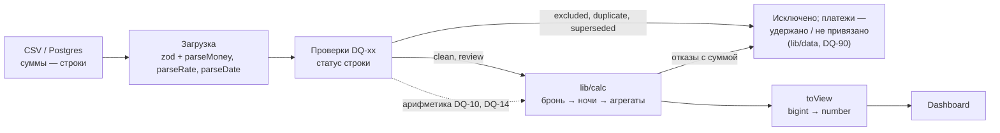

# План модуля расчётов

Что считаем — PLAN.md, 7. Здесь — как считаем: типы, округление, распределение, ошибки, тесты.

Статус: v2 от 2026-10-27, сделан в коде фазой 6b (ROADMAP.md, MONEY_MODEL_PLAN.md). Модуль считает по денежной модели финального задания (PLAN.md 7, отличия — 7.8): ставка и округление комиссии по каждой ночи, PBJT, статус платежа, три вида денег. `lib/nightly` считает ночи через модуль. Где числа v1 (ставка на дату заезда, одно округление на бронь) и v2 различаются, приведены оба: v1 — история.

## 1. Требования

1. **Отдельный модуль** `lib/calc/`: только чистые функции. Нет ввода-вывода, базы, React, Next.js, текущего времени и глобального состояния. Модуль не знает, откуда пришли данные: из CSV, из Supabase или из JSON-ленты событий.
2. **Над деньгами и ставками нет ни одной операции с плавающей точкой.** Суммы хранятся как `bigint` в целых единицах учёта, ставки — как дробь из двух `bigint`.
3. **Округление явное:** одно правило, в одном месте, один раз на ночь: комиссия УК каждой ночи по ставке этой ночи (ТЗ финального задания, п. 6). Комиссия брони, периодов и портфеля — суммы уже округлённых ночных. Промежуточные результаты не округляются.
4. **Сумма частей всегда равна целому** до единицы: ночи — брони (по каждой из сумм A, PBJT, OTA, REF и по комиссии), периоды — всему диапазону, объекты — портфелю.
5. **Ошибка — это исключение с кодом.** Функция никогда не возвращает `NaN`, `undefined`, `0` или пустой результат вместо ошибки. Пакетный расчёт не теряет записи: запись, которую не удалось посчитать, попадает в список отказов вместе со своей суммой.
6. **Детерминизм:** одинаковый вход даёт одинаковый результат при любом порядке строк, часовом поясе и локали. Сегодняшняя дата (по Бали) передаётся аргументом `today`.
7. **Политики** (PLAN.md, 7.7) приходят аргументом, а не из глобального импорта.
8. **Тесты:** 100% покрытия ветвей, property-based проверка инвариантов, эталон, посчитанный вручную, прогон в нескольких часовых поясах.

## 2. Место в системе



- На вход модуля попадают только записи со статусом `clean` или `review`. Тип входа не допускает других статусов, а функция дополнительно проверяет его во время выполнения. Выбор версии брони (последний снимок по `updated_at`) делается до модуля — правилом DQ-02 или, в CLI финального задания, `lib/nightly/snapshots.ts`; модуль получает одну версию на бронь.
- Модуль проверок использует те же примитивы для своей арифметики: доля OTA (DQ-10), ожидаемый платёж (DQ-14, DQ-16), правила комиссии на каждую ночь (DQ-17). Арифметика в системе одна.
- Разбор строк в `Money`, `Rate` и `CalendarDate` выполняет загрузка, но функциями разбора из `lib/calc`. Правила формата заданы в одном месте.
- `lib/nightly` (CLI финального задания) после фазы 6b тоже считает через модуль: разбор JSON, выбор снимков, дубли и форма отчёта по `output_schema.json` остаются в адаптере, расчёт брони и агрегаты — здесь.
- Удержанные платежи броней вне расчёта и не привязанные платежи в модуль не попадают: их статус `excluded` ставит DQ-05. Эти два вида денег собирает адаптер данных (`lib/data`) по вердиктам DQ, модуль считает поступившие и `pending` (5.3).

## 3. Представление данных

### 3.1 Деньги: `Money`

```ts
type Currency = 'IDR' | 'USD';

interface Money {
  readonly amount: bigint;     // целые единицы учёта валюты
  readonly currency: Currency;
}

const SCALE: Record<Currency, number> = { IDR: 0, USD: 2 };
```

- **IDR учитываем в целых рупиях** (масштаб 0), как в PLAN.md, 7.3. В USD учитываем центы. USD нужен только для того, чтобы R0061 разобралась и была исключена правилом DQ-06, а не упала при разборе.
- Значения неизменяемы: функции возвращают новые объекты и не меняют входные.
- Операции — функции над простыми объектами: `add(a, b)`, `sub(a, b)`, `sum(list, currency)`.
- Все операции с двумя суммами сверяют валюту. Если валюты разные — `CURRENCY_MISMATCH`. Пересчёта курсов в модуле нет (вне объёма, PLAN.md, 2).

**Разбор строки** `parseMoney(text, currency)`:
- Грамматика `^-?\d+(\.\d+)?$`, только ASCII-цифры (`\d` в JS без флага `u` совпадает только с 0–9). Не принимаются пробелы, `+`, экспонента, `0x`, разделители тысяч, запятая, `.5` и `5.`.
- Дробная часть длиннее масштаба допустима только из нулей. `"10011978.00"` → `10011978n` (так `numeric(18,2)` приходит из Postgres). `"10011978.50"` → ошибка `AMOUNT_SCALE`, без молчаливого округления.
- `"-0"` → `0n`. У `bigint` нет отрицательного нуля.
- `number` на вход разбора не принимается. Для фикстур и mock-данных есть `fromSafeInteger(n, currency)`: проходит только `Number.isSafeInteger(n)`, иначе `INVALID_AMOUNT` или `UNSAFE_NUMBER`.

### 3.2 Ставки: `Rate`

```ts
interface Rate {
  readonly num: bigint;   // 17n
  readonly den: bigint;   // 100n — всегда степень 10
}
```

- `parseRate("0.17")` → `{ num: 17n, den: 100n }`. Принимается не больше 4 знаков после точки, как в `numeric(6,4)` в `app.commission_rule`. Допустимый диапазон 0 ≤ rate < 1, как ограничение `commission_rule_rate_bounds`.
- `rateFromBps(1700)` → `{ num: 17n, den: 100n }` — ставка ленты событий в базисных пунктах (добавлена в финальном задании). Диапазон 0 ≤ bps ≤ 10 000, число — безопасное целое, иначе `INVALID_RATE`; нули сокращаются, поэтому `rateFromBps(1700)` и `parseRate("0.17")` равны и как объекты.
- Литерал `0.17` в коде модуля запрещён линтером (раздел 8). Ставка попадает в расчёт только через `parseRate`.
- Сравнение долей без деления, перекрёстным умножением: «OTA больше 25% GBV» ⇔ `ota * 100n > gbv * 25n`. Этой функцией (`exceedsShare`) пользуется DQ-10.

### 3.3 Округление

Единственная функция округления в модуле:

```ts
type RoundingMode = 'half-up' | 'half-even';

function roundDiv(n: bigint, d: bigint, mode: RoundingMode): bigint {
  if (d <= 0n) throw new CalcError('INVALID_DIVISOR', ...);
  const q = n / d;                    // bigint делит с усечением к нулю
  const r = n % d;                    // знак остатка как у n
  if (r === 0n) return q;
  const sign = n < 0n ? -1n : 1n;
  const twice = 2n * (r < 0n ? -r : r);
  switch (mode) {
    case 'half-up':                   // половина — от нуля: 2.5 → 3, −2.5 → −3
      return twice >= d ? q + sign : q;
    case 'half-even':                 // банковское: 2.5 → 2, 3.5 → 4
      return twice > d || (twice === d && q % 2n !== 0n) ? q + sign : q;
    default:
      return assertNever(mode);
  }
}
```

- `half-up` в модуле означает «половина от нуля». Так же округляет `round(numeric)` в Postgres, поэтому SQL-пересчёт (раздел 10.6) сходится до рупии.
- По умолчанию используется `half-up`. Режим задаётся политикой `rounding`. HALF_UP ТЗ финального задания для неотрицательных сумм — `(a × bps + 5000) div 10000`, это ровно `roundDiv(a × bps, 10000, 'half-up')`.
- **Где округляем:** только комиссия УК, один раз на каждую ночь: `MF(d) = roundDiv(A(d) × num(d), den(d))`, где `A(d)` — доля проживания ночи `d` после распределения (3.4), а `num(d)/den(d)` — ставка правила, действующего в эту ночь. Комиссия брони `MF_r = Σ MF(d)`, периоды и итоги — суммы ночных. Ночные доли остальных сумм получаются делением без потерь (3.4).
- v1 округлял один раз на бронь (`roundDiv(GBV × num, den)`), затем делил комиссию по ночам. Разница на брони — единицы рупий: на CSV у 96 строк активных броней 1–3 IDR, всего −19 IDR. На ленте финального задания она принципиальна: смена ставки внутри проживания (R101 — 17 % и 20 %) одним округлением не выражается.

### 3.4 Распределение

`allocate(total, n)` делит сумму на `n` частей так, что сумма частей точно равна `total`. Работает через `allocateByWeights(total, weights)` методом наибольших остатков:

1. Знак отделяется: делим `|total|`, затем возвращаем знак.
2. Доля `i` = `|total| × w_i / W` с отбрасыванием дробной части.
3. Недостающие единицы раздаются по одной долям с наибольшим остатком `|total| × w_i mod W`. При равных остатках — меньшему индексу.
4. Проверка `sum(parts) === total`. Если не сошлось — `INVARIANT_VIOLATION`, это ошибка в коде.

При равных весах остаток получают первые ночи, как в PLAN.md, 7.3 и ТЗ п. 5. Каждая из сумм брони (A, PBJT, OTA, REF) делится отдельно; комиссия не делится — она считается по ночам (3.3). Доля с нулевым весом всегда 0. Ошибки: `n = 0` или пустой список весов — `EMPTY_ALLOCATION`; отрицательный вес или сумма весов 0 — `INVALID_WEIGHTS`.

### 3.5 Даты и периоды

```ts
type CalendarDate = string & { readonly __brand: 'CalendarDate' };  // 'YYYY-MM-DD'
interface Period { readonly from: CalendarDate; readonly to: CalendarDate }  // обе границы входят
```

- `parseDate` проверяет формат `^\d{4}-\d{2}-\d{2}$`, затем дату через `Date.UTC` с обратным сравнением года, месяца и дня. Так отсекаются `2026-02-30` и `0050-01-01` (`Date.UTC` превращает годы 0–99 в 1900–1999).
- Вся арифметика идёт в номерах дней от эпохи: `toEpochDay(d) = Date.UTC(y, m − 1, d) / 86 400 000`. Результат — целое число, оно не зависит от часового пояса. Счётчики ночей — `number`: это небольшие целые, а не деньги.
- Запрещены `new Date('YYYY-MM-DD')` с локальными геттерами, `getDate()`/`getMonth()`, `toLocaleDateString` и разность локальных `Date`.
- Проживание — полуоткрытый интервал `[check_in, check_out)`, как `daterange '[)'` в базе. `nightsBetween(in, out) = epoch(out) − epoch(in)`. Бронь требует хотя бы одну ночь, иначе `INVALID_STAY`.
- Период в API включает обе границы (так проще для фильтра «Сентябрь» = 01.09–30.09), внутри модуля он полуоткрытый. Если `from > to` — `INVALID_PERIOD`.
- Даты в одном формате сравниваются как строки.

### 3.6 Входные типы

Модуль принимает уже разобранные и проверенные записи. Их собирают загрузка и DQ.

```ts
type DqStatus = 'clean' | 'review';

interface ReservationInput {
  reservationId: string;
  propertyId: string;
  checkIn: CalendarDate;
  checkOut: CalendarDate;
  status: 'confirmed' | 'modified' | 'cancelled';
  gross: Money;          // проживание без PBJT: gross_booking_value (CSV), accommodation_gross_idr (лента)
  pbjt: Money;           // v2: PBJT, обязательство; в CSV поля нет — адаптер даёт 0 (PLAN.md 7.2)
  otaFee: Money;         // знак не ограничен: R0102 = −100 000 (DQ-08, review)
  refund: Money;         // в ленте событий возвратов нет — 0
  channel: 'OTA' | 'Direct' | null;   // в ленте канала нет — null: OTA fees по каналам не делятся, канал не угадываем
  dqStatus: DqStatus;
}

interface CommissionRuleInput {
  propertyId: string;
  effectiveFrom: CalendarDate;
  effectiveTo: CalendarDate | null;   // включительно; null — без срока
  rate: Rate;                         // parseRate (CSV) или rateFromBps (лента)
  feeBasis: 'gross_booking_value';    // база — проживание без PBJT
}

interface PaymentInput {
  paymentId: string; reservationId: string;
  propertyId: string;                 // в ленте событий поля нет: адаптер берёт виллу брони
  paymentDate: CalendarDate; amount: Money;
  status: 'received' | 'pending';     // v2: pending — ещё не деньги (ТЗ п. 11); другие статусы исключает DQ-25
  dqStatus: DqStatus;
}
interface ExpenseInput { expenseId: string; propertyId: string; expenseDate: CalendarDate; amount: Money; paymentStatus: 'paid' | 'pending'; dqStatus: DqStatus }
```

Все поля `readonly`, а массивы на входе — `ReadonlyArray`. Ленту событий в эти типы переводит `lib/nightly` после выбора снимка; поля, которых в ленте нет, получают значения из комментариев выше, без новых полей во входе.

## 4. Ошибки

```ts
class CalcError extends Error {
  readonly name = 'CalcError';
  constructor(
    readonly code: CalcErrorCode,
    message: string,
    readonly details: Readonly<Record<string, string | number | boolean | null>> = {},
  ) { super(message); }
}
```

`details` содержит только сериализуемые значения: суммы записываются строкой (`"10011978"`), чтобы ошибку можно было записать в журнал и передать в интерфейс.

| Код | Когда | Пример |
|---|---|---|
| `INVALID_AMOUNT` | строка или число не являются целой суммой | `"1e3"`, `"1,000"`, `NaN`, `0.1` |
| `AMOUNT_SCALE` | дробная часть длиннее масштаба валюты | `"100.50"` для IDR |
| `UNSAFE_NUMBER` | `number` за пределами `Number.MAX_SAFE_INTEGER` на входе или выходе | `2 ** 53` |
| `UNKNOWN_CURRENCY` | валюты нет в таблице масштабов | `"RUB"`, `"idr"` |
| `CURRENCY_MISMATCH` | операция над суммами в разных валютах | IDR + USD |
| `INVALID_RATE` | ставка вне формата или диапазона | `"1"`, `"-0.1"`, `"0.12345"`, `"17%"` |
| `INVALID_DIVISOR` | делитель ≤ 0 | внутренняя ошибка вызова |
| `INVALID_DATE` | дата вне формата или несуществующая | `"2026-02-30"`, `"2026-9-1"` |
| `INVALID_PERIOD` | `from > to` | 01.10–30.09 |
| `INVALID_STAY` | ночей ≤ 0 | выезд = заезд |
| `EMPTY_ALLOCATION` | распределение на 0 частей | — |
| `INVALID_WEIGHTS` | отрицательный вес или сумма весов 0 | `[-1, 2]`, `[0, 0]` |
| `NO_COMMISSION_RULE` | хотя бы на одну ночь нет ставки (v1 — на дату заезда) | правило до 30.11, бронь 29.11–03.12; заезд 2027-01-05 |
| `AMBIGUOUS_COMMISSION_RULE` | на ночь больше одной ставки с одной и той же самой поздней датой начала; при политике `commissionRuleOverlap: 'ambiguous'` — любые два правила на ночь | `latest-start`: только в режиме CSV, в базе ключ правила — вилла и дата начала, а пересечение с разными датами начала не ошибка, действует позднее (DQ-22 помечает). `ambiguous` — CLI финального задания |
| `UNSUPPORTED_FEE_BASIS` | неизвестная база комиссии | `fee_basis = net_revenue` |
| `UNKNOWN_STATUS` | неизвестный статус брони, платежа или расхода | `pending` у брони, `refunded` у платежа |
| `RECORD_NOT_ADMITTED` | на вход пришла запись `excluded` или `duplicate` | ошибка вызывающего кода |
| `INVALID_POLICY` | неизвестное значение политики | `rounding: 'up'` |
| `INVARIANT_VIOLATION` | нарушен внутренний инвариант | ошибка в модуле |

**Два уровня обработки:**

1. **Функции записи и примитивы** (`parseMoney`, `calculateReservation` и другие) сразу бросают `CalcError`. Значения-заменители не возвращаются.
2. **Пакетные функции** (`calculateReservations`, `calculateOverview`) ловят `CalcError` по каждой записи и возвращают `{ results, failures }`. Отказ (`CalcFailure`) содержит тип записи (`reservation | payment | expense`), её ключ, объект, код, сообщение и сумму: GBV брони, сумму платежа или расхода. Платежи и расходы в другой валюте или с неизвестным статусом тоже попадают в отказы. На дашборде отказы видны баннером «N записей не рассчитаны» с суммой, а их суммы входят в контрольные суммы (DQ-90): ни одна рупия не пропадает молча. В импорте и в тестах на эталоне `failures.length > 0` считается ошибкой: DQ должен был поймать такую запись раньше.

Правила:
- Перехватывается только `CalcError`. Остальные исключения (`TypeError` и т. п.) — это ошибки в коде, они пробрасываются дальше.
- Неожиданные значения перечислений обрабатываются через `assertNever`: в `switch` по статусу, базе комиссии и политике компилятор требует обработать каждый вариант. Во время выполнения неизвестное значение даёт `UNKNOWN_STATUS` или `UNSUPPORTED_FEE_BASIS`.
- `invariant(cond, message)` — одна функция для внутренних проверок. Её ветка отказа покрыта собственным тестом.

## 5. Функции калькулятора

### 5.1 Примитивы

| Функция | Что делает |
|---|---|
| `parseMoney(text, currency)`, `fromSafeInteger(n, currency)`, `idr(n: bigint)` | создание суммы |
| `add`, `sub`, `neg`, `sum(list, currency)`, `compare`, `isZero`, `isNegative` | арифметика и сравнение; `sum([])` = 0 в указанной валюте |
| `toSafeNumber(m)`, `toDecimalString(m)` | выход наружу (раздел 7) |
| `parseRate(text)`, `rateFromBps(bps)`, `applyRate(m, rate, mode)`, `exceedsShare(part, whole, rate)` | ставки |
| `roundDiv(n, d, mode)` | единственное округление |
| `allocate(m, n)`, `allocateByWeights(m, weights)` | распределение без потерь |
| `parseDate`, `addDays`, `nightsBetween`, `eachNight(in, out)`, `period(from, to)`, `inPeriod(p, d)` | календарь |

### 5.2 Бронь

Обозначения и формулы — PLAN.md, 7.2–7.5.

| Функция | Результат | Формула |
|---|---|---|
| `resolveCommissionRule(rules, propertyId, date, overlap)` | правило | `effective_from ≤ date ≤ effective_to` (null — без срока); 0 правил → `NO_COMMISSION_RULE`; несколько → при `overlap = 'latest-start'` действует правило с самой поздней `effective_from` (PLAN.md, журнал 2026-10-18), при `'ambiguous'` → `AMBIGUOUS_COMMISSION_RULE`; несколько с одной и той же самой поздней `effective_from` → `AMBIGUOUS_COMMISSION_RULE` при любой политике. **Дата — каждая ночь брони** (v1 — `check_in`) |
| `commissionRulesOn(rules, propertyId, date)` | список правил | все правила виллы на дату, без исключений |
| `findCommissionRule(rules, propertyId, date, overlap)` | `{ rule }` или `{ problem: 'no_rule' \| 'ambiguous' }` | то же, что `resolveCommissionRule`, без исключения: по ней DQ-17 и `lib/nightly` по каждой ночи видят, что правила нет или их два, — тем же правилом выбора, что у расчёта |
| `managementFeeForNight(nightGross, rule, mode)` | `MF(d)` | `switch (feeBasis)`: `gross_booking_value` → `roundDiv(A(d) × num, den)`; v1 — `calculateManagementFee(r, rule, mode)` на всю бронь |
| `calculateNetRental(r)` | чистая выручка аренды | `A − REF − OTA` |
| `calculateExpectedPayout(r)` | ожидаемое поступление | `A + PBJT − OTA − REF`: OTA перечисляет проживание + PBJT за вычетом своей комиссии (PLAN.md, 7.4); v1 — без PBJT |
| `calculateOwnerShare(r)` | owner estimate брони, до расходов | `A − REF − OTA − MF` (ТЗ п. 8) |
| `calculateReservation(r, rules, policies)` | `ReservationCalc` | всё выше плюс разнесение по ночам |

`calculateReservation` — основная функция записи:

```ts
interface ReservationCalc {
  reservationId: string;
  propertyId: string;
  checkIn: CalendarDate;
  checkOut: CalendarDate;
  channel: 'OTA' | 'Direct' | null;  // для OTA fees по каналам; null — канал неизвестен (лента)
  dqStatus: DqStatus;
  nights: number;
  active: boolean;                 // confirmed | modified
  rates: Rate[];                   // v2: разные ставки ночей в порядке ночей (одна, если не менялась); пусто у отмены
  gross: Money;                    // признанные суммы; у отмены все 0
  pbjt: Money;                     // v2
  refund: Money;
  otaFee: Money;
  managementFee: Money;            // v2: Σ managementFee строк
  netRental: Money;
  expectedPayout: Money;
  ownerShare: Money;               // owner estimate брони
  cancelled: { gross: Money; refund: Money; retained: Money } | null;  // справочно
  lines: NightLine[];              // по строке на ночь; у отмены пусто
}

interface NightLine {
  date: CalendarDate;              // ночь с date на date + 1
  nights: number;                  // 1; при 'checkout' — все ночи в одной строке
  rate: Rate | null;               // v2: ставка ночи; null в строке 'checkout', где ставок может быть несколько
  gross: Money;
  pbjt: Money;                     // v2
  refund: Money;
  otaFee: Money;
  managementFee: Money;            // v2: округлена по этой ночи
}
```

Порядок расчёта (v2):
1. Проверить `dqStatus`, валюту всех сумм брони и `nights ≥ 1`.
2. По статусу (`switch` с `assertNever`):
   - `confirmed`, `modified` — активная бронь. Каждую из сумм A, PBJT, REF, OTA разнести по ночам через `allocate` отдельно. На каждую ночь взять правило `resolveCommissionRule(…, d, policies.commissionRuleOverlap)` и посчитать `MF(d) = managementFeeForNight(A(d), rule, rounding)`. Ошибка правила на любой ночи — ошибка всей брони: частично посчитанной брони не бывает.
   - `cancelled` — признанные суммы 0, `lines = []`. Исходные A и REF и удержанная часть `retained = A − REF` записываются в `cancelled`. Ненулевой `retained` (частичный возврат, DQ-18) тоже виден, а не теряется.
3. `managementFee` брони — сумма ночных; каждая сумма по ночам точно равна сумме брони, поэтому производные показатели за любой период тоже сходятся.
4. При политике `revenueRecognition = 'checkout'` ночные строки считаются так же, затем сворачиваются в одну строку с датой выезда: комиссия в ней — сумма ночных, а не одно округление.

v1 (до фазы 6b): ставка на `check_in`, `MF` одним округлением на бронь, затем `allocate` комиссии по ночам; `NightLine` без ставки и PBJT.

**Поведение на особых записях:**

| Случай | Результат |
|---|---|
| `modified` (R0143) | как `confirmed`; флаг DQ-13 приходит со статусом `review` |
| ставка меняется внутри проживания (R101 финального задания) | каждая ночь по своей ставке: 2 × 1 100 000 × 17 % + 2 × 1 100 000 × 20 % = 374 000 + 440 000; `rates` = [17 %, 20 %] |
| на одну из ночей нет правила | `NO_COMMISSION_RULE` на всю бронь; до модуля такую бронь исключает DQ-17, поэтому в отказы она попадает, только если проверка её пропустила |
| `cancelled`, полный возврат (R0131) | все признанные суммы 0, `expectedPayout = 0`, `cancelled.retained = 0` |
| `cancelled`, частичный возврат | признанные 0, `cancelled.retained > 0`; решение — политика, PLAN.md, 7.5 |
| отрицательная OTA (R0102) | считается как есть: `netRental = 3 998 667`, ночные доли OTA по −25 000; аномалию показывает DQ-08 |
| возврат у активной брони | уменьшает выручку и разносится по ночам как GBV |
| Direct с «OTA fee» (DQ-11, `info`) | считается как комиссия OTA: это отчисление в рекламный бюджет своей сети продаж (PLAN.md, 15) |

### 5.3 Агрегаты

Все агрегаты принимают `Scope`:

```ts
interface Scope {
  period: Period;
  propertyIds: ReadonlySet<string> | 'all';
  includeReview: boolean;      // переключатель «включать записи под вопросом»
  baseCurrency: Currency;      // IDR; любая другая сумма → CURRENCY_MISMATCH
  today: CalendarDate;         // сегодня по Бали, PLAN.md, 7.1
}
```

| Функция | Результат | Правило отнесения к периоду |
|---|---|---|
| `calculateAccruals(calcs, expenses, scope)` | Accommodation gross, возвраты, PBJT к уплате (v2), OTA fees и они же по каналу брони (`otaFeeByChannel`: OTA, Direct — маркетинговое отчисление, v2 — ещё «канал неизвестен»; в сумме = OTA fees), чистая выручка аренды, Management fees, owner estimate (v2), опер. расходы, ночи, отмены справочно (по дате заезда) | строки ночей с `date` в периоде; расходы по `expense_date`, `paid` + `pending` |
| `calculateCashFlow(payments, expenses, scope)` | поступило (только `received`), ожидается по `pending` (v2), оплаченные расходы, чистый денежный поток | платежи по `payment_date`; расходы `paid` по `expense_date` |
| `reconcileReservation(calc, payments, today, policies)` | ожидалось, получено, разница, статус | `received`-платежи брони любой датой; срок — по политике `paymentDue` |
| `reconcile(calcs, payments, scope, policies)` | строки сверки и итоги | бронь по политике `reconciliationDate` (раздел 6) |
| `estimateOwnerBalance(accruals)` | `{ amount, isEstimate: true, missing[] }` | `owner estimate − опер. расходы` (= чистая выручка − MF − опер. расходы) |
| `calculateOverview(input, scope, policies)` | всё выше по объектам и по портфелю, плюс `failures` | — |

**Три вида денег** (PLAN.md 7.4). Модуль считает два: поступило — платежи `received` допущенных броней; `pending` — та часть «удержано», что приходит с допущенными платежами. Остальное «удержано» (полученные платежи броней, которые исключены или ждут решения) и «не привязано» (брони нет) — платежи со статусом `excluded` по DQ-05: в модуль они не попадают по границе раздела 2, их суммирует `lib/data` по причине в вердикте DQ-05 тем же `sum` и тем же правилом периода. В `lib/nightly` то же делает выбор снимков: он знает, какая бронь на `hold`, а какой нет.

**Статусы сверки** (разница = получено − ожидалось, сравнение точное, без допусков вида `Math.abs(d) < 0.01`):

| Условие | Статус |
|---|---|
| получено = ожидалось | `matched` (сошлось) |
| срок наступил (`paymentDue: 'check_in'` — `check_in ≤ today`; `'check_out'` — `check_out ≤ today`), получено 0, ожидалось > 0 | `not_received` (не получено) |
| срок наступил, 0 < получено < ожидалось | `underpaid` (недоплата) |
| получено > ожидалось | `overpaid` (переплата) |
| срок не наступил, получено < ожидалось | `not_due` (срок не наступил) |

По умолчанию `paymentDue: 'check_in'`: вилла оплачивается полностью до заезда (решение 2026-10-18), поэтому «срок не наступил» только у броней, у которых заезд ещё впереди; всё остальное без полной оплаты — долг. Это та же граница, что у DQ-16.

Платёж P0051 по R0102 даёт `matched`: 3 998 667 = 3 898 667 + 0 − (−100 000). Сверка проверяет только арифметику, а сомнительность самой брони показывают DQ-08 и DQ-14. P101 финального задания: 4 400 000 + 440 000 − 660 000 = 4 180 000 → `matched`; `pending`-платёж P303 той же брони в «получено» не входит.

**Owner estimate и owner balance** всегда возвращаются с `isEstimate: true` и списком недостающих условий из PLAN.md, 7.6: `owner_payouts`, `opening_balance`, `taxes`, `mf_base_on_refunds`, `fx_rates`. `ota_fee_bearer` в v2 убран: ТЗ п. 8 вычитает OTA fee из оценки собственника. Интерфейс не может показать эти числа без пометки «оценка».

**Итоги портфеля** считаются напрямую по строкам, а не сложением итогов объектов.

«Ночи» — это сумма ночей броней. Пересекающиеся брони (DQ-12) считаются дважды. Метрика уникальных занятых ночей появится вместе с `occupancy` (раздел 11, вопрос 5).

## 6. Политики

```ts
interface CalcPolicies {
  revenueRecognition: 'nights' | 'checkout';      // по умолчанию 'nights'; ТЗ финального задания п. 7 подтверждает
  rounding: RoundingMode;                         // 'half-up' (ТЗ п. 6)
  reconciliationDate: 'check_out' | 'last_night'; // 'check_out' — как в PLAN.md, 7.1; см. вопрос 3
  paymentDue: 'check_in' | 'check_out';           // 'check_in' — оплата 100% до заезда (PLAN.md, журнал 2026-10-18)
  commissionRuleOverlap: 'latest-start' | 'ambiguous';  // v2: 'ambiguous' по умолчанию, в системе и в CLI (решение 2026-10-27)
}

export const DEFAULT_POLICIES: CalcPolicies = Object.freeze({ ... });
```

- Тип и значения по умолчанию лежат в `lib/calc/policies.ts`. Ставка комиссии берётся на дату каждой ночи — это не политика: ТЗ финального задания (4B) называет одну ставку на бронь ошибкой. v1 брал ставку на дату заезда (решение 2026-10-18, отменено 2026-10-27).
- `commissionRuleOverlap` — что делать, если на ночь действуют два правила виллы с разными датами начала. `ambiguous` (по умолчанию, решение автора 2026-10-27): `AMBIGUOUS_COMMISSION_RULE`, бронь вне расчёта, DQ-17 её исключает, DQ-22 помечает пересечение — так ТЗ п. 14 читают и система, и CLI финального задания (его результат байт в байт не зависит от значения по умолчанию: CLI передаёт `ambiguous` сам). `latest-start`: действует правило с более поздней `effective_from` (решение 2026-10-18, отменено 2026-10-27; значение политики осталось).
- Переключатель `includeReview` — фильтр интерфейса, он передаётся в `Scope`.

## 7. Граница модуля

**Вход.**
- CSV: строки идут сразу в `parseMoney`/`parseRate`/`parseDate` внутри zod-схем (`z.string().transform(...)`). `Number()` и `parseFloat` на этом пути не используются.
- Postgres: postgres-js по умолчанию отдаёт `numeric` строкой (`"10011978.00"`). Свой парсер типа, который превращает `numeric` в `number`, не подключаем. `sum()` в SQL тоже возвращает `numeric`.

**Выход.**
- `toView(overview)` — единственное место, где `bigint` становится `number`. Преобразование идёт через `toSafeNumber`, который бросает `UNSAFE_NUMBER`, если значение больше `Number.MAX_SAFE_INTEGER` (≈ 9 × 10¹⁵ IDR). Recharts и таблицы HeroUI получают `number`.
- Для JSON и записи в базу используется `toDecimalString` (`"10011978"`). Неявной сериализации `bigint` нет.
- `lib/format.ts` принимает `number | bigint`: `Intl.NumberFormat#format` форматирует `bigint` без потери точности.
- Расчёт выполняется на сервере (серверные компоненты). В клиентские компоненты попадает уже результат `toView`.

## 8. Защита на уровне инструментов

**TypeScript.**
- `tsconfig.json`: `target: ES2022` — литералы `bigint` требуют ES2020+.
- `tsconfig.lib.json` расширяет основной и для `lib/calc/**` включает `noUncheckedIndexedAccess` (в распределении `parts[i]` может быть `undefined`), `noImplicitReturns`, `noFallthroughCasesInSwitch`, `exactOptionalPropertyTypes`. Проверка — `npm run typecheck:lib`.

**ESLint** (блок в `eslint.config.mjs` для `lib/calc/**/*.ts`, кроме `*.test.ts`):

```js
{
  files: ['lib/calc/**/*.ts'],
  ignores: ['lib/calc/**/*.test.ts'],
  rules: {
    'no-restricted-globals': ['error', 'parseFloat', 'parseInt', 'isNaN', 'isFinite'],
    'no-restricted-properties': ['error',
      { object: 'Math', property: 'round' }, { object: 'Math', property: 'floor' },
      { object: 'Math', property: 'ceil' }, { object: 'Math', property: 'trunc' },
      { object: 'Number', property: 'parseFloat' }, { object: 'Date', property: 'now' }],
    'no-restricted-syntax': ['error',
      { selector: 'Literal[raw=/^\\d*\\.\\d/]', message: 'Дробные литералы запрещены: parseRate("0.17")' },
      { selector: "CallExpression[callee.property.name='toFixed']", message: 'toFixed округляет двоичное число' },
      { selector: "NewExpression[callee.name='Date'][arguments.length=0]", message: 'Сегодняшняя дата — только аргументом today' }],
    'no-restricted-imports': ['error', { patterns: ['react', 'next', 'next/*', 'postgres', '@supabase/*', '@/lib/*'] }],
  },
},
{
  // остальной код импортирует только публичный API
  files: ['**/*.{ts,tsx}'],
  ignores: ['lib/calc/**'],
  rules: { 'no-restricted-imports': ['error', { patterns: ['@/lib/calc/*'] }] },
}
```

Внутри модуля импорты только относительные. Снаружи доступен только `@/lib/calc` (`index.ts`). Те же денежные правила ESLint и строгие флаги `tsconfig.lib.json` действуют для `lib/ingest`, `lib/dq`, `lib/data` и `lib/nightly`.

## 9. Структура кода

```
lib/calc/
├─ index.ts                 публичный API: только реэкспорт
├─ errors.ts                CalcError, коды, invariant, assertNever
├─ policies.ts              CalcPolicies, DEFAULT_POLICIES
├─ types.ts                 входные типы, ReservationCalc, Scope, результаты
├─ primitives/
│  ├─ money.ts              Money, parseMoney, add, sum, toSafeNumber ...
│  ├─ rate.ts               Rate, parseRate, applyRate, exceedsShare
│  ├─ rounding.ts           roundDiv
│  ├─ allocate.ts           allocate, allocateByWeights
│  └─ calendar.ts           CalendarDate, Period, nightsBetween, eachNight
├─ commission.ts            resolveCommissionRule, commissionRulesOn, managementFeeForNight (v1 — calculateManagementFee)
├─ reservation.ts           calculateReservation, calculateReservations
├─ accrual.ts               calculateAccruals
├─ cash.ts                  calculateCashFlow
├─ reconciliation.ts        reconcileReservation, reconcile
├─ owner-balance.ts         estimateOwnerBalance
├─ overview.ts              calculateOverview: объекты и портфель
├─ view.ts                  toView: bigint → number для интерфейса
├─ testing/
│  ├─ fixtures.ts           V011, R0018, R0102, R0131 — дословные строки CSV; deepFreeze
│  └─ arbitraries.ts        генераторы fast-check
└─ *.test.ts                тест рядом с каждым файлом
```

## 10. Тесты

### 10.1 Инструменты и команды

- `vitest`, `@vitest/coverage-v8`, `fast-check` — dev-зависимости.
- `vitest.config.mts`: порог покрытия для `lib/calc/**` — 100% строк, ветвей и функций. Ниже порога CI падает.
- Команды:
  - `npm test` — все тесты;
  - `npm run test:lib` — тесты модуля (вместе с `lib/ingest`) с покрытием и проверка типов `tsconfig.lib.json`;
  - `npm run test:calc:tz` — те же тесты при `TZ=Pacific/Kiritimati` (UTC+14) и `TZ=America/Los_Angeles` (UTC−7/−8, переход времени 01.11.2026). Часовой пояс задаётся до запуска процесса, поэтому это отдельные прогоны.
- Входные фикстуры глубоко заморожены (`deepFreeze`). Модули ES работают в strict mode, поэтому любая попытка изменить вход бросает исключение, и тест падает.

### 10.2 Примитивы

**`parseMoney`**

| Вход | Валюта | Ожидаем |
|---|---|---|
| `"10011978"` | IDR | `10011978n` |
| `"10011978.00"` | IDR | `10011978n` (numeric из Postgres) |
| `"-100000"` | IDR | `-100000n` (R0102) |
| `"-0"` | IDR | `0n` |
| `"4280874"` | USD | `428087400n` (масштаб 2) |
| `"12.5"` | USD | `1250n` |
| `"10011978.50"` | IDR | `AMOUNT_SCALE` |
| `"1.005"` | USD | `AMOUNT_SCALE` |
| `""`, `" 1"`, `"1 "`, `"+1"`, `"1,000"`, `"1e3"`, `"0x10"`, `".5"`, `"5."`, `"NaN"`, `"Infinity"`, `"١٢٣"` | IDR | `INVALID_AMOUNT` |
| `"1"` | `"RUB"`, `"idr"` | `UNKNOWN_CURRENCY` |

**`fromSafeInteger` / `toSafeNumber`:** `3602767` → `3602767n`; `0.1`, `NaN`, `Infinity` → `INVALID_AMOUNT`; `2 ** 53` → `UNSAFE_NUMBER`; `-0` → `0n`; `toSafeNumber(2n ** 53n)` → `UNSAFE_NUMBER`; `toSafeNumber(9007199254740991n)` проходит.

**Арифметика:** IDR + USD → `CURRENCY_MISMATCH`; `sum([], 'IDR')` → `0n`; `sum([2n ** 53n, 1n])` → `9007199254740993n` (точно, в отличие от `number`).

**`roundDiv`**

| n / d | `half-up` | `half-even` |
|---|---|---|
| 25 / 10 | 3 | 2 |
| 35 / 10 | 4 | 4 |
| −25 / 10 | −3 | −2 |
| 24 / 10 | 2 | 2 |
| 26 / 10 | 3 | 3 |
| −26 / 10 | −3 | −3 |
| 0 / 7 | 0 | 0 |
| (2⁶⁴ × 10 + 5) / 10 | 2⁶⁴ + 1 | 2⁶⁴ |
| 10 / 0, 10 / −5 | `INVALID_DIVISOR` | `INVALID_DIVISOR` |

**`parseRate`:** `"0.17"` → 17/100; `"0.2"`; `"0.1700"`; `"0"`; `"0.9999"` проходят. `"1"`, `"-0.1"`, `"0.12345"`, `".17"`, `"17%"`, `"0,17"`, `""` → `INVALID_RATE`.

**`rateFromBps`** (есть с финального задания): `1700` → 17/100, равна `parseRate("0.17")`; `0` и `10000` проходят; `-1`, `10001`, `17.5`, `2 ** 53` → `INVALID_RATE`.

**`applyRate` (`half-up`)** — реальные брони и случаи, на которых ошибается `number`:

| Сумма × ставка | Точно | Ожидаем | `Math.round(a * r)` |
|---|---|---|---|
| 3 602 767 × 0.17 (R0020) | 612 470.39 | 612 470 | 612 470 |
| 6 955 058 × 0.17 (R0143) | 1 182 359.86 | 1 182 360 | 1 182 360 |
| 8 309 300 × 0.17 (R0110) | 1 412 581 | 1 412 581 | 1 412 581 |
| 50 × 0.29 | 14.5 | 15 | **14** |
| 90 × 0.35 | 31.5 | 32 | **31** |
| 200 × 0.0725 | 14.5 | 15 | **14** |
| 50 × 0.17 | 8.5 | 9 (`half-even`: 8) | 9 |
| −100 000 × 0.17 | −17 000 | −17 000 | −17 000 |

**`allocate` / `allocateByWeights`**

| Вход | Ожидаем |
|---|---|
| 10 на 3 | `[4, 3, 3]` |
| −10 на 3 | `[−4, −3, −3]` |
| 2 на 5 | `[1, 1, 0, 0, 0]` |
| 0 на 4 | `[0, 0, 0, 0]` |
| 7 924 759 на 4 (R0067) | `[1981190, 1981190, 1981190, 1981189]` |
| 14 989 658 на 6 (R0018) | `[2498277, 2498277, 2498276, 2498276, 2498276, 2498276]` |
| −100 000 на 4 (R0102) | `[−25000 × 4]` |
| 100, веса `[1, 1, 1]` | `[34, 33, 33]` |
| 100, веса `[0, 1, 1]` | `[0, 50, 50]` |
| 100, веса `[2, 1]` | `[67, 33]` |
| на 0 частей | `EMPTY_ALLOCATION` |
| веса `[0, 0]`, `[−1, 2]` | `INVALID_WEIGHTS` |

**Календарь**

| Случай | Ожидаем |
|---|---|
| `nightsBetween(2026-09-28, 2026-10-04)` | 6 |
| `nightsBetween(2026-10-25, 2026-11-01)` (R0003) | 7 в любом часовом поясе |
| `nightsBetween(2026-10-31, 2026-11-02)` | 2 (в Лос-Анджелесе эти двое суток длятся 49 часов) |
| `nightsBetween(2028-02-28, 2028-03-01)` | 2 (високосный год) |
| `nightsBetween(2026-12-31, 2027-01-01)` | 1 |
| `eachNight(2026-09-28, 2026-10-04)` | 28.09, 29.09, 30.09, 01.10, 02.10, 03.10 |
| `parseDate`: `2026-02-30`, `2026-13-01`, `2026-9-1`, `2026-09-01T00:00:00Z`, `20260901`, `0050-01-01`, `""` | `INVALID_DATE` |
| `period(2026-10-01, 2026-09-30)` | `INVALID_PERIOD` |
| `inPeriod(сентябрь, 2026-09-30)` / `2026-10-01` | `true` / `false` |

### 10.3 Бронь и комиссия

**`resolveCommissionRule`** (ставки V011 и синтетические):
- дата = `effective_from` (2026-09-01) → 0.17; дата = `effective_to` (2026-12-31, граница входит) → 0.17;
- 2026-08-31 и 2027-01-01 → `NO_COMMISSION_RULE`;
- правило другого объекта не используется; `effective_to = null` действует без срока;
- два пересекающихся правила с разными датами начала (0.17 с 01.09, 0.20 с 01.11, оба до 31.12): при `latest-start` ночь 15.10 даёт 0.17, ночь 15.11 — 0.20, порядок правил на входе не важен; при `ambiguous` ночь 15.11 → `AMBIGUOUS_COMMISSION_RULE`, а 15.10 (одно правило) — 0.17; два правила с одной датой начала → `AMBIGUOUS_COMMISSION_RULE` при любой политике; правило с той же датой начала, но уже истёкшее, неоднозначности не создаёт;
- ставка меняется внутри проживания (0.17 до 30.09, 0.20 с 01.10; бронь 28.09–04.10) → ночи 28–30.09 по 0.17, ночи 01–03.10 по 0.20 (v1 — 0.17 на всю бронь по дате заезда).

**`calculateReservation`** (числа v2; где v1 другой, он в скобках):
- **тест F1 финального задания, перенесённый из `lib/nightly/fees.test.ts`**: R101 — 29.11–03.12, проживание 4 400 000, PBJT 440 000, OTA 660 000; правила 17 % на ноябрь и 20 % на декабрь → ночи по 1 100 000 / 110 000 / 165 000, комиссия 187 000 × 2 + 220 000 × 2 = 814 000; ни 748 000, ни 880 000 (одна ставка на бронь) не получается; `expectedPayout` = 4 180 000;
- нечётная сумма, где округление по ночам и по брони расходятся (тоже из `fees.test.ts`): 4 000 004 на 4 ночи по 17 % → ночи по 1 000 001 → 170 000,17 → 170 000 × 4 = 680 000, а одним округлением 680 000,68 → 680 001;
- R0020 целиком: 3 ночи, GBV по ночам `[1200923, 1200922, 1200922]`, MF по ночам `[204157, 204157, 204157]` = 612 471 (v1: 612 470), чистая выручка 2 990 297, доля собственника 2 377 826 (v1: 2 377 827);
- R0143 (`modified`) считается так же, как `confirmed`;
- R0131 (`cancelled`): признанные суммы 0, `lines = []`, `expectedPayout = 0`, `cancelled.gross = 6 699 678`, `retained = 0`;
- синтетическая отмена с частичным возвратом: `retained > 0` и виден в результате;
- R0102: OTA −100 000, `netRental = expectedPayout = 3 998 667`, MF 165 693 × 4 = 662 772 (v1: 662 773), OTA по ночам `[−25000 × 4]`, без ошибки;
- синтетический возврат у активной брони (GBV 1000, REF 100, 3 ночи): чистая выручка уменьшена, REF разнесён `[34, 33, 33]`;
- синтетический PBJT: A 1000, PBJT 100, OTA 150, 3 ночи → PBJT по ночам `[34, 33, 33]`, комиссия считается только с A, `expectedPayout = 950`;
- нет правила на последнюю ночь → `NO_COMMISSION_RULE` на всю бронь, строк ночей нет;
- выезд = заезд → `INVALID_STAY`; OTA в USD при GBV в IDR → `CURRENCY_MISMATCH`; статус `pending` (через приведение типа) → `UNKNOWN_STATUS`; `feeBasis = 'net_revenue'` → `UNSUPPORTED_FEE_BASIS`; `dqStatus = 'excluded'` → `RECORD_NOT_ADMITTED`;
- по каждой из сумм A, PBJT, REF, OTA сумма по ночам равна сумме брони; комиссия брони равна сумме ночных;
- при `revenueRecognition = 'checkout'` одна строка с датой выезда, комиссия в ней — сумма ночных.

**`calculateReservations`:** одна битая бронь среди корректных попадает в `failures` с кодом и суммой, остальные результаты не меняются. `TypeError` из подменённой функции пробрасывается, а не попадает в отказы.

### 10.4 Агрегаты

**Разнесение на стыке месяцев** — R0018 (V013, 28.09–04.10, 6 ночей, ставка 0.17):

| | Сентябрь (3 ночи) | Октябрь (3 ночи) | Бронь |
|---|---|---|---|
| GBV | 7 494 830 | 7 494 828 | 14 989 658 |
| OTA | 1 124 226 | 1 124 223 | 2 248 449 |
| MF | 1 274 121 | 1 274 121 | 2 548 242 |

MF по ночам v2 — 424 707 × 6: одно округление на бронь и деление дают на R0018 те же числа, поэтому таблица не меняется.

Прочие случаи:
- R0003 (25.10–01.11): все 7 ночей в октябре, в ноябре 0;
- `includeReview = false` убирает записи `review`; итог по всем записям = итог по `clean` + итог по `review`;
- фильтр по объектам;
- пустой вход → нули в базовой валюте, а не `NaN` или `undefined`;
- расходы `paid` и `pending` входят в опер. расходы, в денежный поток — только `paid`; расход в последний день периода входит в период, в первый день следующего — нет;
- платёж 30.09 относится к сентябрю, платёж 01.10 — к октябрю;
- v2: бронь 29.11–03.12 со ставками 17 % и 20 % даёт ноябрю комиссию 374 000, декабрю 440 000; аванс в ноябре за декабрьскую бронь — ноябрьские деньги, декабрьское начисление (R202 финального задания);
- v2: `pending`-платёж не входит в поступления и в «получено» сверки, его сумма — в `pending` денежного потока; PBJT входит в «PBJT к уплате» по ночам и не меняет ни выручку, ни комиссию, ни owner estimate;
- сверка: все строки таблицы статусов из раздела 5.3, включая R0102/P0051 → `matched`, несколько платежей по одной брони (400 + 600 = 1000 → `matched`), платёж в другом периоде засчитывается, платёж другой брони — нет;
- обе политики `reconciliationDate` на R0003: `check_out` → ноябрь, `last_night` → октябрь.

### 10.5 Эталон: V011, сентябрь 2026

Значения посчитаны вручную по исходным строкам и записаны в тест числами. Расчёт при `includeReview = true` и `today = 2026-10-15`. В эталон входят 4 брони без пересечений: R0020 и R0110 — Direct с маркетинговым отчислением (DQ-11, справка), R0143 — `review` по DQ-13. Выезд R0020 и заезд R0110 приходятся на один день (15.09) — это проверка границы `[)`.

| Показатель | Значение, IDR | Из чего |
|---|---|---|
| Ночи | 15 | 6 (R0143) + 3 (R0020) + 2 (R0110) + 4 (R0067) |
| Gross bookings | 26 791 884 | 6 955 058 + 3 602 767 + 8 309 300 + 7 924 759 |
| Возвраты | 0 | |
| OTA fees | 3 603 816 | 1 043 259 + 612 470 + 997 116 + 950 971 |
| PBJT к уплате (v2) | 0 | в CSV поля нет |
| Чистая выручка аренды | 23 188 068 | |
| Management fees, v2 | 4 554 621 | 1 182 360 + 612 471 + 1 412 582 + 1 347 208 — по ночам |
| Management fees, v1 | 4 554 620 | 1 182 360 + 612 470 + 1 412 581 + 1 347 209 — одно округление на бронь |
| Owner estimate (v2) | 18 633 447 | 23 188 068 − 4 554 621 |
| Опер. расходы | 1 103 588 | E0018 778 388 (pending) + E0057 325 200 (paid) |
| Owner balance (оценка), v2 | 17 529 859 | 18 633 447 − 1 103 588 |
| Owner balance (оценка), v1 | 17 529 860 | 23 188 068 − 4 554 620 − 1 103 588 |
| Поступления | 10 302 481 | P0010 2 990 297 + P0055 7 312 184 |
| Оплаченные расходы | 325 200 | E0057 |
| Чистый денежный поток | 9 977 281 | |
| Сверка: ожидалось | 23 188 068 | |
| Сверка: получено | 10 302 481 | |
| Сверка: разница | −12 885 587 | R0067 6 973 788 + R0143 5 911 799 не получены |

Статусы сверки: R0020 и R0110 — `matched`, R0067 и R0143 — `not_received`. Октябрьские расходы V011 (E0016, E0072) в сентябрь не попадают.

### 10.6 Эталон: весь набор

- Итоги портфеля за сентябрь, октябрь и весь период фиксируются в тесте числами после первой реализации DQ (они зависят от статусов записей). Любое изменение цифр требует явной правки теста и видно в диффе. В фазе 6b меняются только Management fees, owner estimate и owner balance: по строкам активных броней до проверок комиссия v2 меньше v1 на 19 IDR, точное число после статусов фиксирует обновлённый тест.
- **Эталон финального задания**: `case_public.json` через `lib/nightly`, который после фазы 6b считает этим модулем, даёт `results_public.json` байт в байт (FINAL_TEST_PLAN.md 5: ноябрь 374 000, декабрь 640 000 комиссии, `cash_received` 6 380 000, удержано 50 000, не привязано 100 000).
- **Независимый пересчёт** SQL-запросом по `stg_*` в Postgres (PLAN.md, 11.5). Комиссия в SQL — тоже по ночам: `round(night_gross * rate)` по каждой строке `generate_series`, затем `sum`. Тип `numeric` точный, `round(numeric)` округляет половину от нуля, а ночи раскладываются через `generate_series` с раздачей остатка по `row_number()`. Тест сравнивает TS и SQL до рупии. Тест с базой запускается только при заданной `DATABASE_URL` или в PGlite.
- `failures` на полном наборе пуст.

### 10.7 Свойства (fast-check)

Инварианты проверяются на случайных данных: суммы до 10¹⁸ (больше 2⁵³), от 1 до 60 ночей, даты 1970–2100, все статусы. 500 запусков на свойство, seed печатается при падении.

| Свойство | Что проверяет |
|---|---|
| `Σ allocate(t, n) = t`, длина `n`, `max − min ≤ 1`, знак частей = знак `t` | распределение без потерь |
| `allocateByWeights`: сумма = `t`, нулевой вес → 0, отклонение от точной доли < 1 | метод наибольших остатков |
| `2·|n − roundDiv(n, d)·d| ≤ d`; `roundDiv(−n) = −roundDiv(n)` для обоих режимов | корректность и симметрия округления |
| `applyRate` монотонна по сумме; `applyRate(0) = 0`; ставка 0 → 0 | ставки |
| `add` коммутативна и ассоциативна, `sub(add(a, b), b) = a`, `sum` не зависит от порядка | арифметика |
| `nightsBetween(d, addDays(d, k)) = k`; `parseDate(format(d)) = d`; длина `eachNight` = числу ночей | календарь |
| по каждой сумме брони (A, PBJT, REF, OTA) Σ строк = итог; `managementFee = Σ MF(d)` и `MF(d) = roundDiv(A(d) × rate(d))`; `netRental = gross − refund − ota`; `expectedPayout = netRental + pbjt`; PBJT не влияет на комиссию и owner estimate | бронь |
| ставка ночи — правило, действующее в её дату: при разбиении проживания на части по дате смены ставки комиссия брони = сумма комиссий частей с их ставками | ставка по ночам |
| разбиение периода на смежные части: Σ итогов частей = итог периода | аддитивность по времени |
| Σ по объектам = итог портфеля (считаются независимо) | аддитивность по объектам |
| итог(все) = итог(`clean`) + итог(`review`) | переключатель review |
| перемешанный вход → тот же результат | независимость от порядка |
| Σ входных GBV = Σ рассчитанных + Σ отказов | ни одна сумма не пропадает |

### 10.8 Ошибки

- Список кодов экспортируется как `as const`. В тесте есть таблица «код → функция, которая его вызывает» с типом `satisfies Record<CalcErrorCode, () => unknown>`: новый код без теста не скомпилируется. Для каждого кода тест проверяет, что брошен `CalcError` с этим кодом.
- `CalcError` — это `instanceof Error`, у него `name = 'CalcError'`, `JSON.stringify(err.details)` не бросает исключение.
- `invariant(false, ...)` бросает `INVARIANT_VIOLATION`.

### 10.9 Типы

Проверяются через `expectTypeOf` в vitest (`--typecheck`) и `// @ts-expect-error`:
- `add(idr(1n), 5)` не компилируется;
- `money.amount + 1` (`bigint + number`) не компилируется;
- обычная строка не принимается вместо `CalendarDate`;
- новый статус брони без обработки в `switch` не компилируется (`assertNever`).

### 10.10 Мутационное тестирование (по желанию)

Stryker с vitest-runner на `lib/calc`, цель — не меньше 95% убитых мутантов. Он проверяет, что тесты ловят типичные ошибки: `>=` вместо `>` в правиле половины, `+1` вместо `−1` у отрицательных сумм, перепутанный порядок раздачи остатка.

## 11. Открытые вопросы

1. **Точность IDR — закрыт ТЗ финального задания (п. 1):** все корректные суммы — целые рупии. Масштаб IDR остаётся 0, дробная часть — ошибка. В базе `numeric(18,2)` оставлен с запасом.
2. **Округление комиссии УК — закрыт ТЗ финального задания (п. 6):** HALF_UP, отдельно по каждой ночи. Наш прежний выбор (одно округление на бронь) отменён; ежемесячный счёт собственнику складывает уже округлённые ночи.
3. **Период сверки:** по дате выезда (PLAN.md, 7.1) или по последней ночи? Рекомендую последнюю ночь: тогда начисления и сверка брони попадают в один период. Пример — R0003 с выездом 01.11: начисления в октябре, а сверка по дате выезда уйдёт в ноябрь.
4. **Отмена с удержанием:** сейчас удержанная часть только видна в `cancelled.retained` и не признаётся выручкой. Если финдиректор ответит, что удержание — выручка (PLAN.md, вопрос 3), добавляется значение политики, на какие даты её относить.
5. **Ночи при пересечениях:** нужна ли на дашборде метрика уникальных занятых ночей (загрузка) отдельно от суммы ночей броней? Если да, её считаем по `occupancy` после решений по DQ-12.
