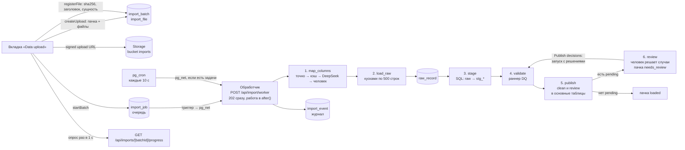

# План загрузки данных

Статус: черновик v2.3 от 2026-10-18 (v1 проверен, изменения — в разделе 17; v2.1 — шаг разбора человеком, v2.2 — записи без сомнений публикуются первым запуском, разбора ждут только случаи; v2.3 — пачка из любого набора файлов, проверки по всему набору данных, Publish decisions вместо Publish batch; разделы 3 и 8, изменения — в разделе 18). **Отложен до сдачи уровня 1; для сдачи — урезанный объём из раздела 0.** Детализирует импорт из PLAN.md (раздел 9) и встраивает в него модуль проверки (VALIDATION_PLAN.md). Если документы расходятся, для загрузки действует этот, расхождения — в разделе 15.

**Порядок выполнения** — в [ROADMAP.md](ROADMAP.md): единый пофазный план по всем четырём документам; таблица этапов ниже сохранена как справка.

## 0. Объём для сдачи (решено 2026-10-18)

Задание просит объяснить повторный импорт без дублей, аудит и разграничение доступа, а не построить фоновый конвейер. Полный план ниже остаётся целевой архитектурой для README (раздел 4 задания); для сдачи делается урезанная версия (PLAN.md, этап 10), после того как уровень 1 готов.

Остаётся:
- `import_batch` + `import_file` с sha256; пачка — от одного до пяти файлов; файл, загруженный раньше, даёт `skipped`, повтор тех же пяти файлов — `skipped` у пачки;
- `raw_record` только дописывание, вставка по `(file_id, line_no)` без дублей; `row_hash` по полям нашего формата;
- `app.stage_file` на SQL (раздел 7) с `try_date` / `try_numeric`;
- раннер проверок с журналом в Postgres (`dq_run`, `dq_check_result`, `dq_record_verdict`), публикация одной транзакцией с `record_version` и `occupancy` (VALIDATION_PLAN.md, 5);
- шлюз разбора (раздел 8): первый запуск публикует записи без сомнений, пачка со случаями останавливается в `needs_review`, кнопка **Publish decisions** синхронно запускает запуск с решениями и публикацию записей решённых случаев. Без экрана разбора (PLAN.md, этап 12) в данных останутся неопубликованными 35 случаев: 86 броней в пересечениях и 3 modified. Поэтому этап 12 идёт сразу за импортом;
- запуск синхронно в одном процессе: `npm run import` (CLI по CSV из репозитория) и кнопка **Load sample data** на вкладке Batches (`/import`) через server function; вкладка читает `import_batch`, `import_file`, `dq_run.summary` вместо мока.

Откладывается: загрузка файлов из браузера и Storage (раздел 3), очередь `import_job` и обработчик с `after()` (раздел 4), pg_net / pg_cron / Vault (4.2), сопоставление колонок и DeepSeek (раздел 5; только точное совпадение с нашим форматом, зашитое в `targets.ts`), опрос прогресса и `import_event` (разделы 9–10). Каждый из этих кусков добавляется поверх урезанной версии без переделки: таблицы и шаги те же, меняется только то, кто и когда их вызывает.

## 1. Требования

1. Загрузка файла и разбор данных разделены. Запрос загрузки только кладёт файл в Supabase Storage и ставит задачу. Разбор идёт в фоне, пачками.
2. Очередь живёт в базе. Вставка задачи сразу будит обработчик (`pg_net`), `pg_cron` раз в несколько секунд подбирает зависшие и отложенные. Без секретов в Vault база молчит, и очередь крутит локальный процесс: один и тот же код шагов в разработке и на Vercel.
3. Колонки файла сопоставляются с нашим форматом: сначала по точному совпадению, затем по кэшу, затем через DeepSeek. Модель только предлагает сопоставление колонок и никогда не меняет значения. Предложение модели подтверждает человек; автоматически принимаются только точное совпадение и кэш.
4. Сырые строки сохраняются в `raw_record` как есть, с исходными именами колонок. Сопоставление применяется на шаге raw → staging. Хэш строки считается по сопоставленным полям, поэтому одна и та же строка из выгрузок с разными заголовками даёт один хэш.
5. Пользователь видит прогресс каждого файла и пачки: этап, строки, события.
6. Каждый шаг пишет событие в журнал загрузки. По журналу видно, что, когда и почему произошло, включая ответ модели.
7. Любой шаг можно повторить без дублей: повтор куска не создаёт лишних строк, повтор `stage` перезаписывает staging, повтор всей пачки с теми же файлами даёт `skipped`.
8. Цепочка шагов описана в одном месте на TypeScript (`lib/import/pipeline.ts`) и покрыта тестами. База отвечает за гарантии: аренду задачи, единственность незавершённой задачи, пробуждение обработчика.
9. **Разбора ждут только случаи.** Записи без сомнений (`clean`, `review`) публикуются первым же запуском. Если проверки нашли случаи `decide` (пересечения, modified-брони, разные версии одной записи), пачка останавливается в `needs_review`: брони случаев и платежи по ним ждут, пока человек не решит случай и не нажмёт **Publish decisions** (VALIDATION_PLAN.md, 7.5).
10. **Пачка — любой набор файлов, проверяется весь набор данных** (решено 2026-10-18). Файлы одной выгрузки приходят в разное время: брони сегодня, платежи через неделю, расходы позже, и это обычный случай. Пачка — от одного до пяти файлов, по одному на сущность. Проверки идут по действующему набору: строки пачки, `pending` прежних пачек, опубликованные записи (VALIDATION_PLAN.md, 2). Случай разбора не принадлежит пачке, новая пачка не мешает разбору прежней.

## 2. Поток данных



Этапы 1–3 идут по каждому файлу отдельно и могут идти параллельно (несколько вызовов обработчика берут разные задачи), этапы 4–6 — по пачке, когда все её файлы прошли этап 3. Этап 6 есть только у пачки со случаями разбора; Publish decisions запускает этапы 4 и 5 ещё раз, с решениями и без пачки (`batch_id = null`).

## 3. Загрузка файла

1. Пользователь выбирает CSV (один или несколько) и, по желанию, дату среза пачки (`import_batch.as_of`; пусто — `dq_run` выберет по правилу из VALIDATION_PLAN.md).
2. Server function `createUpload(files: {name, size}[], asOf?)` создаёт `import_batch` (`status = 'uploading'`) и строку `import_file` на каждый файл (`status = 'uploading'`, сущность и хэш пока пустые), проверяет размер (лимит bucket 50 МБ) и выдаёт signed upload URL на путь `imports/{batch_id}/{file_id}.csv`. Файл идёт из браузера прямо в Storage через `uploadToSignedUrl` с publishable key: токен действует два часа и только на этот путь. Так не мешает лимит тела запроса функции Vercel (4,5 МБ).
3. Server function `registerFile(fileId)` скачивает объект из Storage, считает sha256 и размер, читает заголовок, проверяет, что имена колонок после нормализации уникальны, определяет сущность (раздел 5) и записывает всё в `import_file` (`status = 'uploaded'`). Хэш считает только сервер: браузер его не считает и ему не верят. Если сущность не определилась, она пустая, и пользователь выбирает её в интерфейсе.
4. Кнопка **Start import** доступна, когда в пачке хотя бы один файл, у каждого файла есть сущность и сущности не повторяются (`import_file_one_per_entity`). Все пять файлов не требуются: недостающие сущности правила берут из действующего набора (VALIDATION_PLAN.md, 2). Server function `startBatch` переводит пачку в `queued` и вставляет задачи `map_columns` по файлам.
5. Файл, чей `(entity, sha256)` уже загружен прежней пачкой (индекс `import_file_sha256`), получает `skipped` со ссылкой на тот файл: его строки не читаются, задачи по нему не ставятся. Если так пропущены все файлы, пачка сразу получает `skipped` со ссылкой на пачку последнего из них (PLAN.md, 9). Обработчик на шаге `load_raw` пересчитывает sha256 ещё раз: объект в Storage мог подменить тот, у кого есть секретный ключ.

Bucket `imports` приватный: читает и выдаёт signed URL только сервер с секретным ключом. **Load sample data** на вкладке Batches (`/import`) кладёт пять файлов из `Technical_Challenge_Data` в Storage тем же способом и идёт тем же конвейером (файлы попадают в бандл Vercel через `outputFileTracingIncludes`, PLAN.md, 13).

Пачки, которые остались в `uploading` дольше суток, помечаются `failed` («abandoned») и их объекты удаляются — отдельной задачей `pg_cron` раз в сутки, после первой версии.

## 4. Очередь и обработчик

### 4.1 Очередь `app.import_job`

Своя таблица, а не pgmq: прогресс, попытки и ошибки задачи нужны интерфейсу и журналу, и их удобно хранить в той же строке.

| Колонка | Смысл |
|---|---|
| `job_id` | ключ |
| `batch_id`, `file_id` | пачка; файл — для этапов 1–3, `null` для 4–5 |
| `kind` | `map_columns`, `load_raw`, `stage`, `validate`, `review`, `publish` |
| `status` | `queued`, `running`, `waiting_user`, `done`, `failed`; `review` всегда `waiting_user`, её закрывает запуск с решениями после Publish decisions, когда у пачки не осталось `pending`, а не обработчик |
| `cursor` | jsonb: докуда дошли, например `{"line_no": 1501}` |
| `progress_done`, `progress_total` | для полосы прогресса |
| `attempts`, `max_attempts` | неудачные попытки; по умолчанию 3 |
| `run_after` | не раньше этого времени: отложенный повтор с паузой 10 с, 30 с, 90 с |
| `locked_until`, `lock_token` | аренда: до какого времени и каким вызовом обработчика. Истекла — задачу может взять другой |
| `error` | последняя ошибка |
| `created_at`, `finished_at` | время |

Одна незавершённая задача каждого вида на файл (пачку) — частичный уникальный индекс, а постановка задачи всегда с `on conflict do nothing`: два параллельных обработчика не поставят `validate` дважды.

```sql
create unique index import_job_one_active
  on app.import_job (batch_id, coalesce(file_id, 0), kind)
  where status in ('queued', 'running', 'waiting_user');
```

Выбор задачи — один оператор, поэтому работает и через transaction pooler:

```sql
update app.import_job j
   set status = 'running',
       lock_token = gen_random_uuid(),
       locked_until = now() + interval '60 seconds',
       -- истёкшая аренда — потерянная попытка; возврат в queued по бюджету времени попыткой не считается
       attempts = attempts + (j.status = 'running')::int
 where j.job_id = (
   select job_id
     from app.import_job
    where (status = 'queued' and run_after <= now())
       or (status = 'running' and locked_until < now())
    order by run_after
    for update skip locked
    limit 1)
returning j.*;
```

Все дальнейшие записи по задаче идут с условием `job_id = $1 and lock_token = $2`: если аренда истекла и задачу забрал другой вызов, первый не сможет ни продлить аренду, ни завершить задачу. Куски и так идемпотентны, но двойное завершение с разным курсором так исключено.

Три исхода шага:
- **done** — задача завершена, в той же транзакции ставится следующая по цепочке (`pipeline.ts`);
- **yield** — бюджет времени вышел: `queued` с тем же курсором, `run_after = now()`, `attempts` не растёт;
- **error** — событие `error`; ошибка `retryable` (сеть, таймаут базы или модели, истёкшая аренда) → `queued` с паузой, пока есть попытки; остальные (sha256 не совпал, нет ключа модели для чужого формата, неизвестная сущность) → сразу `failed`, пачка `failed` с текстом ошибки. Кнопка **Retry** в интерфейсе возвращает `failed` в `queued` и обнуляет `attempts`.

### 4.2 Кто будит обработчик

Одна функция `app.wake_import_worker()` (`security definer`, чтобы читать Vault) вызывается из двух мест. Если задач к выполнению нет или в Vault нет `import_worker_url`, она ничего не делает: так локальная разработка и тесты не стучатся в интернет.

```sql
create or replace function app.wake_import_worker()
returns void
language plpgsql
security definer
set search_path = ''
as $$
declare
  worker_url text;
  worker_secret text;
begin
  if not exists (
    select 1 from app.import_job
     where (status = 'queued' and run_after <= now())
        or (status = 'running' and locked_until < now())
  ) then
    return;
  end if;

  select decrypted_secret into worker_url from vault.decrypted_secrets where name = 'import_worker_url';
  select decrypted_secret into worker_secret from vault.decrypted_secrets where name = 'import_worker_secret';
  if worker_url is null then
    return;  -- локальная разработка: очередь крутит npm run import:worker
  end if;

  perform net.http_post(
    url := worker_url,
    body := '{}'::jsonb,
    headers := jsonb_build_object('x-import-secret', worker_secret),
    timeout_milliseconds := 5000
  );
end;
$$;
```

- **Триггер** `import_job_wake` на `import_job`: `after insert or update of status for each row when (new.status = 'queued')`. Срабатывает и на новую задачу, и на возврат из `waiting_user` после подтверждения сопоставления, и на Retry. pg_net кладёт запрос в свою очередь внутри транзакции и отправляет после коммита, поэтому обработчик не увидит незакоммиченную задачу. Пять задач `map_columns` дают пять запросов и до пяти параллельных вызовов обработчика — это нормально, каждый возьмёт свою задачу.
- **`pg_cron`** раз в 10 секунд вызывает ту же функцию. Это сетка безопасности: потерянный запрос, упавший обработчик, отложенный повтор. Каждый запуск пишется в `cron.job_run_details` (8,6 тыс. строк в сутки), поэтому вторая задача cron раз в сутки удаляет записи старше трёх дней.
- Адрес обработчика и общий секрет лежат в Supabase Vault (`import_worker_url`, `import_worker_secret`), а не в тексте задачи cron. Ответы pg_net видны в `net._http_response` около шести часов — первое место, куда смотреть, если обработчик не просыпается.

### 4.3 Обработчик

Route handler Next.js `POST /api/import/worker`, `runtime = 'nodejs'`, `maxDuration = 60`. Проверяет заголовок `x-import-secret` (`timingSafeEqual`), **сразу отвечает 202** и выполняет работу в `after()` из `next/server` в бюджете около 45 секунд. Запрос от базы — это сигнал «есть работа», а не ожидание результата: у pg_net таймаут 5 секунд, и держать соединение 40 секунд незачем. На Vercel `after()` держит функцию живой до конца работы в пределах `maxDuration`.

Цикл `runWorker({ budgetMs })` в `lib/import/worker.ts`:

1. взять задачу (4.1), пометить пачку `processing`, если она ещё `queued`;
2. выполнить шаг её вида, после каждого куска обновлять `cursor`, прогресс и продлевать аренду (`locked_until = now() + 60 s`, с `lock_token`);
3. если шаг не закончен, а бюджет вышел — yield;
4. закончил — `done` и постановка следующей задачи в той же транзакции; триггер разбудит новый вызов, а этот продолжит цикл, пока есть бюджет;
5. ошибка — по правилам 4.1;
6. нет задач или бюджет вышел — выход.

Код шагов лежит в `lib/import/` и не зависит от HTTP. Тот же `runWorker` вызывают route handler на Vercel и локальный цикл `npm run import:worker` (бесконечный бюджет, пауза 2 секунды, когда очередь пуста).

### 4.4 Среды

| Среда | База и Storage | Кто будит обработчик |
|---|---|---|
| Разработка | локальный стек `supabase start` с изменёнными портами в `config.toml` (54322 занят стеком другого проекта) | Vault пуст → pg_net молчит; `npm run import:worker` |
| Тесты | одноразовый контейнер `supabase/postgres:17` (`TEST_DATABASE_URL`); pg_net, pg_cron и Vault в образе есть, секретов нет | никто; тесты зовут `runWorker` сами |
| Vercel | облачный проект | триггер + pg_cron через pg_net на production-URL |

Разработка и Vercel не должны делить одну базу: иначе задачу, поставленную с локальной машины, заберёт обработчик на Vercel с другим кодом. Если всё же нужно поработать на облачной базе, на это время удалить `import_worker_url` из Vault. Production-деплой Vercel открыт по умолчанию, Deployment Protection защищает только preview, так что обход для pg_net не нужен; если защита включена и на production, добавить заголовок `x-vercel-protection-bypass` в `wake_import_worker`.

## 5. Сопоставление колонок (`map_columns`)

Для каждой сущности описан целевой формат (`lib/import/targets.ts`): поля, тип, обязательность, ключевое поле, список псевдонимов (`check_in`: `checkin`, `arrival`, `date_from` ...), описание по-английски для модели. Это те же поля, что в `stg_*`.

**Сущность** известна до этого шага: её определяет `registerFile` по заголовку (после нормализации заголовок содержит все обязательные поля ровно одной сущности) или выбирает пользователь. Модель сущность не угадывает: ей всегда передаётся целевой формат известной сущности.

Порядок, на первом успехе останавливаемся:

1. **Нормализация и точное совпадение.** Снять BOM и кавычки, обрезать пробелы, нижний регистр, пробелы и `-` заменить на `_`, схлопнуть повторы `_`, затем псевдонимы. `check-in`, `Check In`, `check_in`, `checkin` дают `check_in`. На наших файлах этот шаг решает всё, модель не вызывается.
2. **Кэш.** Ключ — сущность и sha256 нормализованного списка колонок. Такой заголовок уже сопоставлялся и был принят — берём сохранённое сопоставление.
3. **DeepSeek.** Модели уходят заголовок, до 5 строк примера и целевой формат сущности. Ответ — JSON: `mapping` (поле → колонка источника или `null`), `confidence` по каждому полю, `notes`. Модель `deepseek-chat` через OpenAI-совместимый API, `response_format: json_object`, `temperature: 0`, таймаут 30 секунд, один повтор. Текст запроса — в `lib/import/mapping/prompt.ts` с номером версии.

Ответ модели проверяется zod-схемой и правилами:

- каждая колонка источника существует, каждая назначена не больше одного раза;
- все обязательные поля сущности назначены;
- значения колонки, назначенной ключевому полю, в строках примера подходят под формат ID (`R\d{4}` и т. п.). Это важнее остального: `raw_record.record_key` берётся по этому назначению и не правится (таблица только дописывается), остальные поля можно перестроить в staging.

Прошло — задача получает `waiting_user`, интерфейс показывает таблицу «поле → колонка» с предложением модели и уверенностью, пользователь правит и подтверждает. Не прошло, модель недоступна или ключа нет — та же таблица без подсказок. Подтверждение (`confirmMapping`) записывает сопоставление, возвращает задачу в `queued`, и триггер будит обработчик. Подтверждённое сопоставление попадает в кэш, так что следующий файл с таким же заголовком проходит без вопросов.

Почему модель не принимается автоматически даже при высокой уверенности: уверенность модели — не калиброванная вероятность, а финансовые данные с перепутанными колонками стоят дороже одного клика на новый формат. В журнале при этом всегда стоит «человек подтвердил». Если захочется порог — это одна настройка в `resolve.ts`, не смена архитектуры.

Что храним (`app.column_mapping`): `mapping_id`, сущность, хэш и сам заголовок, сопоставление `{поле: колонка}`, источник (`exact` / `cache` / `llm` / `manual`), модель, версия запроса, запрос и ответ модели, токены, время ответа, кто подтвердил, когда. Это след для аудита и для раскрытия использования ИИ в отчёте. `import_file.mapping_id` ссылается сюда.

Без ключа `DEEPSEEK_API_KEY` шаг 3 пропускается: файлы с нашим форматом грузятся, файлы с чужими колонками ждут ручного сопоставления. Ключ только на сервере, без префикса `NEXT_PUBLIC_`. В модель уходят пять строк данных: для тестовых данных это ничего не значит, для реальных — вопрос к владельцу данных (раздел 16).

Значения модель не видит целиком и не меняет. Формат дат и чисел разбирает `stage`, ошибки ловит DQ-03.

## 6. Сырые строки (`load_raw`)

- Обработчик скачивает файл из Storage целиком (десятки мегабайт в памяти функции — не проблема, потоковое чтение по `Range` — когда появятся файлы больше), пересчитывает sha256 и сверяет с `import_file`. Не совпало — `failed` без повторов.
- Разбор `csv-parse` с `bom: true`, разделитель запятая. При первом куске: одним проходом считаются переводы строк — это `progress_total`; заголовок уже есть в `import_file` с регистрации.
- Куски по 500 строк, каждый — одна вставка в `raw_record` с `on conflict (file_id, line_no) do nothing`. Повтор куска после сбоя не даёт дублей. Курсор — номер последней записанной строки; при возобновлении разбор идёт с начала файла с `from_line`, для файлов до миллиона строк это копейки.
- `payload` — значения текстом с **исходными** именами колонок. `record_key` — значение колонки, назначенной ключевому полю (`null`, если пусто).
- `row_hash` — sha256 канонического JSON **сопоставленных полей** в порядке `targets.ts`, значения обрезаны по пробелам. Так одна строка из выгрузок с разными заголовками или порядком колонок даёт один хэш, и шаг «ключ есть, хэш тот же → не трогаем» (PLAN.md, 9) работает между выгрузками. Колонки, которых нет в целевом формате, в хэш не входят: их изменение не создаёт новую версию записи.
- После каждого куска — `progress_done` и событие `info` («rows 1–500 written»). После последнего — `import_file.row_count`, статус `loaded`, задача `stage`.

Почему сопоставление не применяется к `raw_record`: сырой слой должен совпадать с файлом. Если сопоставление было ошибочным, его исправляют и заново строят staging без повторной загрузки файла. Исключение — ключевое поле (раздел 5): его ошибка означает новую пачку.

## 7. Staging (`stage`)

Одна SQL-функция `app.stage_file(file_id)`: `case` по сущности и пять статических вставок из `raw_record` в `stg_*`, колонка источника берётся из сопоставления файла: `payload ->> (mapping ->> 'check_in')`. Приведение типов без исключений через `pg_input_is_valid` (Postgres 16+): `app.try_date(text)` и `app.try_numeric(text)` — однострочные SQL-функции `case when pg_input_is_valid($1, 'date') then $1::date end`, не разобралось — `null`. Вставка с `on conflict (raw_record_id) do update`, поэтому шаг идемпотентен и его повтор после исправления сопоставления перестраивает staging. Работает множествами внутри базы, на тысячах строк — доли секунды, кусками не делится.

Когда файл прошёл `stage`, обработчик в той же транзакции ставит задачу пачки `validate`, если все остальные файлы пачки уже `staged` или `skipped` (`insert ... where not exists ... on conflict do nothing`). Два файла, закончившие одновременно в разных вызовах, дадут одну задачу благодаря индексу `import_job_one_active`.

## 8. Проверка и публикация

- **`validate`** вызывает раннер из VALIDATION_PLAN.md (раздел 5, шаги 1–5): создаёт `dq_run`, строит действующий набор (строки пачки, `pending` прежних пачек, опубликованные), выполняет правила с действующими решениями на входе, пишет `dq_check_result`, `dq_record_verdict`, `dq_issue`. Раннер получает `onProgress(done, total)` — число выполненных правил из общего (небольшое дополнение к контракту раннера). После раннера всегда ставится `publish`.
- **`publish`** — шаг 6 раннера: одна транзакция с `set local app.run_id` и `app.actor = 'import:ui'` (`set local` внутри транзакции работает и через transaction pooler, сессионный `set` — нет), основные таблицы, `occupancy`, история через `record_version`. Публикуются записи `clean` и `review`; записи `pending` (брони случаев и платежи по ним) не трогаются. Нет строк `pending` у пачки — `loaded`. Есть — ставится `review`. Прежние пачки `needs_review`, у которых `pending` не осталось, тоже закрываются `loaded`.
- **`review`** — шаг человека. Задача сразу получает `waiting_user`, обработчик её не берёт; пачка — `needs_review`, её записи без сомнений уже опубликованы; прогресс задачи — решённые случаи из тех, где есть строки этой пачки (`app.review_case`). Человек решает случаи на `/review`: server action `resolveCase` пишет решения одной транзакцией и обновляет прогресс, основные таблицы и календарь не меняются (VALIDATION_PLAN.md, 7.5). Кнопка **Publish decisions** (`publishDecisions`) ставит `validate` без пачки (`batch_id = null`; индекс `import_job_one_active` берёт `coalesce` и по пачке). Триггер будит обработчик, запуск с решениями публикует записи решённых случаев, убирает из основных таблиц то, что решение исключило, и закрывает `review` (`done`) у каждой пачки, у которой не осталось `pending`.
- После публикации без `pending` пачка получает `loaded`, итоговые счётчики (опубликовано, ждёт решения, исключено) пишутся в `dq_run.summary` и показываются на странице журнала. Ошибка публикации — `failed` у задачи и пачки, журнал проверок остаётся.
- **Новая пачка, пока прежняя ждёт разбора.** Загружать можно, прежней пачке это не мешает: случай не принадлежит пачке. Пачка из одних расходов публикуется и закрывается `loaded`, случаи прежней не меняются. Если новая пачка принесла новую версию строки случая, старая строка получает `superseded`, случай пересобирается по правилу «новые данные — решение заново» (VALIDATION_PLAN.md, 7.5), а прежняя пачка закрывается, как только у неё не осталось `pending`. Статуса пачки `superseded` нет. `validate` и `publish` в каждый момент идут не больше чем у одного запуска: они читают и пишут один действующий набор.
- **В урезанной версии (раздел 0)** то же без очереди: `npm run import` публикует записи без сомнений и останавливается в `needs_review`, `publishDecisions` выполняет запуск с решениями синхронно в server function.

Модуль проверки строится отдельно по своему плану. До его готовности `validate` — заглушка, которая пишет событие «checks not implemented» и сразу ставит `publish`, а `publish` ничего не публикует и переводит пачку в `loaded`. Так загрузка до staging работает и проверяется независимо.

## 9. Журнал загрузки

Сейчас в схеме есть журнал проверок (`dq_check_result`), но нет журнала процесса загрузки: только `import_batch.error`. Добавляем `app.import_event`, только дописывание (`forbid_change`):

| Колонка | Смысл |
|---|---|
| `event_id` | ключ |
| `batch_id`, `file_id`, `job_id` | к чему относится |
| `stage` | `upload`, `map_columns`, `load_raw`, `stage`, `validate`, `review`, `publish`, `worker` |
| `level` | `info`, `warn`, `error` |
| `code` | машинный код: `file_registered`, `batch_skipped`, `mapping_exact`, `mapping_cached`, `mapping_proposed`, `mapping_confirmed`, `chunk_written`, `sha_mismatch`, `job_yielded`, `job_retry`, `job_failed`, `review_required`, `case_resolved`, `publish_requested`, `rows_superseded`, `batch_closed` ... |
| `message` | текст для человека |
| `details` | jsonb: строки куска, `mapping_id`, ошибка со стеком, `attempt` |
| `at` | время |

Объём: событие на кусок в 500 строк, на 100 тыс. строк — 200 событий, пустяк. Журнал пачек (вкладка Batches, `/import`) читает `import_batch`, `import_file`, `import_job` и `import_event` вместо `lib/mock/imports.ts`. Форма данных в моке близка: шаги пачки — задачи, события — `import_event`, счётчики по файлам (new / changed / unchanged) — из `dq_run.summary`. Кнопка **Re-import CSV** становится **Load sample data** (раздел 3).

## 10. Интерфейс

Нового пункта меню нет: в боковой панели только Dashboard и Import (PLAN.md 15, 2026-10-19). Загрузка — вкладка **Upload** раздела Import, страница `/import/upload`. Подписи по-английски, как во всём интерфейсе. Правила в ленте и на шагах показываются значками (`RuleBadge`, PLAN.md 8).

1. **Выбор файлов.** Зона перетаскивания, несколько CSV, поле даты среза. По каждому файлу: имя, размер, сущность (определена или выпадающий список), статус загрузки в Storage. Кнопка **Start import** и условия её доступности (раздел 3).
2. **Сопоставление.** Если у файла задача `waiting_user`: таблица «поле → колонка источника», источник (exact / cache / AI / manual) и уверенность, кнопка **Confirm mapping**.
3. **Прогресс.** По каждому файлу шаги Uploaded → Columns mapped → Raw rows (полоса `done / total`) → Staged. Ниже — шаги пачки Validation (правила `x / N`) → Publishing (опубликовано строк, ждёт решения строк) → Review (случаи `x / N`, кнопка **Open review** на `/review`) → Publishing decisions → Done. Шаги Review и Publishing decisions видны только у пачки со случаями. У упавшего шага — ошибка и кнопка **Retry**.
4. **Лента событий.** Последние `import_event` пачки, новые сверху, ошибки выделены.
5. **Пока пачка ждёт разбора**, дашборд считает по опубликованному, включая записи без сомнений из этой пачки. Баннер «пачка от <дата> ждёт разбора: N случаев, M броней на X IDR не в расчётах» со ссылкой на `/review` показывается в разделе Import. Показывать ли его и на обзоре, не решено (ROADMAP.md 6): по решению 2026-10-19 на обзоре сигналов об ошибках нет. Без базы дашборд работает на CSV (режим уровня 1), там `pending` показываются как `review` (VALIDATION_PLAN.md, 7.5).

Прогресс приходит опросом `GET /api/imports/[batchId]/progress` раз в секунду, пока пачка не в конечном статусе (`params` в Next.js 16 — промис, ответ с `cache-control: no-store`). Supabase Realtime не используем: схема `app` закрыта от Data API и RLS, открывать её ради подписки незачем, а опрос раз в секунду для одного пользователя ничего не стоит.

Входа в систему нет (PLAN.md, 2): server functions и `/progress` открыты любому, кто знает uuid пачки. Для прототипа допустимо, в README — в ограничениях.

## 11. Изменения схемы

Урезанная версия (раздел 0) сделана 2026-10-18 миграцией `20261018195205_data_model`; остальное придёт вместе с очередью.

| Объект | Сделано (урезанная версия) | С очередью |
|---|---|---|
| `import_batch.status` | `loading`, `needs_review`, `loaded`, `skipped`, `failed`; ограничение `finished`: `finished_at is null` у `loading` и `needs_review` | `loading` заменяется на `uploading`, `queued`, `processing`; `finished_at is null` ровно для первых четырёх |
| `import_batch.source_kind` | без изменений: `csv`, `google_sheets` | добавить `upload` (файлы из интерфейса); `source_ref` для них — префикс в Storage |
| `import_file` | `status` (`loaded`, `skipped`), `same_as_file_id` для `skipped` с ограничением «`skipped` ⇔ ссылка есть»; `row_count` заполнен и у `skipped` (файл читается целиком ради sha256), DQ-90 сверяет только `loaded` | статусы `uploading`, `uploaded`, `mapping`, `mapped`, `loading`, `staged`, `failed` (`waiting_user` — у задачи), `storage_path`, `mapping_id`; `entity`, `file_sha256`, `byte_size`, `header` допускают `null` до регистрации, `row_count` — до конца `load_raw`; ограничения по статусу. `unique (batch_id, entity)` остаётся: `null` не конфликтуют |
| `app.import_job` | — | новая, раздел 4.1, с индексом `import_job_one_active`; `batch_id` допускает `null` у запуска с решениями; второй частичный уникальный индекс — не больше одной задачи `validate` / `publish` в `queued` или `running` на всю базу (раздел 8) |
| разбор | `dq_issue` (`decide`, `review`), `dq_record_verdict` (статусы `pending`, `superseded`, колонка `decision_id`), `review_decision` (четыре решения, `case_key`, `record_key`), представление `app.review_case`; `dq_run.batch_id` допускает `null` — VALIDATION_PLAN.md, 7.5 | — |
| действующий набор | функции `app.eff_*(batch_id)` поверх `stg_*`, последних вердиктов и основных таблиц — VALIDATION_PLAN.md, 2 и 7.5 | — |
| `commission_rule` | ограничение `commission_rule_no_overlap` снято (DQ-22 — `review`) | — |
| `app.import_event` | — | новая, раздел 9, `forbid_change` |
| `app.column_mapping` | — | новая, раздел 5 |
| функции | — (`app.stage_file`, `try_date`, `try_numeric` — на этапе загрузчика) | `app.wake_import_worker` (`security definer`) и триггерная обёртка |
| триггеры | — | `import_job_wake` (раздел 4.2). Цепочку задач ставит обработчик, других триггеров очереди нет |
| расширения | — | `pg_cron`, `pg_net` (в Supabase ставятся в схему `extensions`) |

Три вещи живут вне декларативной схемы, `npm run db:sync` их не увидит: `cron.schedule(...)` и `insert into storage.buckets` (данные, а не DDL) — в миграции, написанной руками (`supabase migration new import_runtime`); секреты Vault — руками, в репозитории только команды:

```sql
select vault.create_secret('https://<app>.vercel.app/api/import/worker', 'import_worker_url');
select vault.create_secret('<тот же секрет, что IMPORT_WORKER_SECRET на Vercel>', 'import_worker_secret');
select cron.schedule('import-worker-wake', '10 seconds', $$select app.wake_import_worker()$$);
select cron.schedule('cron-log-purge', '0 3 * * *', $$delete from cron.job_run_details where end_time < now() - interval '3 days'$$);
```

Для локального стека bucket описывается в `config.toml` (`[storage.buckets.imports]`), а миграция с `insert into storage.buckets ... on conflict do nothing` не мешает.

Переменные окружения (в `.env.example` без значений): к существующим `DATABASE_URL`, `NEXT_PUBLIC_SUPABASE_URL`, `NEXT_PUBLIC_SUPABASE_PUBLISHABLE_KEY` добавляются `SUPABASE_SECRET_KEY`, `DEEPSEEK_API_KEY`, `IMPORT_WORKER_SECRET`.

## 12. Структура кода

```
lib/import/
├─ targets.ts          целевой формат сущностей: поля, типы, ключ, обязательность, псевдонимы, описания
├─ detect.ts           сущность по заголовку
├─ mapping/
│  ├─ normalize.ts     нормализация имён колонок, псевдонимы, точное совпадение
│  ├─ prompt.ts        текст запроса к модели, версия
│  ├─ deepseek.ts      запрос к модели, zod-схема ответа
│  └─ resolve.ts       точно → кэш → модель → ожидание человека
├─ steps/              map-columns.ts, load-raw.ts, stage.ts, validate.ts, publish.ts
├─ pipeline.ts         цепочка: какой вид задачи ставится после какого
├─ queue.ts            взять задачу, продлить аренду, yield, done, retry
├─ errors.ts           ImportError с признаком retryable
├─ events.ts           запись в import_event
├─ storage.ts          signed URL, скачивание, sha256
├─ hash.ts             row_hash по сопоставленным полям
└─ worker.ts           runWorker в бюджете времени
lib/db.ts                             postgres-js, prepare: false
app/api/import/worker/route.ts        вход для pg_net: секрет, 202, after()
app/api/imports/[batchId]/progress/route.ts
app/import/upload/page.tsx
app/import/actions.ts                 createUpload, registerFile, startBatch, confirmMapping, retryJob, loadSampleData
app/review/page.tsx                   разбор случаев пачки (VALIDATION_PLAN.md, 7.5)
app/review/actions.ts                 resolveCase, publishDecisions, exportCasesCsv
components/imports/upload/            выбор файлов, сопоставление, прогресс, лента
scripts/import-worker.ts              локальный цикл для разработки
```

Новые зависимости: `@supabase/supabase-js` (Storage), `postgres`, `csv-parse`, `zod`, `tsx` (dev) для скрипта. Перед кодом на Next.js — `node_modules/next/dist/docs` (`after`, route handlers, server functions, `params` как промис), как требует AGENTS.md.

## 13. Тесты

Тесты с базой идут на `TEST_DATABASE_URL` (одноразовый контейнер `supabase/postgres:17` с нашими миграциями) и пропускаются, если переменной нет.

1. **Сопоставление:** `check-in`, `Check In`, `checkin` и т. п. дают `check_in`; ответ модели с несуществующей колонкой, двойным назначением, без обязательного поля или с ключевой колонкой, значения которой не похожи на ID, отклоняется; модель в тестах подменена.
2. **Хэш строки:** одна строка под заголовками `check_in` и `Check In` даёт один `row_hash`; лишняя колонка источника на хэш не влияет.
3. **Повтор куска:** `load_raw` с одним курсором дважды — число строк в `raw_record` не меняется.
4. **Прерывание:** бюджет времени кончился посреди файла — следующий вызов продолжает с курсора, итог совпадает с загрузкой за один проход; `attempts` не вырос.
5. **Аренда:** задача с истёкшим `locked_until` берётся заново с новым `lock_token`, и старый вызов не может её завершить; две параллельные выборки не берут одну задачу (`skip locked`).
6. **Гонка на `validate`:** два файла пачки завершают `stage` в двух транзакциях — в очереди одна задача `validate`.
7. **Пробуждение:** без секретов в Vault `wake_import_worker` ничего не кладёт в `net.http_request_queue`; с секретами — кладёт запрос с заголовком секрета (без отправки).
8. **Повтор файлов:** те же пять файлов — пачка `skipped`, новых строк нет; четыре прежних и один новый — четыре файла `skipped`, загружается один, пачка проходит `validate` по всему набору.
9. **Staging:** `stage` дважды даёт те же строки; после замены сопоставления файла повторный `stage` перестраивает `stg_*`.
10. **Сквозной:** пять файлов из `Technical_Challenge_Data` → staging; число строк `stg_*` = `import_file.row_count` = строк в файле.
11. **Файл с чужими колонками:** копия `reservations.csv` с переименованными колонками (`check-in`, `Gross Value`) проходит через модель (подменённую) и подтверждение и даёт тот же staging и те же `row_hash`, что оригинал.
12. **Шлюз разбора:** пять файлов из `Technical_Challenge_Data` останавливаются в `needs_review` с задачей `review` (35 случаев); в основных таблицах есть записи `clean` и `review`, в `occupancy` — брони без пересечений, броней случаев и платежей по ним там нет; `publishDecisions` без решённых случаев отклоняется; после части решений публикуются записи этих случаев, остальные ждут, пачка остаётся `needs_review`; после последнего — `loaded`, у строк первой публикации новых версий в `record_version` нет. Пачка из одного `expenses.csv` во время разбора проходит `loaded`, случаи прежней не меняются; пачка из одного `payments.csv` находит брони в опубликованном.

## 14. Этапы

Порядок изменён относительно v1: сначала путь для наших пяти файлов целиком, модель и подтверждение — последним необязательным этапом.

| # | Этап | Оценка | Факт |
|---|---|---|---|
| 1 | Схема: `import_job`, `import_event`, `column_mapping`, изменения `import_batch` / `import_file`, функции, bucket, миграция руками | 45 мин | |
| 2 | Загрузка в Storage: `createUpload`, signed URL, `registerFile` с хэшем и сущностью, `startBatch` с проверкой близнецов по файлам, страница выбора файлов | 50 мин | |
| 3 | Очередь и обработчик: выбор задачи, аренда, yield, повторы, журнал событий, route handler с `after()`, локальный цикл | 50 мин | |
| 4 | `map_columns` только по точному совпадению, `load_raw` кусками, `row_hash`, `stage` на SQL, заглушки `validate` / `publish` | 50 мин | |
| 5 | Прогресс и лента событий в интерфейсе; журнал пачек (`/import`) на реальных данных; Load sample data | 50 мин | |
| 6 | `pg_cron` + `pg_net` + Vault, проверка на Vercel | 30 мин | |
| 7 | DeepSeek: кэш, запрос, проверка ответа, экран подтверждения (необязательный, можно отложить) | 60 мин | |
| 8 | Подключение `validate` / `publish` к модулю проверки; `publish` первым запуском без записей `pending`; шаг `review`: статус `needs_review`, `publishDecisions`, запуск с решениями без пачки, индекс одного запуска на шлюзе | по VALIDATION_PLAN.md + 30 мин | |
| | **Итого без этапа 8** | **≈ 5 ч 35 мин** | |

Этапы 1–4 дают сквозной путь «файл → Storage → задача → raw → staging» на наших данных, с него удобно начинать. Этапы 6 и 7 можно отложить или не делать: без 6 очередь крутит локальный процесс, без 7 чужие заголовки сопоставляются руками.

Вместе с PLAN.md (уровень 1 ≈ 4 ч 30 мин) и VALIDATION_PLAN.md (≈ 3 ч 50 мин) это около 14 часов против рекомендованных 2–3. Время отчитываем честно, уровень 2 — отдельной строкой (PLAN.md, 13).

## 15. Расхождения с PLAN.md

- **Источник загрузки:** в PLAN.md кнопка на `/import` заново импортирует CSV из репозитория. Теперь основной путь — файлы из интерфейса через Storage. CSV из репозитория остаётся как кнопка **Load sample data**, которая кладёт те же пять файлов в Storage и идёт тем же конвейером.
- **Синхронный импорт CLI** (`npm run import`) заменяется постановкой пачки в очередь; локально её отрабатывает `npm run import:worker`.
- **`raw_record.payload`** хранит исходные имена колонок, а не поля нашего формата. Сопоставление — отдельный версионируемый объект (`column_mapping`). `row_hash` при этом считается по полям нашего формата.
- **Статусы `import_batch`** расширены (раздел 11), `loading` заменён на `uploading` / `queued` / `processing`.
- **Раннер проверок** получает `onProgress` (дополнение к VALIDATION_PLAN.md, раздел 3).
- **Разбора ждут только случаи:** в PLAN.md (9) импорт публикует пачку одним шагом. Теперь первый запуск публикует записи без сомнений, пачка со случаями `decide` останавливается в `needs_review`, а записи случаев публикует запуск с решениями после Publish decisions (раздел 8).
- **Пачка — любой набор файлов:** в PLAN.md (9) пачка — все пять файлов, а повтор сравнивается по пачке целиком. Теперь файлы одной выгрузки приходят в разное время, пачка — от одного до пяти файлов, `skipped` — по файлу, проверки идут по действующему набору (VALIDATION_PLAN.md, 2).
- **Статусы в схеме сейчас — урезанные** (миграция `20261018195205_data_model`, раздел 11): `import_batch.status` знает `loading`, `needs_review`, `loaded`, `skipped`, `failed`, а PLAN.md (9) перечисляет статусы очереди (`uploading`, `queued`, `processing`); `import_file.status` — только `loaded` и `skipped`. Статусы очереди и Storage добавятся той же миграцией, что и `import_job`.
- **`app.eff_*` — функции с аргументом «пачка запуска», а не представления** (VALIDATION_PLAN.md, 11, запись v5): `app.eff_reservation(batch_id)`, `null` у запуска с решениями.

## 16. Открытые вопросы

1. **Где работает обработчик:** route handler Next.js на Vercel (рекомендую: тот же TypeScript и код `lib/`, один деплой) или Supabase Edge Function (Deno; pg_net достаёт её и из локальной разработки, но код DQ придётся делить между двумя средами). Запасной вариант, если pg_net, Vault или защита деплоя съедят больше получаса: `startBatch` и `confirmMapping` сами запускают `runWorker` в `after()`, а `/progress` при каждом опросе будит обработчик, если есть задачи без аренды; pg_cron остаётся по желанию. Требование 2 при этом ослабляется, остальное не меняется.
2. **Неполная пачка — решено 2026-10-18.** Пачка — любой набор файлов: файлы одной выгрузки приходят в разное время, расходы могут прийти позже броней, и это обычный случай. Проверки между сущностями берут недостающее из действующего набора (VALIDATION_PLAN.md, 2).
3. **Подтверждение сопоставления:** в v2 предложение модели подтверждается всегда (раздел 5). Если решим принимать по порогу уверенности — это одна настройка.
4. **Тип сущности:** определяется по заголовку с возможностью поправить (принято в v2). Модель сущность не угадывает.
5. **Размер куска и частота cron:** 500 строк и 10 секунд — с запасом для наших 357 строк; для реальных выгрузок проверить на файле в 100 тыс. строк.
6. **Данные в сторонней модели:** в DeepSeek уходят заголовок и пять строк файла. Для тестовых данных это ничего не значит; для реальных нужно согласие владельца данных или модель в своём контуре. В README — в ограничениях.
7. **Брошенные загрузки:** чистка пачек в `uploading` старше суток и их объектов в Storage — после первой версии.

## 17. Что изменилось в v2

| Было в v1 | Стало | Почему |
|---|---|---|
| Браузер считает sha256, путь в Storage по хэшу | Хэш, заголовок и сущность считает `registerFile` на сервере; путь по `file_id` | Хэшу из браузера всё равно не верили; одна реализация вместо двух, нет `crypto.subtle` |
| Проверка близнеца пачки при старте по хэшам из браузера | По хэшам, посчитанным сервером при регистрации | Решение `skipped` опиралось на недоверенные данные |
| `attempts` растёт при каждом взятии задачи | Растёт только при потерянной аренде и ошибке; yield по бюджету бесплатен | Длинный файл за четыре вызова сгорал бы без единой ошибки |
| Аренда без токена | `lock_token`, все записи по задаче с ним | Вызов с истёкшей арендой не завершит задачу, которую уже забрал другой |
| Триггер пробуждения только `after insert` | `after insert or update of status when new.status = 'queued'` | Возврат из `waiting_user` и Retry никого не будили |
| Обработчик держит запрос pg_net до 40 с | Ответ 202 сразу, работа в `after()` | Таймаут pg_net 5 с; запрос от базы — сигнал, а не ожидание |
| Следующую задачу ставят и обработчик, и триггеры на `import_file` | Только обработчик, цепочка в `pipeline.ts`; гонку на `validate` закрывает частичный уникальный индекс + `on conflict do nothing` | Два механизма — двойные задачи; без `on conflict` вторая транзакция падала бы на уникальности |
| `row_hash` по исходным значениям | По сопоставленным полям в каноническом порядке | Иначе одна строка из выгрузок с разными заголовками считалась бы изменённой |
| Модель принимается автоматически при уверенности ≥ 0,8 | Предложение модели всегда подтверждает человек; автоматически — точное совпадение и кэш | Уверенность модели не калибрована; один клик на новый формат, в журнале «человек подтвердил» |
| Модель угадывает и сущность | Сущность известна до шага: по заголовку или выбор пользователя | Модель делает одно дело; `unique (batch_id, entity)` проверяется до старта |
| Нет проверки ключевой колонки | Значения ключевой колонки в примере проверяются по формату ID | `record_key` в `raw_record` не исправить, таблица только дописывается |
| Статус файла `waiting_user` | Только у задачи | Один источник правды для интерфейса |
| `try_date` / `try_numeric` с перехватом исключений | Однострочники на `pg_input_is_valid` (Postgres 16+) | Меньше кода, нет plpgsql с `exception` |
| `stage` вставкой | `on conflict (raw_record_id) do update` | Повтор и перестройка после исправления сопоставления |
| Среды не описаны | Раздел 4.4: локальный стек с другими портами, тестовый контейнер, Vercel; запрет делить базу между dev и Vercel | Иначе задачу с локальной машины забирает Vercel с другим кодом |
| `cron.schedule`, bucket и Vault «в миграции» | Явно вне декларативной схемы: миграция руками + команды для Vault; чистка `cron.job_run_details` | `db:sync` их не сгенерирует; 10-секундный cron даёт 8,6 тыс. строк журнала в сутки |
| Этапы: модель до `load_raw` | Модель — последний необязательный этап | Сначала демонстрируемый путь на наших файлах |
| Нет даты среза в форме, нет Retry | Поле `as_of` при загрузке, кнопка Retry у упавшего шага | DQ-16 и DQ-20 зависят от среза; упавшую пачку иначе не оживить |

## 18. Что изменилось в v2.1, v2.2 и v2.3

| Было | Стало | Почему |
|---|---|---|
| v2: `validate` сразу ставит `publish`, пачка публикуется целиком | v2.1: пачка со случаями `decide` останавливается в `needs_review` и не публикует ничего до Publish batch | Разбор человеком перед публикацией (VALIDATION_PLAN.md v3) |
| v2.1: пачка с `pending` не публикует ничего | v2.2: `publish` идёт сразу за `validate` и публикует `clean` и `review`; ждут только брони случаев и платежи по ним; `review` стоит после первой публикации | Решение 2026-10-18: в записи без сомнений сомневаться не в чем, держать её из-за чужого пересечения незачем; целиком первая пачка не дала бы ни одной цифры до разбора 35 случаев |
| v2.2: пачка — все пять файлов, повтор — по пачке целиком; новая пачка переводит прежнюю `needs_review` в `superseded`; Publish batch после всех случаев пачки | v2.3: пачка — от одного до пяти файлов, `skipped` — по файлу; проверки по действующему набору (пачка → `pending` прежних → опубликованное); случай не принадлежит пачке, статуса пачки `superseded` нет; **Publish decisions** публикует решённые случаи | Решение 2026-10-18: файлы одной выгрузки приходят в разное время, расходы позже броней; это обычный случай, а не исключение |
