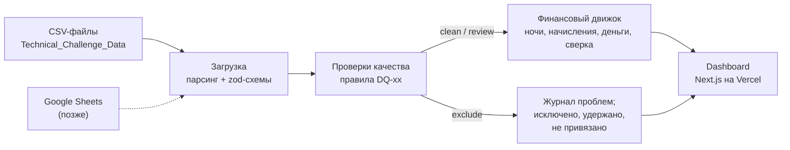
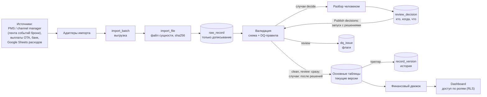

# План системы: финансовая аналитика портфеля вилл

Статус: v2 от 2026-10-27 (v1 — 2026-10-18). В v2 денежная модель заменена моделью финального задания ([FINAL_TEST_PLAN.md](FINAL_TEST_PLAN.md), ТЗ 2026-10-23): ставка и округление комиссии по каждой ночи, PBJT как отдельное обязательство, три вида денег (поступило, удержано, не привязано), версия брони по `updated_at`. Изменения — раздел 7.8 и журнал решений от 2026-10-27; код переводится фазой 6b ([ROADMAP.md](ROADMAP.md), рабочий план — [MONEY_MODEL_PLAN.md](MONEY_MODEL_PLAN.md)), пока модель работает только в адаптере `lib/nightly`. Документ описывает, что строим, как считаем и в каком порядке делаем. Главный документ сдачи — `README.md`: в него войдут формулы, допущения, журнал ошибок данных и схема архитектуры из этого плана. **v2.1 от 2026-10-27:** модель сделана в коде (фаза 6b, [MONEY_MODEL_PLAN.md](MONEY_MODEL_PLAN.md)); решения автора по DQ-16/DQ-23 и пересечению правил комиссии — журнал 15.

**Порядок выполнения** — в [ROADMAP.md](ROADMAP.md): единый пофазный план по всем четырём документам; таблица этапов ниже сохранена как справка.

## 1. Цель

Прототип аналитической системы для портфеля из 20 вилл. Данные о бронированиях, комиссиях, расходах и платежах загружаются, проверяются на ошибки, сводятся в финансовые показатели и выводятся на дашборд.

Что оценивают проверяющие и чем мы на это отвечаем:

| Раздел задания | Чем закрываем |
|---|---|
| 1. Dashboard | Next.js-приложение на Vercel, фильтры по объекту и периоду, три блока: начисления, деньги, сверка |
| 2. Методология | Формулы и правила в разделе 7, затем в README |
| 3. Качество данных | Правила DQ-xx (раздел 6), журнал проблем, решение по каждой записи |
| 4. Архитектура | Схема в разделе 4. На уровне 2 — работающий импорт в Supabase без дублей и с аудитом |
| 5. Компромиссы | Разделы 3, 13, 15 и журнал решений |

Критерии из задания: обоснованность решений, корректность расчётов и прозрачность допущений важнее внешнего вида. Отсюда правило: сначала правильные цифры и объяснимость. Интерфейс собираем из готовых компонентов HeroUI и не тратим время на ручную полировку.

## 2. Объём работ

**Уровень 1 — ядро (обязательно).**
- Загрузка пяти CSV, проверка типов и форматов.
- Движок проверок качества с журналом проблем.
- Финансовый движок: разнесение по ночам, начисления, денежный поток, сверка, оценка owner balance.
- Дашборд с фильтрами и вкладкой качества данных.
- Тесты: эталонный пересчёт одной виллы и инварианты.
- README и деплой на Vercel.
- Работает без базы и без секретов: данные читаются из CSV в репозитории.

**Уровень 2 — система (после уровня 1, сверх рекомендованного времени).**
- Хранение в Supabase Postgres.
- Импорт пачками: повторная загрузка не создаёт дублей, у записей есть история версий.
- Разбор случаев: записи без сомнений публикуются сразу; пересечения, modified-брони и разные версии одной записи, которые не упорядочить по `updated_at`, публикуются только после решений человека; новая версия брони с более поздним `updated_at` вытесняет прежнюю сама; решения сохраняются с автором, временем и комментарием.
- Политики RLS для разграничения доступа.

**Финальное задание (сделано 2026-10-23).** Комиссия по ночам и защита от повторного импорта событий: адаптер `lib/nightly` и CLI `npm run nightly` на JSON-кейсе заказчика (FINAL_TEST_PLAN.md). Его денежная модель с 2026-10-27 — основная методология системы (раздел 7). Ядро `lib/calc`, правила DQ и дашборд переводятся на неё фазой 6b (ROADMAP.md), после этого `lib/nightly` считает через ядро.

**Вне объёма (только описываем).** Интерфейс входа, живая синхронизация с Google Sheets, курсы валют, налоги (кроме PBJT, который приходит из источника готовой суммой), PDF-отчёты собственникам, расписание импорта.

## 3. Стек

| Слой | Выбор | Почему |
|---|---|---|
| Язык | TypeScript (Node 24) | Основной стек автора. Строгие типы для денежных расчётов |
| Приложение | Next.js (App Router) | Дашборд и серверные расчёты в одном проекте, деплой на Vercel в один шаг |
| UI-компоненты | HeroUI (работает поверх Tailwind CSS) | Готовые таблицы, карточки, выбор дат, списки выбора и переключатели: аккуратный интерфейс сразу, без ручной вёрстки. Версию фиксируем при установке и проверяем совместимость с Tailwind |
| Графики | Recharts (1–2 графика) | Достаточно для прототипа |
| Схемы данных | zod | Описание и проверка структуры каждой строки CSV |
| CSV | csv-parse | Корректно работает с BOM и кавычками |
| Тесты | vitest | Быстрый, работает с TS без настройки |
| БД (уровень 2) | Supabase Postgres 17 через Drizzle ORM и postgres-js | Проект уже создан; Drizzle даёт типизированную схему и миграции в репозитории |

Почему не Python: в задании стек свободный, а объём данных (около 360 строк) не даёт преимущества pandas. Код на своём стеке проще защищать на собеседовании.

Почему расчёты на TypeScript, а не в SQL: одна реализация, которую легко покрыть тестами. Тот же движок работает и с CSV, и с базой. При росте объёмов расчёты переезжают в SQL-витрины (dbt).

## 4. Архитектура

### 4.1 Прототип (уровень 1)



### 4.2 Целевая система (уровень 2 и дальше)



Слой данных спрятан за общим интерфейсом источника: `CsvSource` (по умолчанию) и `SupabaseSource` (если задан `DATABASE_URL`). Проверки и расчёты не знают, откуда пришли данные. Если база недоступна (например, бесплатный проект Supabase уснул), дашборд переключается на CSV и показывает об этом баннер.

## 5. Данные

### 5.1 Источники

Файлы в UTF-8 с BOM, разделитель — запятая. Исходные файлы не изменяем.

| Файл | Строк | Ключ | Ссылки |
|---|---|---|---|
| properties.csv | 20 | property_id | owner_id (1 собственник на 1 виллу) |
| commission_rules.csv | 20 | property_id + effective_from | property_id |
| reservations.csv | 151 | reservation_id | property_id |
| payments.csv | 76 | payment_id | reservation_id, property_id |
| expenses.csv | 90 | expense_id | property_id |

Что выяснили при первичном анализе:
- Все 68 ненулевых платежей ровно равны `gross_booking_value − ota_fee`. Значит, деньги приходят за вычетом комиссии OTA. Финальное задание подтверждает это правилом: OTA перечисляет проживание + PBJT − OTA fee (7.4); PBJT в CSV нет.
- Платежи есть только у бронирований с чётными ID (75 из 150). Похоже на неполную выгрузку или пакетные выплаты OTA.
- `updated_at` принимает два значения: 2026-09-15 и 2026-10-15. Это похоже на две выгрузки. Это дата без времени: две версии одной брони с одной датой по ней не упорядочить (DQ-02, 7.5).
- Ни один платёж не датирован раньше заезда: 9 в день заезда, 60 позже, медиана — через день после выезда. При правиле «оплата 100% до заезда» это проблема данных (DQ-16, DQ-23). В финальном задании выплата OTA по R101 приходит после выезда, и ТЗ называет это обычным разрывом начисления и денег, а не долгом. Что это значит для DQ-16 и DQ-23 у броней OTA, решает автор (вопрос 13, ROADMAP.md 6); до решения правила не меняются.
- `payments.csv` содержит `status`; все 76 строк — `received`.
- Период данных: проживания с 2026-09-01 по 2026-11-01, платежи с 2026-09-06 по 2026-11-05, расходы с 2026-09-01 по 2026-10-31.

**Лента событий брони (формат финального задания).** JSON-кейс `final-test/case_public.json`: `report_months`; `properties` с `base_currency`; `commission_rules` со ставкой в базисных пунктах (`rate_bps`, 1700 = 17 %); `reservation_events` — снимки брони, ключ события `source_event_id`, ключ брони `reservation_id`, `updated_at` — момент времени с зоной, суммы `accommodation_gross_idr`, `pbjt_idr`, `ota_fee_idr`; `payments` без `property_id` (вилла — через бронь), со `status` `received` или `pending`. Возвратов и канала в ленте нет. Сейчас её читает только `lib/nightly`; как отдельная сущность импорта (`reservation_event`) она — пункт фазы 10 (ROADMAP.md).

### 5.2 Статус каждой записи после проверок

У каждой исходной строки ровно один итоговый статус:

| Статус | Что значит | Участвует в расчётах |
|---|---|---|
| `clean` | Проблем не найдено | Да |
| `review` | Есть сомнение, нужна проверка человеком | Да, с флагом; переключатель на дашборде может их убрать |
| `pending` | Система не может решить сама: пересечение, modified-бронь, разные версии одной записи с одинаковым `updated_at` или без него; платёж по такой брони ждёт вместе с ней | Уровень 2: нет, пока человек не решит случай; остальная пачка публикуется сразу. Уровень 1 (без базы и решений): как `review` |
| `excluded` | Запись противоречива или не привязана к объекту | Нет; суммы показаны отдельно: брони и расходы — «исключено», платежи — «не привязано» (брони нет), «удержано» (бронь вне расчёта) или «исключено» (ошибка самого платежа), 7.4 |
| `duplicate` | Точная копия другой строки (тот же ID и то же содержимое), удалена автоматически | Нет; учтена в журнале |
| `superseded` | Прежняя версия записи: у той же брони есть версия с более поздним `updated_at` (DQ-02), или строку `pending` вытеснила версия из более поздней пачки | Нет; видна в журнале и истории как вытесненная, не суммируется |

**Сначала система, потом человек.** `duplicate` и `excluded` система ставит сама и окончательно, человеку они не показываются и видны в отчёте «исключено автоматически». `clean` и `review` публикуются сразу: в них сомневаться не в чем. `pending` решает человек, и публикации ждут только эти записи. `review` — флаг: запись публикуется с пометкой (VALIDATION_PLAN.md, разделы 2 и 7.5).

**Источник правды — входящие данные.** Мы их не исправляем: решение выбирает, каким записям верить, но значений не меняет. Пришли новые данные по случаю — случай решается заново.

**Контрольные суммы.** По каждому файлу сумма по источнику = в расчётах + исключено + удалено как дубль + вытеснено новой версией. У платежей та же сумма раскладывается и по видам денег (7.4): поступило + удержано + не привязано + исключено по ошибкам самого платежа + дубли. Это проверяется тестом и показывается на вкладке качества данных: ни одна рупия не теряется молча.

## 6. Качество данных: правила

Найденные проблемы — результат первичного анализа, при реализации пересчитаем. Подробный план модуля проверок (контракт функций, журнал, пересечения средствами базы) и актуальный каталог правил — в [VALIDATION_PLAN.md](VALIDATION_PLAN.md).

| ID | Проверка | Действие | Найдено |
|---|---|---|---|
| DQ-01 | Полный дубль строки | duplicate: копия удаляется | R0015, P0075 |
| DQ-02 | Повтор ID с разным содержимым | у брони действует версия с наибольшим `updated_at`, прежние — superseded (ТЗ финального задания, п. 10); `updated_at` равны или его нет (платежи, расходы, справочники) — decide: какая версия верна, решает человек | 0 |
| DQ-03 | Формат ID (`R####`, `V###`, `P####`, `E####`) и дат | excluded | 0 |
| DQ-04 | Ссылка на несуществующий объект | excluded → «исключено» | R0034 (V999), E0017 (V777) |
| DQ-05 | Платёж по несуществующей или исключённой брони | excluded; брони нет → деньги «не привязано», бронь исключена → «удержано» (7.4) | P0036 (R0072) — удержано, 0 IDR; P0017 (R0034) раньше исключает DQ-04 |
| DQ-06 | Валюта не совпадает с базовой валютой объекта | excluded | R0061: USD 4 280 874 за 4 ночи, по величине это сумма в IDR |
| DQ-07 | Сумма брони ≤ 0 или ночей ≤ 0 | excluded | 0 |
| DQ-08 | Комиссия OTA < 0 или больше суммы брони | review | R0102: −100 000 |
| DQ-09 | Возврат больше суммы брони или возврат у неотменённой брони | excluded | R0072: confirmed, возврат 7 970 068 > суммы 7 070 068, платёж 0 |
| DQ-10 | Ставка OTA вне диапазона 0–25% | review | 0 (R0102 пропускается: уже DQ-08) |
| DQ-11 | «OTA fee» у прямой брони (Direct): отчисление в рекламный бюджет | info | 31 бронь |
| DQ-12 | Пересечение периодов проживания на одном объекте | decide: случай — группа конфликта | 68 пар, 86 броней, 32 группы, 17 вилл |
| DQ-13 | Статус modified без ссылки на исходную бронь | decide: человек принимает и вручную связывает с исходной | 8 броней (5 в группах конфликта, 3 отдельно) |
| DQ-14 | Платёж не равен ожидаемому (`A + PBJT − ota_fee − refund`, 7.4) | review в сверке | P0051: 3 998 667 > суммы брони 3 898 667 (из-за R0102) |
| DQ-15 | Нулевой платёж со статусом received | info | 7 (6 отмен + R0072) |
| DQ-16 | Не оплачено к дню заезда, брони OTA тоже: полученные платежи с датой ≤ заезда меньше `A + PBJT − ota_fee − refund` | info: долг на дату заезда; вид — «оплачено с опозданием на N дней» или «не оплачено, долг на сегодня» (v2, DQ-23 слит сюда) | 113 броней на 19.10: 51 оплачена позже, 62 без единого платежа |
| DQ-17 | Хотя бы на одну ночь проживания нет действующего правила комиссии или их два с одной датой начала | excluded: без ставки ночи комиссию не посчитать (ТЗ п. 14); бронь вернётся в расчёт, когда придёт правило. Смена ставки внутри проживания — не проблема: каждая ночь по своей ставке | 0 |
| DQ-18 | Отмена с частичным возвратом | review: политика удержания | 0 |
| DQ-19 | Объект в платеже не совпадает с объектом брони | review | 0 |
| DQ-22 | Периоды правил комиссии одной виллы пересекаются | review: на спорных ночах ставки нет — DQ-17 исключает брони с такой ночью (политика `commissionRuleOverlap: 'ambiguous'`, 7.7) | 0 |
| ~~DQ-23~~ | ~~Платёж датирован позже дня заезда~~ — слит в DQ-16 v2 (2026-10-27) | — | было 58 платежей (60 по сырым строкам) |
| DQ-24 | Бронь confirmed без единого полученного платежа | info: платёж не дошёл или статус ошибочный | 64 брони на 19.10, у 6 заезд впереди |
| DQ-25 | Статус платежа не `received` | `pending` — info: ещё не деньги, сумма в «удержано» (ТЗ п. 11); незнакомый статус — excluded, сумма тоже в «удержано» | 0: все 76 — received |

**Пересечения (DQ-12) делим на подтипы**, чтобы разбор шёл по приоритету:
- одинаковые даты на одном объекте: R0033 и R0056 (V008). Это не дубль: разные ID, GBV 14,6 и 5,6 млн IDR, платёж только у R0056;
- одна из броней modified — вероятно, старая и новая версия одной брони: 6 пар (R0027/R0146, R0112/R0146, R0149/R0150, R0126/R0145, R0038/R0148, R0045/R0148);
- остальные частичные пересечения — двойное бронирование или ошибка дат: 61 пара. Пять из них дала R0102: она больше не исключается (DQ-08 — review) и пересекается с R0017, R0096, R0101, R0103, R0128.

Почему пересечения не исключаем: без пересечений только 49 активных броней из 135. Исключение уничтожило бы данные. Массовость говорит о системной проблеме источника, а не о случайных опечатках. На дашборде переключатель «включать записи под вопросом» показывает, насколько от них зависят цифры.

Пересечения и modified-брони разбирает человек по случаям: 32 группы конфликта на 17 виллах и 3 modified-брони вне групп, всего 35 случаев. В группе он выбирает набор броней для календаря, по остальным решает — оставить только в финансах или исключить; modified связывает с исходной и при необходимости сливает платежи вручную. Пока случай не решён, его брони и платежи по ним не публикуются; остальная пачка публикуется сразу. Автоматического выбора нет: он зависит от фактов вне данных (VALIDATION_PLAN.md, 7.5).

## 7. Финансовая методология

Денежная модель взята из финального задания: заказчик назвал её правила «утверждёнными именно для теста» (ТЗ, раздел 3). Другой методологии, сформулированной самим заказчиком, у нас нет, поэтому с 2026-10-27 она заменяет модель первого задания. Что поменялось — 7.8. В коде модель пока есть только в адаптере `lib/nightly`. Ядро `lib/calc`, правила DQ и дашборд считают по-старому до фазы 6b (ROADMAP.md); на данных первого задания разница — округление комиссии, −19 IDR по всему набору (7.3).

### 7.1 Даты и период

- Даты — календарные, без времени и часовых поясов. Сравниваются как ISO-строки, арифметика в UTC (иначе на Vercel возможен сдвиг на сутки).
- Ночь с датой `d` — это ночь с `d` на `d+1`. Дата заезда входит, дата выезда — нет. Месяц ночи — месяц её даты.
- **Начисления** относятся к периоду по ночам проживания. Бронь 28.09–04.10 даёт 3 ночи в сентябре и 3 в октябре; выезд 01.11 — последняя ночь 31.10, то есть октябрь. Одна бронь может давать начисление в двух месяцах, и по разным ставкам (7.3).
- **Деньги** относятся к периоду по `payment_date`, расходы — по `expense_date`. Аванс, полученный в ноябре за декабрьское проживание, — ноябрьские деньги и декабрьское начисление (ТЗ п. 7).
- Итог периода — сумма итогов любых его смежных частей, в том числе месяцев: каждая ночь и каждый платёж относятся ровно к одной дате, поэтому итог сходится с месяцами и с виллами по построению.
- **Сверка** считается по броням с датой выезда в периоде, чтобы каждая бронь попадала ровно в один период.
- «Сегодня» — дата по Бали (Asia/Makassar) в момент запуска, а не на сервере. От неё зависят «срок не наступил» в сверке, DQ-16 и DQ-20. Отдельной даты среза нет: период пользователь выбирает фильтром, а долг это или ещё рано, решает сегодняшний день.

### 7.2 Обозначения для одной брони r

- `n_r = check_out − check_in` — число ночей, `d` — ночь брони.
- Бронь активна, если статус `confirmed` или `modified`, она не исключена проверками и это её действующая версия (наибольший `updated_at`, 7.5).
- `A_r` — стоимость проживания **без PBJT**: `gross_booking_value` в CSV, `accommodation_gross_idr` в ленте событий. Это доход от аренды и база комиссии УК.
- `PBJT_r` — налог на проживание (PBJT, прежнее название PB1): обязательство перед государством, **не доход компании и не доход собственника**. Сумма приходит из источника, ставка заново не вычисляется. В CSV такого поля нет: адаптер CSV подставляет 0, а `gross_booking_value` читается как проживание без PBJT — это допущение, вопрос 2 финдиректору остаётся.
- `OTA_r`, `REF_r` — комиссия канала и возврат: `ota_fee`, `refund_amount` из CSV; в ленте событий — `ota_fee_idr`, возвратов нет. У прямой брони в ленте OTA = 0; про ненулевое поле у прямых броней CSV — 7.4.
- `rate(d)` — ставка правила `commission_rules` виллы, действующего в ночь `d`: `effective_from ≤ d ≤ effective_to`, обе границы входят, пустой `effective_to` — без конца. В CSV ставка — доля (`management_fee_rate = 0.17`), в ленте — базисные пункты (`rate_bps = 1700`), в расчёте обе становятся одной дробью 17/100. Если на ночь действуют два правила с разными датами начала — 7.7.
- `MF_r(d) = HALF_UP(A_r(d) × rate(d))` — комиссия УК за ночь; `MF_r = Σ_d MF_r(d)`. База — проживание без PBJT, как указано в `fee_basis = gross_booking_value`.

### 7.3 Распределение по ночам и округление

Суммы хранятся в целых IDR. Валюта по самостоятельно подобранному курсу не пересчитывается (ТЗ п. 1, 12). Каждая из сумм брони — `A`, `PBJT`, `OTA`, `REF` — делится на ночи отдельно: каждая ночь получает `floor(X / n)`, остаток `X mod n` раздаётся по 1 IDR первым ночам в хронологическом порядке. Сумма по ночам всегда равна сумме брони до рупии.

**Комиссия УК считается по каждой ночи** по ставке этой ночи и округляется до целой рупии отдельно по каждой ночи правилом HALF_UP: для неотрицательных сумм `(A(d) × bps + 5000) div 10000` (ТЗ п. 4, 6). Комиссия брони — сумма ночных; её не округляют и не делят повторно. Бронь на стыке смены ставки получает обе ставки: R101 финального задания (29.11–03.12, ночь 1 100 000) — две ноябрьские ночи по 17 % и две декабрьские по 20 %, 374 000 + 440 000 = 814 000. Одна ставка на всю бронь дала бы 748 000 или 880 000, и ТЗ (4B) считает это ошибкой.

На данных первого задания ставка внутри проживания не меняется нигде: у каждой виллы одно правило на весь период. Меняется только округление: у 96 строк активных броней комиссия отличается от прежней (одно округление на бронь) на 1–3 IDR, по всем строкам активных броней в IDR до проверок в сумме −19 IDR; точные числа портфеля после статусов DQ фиксирует эталон фазы 6b. Пример — R0020: 3 602 767 × 0.17 = 612 470,39 → 612 470 одним округлением; по ночам 1 200 923 / 1 200 922 / 1 200 922 → 204 157 × 3 = 612 471.

### 7.4 Показатели (период P, набор объектов S)

**Начисления** (по ночам в P, только активные брони):

```
Accommodation gross   = Σ A по ночам                     проживание без PBJT
Возвраты              = Σ REF по ночам
PBJT к уплате         = Σ PBJT по ночам                  обязательство перед государством, не доход
OTA fees              = Σ OTA по ночам
Чистая выручка аренды = Accommodation gross − Возвраты − OTA fees
Management fees       = Σ MF(d) по ночам                 каждая ночь округлена отдельно
Owner estimate        = Чистая выручка аренды − Management fees
Опер. расходы         = Σ expenses.amount, expense_date в P (paid + pending)
Owner balance (оценка)= Owner estimate − Опер. расходы
```

**Owner estimate** — условная оценка результата собственника до расходов и выплат (ТЗ п. 8): `A − OTA − MF`, у нас ещё минус возвраты, которых в ленте событий нет. Это не обязательство к выплате и не банковский остаток. **Owner balance** дополнительно вычитает операционные расходы виллы; это тоже оценка (7.6). PBJT не входит ни в выручку, ни в базу комиссии, ни в оценку собственника.

У прямой брони (Direct) `OTA` — отчисление в рекламный бюджет своей сети продаж. Оно входит в OTA fees и вычитается из owner estimate так же, как комиссия OTA (решение 2026-10-19, раздел 15). В ленте событий у прямой брони OTA = 0. Ненулевое поле у прямых броней CSV по-прежнему читаем как отчисление (решение 2026-10-19): ТЗ такого случая не описывает, вопрос 5 финдиректору остаётся.

**Деньги** (по датам в P). Каждый платёж попадает ровно в один вид денег:

```
Поступило (received)  = Σ платежей status = received по броням в расчёте, payment_date в P
Удержано (held)       = Σ платежей pending (и с незнакомым статусом), payment_date в P
                        + Σ полученных платежей по броням вне расчёта: исключённым или ждущим решения
Не привязано          = Σ полученных платежей, чьей брони нет в данных, payment_date в P
Оплаченные расходы    = Σ expenses.amount, expense_date в P, payment_status = paid
Чистый денежный поток = Поступило − Оплаченные расходы
```

Удержано и не привязано — деньги, о которых мы знаем, но вилле не приписываем: `pending` — ещё не деньги (ТЗ п. 11); полученный платёж по брони, которую мы сами исключили или держим до решения, реален, но без начисления по брони у виллы появился бы кэш из ниоткуда; платёж на несуществующую бронь не теряется и не становится доходом виллы (п. 13). Оба вида показываются рядом с поступлениями и в них не входят (ТЗ 4D: не прятать неподтверждённые деньги). Повтор платежа с тем же `payment_id` и тем же содержимым учитывается один раз (DQ-01). На дашборде удержано и не привязано фильтруются по `payment_date`, как поступления; в CLI финального задания окно отчёта — `report_months`, и туда они входят без окна (FINAL_TEST_PLAN.md 3.3).

**Сверка** (брони с выездом в P):

```
Ожидалось_r  = A_r + PBJT_r − OTA_r − REF_r   OTA перечисляет проживание + PBJT за вычетом своей комиссии
Получено_r   = Σ полученных (received) платежей по брони r, любой датой
Разница_r    = Получено_r − Ожидалось_r
Статус       = сошлось | недоплата | переплата | не получено | срок не наступил
```

OTA fee из фактического банковского платежа второй раз не вычитается (ТЗ п. 3): P101 финального задания = 4 400 000 + 440 000 − 660 000 = 4 180 000. `pending`-платёж в «получено» не входит. На данных первого задания PBJT = 0, и формула совпадает с прежней `GBV − OTA − REF`.

Срок оплаты — день заезда: вилла оплачивается полностью до заезда. «Срок не наступил» — только у броней, у которых заезд ещё впереди; всё остальное без полной оплаты — долг. У броней OTA так же (решение автора 2026-10-27): канал перечисляет деньги не позже дня заезда; выплата OTA по R101 после выезда в финальном задании — пример задания, а не правило бизнеса. Долг на день заезда помечает DQ-16 как справку (`info`): статус брони он не меняет.

Ожидаемое поступление по брони — чистая выручка аренды плюс PBJT: PBJT проходит через нас транзитом и уходит государству. Разница между начислениями и деньгами — это дебиторка (не получено), разница во времени (получено в другом периоде) и удержанные деньги. На дашборде блоки подписаны своей базой, чтобы выручку и денежный поток не смешивать.

### 7.5 Версии, отмены, возвраты, modified

- **Версии брони** (ТЗ п. 9, 10, 14). В расчёт идёт последний полный снимок брони — версия с наибольшим `updated_at`; прежние версии получают статус `superseded`: они сохраняются в журнале и истории, но не суммируются как отдельные брони. Порядок прихода не важен: поздно пришедшая старая версия не вытесняет новую. Две версии с одинаковым `updated_at` и разным содержимым — случай `decide`, правило выбора не придумываем. Одинаковое содержимое — одна версия, сколько бы раз её ни прислали. В ленте событий `updated_at` — момент времени (сравнивается момент, а не строка); в CSV — дата без времени, поэтому две версии одной даты с разным содержимым тоже идут человеку (DQ-02).
- **Повтор события ленты.** Тот же `source_event_id` и то же содержимое — одно событие (DQ-01). Тот же `source_event_id` с другим содержимым — лента по этой брони недостоверна: случай `decide`, бронь ждёт решения (в CLI финального задания — `CONFLICTING_EVENT`).
- **Отмена:** выручка, PBJT, комиссия OTA и комиссия УК равны 0. Допущение: комиссия OTA при отмене возвращается. Отменённые брони показываются справочно (количество и сумма). Во всех 12 отменах CSV возврат равен полной сумме брони. В ленте событий статус `cancelled` не описан: CLI финального задания держит такую бронь вне расчёта (`UNKNOWN_STATUS`), в CSV это известный статус.
- **Частичный возврат при отмене:** удержанная часть (`A − REF`) была бы выручкой. В данных таких нет, правило DQ-18 их ловит. Политика — вопрос финдиректору.
- **Возврат у активной брони:** уменьшает выручку. В данных единственный случай (R0072) противоречив и исключён.
- **modified:** в ленте событий изменение брони — новая версия с тем же `reservation_id`, её выбирает правило версий выше. В CSV modified-бронь пришла под новым ID без ссылки на исходную, поэтому каждую такую бронь принимает человек и сам связывает с исходной (DQ-13, VALIDATION_PLAN.md, 7.5). Связанная исходная бронь исключается как заменённая, её платежи переходят к новой версии только по отдельному решению (слияние). На уровне 1 решений нет: modified считается актуальной версией с флагом.

### 7.6 Почему owner balance — оценка

В данных нет (финальное задание тоже их сознательно не даёт, ТЗ п. 8):
- выплат собственникам и начального сальдо;
- налогов: PBJT в CSV (в ленте событий он есть отдельным полем), PPN (НДС) на комиссию УК;
- базы комиссии УК при возвратах (до или после);
- курсов валют: бронь в другой валюте без утверждённого курса в расчёт не входит (DQ-06);
- даты создания брони (поэтому «бронирования за период» по дате продажи посчитать нельзя).

Кто несёт комиссию OTA, больше не допущение: оценка собственника по ТЗ п. 8 вычитает OTA fee, значит её несёт собственник.

### 7.7 Политики в одном месте

Методологические решения собраны в `lib/calc/policies.ts` (CALCULATION_MODULE.md, 6): признание выручки (`nights` или `checkout`; ТЗ п. 7 подтверждает `nights`), учёт записей под вопросом, выбор правила комиссии при пересечении периодов (`commissionRuleOverlap`). Если финдиректор ответит иначе, меняется одна настройка, а не код расчётов.

`commissionRuleOverlap` нужна, потому что ТЗ финального задания и решение 2026-10-18 по-разному читают пересечение правил одной виллы. По умолчанию — и в системе, и в CLI финального задания — `ambiguous` (решение автора 2026-10-27): ночь с двумя правилами — бронь вне расчёта, «не придумывай правило» (ТЗ п. 14); DQ-22 помечает пересечение, DQ-17 исключает бронь, пока старое правило не закроют. `latest-start` (решение 2026-10-18: на спорной ночи действует правило с более поздней датой начала) остаётся значением политики. Ставка по ночам и округление по ночам — не политики: их ТЗ задаёт прямо (4B, п. 6).

### 7.8 Что изменила модель финального задания

| Тема | Было (первое задание) | Стало (с 2026-10-27) | Основание |
|---|---|---|---|
| Ставка комиссии | одна на бронь, по дате заезда; смена внутри проживания — флаг DQ-17 | ставка каждой ночи | ТЗ п. 4, 4B |
| Округление комиссии | один раз на бронь, затем деление по ночам | отдельно по каждой ночи, HALF_UP; комиссия брони — сумма ночных | п. 6 |
| База комиссии | `gross_booking_value` | проживание без PBJT (в CSV — то же поле, PBJT там нет) | п. 2, 4 |
| PBJT | не учитывался | отдельная сумма, обязательство; не доход, не база комиссии | п. 2 |
| Ожидаемый платёж | `GBV − OTA − REF` | `A + PBJT − OTA − REF` | п. 3 |
| Деньги | поступления; «нераспределено» = все исключённые платежи | поступило (`received`), удержано (`pending`, бронь вне расчёта), не привязано (брони нет) | п. 11, 13, 4D |
| Оценка собственника | owner balance после расходов | owner estimate до расходов (ТЗ) и owner balance после | п. 8 |
| Версии брони | разное содержимое под одним ID решает человек (DQ-02) | последний снимок по `updated_at`, прежние `superseded`; человек — только при равном `updated_at` | п. 10, 14 |
| Нет ставки на ночь | `review`, расчёт брони падал в отказы | бронь исключается (DQ-17), вернётся с правилом | п. 14 |

Не изменилось: суммы в целых IDR, ночи `[check_in, check_out)`, остаток по рупии первым ночам, начисления по ночам и деньги по дате платежа, бронь в чужой валюте исключается без пересчёта (DQ-06), дубль — только тот же ключ и то же содержимое (DQ-01).

## 8. Dashboard

Фильтры передаются в URL (ссылкой можно поделиться):
- объект или несколько объектов — `Select` с множественным выбором;
- кластер — `Select`;
- период — `DateRangePicker` и быстрые варианты «Сентябрь», «Октябрь», «Весь период»;
- переключатель «включать записи под вопросом» — `Switch`, по умолчанию включён.

Компоненты HeroUI: `Card` для показателей, `Table` для списков, `Chip` для статусов (clean / review / excluded, статусы сверки), `Tabs` или навигация между страницами. Правила показываются значками (`components/rules/`): иконка или короткий тег в цвете действия, проблема словами в подсказке, легенда рядом с таблицей. Код DQ-NN в интерфейсе не показывается (решение 2026-10-19). Расчёты выполняются на сервере, клиентские компоненты HeroUI получают готовые данные.

Страницы. В боковой панели два раздела: Dashboard (`/`) — цифры по проверенным данным; Import (`/import`) — пачки, исходные строки, качество данных и сверка вкладками (решение 2026-10-19). Пункты 2–4 — вкладки Import.
1. **Обзор (`/`).**
   - Три блока показателей: начисления (проживание, PBJT к уплате отдельной строкой, OTA, комиссия УК, owner estimate), деньги (поступило; удержано и не привязано рядом, не в сумме), сверка. С фазы 6b (ROADMAP.md); до неё — прежние показатели.
   - Метка «оценка» у owner estimate и owner balance со ссылкой на список недостающих условий.
   - Таблица по объектам: ночи, проживание, PBJT, OTA, комиссия УК, owner estimate, расходы, owner balance, поступления, разница, число флагов качества. Не привязанные платежи вилле не принадлежат и показываются только итогом портфеля. В ячейках только чистые записи при любом положении общего переключателя. Свой переключатель таблицы Under review показывает под каждой цифрой, сколько добавят записи под вопросом. Число флагов ведёт на исходные строки виллы.
   - Графика GBV и карточки качества данных на обзоре нет: обзор — для показателей, разбор ошибок — на странице качества данных (решение 2026-10-19).
2. **Сверка (`/import/reconciliation`).** Брони периода: ожидалось (`A + PBJT − OTA − REF`), получено (только `received`), разница, статус. Отдельно — не привязанные платежи (брони нет) и удержанные (`pending`, бронь исключена или ждёт решения) с причиной.
3. **Качество данных (`/import/data-quality`).** Сводка по правилам (сколько записей, действие, сумма), контрольные суммы, график GBV по объектам (чистые записи и под вопросом), отчёт «исключено автоматически», список проблем с фильтром, группы пересечений.
4. **Импорт (`/import`, уровень 2).** История пачек, результат повторного импорта, шаги пачки.
5. **Разбор (`/review`, уровень 2).** Открытые случаи из всех пачек: таймлайн броней по ночам, решение по каждой брони, связь modified, итог и кнопка Publish decisions (VALIDATION_PLAN.md, 7.5). Пока случаи ждут, показывается баннер: сколько броней и денег не в расчётах, со ссылкой сюда. Где именно его показывать, решается в фазе 7c (ROADMAP.md, 6): по решению 2026-10-19 на обзоре сигналов об ошибках нет.

## 9. Уровень 2: Supabase

- **Подключение.** Строка Transaction pooler (`DATABASE_URL`, IPv4, порт 6543). Прямой хост проекта доступен только по IPv6 и с Vercel не работает. Для postgres-js через этот pooler нужен `prepare: false`.
- **Схема `app`.** Не публикуется через Data API Supabase. RLS включён на всех таблицах, по умолчанию доступ запрещён. Сервер ходит в базу напрямую, publishable key в браузере доступа к данным не даёт.

**Таблицы:**

| Таблица | Назначение |
|---|---|
| `import_batch` | одна загрузка, от одного до пяти файлов: тип источника (CSV, Google Sheets), откуда, статус (`uploading` / `queued` / `processing` / `needs_review` / `loaded` / `skipped` / `failed`), ссылка на пачку-близнеца для `skipped`, кто и когда запустил |
| `import_file` | файл пачки, по одному на сущность, не обязательно все пять: имя, sha256, размер, заголовок, число строк; `skipped` для файла, загруженного раньше |
| `raw_record` | сырые строки как JSON, файл, номер строки, ключ записи, хэш строки; только дописывание |
| `stg_*` | типизированные строки пачки без бизнес-ограничений; вход для проверок — действующий набор `eff_*`: строки пачки, `pending` прежних пачек, опубликованные (VALIDATION_PLAN.md, 2) |
| `reservation`, `payment`, `expense`, `property`, `commission_rule` | текущие версии записей `clean` и `review` по естественному ключу; `raw_record_id` и `row_hash` текущей версии. У брони текущая — версия с наибольшим `updated_at`; колонка `pbjt` (`null` — источник PBJT не прислал, как CSV). У платежа `status` — `received` или `pending` (фаза 6b) |
| `record_version` | история всех основных таблиц в одной таблице: сущность, ключ, номер версии, операция, данные целиком, строка источника, запуск, автор, время; пишет триггер, только дописывание |
| `occupancy` | календарь занятости: допущенные активные брони, `EXCLUDE` запрещает пересечения; кто допустил — `admitted_run_id` и `decision_id` |
| `dq_run`, `dq_check_result`, `dq_record_verdict` | запуск проверок и публикации, вердикты правил, итоговый статус строки (VALIDATION_PLAN.md, раздел 4) |
| `dq_issue` | проблема между запусками: правило, запись, действие (`decide` или `review`), ключ случая, детали, `open` / `resolved` / `closed` |
| `review_decision` | решение по брони в случае: `accept`, `finance_only`, `exclude`, `keep_published`; связь modified и слияние в `payload`; ключ случая, хэш строки, комментарий, автор, время; только дописывание |
| `user_property_access` | какие объекты видит пользователь (для RLS) |

**Повторный импорт без дублей:**
1. Файл совпадает по sha256 с уже загруженным файлом той же сущности → файл `skipped`, его строки не читаются. Пропущены все файлы пачки → пачка `skipped` со ссылкой на пачку-близнеца, данные не меняются. Остальные файлы загружаются, а неизменные строки в них отсеет шаг 4.
2. Строка с новым ключом → вставка в основную таблицу, триггер пишет версию 1 в `record_version`.
3. Ключ есть, хэш строки другой → строка обновляется, триггер пишет версию `n + 1`. Предыдущая версия остаётся в `record_version` и действовала до `recorded_at` новой. **У брони решает `updated_at`, а не порядок прихода** (7.5): пришла версия новее опубликованной — обновление; старше — строка остаётся в `raw_record` и журнале со статусом `superseded`, опубликованная бронь не меняется; тот же `updated_at` — случай `decide` (DQ-02). У сущностей без `updated_at` (платежи, расходы, справочники) новее — строка более поздней пачки, как раньше.
4. Ключ есть, хэш тот же → строка не трогается, новой версии нет.
5. Точные дубли внутри файла схлопываются, проблема DQ-01 пишется в журнал.
6. Записи, которой нет в новом файле, ничего не делается: файл — не полный снимок, файлы одной выгрузки приходят в разное время (решено 2026-10-18). Отмена брони приходит статусом `cancelled`, удалений из выгрузки не выводим.

**Аудит:** сырые данные неизменны, история версий, журнал пачек, решения по проверке с автором и временем. Таблицы «только дописывание» (`raw_record`, `record_version`, `dq_check_result`, `dq_record_verdict`, `review_decision`) защищены триггером `forbid_change`. Для любой версии записи видно, из какой строки какого файла она пришла, каким запуском опубликована и кто её изменил; правка руками в обход импорта попадает в историю с `run_id = null`.

**Доступ:**
- роли: finance (всё), ops (все объекты без owner balance), owner (только свои объекты);
- RLS-политики по `property_id` через `user_property_access`;
- в прототипе — миграция с политиками и SQL-тест, что собственник видит только свои строки; интерфейс входа — вне объёма.

**Импорт запускается:**
- командой `pnpm import` из CLI;
- кнопкой на странице `/import`, которая заново импортирует CSV из репозитория (демонстрация идемпотентности);
- адаптер Google Sheets через публичный CSV-экспорт — по желанию.

## 10. Структура репозитория

Приложение живёт в корне, без `src/`. Тесты лежат рядом с кодом (`*.test.ts`).

```
.
├─ Technical_Challenge_Data/   исходные CSV, не изменяются
├─ docs/                       PLAN.md, ROADMAP.md, VALIDATION_PLAN.md, CALCULATION_MODULE.md, IMPORT_PLAN.md, FINAL_TEST_PLAN.md, MONEY_MODEL_PLAN.md
├─ final-test/                 ТЗ финального задания, case_public.json, output_schema.json, results_public.json
├─ app/                        страницы Next.js: /, /import (пачки), /import/raw-data, /import/data-quality, /import/reconciliation
├─ components/                 UI-компоненты (HeroUI)
├─ lib/
│  ├─ ingest/                  парсинг CSV (csv-parse, BOM), zod-схема на файл; строка хранит файл и номер строки
│  ├─ dq/                      контракт, раннер, правила DQ-xx, журнал в памяти / Postgres (VALIDATION_PLAN.md, 8)
│  ├─ calc/                    финансовый движок: ночи, начисления, деньги, сверка, политики (модель раздела 7, фаза 6b)
│  ├─ nightly/                 адаптер финального задания: JSON-кейс → снимки → комиссия по ночам → отчёт по схеме ТЗ
│  ├─ data/                    сборка входа расчётов из строк и вердиктов; источник CSV или Supabase
│  ├─ import/                  импорт в базу (уровень 2, IMPORT_PLAN.md)
│  └─ mock/                    данные каркаса интерфейса; удаляются по мере подключения реальных
├─ supabase/schemas/app/       декларативная SQL-схема: таблицы, функции, триггеры (по файлу на объект)
├─ supabase/migrations/        миграции, сгенерированные из схемы
├─ scripts/                    CLI: проверки по CSV, `nightly` (финальное задание), импорт (уровень 2)
├─ .env.example                только имена переменных
└─ README.md
```

## 11. Как проверяем корректность

1. **Модульные тесты** на каждое правило DQ, распределение по ночам, границы периода, комиссию, статусы сверки. Тест смены ставки внутри проживания: R101 — 374 000 + 440 000, а не 748 000 или 880 000 (ТЗ, F).
2. **Эталонная вилла.** V011 за сентябрь: 4 брони без пересечений и аномалий, 2 расхода (paid и pending). Ожидаемые значения посчитаны вручную и записаны в тест числами. По модели раздела 7 комиссия V011 за сентябрь — 4 554 621 (по-старому 4 554 620; CALCULATION_MODULE.md 10.5).
3. **Эталон финального задания.** `case_public.json` → `results_public.json`: контрольная арифметика ТЗ и таблица FINAL_TEST_PLAN.md 5, сверка CLI байт в байт; тест повторной версии и дубля платежа.
4. **Инварианты:**
   - сумма по объектам = итог портфеля;
   - сумма по ночам = сумма брони по каждой из сумм A, PBJT, OTA, REF; комиссия брони = сумма ночных;
   - каждый платёж — ровно в одном виде денег (поступило, удержано, не привязано, исключено, дубль);
   - у каждой исходной строки ровно один статус;
   - контрольные суммы источника сходятся.
5. **Независимый пересчёт итогов** SQL-запросом по сырым данным (в Supabase или psql). Результат фиксируем в README.
6. **Использование AI.** Код и документы писались с Claude Code. В README указываем инструмент и способ проверки: пункты 1–5 и ручная сверка ключевых цифр.

## 12. Этапы

**Порядок (решено 2026-10-18): сначала данные, не интерфейс и не импорт.** Интерфейс уже свёрстан на моках и ждёт данные, расчётный модуль готов и ждёт DQ-статусы. Без загрузчика и проверок ни одна реальная цифра не появляется. Поэтому первым делом тонкий сквозной путь CSV → проверки → расчёт → реальная цифра на дашборде (этапы 1, 2, 3, 5), затем страница качества данных, README и деплой. Импорт в базу (IMPORT_PLAN.md) — после сдачи уровня 1 и в урезанном объёме. Уровень 1 — законченный результат сам по себе.

Оценка — план, факт заполняем по ходу работы для честного отчёта о времени (ориентир — время коммитов).

| # | Этап | Оценка | Факт |
|---|---|---|---|
| 0 | Каркас: Next.js, TS, HeroUI + Tailwind, vitest; страницы на моках | 20 мин | сделано |
| 1 | Загрузчик `lib/ingest`: csv-parse с BOM, zod-схема на файл, строка хранит файл и номер строки | 30 мин | |
| 2 | Ядро `lib/dq`: контракт, раннер (порядок по `dependsOn`, проверка покрытия), итоговый статус, журнал в памяти, контрактный тест | 40 мин | |
| 3 | Правила на TS: DQ-01…20, DQ-23; DQ-12 через TS-двойник; DQ-90 как инвариант; эталонный тест по колонке «Ожидаем» | 75 мин | |
| 4 | Финансовый движок `lib/calc` и тесты (эталон V011, инварианты) | 60 мин | сделано |
| 5 | Адаптер `lib/data`: строки + вердикты → `OverviewInput`; главная страница на реальных цифрах; фильтры в URL (период, объекты, «включать review»); политика `paymentDue` в `lib/calc` | 60 мин | |
| 6 | Страница `/import/data-quality`: сводка по правилам, «исключено автоматически», список проблем, контрольные суммы | 40 мин | |
| 7 | README: формулы, допущения, найденные ошибки, архитектура, компромиссы, вопросы, фактическое время | 40 мин | |
| 8 | Деплой на Vercel | 15 мин | |
| | **Итого уровень 1, осталось** | **≈ 5 ч** | |
| 9 | Supabase: схема `app`, миграции (без RLS-политик) | 30 мин | сделано |
| 10 | Импорт в урезанном объёме (IMPORT_PLAN.md, раздел 0): синхронный `npm run import` и кнопка Load sample data, sha256 пачки, raw → stg → раннер с журналом в Postgres → публикация с `record_version` | 90 мин | |
| 11 | RLS-политики и SQL-тест доступа | 30 мин | |
| 12 | Экран разбора `/review` (идёт сразу за этапом 10: без него пачка со случаями не опубликуется): список случаев, таймлайн, решение по брони, связь и слияние modified, итог и Publish decisions, выгрузка CSV. Логика — VALIDATION_PLAN.md, этап 8 | 90 мин | |
| 13 | Адаптер Google Sheets (по желанию) | 30 мин | |
| 14 | Финальное задание: `lib/nightly`, CLI, `rateFromBps`, заметки (FINAL_TEST_PLAN.md) | 2 ч 40 мин | 1 ч 45 мин, 2026-10-23 |
| 15 | Денежная модель раздела 7 в ядре, DQ, дашборде; `lib/nightly` через ядро (ROADMAP.md, фаза 6b) | ≈ 5 ч 20 мин | см. MONEY_MODEL_PLAN.md 8, 2026-10-27 |

## 13. Риски

| Риск | Мера |
|---|---|
| Работа выходит за рекомендованные 2–3 часа | Уровень 1 — законченный результат сам по себе; время отчитываем честно, уровень 2 — отдельной строкой |
| Бесплатный проект Supabase засыпает после недели без активности | Автоматический переход на CSV и баннер; разбудить проект перед отправкой |
| Утечка секретов | `.env` в `.gitignore`, в репозитории только `.env.example`; переменные — в настройках Vercel; ничего секретного с префиксом `NEXT_PUBLIC_` |
| Publishable key открывает таблицы через Data API | Таблицы в схеме `app`, RLS на всех таблицах |
| Цифры сильно зависят от пересечений | Переключатель «под вопросом», показ суммы под вопросом рядом с итогами |
| Допущения разойдутся с реальной политикой компании | Политики в одном файле (7.7), список вопросов финдиректору |
| CSV не попадут в серверный бандл Vercel | Явно включить файлы через `outputFileTracingIncludes` и проверить на деплое |
| Сдвиг дат из-за часового пояса | Календарные даты как строки, арифметика в UTC, тест на границу месяца. `DateRangePicker` HeroUI работает с календарными датами без времени (`@internationalized/date`), это совпадает с нашим подходом |
| Компоненты HeroUI клиентские, логика может «утечь» в браузер | Граница `"use client"` только у компонентов отображения; фильтрация и расчёты — на сервере по параметрам URL |
| Модель финального задания описывает ленту событий, а данные первого задания — CSV без PBJT и с modified под новыми ID | PBJT = 0 как допущение с вопросом 2; modified по-прежнему связывает человек (DQ-13); выплаты OTA после выезда — решение автора о DQ-16 и DQ-23 (ROADMAP.md 6) |
| Ядро и `lib/nightly` разойдутся, пока модель живёт в двух местах | Фаза 6b переводит адаптер на ядро; `results_public.json` должен совпасть байт в байт, 147 тестов адаптера остаются |

## 14. Вопросы финансовому директору

Часть вопросов закрыло ТЗ финального задания (2026-10-23): его денежная модель утверждена заказчиком «для теста», и мы приняли её как основную (раздел 7). Такие ответы помечены; вопрос остаётся там, где ТЗ отвечает не полностью.

1. Как признаётся выручка: по ночам проживания, по дате выезда или по дате бронирования? **Ответ ТЗ п. 7:** по ночам; деньги — по дате платежа.
2. Включает ли `gross_booking_value` налоги (PB1) и сервисные сборы? **ТЗ п. 1–2:** проживание считается без PBJT, PBJT приходит отдельной суммой. Остаётся: в CSV поля PBJT нет — `gross_booking_value` без налога (как мы читаем) или с ним?
3. База комиссии УК — сумма до или после комиссии OTA и возвратов? Берётся ли комиссия при отмене с удержанием? **ТЗ п. 4:** база — проживание без PBJT, OTA fee не вычитается; ставка — каждой ночи. Остаётся: возвраты и отмена с удержанием.
4. Кто несёт комиссию OTA: собственник или управляющая компания? **ТЗ п. 8:** собственник — оценка собственника вычитает OTA fee.
5. Подтвердите: «OTA fee» у прямых броней — отчисление в рекламный бюджет своей сети продаж, и собственник несёт его так же, как комиссию OTA?
6. Как связать бронь со статусом modified с исходной? Какая версия актуальна? Платежи исходной брони переходят к новой версии? До ответа связывает и сливает человек вручную в каждом случае.
7. Относятся ли неоплаченные (pending) расходы на собственника в периоде начисления?
8. Есть ли выплаты собственникам, начальное сальдо, депозиты, резервы?
9. Бывают ли брони в другой валюте? По какому курсу и на какую дату пересчитывать? **ТЗ п. 12:** без утверждённого курса такая бронь в расчёт не входит (`CURRENCY_MISMATCH`, у нас DQ-06). Остаётся: откуда и на какую дату брать курс, когда он появится.
10. На какую дату сделана выгрузка? Почему платежи есть только по части броней (пакетные выплаты OTA?) Бронь подтверждается оплатой: почему 64 брони confirmed без единого платежа (DQ-24)?
11. Какие налоги удерживаются с комиссии УК (PPN)? ТЗ п. 8 PPN сознательно не рассматривает.
12. Что означают нулевые платежи по отменам со статусом received?
13. Правило оплаты — 100% до заезда? Почему в payments.csv нет ни одного платежа до заезда: это даты выплат OTA, а не оплаты гостя, или ошибка выгрузки? **ТЗ п. 3 и контрольный пример:** OTA перечисляет проживание + PBJT − OTA fee, у R101 деньги OTA пришли после выезда, и это не названо долгом. Похоже, в payments.csv выплаты OTA. **Решение автора 2026-10-27:** «100% до заезда» действует для всех каналов, OTA перечисляет не позже первого дня аренды; DQ-16 — справка о долге, DQ-23 слит в неё. Остаётся: почему все платежи выгрузки позже заезда — реальные опоздания или в файле даты выплат, а не поступлений.

## 15. Журнал решений

| Дата | Решение | Почему |
|---|---|---|
| 2026-10-18 | Node/TypeScript + Next.js вместо Python | Стек автора; объём данных маленький, преимущества pandas нет |
| 2026-10-18 | Деплой на Vercel, дашборд по ссылке | Проверяющий видит результат без установки |
| 2026-10-18 | HeroUI для интерфейса (поверх Tailwind) | Аккуратный интерфейс из готовых компонентов без лишнего времени на вёрстку |
| 2026-10-18 | Supabase Postgres через Transaction pooler | Проект уже есть; прямой хост работает только по IPv6 |
| 2026-10-18 | Расчёты на TS, база — для импорта, истории и аудита | Одна тестируемая реализация, работает и без базы |
| 2026-10-18 | Режим без базы на CSV | Проверяющий запускает `npm i && npm run dev` без секретов |
| 2026-10-18 | Выручка по ночам проживания (принято по умолчанию) | Корректно для любого периода и броней на стыке месяцев |
| 2026-10-18 | Пересечения — флаг, а не исключение (принято по умолчанию) | Без пересечений только 49 из 135 активных броней |
| 2026-10-18 | Ставка комиссии по дате заезда. **Отменено 2026-10-27: ставка каждой ночи, см. ниже** | Просто и прозрачно; смена ставки внутри проживания ловится DQ-17 |
| 2026-10-18 | README на русском (принято по умолчанию) | Задание на русском |
| 2026-10-18 | Каждое правило выносит вердикт по каждой строке источника, журнал `dq_check_result` | По любой записи видно, какие проверки она прошла, а какие нет; раннер не пропустит строку без вердикта |
| 2026-10-18 | Пересечения меряет база (`daterange '[)'`, GiST), календарь `occupancy` с `EXCLUDE` не принимает пересечения | Выезд и заезд в один день не считается пересечением; финансовые факты сохраняются в `reservation` с флагом |
| 2026-10-18 | Одна таблица истории `record_version` на все сущности, пишет триггер | Одна схема и один триггер вместо пяти таблиц `*_version`; в историю попадают и правки в обход импорта |
| 2026-10-18 | Пачка — набор файлов: `import_batch` + `import_file` | Выгрузка источника — это пять файлов на одну дату среза; проверки между сущностями (платёж ↔ бронь) идут в одной пачке |
| 2026-10-18 | В `occupancy` вместо `admitted_by` — `admitted_run_id` и `decision_id` | Внешние ключи вместо текстового поля «'auto' или id»: ссылку на решение проверяет база |
| 2026-10-18 | Сначала система, потом человек: `duplicate` и `excluded` — окончательные решения системы, в очередь идёт только `review` | Человек не тратит время на то, что система решает однозначно |
| 2026-10-18 | Дубль — только тот же ID и то же содержимое; одинаковые даты под разными ID — конфликт, а не дубль | R0033 и R0056 различаются суммой, платёж только у одной: автоматическое удаление выбросило бы оплаченную бронь |
| 2026-10-18 | Пересечения разбирает человек по группам конфликта, выбирая набор броней для календаря | Выбор зависит от фактов вне данных; в группе бывает несколько верных броней (V003: из 8 броней 3 не пересекаются) |
| 2026-10-18 | При повторном импорте допущенная бронь остаётся в календаре, новая пересекающаяся ждёт решения | Новые данные не вытесняют принятые молча |
| 2026-10-18 | Порядок реализации: загрузчик и проверки, затем подключение расчётов к дашборду; импорт в базу после сдачи уровня 1 | Интерфейс уже есть на моках, расчёты готовы; без загрузчика и DQ-статусов ни одна реальная цифра не появляется |
| 2026-10-18 | Дата среза по умолчанию 2026-10-15 (отменено 2026-10-19, см. ниже) | Последний `updated_at`, похоже на дату выгрузки; при 2026-11-05 DQ-20 не нашёл бы события позже выгрузки |
| 2026-10-18 | Импорт для сдачи — синхронный и урезанный; очередь, Storage, pg_net, DeepSeek — после | Задание просит объяснить импорт без дублей и аудит; простой вариант это показывает, а конвейер стоит больше 5 часов |
| 2026-10-18 | Раннер DQ получает источник строк и журнал через интерфейсы | Уровень 2 меняет два адаптера (источник из `stg_*`, журнал в Postgres), правила и тесты остаются |
| 2026-10-18 | Оплата виллы — 100% до заезда; всё, что не внесено к дню заезда, — долг. DQ-16 считается по заезду, а не по выезду; платежи позже заезда помечает DQ-23 | Правило бизнеса. В данных ни одного платежа до заезда: это ошибка данных или даты выплат OTA, помечаем и спрашиваем, а не принимаем молча |
| 2026-10-18 | Публикация пачки ждёт разбора целиком: пока не решён каждый случай `decide` (DQ-02, 12, 13), из пачки не публикуется ничего. **Отменено в тот же день, см. последнюю строку** | Решение меняет и деньги: исключённая бронь уходит из GBV, её платёж становится нераспределённым, слияние переносит платёж. Каждая публикация целиком решена, смешанного состояния нет |
| 2026-10-18 | Входящие данные не исправляем, решения `correct` нет; при новых данных по случаю он решается заново, прежнее решение не подставляется; можно оставить опубликованную версию (`keep_published`) | Источник правды — входящие данные, но они путаные: прав может быть и новый источник, и уже принятый. Исправление у нас скрыло бы, что источник прислал обновление. Уточняет решение о повторном импорте выше |
| 2026-10-18 | Каждую modified-бронь принимает человек; связь с исходной и слияние платежей — только вручную | modified может оказаться изменением брони, которую уже отклонили; кандидаты DQ-21 — подсказка, а не решение |
| 2026-10-18 | Остальные `review` (DQ-08, 11, 14, 16, 20, 23 …) публикацию не держат | Это флаги: DQ-16 даёт 109 броней, держать ими публикацию значило бы не публиковать никогда |
| 2026-10-18 | Экран разбора — HeroUI и свой таймлайн на CSS grid, без AG Grid | Группировка строк и пивот в AG Grid только в платной Enterprise; данных мало — 35 случаев, до 8 броней на 17 ночей |
| 2026-10-18 | Записи без сомнений (`clean`, `review`) публикуются первым же запуском; разбора ждут только брони случаев `decide` (DQ-02, 12, 13) и платежи по ним (`hold`). Отменяет решение о публикации целиком | В проверенной записи сомневаться не в чем, держать её из-за чужого пересечения незачем. Иначе первая пачка не дала бы ни одной цифры до разбора 35 случаев. Дашборд показывает, сколько броней и денег ждёт решения; принятые брони добавятся после разбора |
| 2026-10-18 | Пачка — любой набор файлов, от одного до пяти; проверки идут по действующему набору данных (пачка → `pending` прежних пачек → опубликованное), а не по пачке; случай разбора не принадлежит пачке; **Publish decisions** публикует решённые случаи, не дожидаясь остальных. Уточняет решение «Пачка — набор файлов» | Файлы одной выгрузки приходят в разное время: брони сегодня, платежи через неделю, расходы позже, и это обычный случай. Платёж должен находить бронь в опубликованном, новая бронь — пересекаться с принятой, долг по DQ-16 — закрываться, когда пришли платежи |
| 2026-10-18 | Пересечение периодов правил комиссии — флаг (DQ-22 `review`), на спорных датах действует правило с более поздней датой начала; запрет пересечений в базе снят | Правила меняются постоянно и приходят отдельными файлами: новое правило обычно приходит без укороченного старого, исключать его значило бы считать по устаревшей ставке. Данные не правим, выбор делает правило расчёта, пересечение видно в списке проблем |
| 2026-10-19 | «OTA fee» у прямой брони — отчисление в рекламный бюджет своей сети продаж: вычитается из owner balance как комиссия OTA; DQ-11 из `review` стал `info`, условие `direct_ota_fee_meaning` снято | Если бы отчисления не было, в поле стоял бы 0. Данные это поддерживают: у всех 30 прямых броней ставки те же, что у OTA (12, 15, 17 %), и платежи приходят за вычетом отчисления. Эквайринг (2–3 %) не подходит. Флаг `review` выкидывал бы такие брони целиком при выключенном переключателе |
| 2026-10-19 | Два раздела навигации: Dashboard (`/`) и Import (`/import`). Raw data, Data quality и Reconciliation — вкладки Import рядом с журналом пачек; вкладки Raw data на дашборде нет | Дашборд — для работы с цифрами по уже принятым данным; всё, что относится к приёму данных (исходные строки, проверки, сверка с платежами), — в одном месте. Старые адреса перенаправляются |
| 2026-10-19 | На обзоре только цифры по принятым данным. Графика GBV и карточки качества данных там нет: график перенесён на страницу качества данных. Таблица по виллам показывает только чистые записи, часть под вопросом — по своему переключателю Under review | Обзор — не место, где разбирают импорт и сигналят об ошибках. Деление «чистые / под вопросом» на обзоре путало: карточка считала строки всех пяти файлов, а график — только GBV броней |
| 2026-10-19 | Правила в интерфейсе — значки, а не коды. Иконка для частых и очевидных проблем, тег из 3–4 букв для остальных; цвет — по действию правила, проблема словами в подсказке, легенда рядом с таблицей. Код DQ-NN остаётся в коде, тестах, журнале и документах | Человеку на экране код DQ-NN ничего не говорит: его надо искать в каталоге. Значок запоминается один раз по легенде, а цвет сразу показывает, что стало со строкой |
| 2026-10-19 | Даты среза нет. Проверки и сверка сравнивают с сегодняшним днём по Бали: заезд ещё впереди — не долг, платёж или расход позже сегодняшнего дня — флаг DQ-20 «дата в будущем». Поля `as_of` у пачки и запуска сняты, `--as-of` у `npm run dq` убран | Период пользователь выбирает фильтром, а для вопроса «долг или ещё рано» нужен только сегодняшний день, отдельное понятие лишнее. Угаданная 15.10 противоречила данным: в выгрузке есть платежи «получен» до 05.11 |
| 2026-10-19 | Бронь `confirmed` без единого платежа помечает DQ-24 (`info`), при любой дате заезда. Бронь `modified` не проверяется | Бронь подтверждается оплатой: confirmed без платежа значит, что платёж не дошёл до нас или статус ошибочный. Это пометка, а не долг: долг на день заезда считает DQ-16. До заезда DQ-16 молчит, и такие брони видны только по DQ-24. Платёж modified-брони может лежать на исходной, пока человек их не связал |
| 2026-10-27 | Денежная модель финального задания (ТЗ 2026-10-23, раздел 3) — основная методология системы; раздел 7 переписан, отличия — 7.8. Ядро, DQ и дашборд переводятся фазой 6b, `lib/nightly` после неё считает через ядро | ТЗ — единственные правила, которые заказчик сформулировал сам (назвал их «утверждёнными именно для теста»); они закрывают часть вопросов финдиректору (14). Две реализации одной методологии разошлись бы |
| 2026-10-27 | Ставка комиссии — по каждой ночи, комиссия округляется HALF_UP по каждой ночи, комиссия брони — сумма ночных. Отменяет «ставку по дате заезда» (2026-10-18) и «одно округление на бронь» (CALCULATION_MODULE.md, v1) | ТЗ 4B: одна ставка на бронь — ошибка; п. 6 задаёт округление по ночам. На CSV ставка внутри проживания не меняется, разница — только округление, −19 IDR на весь набор |
| 2026-10-27 | PBJT — отдельная сумма брони: обязательство перед государством, не доход и не база комиссии; входит в ожидаемый платёж OTA. В CSV поля нет: PBJT = 0, `gross_booking_value` читается как проживание без PBJT | ТЗ п. 1–3. Ставку налога не вычисляем: сумму даёт источник. Поле не придумываем, допущение и вопрос 2 финдиректору остаются |
| 2026-10-27 | Три вида денег: поступило (`received` по броням в расчёте), удержано (`pending` и платежи броней вне расчёта), не привязано (брони нет). Прежнее «нераспределено» делится на удержано и не привязано | ТЗ п. 11, 13, 4D: неподтверждённые деньги не теряются и не становятся доходом виллы. Бронь найдена, но исключена — это не «брони нет»: деньги реальные, вилле не подтверждены |
| 2026-10-27 | Версия брони — последний снимок по `updated_at`, прежние `superseded`; человек решает только при равном `updated_at` или без него (DQ-02). Уточняет решение «Входящие данные не исправляем» (2026-10-18): выбор версии по времени — правило, а не исправление | ТЗ п. 10: новая версия вытесняет старую автоматически; п. 14: при равной дате правило не придумываем. Поздно пришедшая старая версия не откатывает бронь |
| 2026-10-27 | Нет ставки хотя бы на одну ночь — бронь исключается (DQ-17 `exclude`), а не флаг; вернётся в расчёт, когда придёт правило | ТЗ п. 14. Без ставки ночи комиссии нет, а бронь без комиссии в итогах завысила бы оценку собственника. Повторная проверка действующего набора примет бронь без перезагрузки |
| 2026-10-27 | Пересечение правил комиссии с разными датами начала: в системе по-прежнему действует позднее (DQ-22 `review`), в CLI финального задания — бронь вне расчёта. Выбор — политика `commissionRuleOverlap` | Причина решения 2026-10-18 не изменилась: новое правило приходит без укороченного старого, и держать из-за этого брони виллы значило бы останавливать расчёт при каждой смене ставки. ТЗ п. 14 пересечения правил прямо не называет, адаптер читает его строже, и этот выбор сохраняется для воспроизводимости сданного результата. Отвергнуто: одно строгое поведение для всех (каждая смена ставки ждала бы человека) |
| 2026-10-27 | DQ-16 и DQ-23 не меняются, пока автор не решит, что значит выплата OTA после выезда (ROADMAP.md 6). Заменено решением ниже в тот же день | ТЗ показывает выплату OTA после выезда как обычную, но правило «100 % до заезда» — решение автора; менять его молча нельзя |
| 2026-10-27 | Решение автора: исключений для OTA нет — «Букинг должен перечислить в первый день аренды максимум»; пока денег нет на счёте, их нельзя зачислить, это долг. DQ-16 — `info`, а не `review`: «ревью не обязательно, т.к. резолвить нечего, но долг и флаг остаются». DQ-23 слит в DQ-16 v2: «долг и опоздание по сути схожее понятие» | На CSV все 58 платежей DQ-23 — платежи броней, которые DQ-16 помечает как оплаченные позже. Деньги в цифрах и так видны: в поступлениях только пришедшее, сверка показывает разрыв. Следствие: 49 строк (34 брони и 15 платежей на 19.10) из «под вопросом» стали чистыми. Отвергнуто: `skip` у OTA и отдельное правило срока выплаты OTA; пропуск только DQ-23 у OTA |
| 2026-10-27 | Решение автора: пересечение правил комиссии — `ambiguous` везде, в `DEFAULT_POLICIES` тоже. Отменяет «действует позднее правило» (2026-10-18) в системе | Строгое чтение ТЗ п. 14 одинаково для системы и CLI: бронь со спорной ночью исключается, пока старое правило не закроют. На CSV пересечений нет, числа не меняются. Отвергнуто: `latest-start` в системе и `ambiguous` только в CLI |
