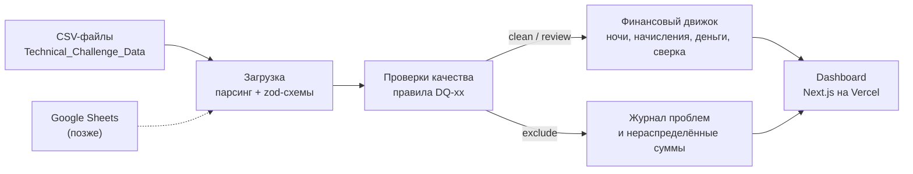
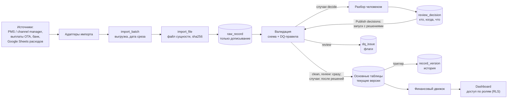

# План системы: финансовая аналитика портфеля вилл

Статус: черновик v1 от 2026-10-18. Документ описывает, что строим, как считаем и в каком порядке делаем. Главный документ сдачи — `README.md`: в него войдут формулы, допущения, журнал ошибок данных и схема архитектуры из этого плана.

**Порядок выполнения** — в [ROADMAP.md](ROADMAP.md): единый пофазный план по всем четырём документам; таблица этапов ниже сохранена как справка.

## 1. Цель

Прототип аналитической системы для портфеля из 20 вилл. Данные о бронированиях, комиссиях, расходах и платежах загружаются, проверяются на ошибки, сводятся в финансовые показатели и выводятся на дашборд.

Что оценивают проверяющие и чем мы на это отвечаем:

| Раздел задания | Чем закрываем |
|---|---|
| 1. Dashboard | Next.js-приложение на Vercel, фильтры по объекту и периоду, три блока: начисления, деньги, сверка |
| 2. Методология | Формулы и правила в разделе 7, затем в README |
| 3. Качество данных | Правила DQ-xx (раздел 6), журнал проблем, решение по каждой записи |
| 4. Архитектура | Схема в разделе 4. На уровне 2 — работающий импорт в Supabase без дублей и с аудитом |
| 5. Компромиссы | Разделы 3, 13, 15 и журнал решений |

Критерии из задания: обоснованность решений, корректность расчётов и прозрачность допущений важнее внешнего вида. Отсюда правило: сначала правильные цифры и объяснимость. Интерфейс собираем из готовых компонентов HeroUI и не тратим время на ручную полировку.

## 2. Объём работ

**Уровень 1 — ядро (обязательно).**
- Загрузка пяти CSV, проверка типов и форматов.
- Движок проверок качества с журналом проблем.
- Финансовый движок: разнесение по ночам, начисления, денежный поток, сверка, оценка owner balance.
- Дашборд с фильтрами и вкладкой качества данных.
- Тесты: эталонный пересчёт одной виллы и инварианты.
- README и деплой на Vercel.
- Работает без базы и без секретов: данные читаются из CSV в репозитории.

**Уровень 2 — система (после уровня 1, сверх рекомендованного времени).**
- Хранение в Supabase Postgres.
- Импорт пачками: повторная загрузка не создаёт дублей, у записей есть история версий.
- Разбор случаев: записи без сомнений публикуются сразу; пересечения, modified-брони и разные версии одной записи публикуются только после решений человека; решения сохраняются с автором, временем и комментарием.
- Политики RLS для разграничения доступа.

**Вне объёма (только описываем).** Интерфейс входа, живая синхронизация с Google Sheets, курсы валют, налоги, PDF-отчёты собственникам, расписание импорта.

## 3. Стек

| Слой | Выбор | Почему |
|---|---|---|
| Язык | TypeScript (Node 24) | Основной стек автора. Строгие типы для денежных расчётов |
| Приложение | Next.js (App Router) | Дашборд и серверные расчёты в одном проекте, деплой на Vercel в один шаг |
| UI-компоненты | HeroUI (работает поверх Tailwind CSS) | Готовые таблицы, карточки, выбор дат, списки выбора и переключатели: аккуратный интерфейс сразу, без ручной вёрстки. Версию фиксируем при установке и проверяем совместимость с Tailwind |
| Графики | Recharts (1–2 графика) | Достаточно для прототипа |
| Схемы данных | zod | Описание и проверка структуры каждой строки CSV |
| CSV | csv-parse | Корректно работает с BOM и кавычками |
| Тесты | vitest | Быстрый, работает с TS без настройки |
| БД (уровень 2) | Supabase Postgres 17 через Drizzle ORM и postgres-js | Проект уже создан; Drizzle даёт типизированную схему и миграции в репозитории |

Почему не Python: в задании стек свободный, а объём данных (около 360 строк) не даёт преимущества pandas. Код на своём стеке проще защищать на собеседовании.

Почему расчёты на TypeScript, а не в SQL: одна реализация, которую легко покрыть тестами. Тот же движок работает и с CSV, и с базой. При росте объёмов расчёты переезжают в SQL-витрины (dbt).

## 4. Архитектура

### 4.1 Прототип (уровень 1)



### 4.2 Целевая система (уровень 2 и дальше)



Слой данных спрятан за общим интерфейсом источника: `CsvSource` (по умолчанию) и `SupabaseSource` (если задан `DATABASE_URL`). Проверки и расчёты не знают, откуда пришли данные. Если база недоступна (например, бесплатный проект Supabase уснул), дашборд переключается на CSV и показывает об этом баннер.

## 5. Данные

### 5.1 Источники

Файлы в UTF-8 с BOM, разделитель — запятая. Исходные файлы не изменяем.

| Файл | Строк | Ключ | Ссылки |
|---|---|---|---|
| properties.csv | 20 | property_id | owner_id (1 собственник на 1 виллу) |
| commission_rules.csv | 20 | property_id + effective_from | property_id |
| reservations.csv | 151 | reservation_id | property_id |
| payments.csv | 76 | payment_id | reservation_id, property_id |
| expenses.csv | 90 | expense_id | property_id |

Что выяснили при первичном анализе:
- Все 68 ненулевых платежей ровно равны `gross_booking_value − ota_fee`. Значит, деньги приходят за вычетом комиссии OTA.
- Платежи есть только у бронирований с чётными ID (75 из 150). Похоже на неполную выгрузку или пакетные выплаты OTA.
- `updated_at` принимает два значения: 2026-09-15 и 2026-10-15. Это похоже на две выгрузки.
- Ни один платёж не датирован раньше заезда: 9 в день заезда, 60 позже, медиана — через день после выезда. При правиле «оплата 100% до заезда» это проблема данных (DQ-16, DQ-23).
- Период данных: проживания с 2026-09-01 по 2026-11-01, платежи с 2026-09-06 по 2026-11-05, расходы с 2026-09-01 по 2026-10-31.

### 5.2 Статус каждой записи после проверок

У каждой исходной строки ровно один итоговый статус:

| Статус | Что значит | Участвует в расчётах |
|---|---|---|
| `clean` | Проблем не найдено | Да |
| `review` | Есть сомнение, нужна проверка человеком | Да, с флагом; переключатель на дашборде может их убрать |
| `pending` | Система не может решить сама: пересечение, modified-бронь, разные версии одной записи; платёж по такой брони ждёт вместе с ней | Уровень 2: нет, пока человек не решит случай; остальная пачка публикуется сразу. Уровень 1 (без базы и решений): как `review` |
| `excluded` | Запись противоречива или не привязана к объекту | Нет; суммы показаны отдельно как «исключено / нераспределено» |
| `duplicate` | Точная копия другой строки (тот же ID и то же содержимое), удалена автоматически | Нет; учтена в журнале |

**Сначала система, потом человек.** `duplicate` и `excluded` система ставит сама и окончательно, человеку они не показываются и видны в отчёте «исключено автоматически». `clean` и `review` публикуются сразу: в них сомневаться не в чем. `pending` решает человек, и публикации ждут только эти записи. `review` — флаг: запись публикуется с пометкой (VALIDATION_PLAN.md, разделы 2 и 7.5).

**Источник правды — входящие данные.** Мы их не исправляем: решение выбирает, каким записям верить, но значений не меняет. Пришли новые данные по случаю — случай решается заново.

**Контрольные суммы.** По каждому файлу сумма по источнику = в расчётах + исключено + удалено как дубль. Это проверяется тестом и показывается на вкладке качества данных: ни одна рупия не теряется молча.

## 6. Качество данных: правила

Найденные проблемы — результат первичного анализа, при реализации пересчитаем. Подробный план модуля проверок (контракт функций, журнал, пересечения средствами базы) и актуальный каталог правил — в [VALIDATION_PLAN.md](VALIDATION_PLAN.md).

| ID | Проверка | Действие | Найдено |
|---|---|---|---|
| DQ-01 | Полный дубль строки | duplicate: копия удаляется | R0015, P0075 |
| DQ-02 | Повтор ID с разным содержимым | decide: какая версия верна, решает человек | 0 |
| DQ-03 | Формат ID (`R####`, `V###`, `P####`, `E####`) и дат | excluded | 0 |
| DQ-04 | Ссылка на несуществующий объект | excluded → «нераспределено» | R0034 (V999), E0017 (V777) |
| DQ-05 | Платёж по несуществующей или исключённой брони | excluded → «нераспределено» | P0017 (R0034), P0036 (R0072) |
| DQ-06 | Валюта не совпадает с базовой валютой объекта | excluded | R0061: USD 4 280 874 за 4 ночи, по величине это сумма в IDR |
| DQ-07 | Сумма брони ≤ 0 или ночей ≤ 0 | excluded | 0 |
| DQ-08 | Комиссия OTA < 0 или больше суммы брони | review | R0102: −100 000 |
| DQ-09 | Возврат больше суммы брони или возврат у неотменённой брони | excluded | R0072: confirmed, возврат 7 970 068 > суммы 7 070 068, платёж 0 |
| DQ-10 | Ставка OTA вне диапазона 0–25% | review | 0 (R0102 пропускается: уже DQ-08) |
| DQ-11 | «OTA fee» у прямой брони (Direct): отчисление в рекламный бюджет | info | 31 бронь |
| DQ-12 | Пересечение периодов проживания на одном объекте | decide: случай — группа конфликта | 68 пар, 86 броней, 32 группы, 17 вилл |
| DQ-13 | Статус modified без ссылки на исходную бронь | decide: человек принимает и вручную связывает с исходной | 8 броней (5 в группах конфликта, 3 отдельно) |
| DQ-14 | Платёж не равен ожидаемому (`gross − ota_fee − refund`) | review в сверке | P0051: 3 998 667 > суммы брони 3 898 667 (из-за R0102) |
| DQ-15 | Нулевой платёж со статусом received | info | 7 (6 отмен + R0072) |
| DQ-16 | Не оплачено к дню заезда: платежи с датой ≤ заезда меньше `gross − ota_fee − refund` | review: долг на дату заезда | 109 броней при срезе 15.10, из них 58 без единого платежа |
| DQ-17 | Нет правила комиссии на дату заезда или ставка меняется внутри проживания | review | 0 |
| DQ-18 | Отмена с частичным возвратом | review: политика удержания | 0 |
| DQ-19 | Объект в платеже не совпадает с объектом брони | review | 0 |
| DQ-22 | Периоды правил комиссии одной виллы пересекаются | review: на спорных датах действует правило с более поздней датой начала | 0 |
| DQ-23 | Платёж датирован позже дня заезда | review | 60 платежей из 69 |

**Пересечения (DQ-12) делим на подтипы**, чтобы разбор шёл по приоритету:
- одинаковые даты на одном объекте: R0033 и R0056 (V008). Это не дубль: разные ID, GBV 14,6 и 5,6 млн IDR, платёж только у R0056;
- одна из броней modified — вероятно, старая и новая версия одной брони: 6 пар (R0027/R0146, R0112/R0146, R0149/R0150, R0126/R0145, R0038/R0148, R0045/R0148);
- остальные частичные пересечения — двойное бронирование или ошибка дат: 61 пара. Пять из них дала R0102: она больше не исключается (DQ-08 — review) и пересекается с R0017, R0096, R0101, R0103, R0128.

Почему пересечения не исключаем: без пересечений только 49 активных броней из 135. Исключение уничтожило бы данные. Массовость говорит о системной проблеме источника, а не о случайных опечатках. На дашборде переключатель «включать записи под вопросом» показывает, насколько от них зависят цифры.

Пересечения и modified-брони разбирает человек по случаям: 32 группы конфликта на 17 виллах и 3 modified-брони вне групп, всего 35 случаев. В группе он выбирает набор броней для календаря, по остальным решает — оставить только в финансах или исключить; modified связывает с исходной и при необходимости сливает платежи вручную. Пока случай не решён, его брони и платежи по ним не публикуются; остальная пачка публикуется сразу. Автоматического выбора нет: он зависит от фактов вне данных (VALIDATION_PLAN.md, 7.5).

## 7. Финансовая методология

### 7.1 Даты и период

- Даты — календарные, без времени и часовых поясов. Сравниваются как ISO-строки, арифметика в UTC (иначе на Vercel возможен сдвиг на сутки).
- Ночь с датой `d` — это ночь с `d` на `d+1`. Дата заезда входит, дата выезда — нет.
- **Начисления** относятся к периоду по ночам проживания. Бронь 28.09–04.10 даёт 3 ночи в сентябре и 3 в октябре; выезд 01.11 — последняя ночь 31.10, то есть октябрь.
- **Деньги** относятся к периоду по `payment_date`, расходы — по `expense_date`.
- **Сверка** считается по броням с датой выезда в периоде, чтобы каждая бронь попадала ровно в один период.
- Дата среза по умолчанию — 2026-10-15, последний `updated_at` в данных (похоже на дату выгрузки). Вариант 2026-11-05 (последнее событие) скрыл бы платежи и расходы, датированные позже выгрузки (DQ-20). Задаётся в политиках, вопрос к финдиректору (VALIDATION_PLAN.md, 12.2).

### 7.2 Обозначения для одной брони r

- `n_r = check_out − check_in` — число ночей.
- Бронь активна, если статус `confirmed` или `modified` и она не исключена проверками.
- `GBV_r`, `OTA_r`, `REF_r` — `gross_booking_value`, `ota_fee`, `refund_amount` из файла.
- `rate_r` — ставка из `commission_rules` для объекта, действующая на дату заезда.
- `MF_r = round(rate_r × GBV_r)` — комиссия УК. База — `gross_booking_value`, как указано в `fee_basis`.

### 7.3 Распределение по ночам и округление

Суммы хранятся в целых IDR. Сумма `A` брони из `n` ночей делится так: каждая ночь получает `floor(A / n)`, остаток `A mod n` раздаётся по 1 IDR первым ночам. Сумма по ночам всегда равна исходной до рупии. Комиссия УК округляется один раз на уровне брони (half-up), затем делится так же.

### 7.4 Показатели (период P, набор объектов S)

**Начисления** (по ночам в P, только активные брони):

```
Gross bookings        = Σ GBV по ночам
Возвраты              = Σ REF по ночам
OTA fees              = Σ OTA по ночам
Чистая выручка аренды = Gross bookings − Возвраты − OTA fees
Management fees       = Σ MF по ночам
Опер. расходы         = Σ expenses.amount, expense_date в P (paid + pending)
Owner balance (оценка)= Чистая выручка аренды − Management fees − Опер. расходы
```

У прямой брони (Direct) `OTA` — отчисление в рекламный бюджет своей сети продаж. Оно входит в OTA fees и вычитается из owner balance так же, как комиссия OTA (решение 2026-10-19, раздел 15).

**Деньги** (по датам в P):

```
Поступления           = Σ payments.amount, payment_date в P, без дублей и нераспределённых
Оплаченные расходы    = Σ expenses.amount, expense_date в P, payment_status = paid
Чистый денежный поток = Поступления − Оплаченные расходы
```

**Сверка** (брони с выездом в P):

```
Ожидалось_r  = GBV_r − OTA_r − REF_r    (OTA удерживает комиссию, это подтверждено данными)
Получено_r   = Σ платежей по брони r (любой датой)
Разница_r    = Получено_r − Ожидалось_r
Статус       = сошлось | недоплата | переплата | не получено | срок не наступил
```

Срок оплаты — день заезда: вилла оплачивается полностью до заезда. «Срок не наступил» — только у броней с заездом после даты среза; всё остальное без полной оплаты — долг.

Ожидаемое поступление по брони совпадает с чистой выручкой аренды. Разница между начислениями и деньгами — это дебиторка (не получено) и разница во времени (получено в другом периоде). На дашборде три блока подписаны своей базой, чтобы выручку и денежный поток не смешивать.

### 7.5 Отмены, возвраты, modified

- **Отмена:** выручка, комиссия OTA и комиссия УК равны 0. Допущение: комиссия OTA при отмене возвращается. Отменённые брони показываются справочно (количество и сумма). Во всех 12 отменах возврат равен полной сумме брони.
- **Частичный возврат при отмене:** удержанная часть (`GBV − REF`) была бы выручкой. В данных таких нет, правило DQ-18 их ловит. Политика — вопрос финдиректору.
- **Возврат у активной брони:** уменьшает выручку. В данных единственный случай (R0072) противоречив и исключён.
- **modified:** ссылки на исходную бронь в данных нет, поэтому каждую modified-бронь принимает человек и сам связывает с исходной (DQ-13, VALIDATION_PLAN.md, 7.5). Связанная исходная бронь исключается как заменённая, её платежи переходят к новой версии только по отдельному решению (слияние). На уровне 1 решений нет: modified считается актуальной версией с флагом.

### 7.6 Почему owner balance — оценка

В данных нет:
- выплат собственникам и начального сальдо;
- налогов: PB1 на проживание, PPN (НДС) на комиссию УК;
- правила, кто несёт комиссию OTA (допущение: собственник);
- базы комиссии УК при возвратах (до или после);
- курсов валют;
- даты создания брони (поэтому «бронирования за период» по дате продажи посчитать нельзя).

### 7.7 Политики в одном месте

Методологические решения собраны в `lib/calc/policies.ts` (CALCULATION_MODULE.md, 7): признание выручки (`nights` или `checkout`), база комиссии, учёт записей под вопросом, дата среза. Если финдиректор ответит иначе, меняется одна настройка, а не код расчётов.

## 8. Dashboard

Фильтры передаются в URL (ссылкой можно поделиться):
- объект или несколько объектов — `Select` с множественным выбором;
- кластер — `Select`;
- период — `DateRangePicker` и быстрые варианты «Сентябрь», «Октябрь», «Весь период»;
- переключатель «включать записи под вопросом» — `Switch`, по умолчанию включён.

Компоненты HeroUI: `Card` для показателей, `Table` для списков, `Chip` для статусов (clean / review / excluded, статусы сверки), `Tabs` или навигация между страницами. Расчёты выполняются на сервере, клиентские компоненты HeroUI получают готовые данные.

Страницы:
1. **Обзор (`/`).**
   - Три блока показателей: начисления, деньги, сверка.
   - Метка «оценка» у owner balance со ссылкой на список недостающих условий.
   - Таблица по объектам: ночи, GBV, OTA, комиссия УК, расходы, owner balance, поступления, разница, число флагов качества.
   - Графика GBV и карточки качества данных на обзоре нет: обзор — для показателей, разбор ошибок — на странице качества данных (решение 2026-10-19).
2. **Сверка (`/reconciliation`).** Брони периода: ожидалось, получено, разница, статус. Отдельно — нераспределённые платежи.
3. **Качество данных (`/data-quality`).** Сводка по правилам (сколько записей, действие, сумма), контрольные суммы, график GBV по объектам (чистые записи и под вопросом), отчёт «исключено автоматически», список проблем с фильтром, группы пересечений.
4. **Импорт (`/imports`, уровень 2).** История пачек, результат повторного импорта, шаги пачки.
5. **Разбор (`/review`, уровень 2).** Открытые случаи из всех пачек: таймлайн броней по ночам, решение по каждой брони, связь modified, итог и кнопка Publish decisions (VALIDATION_PLAN.md, 7.5). Пока случаи ждут, на дашборде баннер: сколько броней и денег не в расчётах, со ссылкой сюда.

## 9. Уровень 2: Supabase

- **Подключение.** Строка Transaction pooler (`DATABASE_URL`, IPv4, порт 6543). Прямой хост проекта доступен только по IPv6 и с Vercel не работает. Для postgres-js через этот pooler нужен `prepare: false`.
- **Схема `app`.** Не публикуется через Data API Supabase. RLS включён на всех таблицах, по умолчанию доступ запрещён. Сервер ходит в базу напрямую, publishable key в браузере доступа к данным не даёт.

**Таблицы:**

| Таблица | Назначение |
|---|---|
| `import_batch` | одна загрузка, от одного до пяти файлов: тип источника (CSV, Google Sheets), откуда, дата среза, статус (`uploading` / `queued` / `processing` / `needs_review` / `loaded` / `skipped` / `failed`), ссылка на пачку-близнеца для `skipped`, кто и когда запустил |
| `import_file` | файл пачки, по одному на сущность, не обязательно все пять: имя, sha256, размер, заголовок, число строк; `skipped` для файла, загруженного раньше |
| `raw_record` | сырые строки как JSON, файл, номер строки, ключ записи, хэш строки; только дописывание |
| `stg_*` | типизированные строки пачки без бизнес-ограничений; вход для проверок — действующий набор `eff_*`: строки пачки, `pending` прежних пачек, опубликованные (VALIDATION_PLAN.md, 2) |
| `reservation`, `payment`, `expense`, `property`, `commission_rule` | текущие версии записей `clean` и `review` по естественному ключу; `raw_record_id` и `row_hash` текущей версии |
| `record_version` | история всех основных таблиц в одной таблице: сущность, ключ, номер версии, операция, данные целиком, строка источника, запуск, автор, время; пишет триггер, только дописывание |
| `occupancy` | календарь занятости: допущенные активные брони, `EXCLUDE` запрещает пересечения; кто допустил — `admitted_run_id` и `decision_id` |
| `dq_run`, `dq_check_result`, `dq_record_verdict` | запуск проверок и публикации, вердикты правил, итоговый статус строки (VALIDATION_PLAN.md, раздел 4) |
| `dq_issue` | проблема между запусками: правило, запись, действие (`decide` или `review`), ключ случая, детали, `open` / `resolved` / `closed` |
| `review_decision` | решение по брони в случае: `accept`, `finance_only`, `exclude`, `keep_published`; связь modified и слияние в `payload`; ключ случая, хэш строки, комментарий, автор, время; только дописывание |
| `user_property_access` | какие объекты видит пользователь (для RLS) |

**Повторный импорт без дублей:**
1. Файл совпадает по sha256 с уже загруженным файлом той же сущности → файл `skipped`, его строки не читаются. Пропущены все файлы пачки → пачка `skipped` со ссылкой на пачку-близнеца, данные не меняются. Остальные файлы загружаются, а неизменные строки в них отсеет шаг 4.
2. Строка с новым ключом → вставка в основную таблицу, триггер пишет версию 1 в `record_version`.
3. Ключ есть, хэш строки другой → строка обновляется, триггер пишет версию `n + 1`. Предыдущая версия остаётся в `record_version` и действовала до `recorded_at` новой.
4. Ключ есть, хэш тот же → строка не трогается, новой версии нет.
5. Точные дубли внутри файла схлопываются, проблема DQ-01 пишется в журнал.
6. Записи, которой нет в новом файле, ничего не делается: файл — не полный снимок, файлы одной выгрузки приходят в разное время (решено 2026-10-18). Отмена брони приходит статусом `cancelled`, удалений из выгрузки не выводим.

**Аудит:** сырые данные неизменны, история версий, журнал пачек, решения по проверке с автором и временем. Таблицы «только дописывание» (`raw_record`, `record_version`, `dq_check_result`, `dq_record_verdict`, `review_decision`) защищены триггером `forbid_change`. Для любой версии записи видно, из какой строки какого файла она пришла, каким запуском опубликована и кто её изменил; правка руками в обход импорта попадает в историю с `run_id = null`.

**Доступ:**
- роли: finance (всё), ops (все объекты без owner balance), owner (только свои объекты);
- RLS-политики по `property_id` через `user_property_access`;
- в прототипе — миграция с политиками и SQL-тест, что собственник видит только свои строки; интерфейс входа — вне объёма.

**Импорт запускается:**
- командой `pnpm import` из CLI;
- кнопкой на странице `/imports`, которая заново импортирует CSV из репозитория (демонстрация идемпотентности);
- адаптер Google Sheets через публичный CSV-экспорт — по желанию.

## 10. Структура репозитория

Приложение живёт в корне, без `src/`. Тесты лежат рядом с кодом (`*.test.ts`).

```
.
├─ Technical_Challenge_Data/   исходные CSV, не изменяются
├─ docs/                       PLAN.md, VALIDATION_PLAN.md, CALCULATION_MODULE.md, IMPORT_PLAN.md
├─ app/                        страницы Next.js: /, /raw-data, /data-quality, /imports
├─ components/                 UI-компоненты (HeroUI)
├─ lib/
│  ├─ ingest/                  парсинг CSV (csv-parse, BOM), zod-схема на файл; строка хранит файл и номер строки
│  ├─ dq/                      контракт, раннер, правила DQ-xx, журнал в памяти / Postgres (VALIDATION_PLAN.md, 8)
│  ├─ calc/                    финансовый движок: ночи, начисления, деньги, сверка, политики (готово)
│  ├─ data/                    сборка входа расчётов из строк и вердиктов; источник CSV или Supabase
│  ├─ import/                  импорт в базу (уровень 2, IMPORT_PLAN.md)
│  └─ mock/                    данные каркаса интерфейса; удаляются по мере подключения реальных
├─ supabase/schemas/app/       декларативная SQL-схема: таблицы, функции, триггеры (по файлу на объект)
├─ supabase/migrations/        миграции, сгенерированные из схемы
├─ scripts/                    CLI: проверки по CSV, импорт (уровень 2)
├─ .env.example                только имена переменных
└─ README.md
```

## 11. Как проверяем корректность

1. **Модульные тесты** на каждое правило DQ, распределение по ночам, границы периода, комиссию, статусы сверки.
2. **Эталонная вилла.** V011 за сентябрь: 4 брони без пересечений и аномалий, 2 расхода (paid и pending). Ожидаемые значения посчитаны вручную и записаны в тест числами.
3. **Инварианты:**
   - сумма по объектам = итог портфеля;
   - сумма по ночам = сумма брони;
   - у каждой исходной строки ровно один статус;
   - контрольные суммы источника сходятся.
4. **Независимый пересчёт итогов** SQL-запросом по сырым данным (в Supabase или psql). Результат фиксируем в README.
5. **Использование AI.** Код и документы писались с Claude Code. В README указываем инструмент и способ проверки: пункты 1–4 и ручная сверка ключевых цифр.

## 12. Этапы

**Порядок (решено 2026-10-18): сначала данные, не интерфейс и не импорт.** Интерфейс уже свёрстан на моках и ждёт данные, расчётный модуль готов и ждёт DQ-статусы. Без загрузчика и проверок ни одна реальная цифра не появляется. Поэтому первым делом тонкий сквозной путь CSV → проверки → расчёт → реальная цифра на дашборде (этапы 1, 2, 3, 5), затем страница качества данных, README и деплой. Импорт в базу (IMPORT_PLAN.md) — после сдачи уровня 1 и в урезанном объёме. Уровень 1 — законченный результат сам по себе.

Оценка — план, факт заполняем по ходу работы для честного отчёта о времени (ориентир — время коммитов).

| # | Этап | Оценка | Факт |
|---|---|---|---|
| 0 | Каркас: Next.js, TS, HeroUI + Tailwind, vitest; страницы на моках | 20 мин | сделано |
| 1 | Загрузчик `lib/ingest`: csv-parse с BOM, zod-схема на файл, строка хранит файл и номер строки | 30 мин | |
| 2 | Ядро `lib/dq`: контракт, раннер (порядок по `dependsOn`, проверка покрытия), итоговый статус, журнал в памяти, контрактный тест | 40 мин | |
| 3 | Правила на TS: DQ-01…20, DQ-23; DQ-12 через TS-двойник; DQ-90 как инвариант; эталонный тест по колонке «Ожидаем» | 75 мин | |
| 4 | Финансовый движок `lib/calc` и тесты (эталон V011, инварианты) | 60 мин | сделано |
| 5 | Адаптер `lib/data`: строки + вердикты → `OverviewInput`; главная страница на реальных цифрах; фильтры в URL (период, объекты, «включать review»); политика `paymentDue` в `lib/calc` | 60 мин | |
| 6 | Страница `/data-quality`: сводка по правилам, «исключено автоматически», список проблем, контрольные суммы | 40 мин | |
| 7 | README: формулы, допущения, найденные ошибки, архитектура, компромиссы, вопросы, фактическое время | 40 мин | |
| 8 | Деплой на Vercel | 15 мин | |
| | **Итого уровень 1, осталось** | **≈ 5 ч** | |
| 9 | Supabase: схема `app`, миграции (без RLS-политик) | 30 мин | сделано |
| 10 | Импорт в урезанном объёме (IMPORT_PLAN.md, раздел 0): синхронный `npm run import` и кнопка Load sample data, sha256 пачки, raw → stg → раннер с журналом в Postgres → публикация с `record_version` | 90 мин | |
| 11 | RLS-политики и SQL-тест доступа | 30 мин | |
| 12 | Экран разбора `/review` (идёт сразу за этапом 10: без него пачка со случаями не опубликуется): список случаев, таймлайн, решение по брони, связь и слияние modified, итог и Publish decisions, выгрузка CSV. Логика — VALIDATION_PLAN.md, этап 8 | 90 мин | |
| 13 | Адаптер Google Sheets (по желанию) | 30 мин | |

## 13. Риски

| Риск | Мера |
|---|---|
| Работа выходит за рекомендованные 2–3 часа | Уровень 1 — законченный результат сам по себе; время отчитываем честно, уровень 2 — отдельной строкой |
| Бесплатный проект Supabase засыпает после недели без активности | Автоматический переход на CSV и баннер; разбудить проект перед отправкой |
| Утечка секретов | `.env` в `.gitignore`, в репозитории только `.env.example`; переменные — в настройках Vercel; ничего секретного с префиксом `NEXT_PUBLIC_` |
| Publishable key открывает таблицы через Data API | Таблицы в схеме `app`, RLS на всех таблицах |
| Цифры сильно зависят от пересечений | Переключатель «под вопросом», показ суммы под вопросом рядом с итогами |
| Допущения разойдутся с реальной политикой компании | Политики в одном файле (7.7), список вопросов финдиректору |
| CSV не попадут в серверный бандл Vercel | Явно включить файлы через `outputFileTracingIncludes` и проверить на деплое |
| Сдвиг дат из-за часового пояса | Календарные даты как строки, арифметика в UTC, тест на границу месяца. `DateRangePicker` HeroUI работает с календарными датами без времени (`@internationalized/date`), это совпадает с нашим подходом |
| Компоненты HeroUI клиентские, логика может «утечь» в браузер | Граница `"use client"` только у компонентов отображения; фильтрация и расчёты — на сервере по параметрам URL |

## 14. Вопросы финансовому директору

1. Как признаётся выручка: по ночам проживания, по дате выезда или по дате бронирования?
2. Включает ли `gross_booking_value` налоги (PB1) и сервисные сборы?
3. База комиссии УК — сумма до или после комиссии OTA и возвратов? Берётся ли комиссия при отмене с удержанием?
4. Кто несёт комиссию OTA: собственник или управляющая компания?
5. Подтвердите: «OTA fee» у прямых броней — отчисление в рекламный бюджет своей сети продаж, и собственник несёт его так же, как комиссию OTA?
6. Как связать бронь со статусом modified с исходной? Какая версия актуальна? Платежи исходной брони переходят к новой версии? До ответа связывает и сливает человек вручную в каждом случае.
7. Относятся ли неоплаченные (pending) расходы на собственника в периоде начисления?
8. Есть ли выплаты собственникам, начальное сальдо, депозиты, резервы?
9. Бывают ли брони в другой валюте? По какому курсу и на какую дату пересчитывать?
10. На какую дату сделана выгрузка? Почему платежи есть только по части броней (пакетные выплаты OTA?)
11. Какие налоги удерживаются с комиссии УК (PPN)?
12. Что означают нулевые платежи по отменам со статусом received?
13. Правило оплаты — 100% до заезда? Почему в payments.csv нет ни одного платежа до заезда: это даты выплат OTA, а не оплаты гостя, или ошибка выгрузки?

## 15. Журнал решений

| Дата | Решение | Почему |
|---|---|---|
| 2026-10-18 | Node/TypeScript + Next.js вместо Python | Стек автора; объём данных маленький, преимущества pandas нет |
| 2026-10-18 | Деплой на Vercel, дашборд по ссылке | Проверяющий видит результат без установки |
| 2026-10-18 | HeroUI для интерфейса (поверх Tailwind) | Аккуратный интерфейс из готовых компонентов без лишнего времени на вёрстку |
| 2026-10-18 | Supabase Postgres через Transaction pooler | Проект уже есть; прямой хост работает только по IPv6 |
| 2026-10-18 | Расчёты на TS, база — для импорта, истории и аудита | Одна тестируемая реализация, работает и без базы |
| 2026-10-18 | Режим без базы на CSV | Проверяющий запускает `npm i && npm run dev` без секретов |
| 2026-10-18 | Выручка по ночам проживания (принято по умолчанию) | Корректно для любого периода и броней на стыке месяцев |
| 2026-10-18 | Пересечения — флаг, а не исключение (принято по умолчанию) | Без пересечений только 49 из 135 активных броней |
| 2026-10-18 | Ставка комиссии по дате заезда | Просто и прозрачно; смена ставки внутри проживания ловится DQ-17 |
| 2026-10-18 | README на русском (принято по умолчанию) | Задание на русском |
| 2026-10-18 | Каждое правило выносит вердикт по каждой строке источника, журнал `dq_check_result` | По любой записи видно, какие проверки она прошла, а какие нет; раннер не пропустит строку без вердикта |
| 2026-10-18 | Пересечения меряет база (`daterange '[)'`, GiST), календарь `occupancy` с `EXCLUDE` не принимает пересечения | Выезд и заезд в один день не считается пересечением; финансовые факты сохраняются в `reservation` с флагом |
| 2026-10-18 | Одна таблица истории `record_version` на все сущности, пишет триггер | Одна схема и один триггер вместо пяти таблиц `*_version`; в историю попадают и правки в обход импорта |
| 2026-10-18 | Пачка — набор файлов: `import_batch` + `import_file` | Выгрузка источника — это пять файлов на одну дату среза; проверки между сущностями (платёж ↔ бронь) идут в одной пачке |
| 2026-10-18 | В `occupancy` вместо `admitted_by` — `admitted_run_id` и `decision_id` | Внешние ключи вместо текстового поля «'auto' или id»: ссылку на решение проверяет база |
| 2026-10-18 | Сначала система, потом человек: `duplicate` и `excluded` — окончательные решения системы, в очередь идёт только `review` | Человек не тратит время на то, что система решает однозначно |
| 2026-10-18 | Дубль — только тот же ID и то же содержимое; одинаковые даты под разными ID — конфликт, а не дубль | R0033 и R0056 различаются суммой, платёж только у одной: автоматическое удаление выбросило бы оплаченную бронь |
| 2026-10-18 | Пересечения разбирает человек по группам конфликта, выбирая набор броней для календаря | Выбор зависит от фактов вне данных; в группе бывает несколько верных броней (V003: из 8 броней 3 не пересекаются) |
| 2026-10-18 | При повторном импорте допущенная бронь остаётся в календаре, новая пересекающаяся ждёт решения | Новые данные не вытесняют принятые молча |
| 2026-10-18 | Порядок реализации: загрузчик и проверки, затем подключение расчётов к дашборду; импорт в базу после сдачи уровня 1 | Интерфейс уже есть на моках, расчёты готовы; без загрузчика и DQ-статусов ни одна реальная цифра не появляется |
| 2026-10-18 | Дата среза по умолчанию 2026-10-15 | Последний `updated_at`, похоже на дату выгрузки; при 2026-11-05 DQ-20 не нашёл бы события позже выгрузки |
| 2026-10-18 | Импорт для сдачи — синхронный и урезанный; очередь, Storage, pg_net, DeepSeek — после | Задание просит объяснить импорт без дублей и аудит; простой вариант это показывает, а конвейер стоит больше 5 часов |
| 2026-10-18 | Раннер DQ получает источник строк и журнал через интерфейсы | Уровень 2 меняет два адаптера (источник из `stg_*`, журнал в Postgres), правила и тесты остаются |
| 2026-10-18 | Оплата виллы — 100% до заезда; всё, что не внесено к дню заезда, — долг. DQ-16 считается по заезду, а не по выезду; платежи позже заезда помечает DQ-23 | Правило бизнеса. В данных ни одного платежа до заезда: это ошибка данных или даты выплат OTA, помечаем и спрашиваем, а не принимаем молча |
| 2026-10-18 | Публикация пачки ждёт разбора целиком: пока не решён каждый случай `decide` (DQ-02, 12, 13), из пачки не публикуется ничего. **Отменено в тот же день, см. последнюю строку** | Решение меняет и деньги: исключённая бронь уходит из GBV, её платёж становится нераспределённым, слияние переносит платёж. Каждая публикация целиком решена, смешанного состояния нет |
| 2026-10-18 | Входящие данные не исправляем, решения `correct` нет; при новых данных по случаю он решается заново, прежнее решение не подставляется; можно оставить опубликованную версию (`keep_published`) | Источник правды — входящие данные, но они путаные: прав может быть и новый источник, и уже принятый. Исправление у нас скрыло бы, что источник прислал обновление. Уточняет решение о повторном импорте выше |
| 2026-10-18 | Каждую modified-бронь принимает человек; связь с исходной и слияние платежей — только вручную | modified может оказаться изменением брони, которую уже отклонили; кандидаты DQ-21 — подсказка, а не решение |
| 2026-10-18 | Остальные `review` (DQ-08, 11, 14, 16, 20, 23 …) публикацию не держат | Это флаги: DQ-16 даёт 109 броней, держать ими публикацию значило бы не публиковать никогда |
| 2026-10-18 | Экран разбора — HeroUI и свой таймлайн на CSS grid, без AG Grid | Группировка строк и пивот в AG Grid только в платной Enterprise; данных мало — 35 случаев, до 8 броней на 17 ночей |
| 2026-10-18 | Записи без сомнений (`clean`, `review`) публикуются первым же запуском; разбора ждут только брони случаев `decide` (DQ-02, 12, 13) и платежи по ним (`hold`). Отменяет решение о публикации целиком | В проверенной записи сомневаться не в чем, держать её из-за чужого пересечения незачем. Иначе первая пачка не дала бы ни одной цифры до разбора 35 случаев. Дашборд показывает, сколько броней и денег ждёт решения; принятые брони добавятся после разбора |
| 2026-10-18 | Пачка — любой набор файлов, от одного до пяти; проверки идут по действующему набору данных (пачка → `pending` прежних пачек → опубликованное), а не по пачке; случай разбора не принадлежит пачке; **Publish decisions** публикует решённые случаи, не дожидаясь остальных. Уточняет решение «Пачка — набор файлов» | Файлы одной выгрузки приходят в разное время: брони сегодня, платежи через неделю, расходы позже, и это обычный случай. Платёж должен находить бронь в опубликованном, новая бронь — пересекаться с принятой, долг по DQ-16 — закрываться, когда пришли платежи |
| 2026-10-18 | Пересечение периодов правил комиссии — флаг (DQ-22 `review`), на спорных датах действует правило с более поздней датой начала; запрет пересечений в базе снят | Правила меняются постоянно и приходят отдельными файлами: новое правило обычно приходит без укороченного старого, исключать его значило бы считать по устаревшей ставке. Данные не правим, выбор делает правило расчёта, пересечение видно в списке проблем |
| 2026-10-19 | «OTA fee» у прямой брони — отчисление в рекламный бюджет своей сети продаж: вычитается из owner balance как комиссия OTA; DQ-11 из `review` стал `info`, условие `direct_ota_fee_meaning` снято | Если бы отчисления не было, в поле стоял бы 0. Данные это поддерживают: у всех 30 прямых броней ставки те же, что у OTA (12, 15, 17 %), и платежи приходят за вычетом отчисления. Эквайринг (2–3 %) не подходит. Флаг `review` выкидывал бы такие брони целиком при выключенном переключателе |
