# План внедрения по фазам

Статус: v1 от 2026-10-18. Единственный документ о **порядке** работ. Четыре плана (`PLAN.md`, `VALIDATION_PLAN.md`, `IMPORT_PLAN.md`, `CALCULATION_MODULE.md`) остаются спецификациями: что строим и почему. Их собственные таблицы этапов (PLAN.md 12, VALIDATION_PLAN.md 10, IMPORT_PLAN.md 14, CALCULATION_MODULE.md 12) пересекаются и ссылаются друг на друга; здесь они сведены в одну последовательность. Если здесь и в спецификации разный порядок, действует этот документ; если разное содержание — спецификация.

## 1. Принципы

1. **Сначала данные.** Интерфейс свёрстан на моках, расчётный модуль готов и протестирован. Ни одной реальной цифры нет, пока нет загрузчика и проверок. Поэтому первые фазы — тонкий сквозной путь CSV → проверки → расчёт → дашборд.
2. **Уровень 1 — законченная сдача.** Фазы 1–6 работают без базы и секретов (`npm i && npm run dev`). После фазы 6 работу можно отправить. Уровень 2 (фазы 7–9) делается сверх рекомендованного времени и отчитывается отдельной строкой.
3. **Фаза закрыта, когда выполнены критерии готовности** из её раздела, тесты зелёные, фактическое время записано в таблицу раздела 5, сделан коммит. Начало следующей фазы — после согласования с автором (так принято 2026-10-18).
4. **Согласованные решения не пересматриваем.** Журнал решений — PLAN.md 15. Ключевые: записи без сомнений публикуются первым запуском, разбора ждут только случаи; пачка — любой набор файлов, проверки по действующему набору; входящие данные не правим; оплата 100% до заезда.

## 2. Что уже сделано

| Что | Где | Спецификация |
|---|---|---|
| Каркас: Next.js 16, TypeScript, HeroUI 3 + Tailwind 4, vitest; страницы `/`, `/raw-data`, `/imports` на моках `lib/mock/*` | `app/`, `components/`, `lib/mock/` | PLAN.md 12, этап 0 |
| Расчётный модуль: деньги в `bigint`, примитивы, комиссия, бронь, начисления, деньги, сверка, owner balance, сводка, `toView`; эталон V011; 235 тестов, 100 % покрытия, прогоны в разных часовых поясах | `lib/calc/` | CALCULATION_MODULE.md, этапы 0–4; PLAN.md 12, этап 4 |
| Схема базы `app`: `import_batch`, `import_file`, `raw_record`, `stg_*`, основные таблицы, `occupancy` с `EXCLUDE`, `record_version` с триггером, `dq_*`, `review_decision`, представление `review_case`, функции `eff_*`; миграция `20261018195205_data_model` | `supabase/schemas/app/`, `supabase/migrations/` | PLAN.md 12, этап 9; VALIDATION_PLAN.md 10, этап 3 и 7.5 «Изменения схемы» |
| Скрипт анализа пересечений | `scripts/reservation-conflicts.mjs` | — |

Не сделано из уже «готовых» модулей и переносится в фазы ниже: SQL-пересчёт и Stryker (фаза 10). Политика `paymentDue` сделана в фазе 3, подключение дашборда к расчётам и эталон по всему набору — в фазе 4.

## 3. Фазы

Зависимости между фазами:

```mermaid
flowchart LR
  P1["1 Загрузчик"] --> P2["2 Ядро DQ"] --> P3["3 Правила DQ"] --> P4["4 Дашборд на данных"] --> P5["5 Качество данных"] --> P6["6 README, деплой"]
  P6 --> P7a["7a Импорт до staging"] --> P7b["7b DQ в Postgres"] --> P7c["7c Публикация и шлюз"] --> P8["8 Разбор случаев"] --> P9["9 RLS"]
  P9 -.-> P10["10 По желанию"]
```

### Уровень 1: CSV, без базы

#### Фаза 1. Загрузчик `lib/ingest`

Спецификация: PLAN.md 10 и 12 (этап 1); схемы файлов — PLAN.md 5.1; типы входа — CALCULATION_MODULE.md 4.6.

Делаем:
- `csv-parse` с `bom: true`, разделитель запятая; исходные файлы не меняются;
- zod-схема на каждый из пяти файлов; значения, которые не разобрались, остаются `null` с ошибкой разбора у строки (её поднимет DQ-03), а не падают при загрузке;
- каждая строка хранит файл, номер строки, сырые значения и `rowHash` по полям нашего формата (тот же алгоритм, что потом в `raw_record`: IMPORT_PLAN.md 6);
- `loadDataset(dir)` возвращает пять наборов строк; путь по умолчанию — `Technical_Challenge_Data/`.

Готово, когда:
- все 357 строк пяти файлов загружены, число строк по файлу равно числу строк в CSV;
- тест на BOM, кавычки, пустые значения, дату в неверном формате;
- `rowHash` одинаков для строки с другим порядком колонок и лишней колонкой.

Оценка: 30 мин.

**Сделано 2026-10-19** (≈ 15 мин). `lib/ingest/`: `entities.ts` (zod-схемы пяти файлов — единый источник порядка полей, ключей и кодеков), `csv.ts` (`parseCsv`), `hash.ts` (`rowHash`, `sha256`), `load.ts` (`loadFile`, `loadDataset`), `errors.ts`; 38 тестов, покрытие 100 %, прогоны в двух часовых поясах. Решения по ходу:
- `values` строки — под исходными именами колонок (`check_in`, не `checkIn`), 1:1 со `stg_*`; перевод в camelCase `lib/calc` делает адаптер `lib/data` (фаза 4);
- суммы — `bigint` целых единиц, как в `lib/calc`; дробная часть допустима только нулевая (`10011978.00`), иначе ошибка формата; ставка — `parseRate`, даты — `parseDate` из `lib/calc`;
- обязательные поля: идентификаторы, даты, суммы, перечисления (`status`, `channel`, `payment_status`, `fee_basis`); описательный текст (`property_name`, `cluster`, `category`, `note`) и `effective_to` пустыми дают `null` без ошибки; `status` платежа и `currency` — текст без перечисления (их смысл проверяют DQ, не формат);
- `recordKey` правила комиссии составной: `V001@2026-09-01`; пустая ключевая колонка → `null`;
- `lineNo` — физическая строка начала записи (заголовок = 1), `unitId` = `имя файла:lineNo`;
- файл с недостающей колонкой грузится: колонка в `file.missingColumns`, у каждой строки ошибка `column missing`; лишние колонки — в `raw`, в хэш не входят; неровная строка — ошибка уровня строки, не файла;
- `IngestError` только для файла, который не таблица: нет заголовка, повтор колонки, битый CSV, нет файла;
- `tsconfig.calc.json` → `tsconfig.lib.json`, скрипты `test:calc` / `typecheck:calc` → `test:lib` / `typecheck:lib`: строгие флаги и порог покрытия 100 % теперь на `lib/calc` и `lib/ingest`.

#### Фаза 2. Ядро модуля проверок `lib/dq`

Спецификация: VALIDATION_PLAN.md 3 (контракт), 4 (итоговый статус), 5 (шаги раннера), 8 (структура); PLAN.md 12, этап 2.

Делаем:
- `types.ts`: `Check`, `CheckResult`, `Outcome`, `Action` (с `decide` и `hold`), `CheckContext` с `units()`, `statusSoFar()`, `decisions`, `policies`, `asOf`;
- `registry.ts`, `runner.ts`: порядок по `dependsOn`, проверка покрытия (ровно один результат на строку области, иначе `error` и запуск `failed`), сортировка по `unitId`, детерминизм;
- `verdict.ts`: итоговый статус по приоритету 0–5 из VALIDATION_PLAN.md 4, с учётом решений (на уровне 1 решений нет, `decide` без решения → `pending`);
- `sinks/memory.ts` и интерфейс журнала; источник строк — интерфейс поверх `lib/ingest`;
- контрактный тест, который выполняется для каждого правила из реестра.

Готово, когда:
- контрактный тест проходит на двух правилах-заглушках (`pass`-всегда и `fail`-всегда), ловит правило без вердикта по строке и правило без `reason` у `skip`;
- два запуска на тех же данных дают одинаковый журнал.

Оценка: 40 мин.

**Сделано 2026-10-19** (≈ 10 мин). `lib/dq/`: `types.ts` (контракт раздела 3 целиком: `Check`, `CheckResult`, `CheckContext`, `Unit` = строка или файл, `Source`, `Sink`, `Decision`), `contract.ts` (`contractViolations` — одна функция и для раннера, и для контрактного теста), `registry.ts` (порядок по `dependsOn`, среди готовых — порядок регистрации; ошибки: формат id, повтор, неизвестная зависимость, цикл), `verdict.ts` (приоритет 0–5 с решениями), `runner.ts`, `sources/dataset.ts` (поверх `lib/ingest`), `sinks/memory.ts`, `testing/` (фикстуры через настоящий парсер, правила-заглушки, `describeContract` для тестов правил фазы 3); 67 тестов, покрытие `lib/` 100 %, прогоны в двух часовых поясах. Решения по ходу:
- `error` возвращает только раннер; правило, которое вернуло `error`, нарушило контракт. Правило, которое упало или нарушило контракт, получает `error` по всей области, запуск — `failed`, но остальные правила выполняются: журнал показывает всю картину;
- `fail` правила уровня файла (DQ-90) тоже даёт запуск `failed` — по каталогу раздела 6;
- `recordKey` в результате — `string | null` (файл, строка без ключа), как `dq_check_result.record_key`; контракт сверяет его с ключом строки;
- SQL-правило без базы идёт через `runTs`; без двойника — `error`. `ctx.db` появляется только при переданном дескрипторе;
- решение человека снимает только `decide`; `hold` остаётся `pending` (платёж ждёт решения по брони, а не по себе). `decisionId` в вердикте пишется только тогда, когда статус поставило решение, иначе `null` — как ограничение `dq_record_verdict_reasons`;
- дата среза: `asOf` из опций, иначе наибольший `updated_at` по набору с `asOfDefaulted: true`; без дат — `DqError NO_AS_OF`; дата проверяется `parseDate`;
- журнал в памяти без времени: у модуля нет часов; `batchId` CSV-запуска — константа `csv`, чтобы журнал не зависел от машины. `journalOf(run)` — текст запуска без `runId` для теста «два запуска = один журнал»;
- `zod` объявлен в `package.json` явно (раньше приезжал транзитивно через eslint); `test:calc:tz` → `test:lib:tz` по всему `lib/`.

#### Фаза 3. Правила DQ на TypeScript

Спецификация: VALIDATION_PLAN.md 6 (каталог с колонкой «Ожидаем»), 7.2 и 7.4 (DQ-12 и TS-двойник), 9 (тесты); PLAN.md 6; CALCULATION_MODULE.md 13 (`paymentDue`). Соответствует PLAN.md 12 этап 3 и VALIDATION_PLAN.md 10 этапы 2, 4, 5.

Делаем, в порядке этапов раннера:
1. этап 0: DQ-03, DQ-01, DQ-02;
2. этап 1: DQ-22 (TS-двойник, SQL придёт в фазе 7b);
3. этап 2: DQ-04, 06, 07, 08, 09, 10, 11, 13, 17, 18;
4. этап 3: DQ-12 на TS (`runTs`, интервал `[)`, пары → группы, ключ группы = ключ случая), `cases.ts` с типами случаев `conflict` / `modification` / `version`;
5. этап 4: DQ-05 (с `hold` для платежей броней `pending`), 14, 15, 16, 19, 20, 23;
6. этап 5: DQ-90 как инвариант по файлам;
7. политика `paymentDue: 'check_in'` в `lib/calc`: `not_due` в сверке = `check_in > asOf`; меняется вместе с DQ-16 (CALCULATION_MODULE.md 13);
8. `npm run dq`: сводка по правилам по CSV.

DQ-21 (`info`, кандидаты для modified) на уровне 1 не нужен: подсказка используется только на экране разбора. Делается в фазе 7b на SQL, TS-двойник — фаза 10.

Готово, когда:
- на каждое правило — файл и тест (`pass`, `fail`, граница), все правила проходят контрактный тест;
- эталонный тест на реальных данных совпадает с колонкой «Ожидаем»: R0015 и P0075 дубли; R0034, R0061, R0072, E0017, P0017, P0036 исключены; DQ-12 даёт 68 пар, 86 броней, 32 группы на 17 виллах; DQ-13 — 8; DQ-16 — 109 при срезе 2026-10-15; DQ-23 — 60 (факт 58: две строки уже исключены, см. «Сделано» ниже); случаев 35;
- тесты границ пересечений 9.3: 01–05 и 05–08 не пересекаются, одинаковые даты — `same_dates`, отмена не блокирует;
- у каждой строки ровно один статус, DQ-90 сходится;
- `npm run dq` печатает сводку.

Оценка: 75 мин.

**Сделано 2026-10-19** (≈ 35 мин). `lib/dq/checks/` — 22 правила, по файлу и тесту на каждое (`pass`, `fail`, граница, пропуски), `common.ts` (построители результатов, причины `skip`, индексы: виллы в силе, бронь по id для платежа, платежи по брони), `index.ts` (`CHECKS` по этапам, `defaultRegistry()`); `cases.ts` (`buildCases`: `conflict` / `modification` / `version` только по строкам `pending`); `golden.test.ts` — эталон на реальных данных; `testing/run.ts` (`runOn`, `contextBefore`, `runAlone`); `scripts/dq.ts` → `npm run dq` (сводка по правилам, `--as-of`, `--dir`, `--cases`; на `tsx`); политика `paymentDue` в `lib/calc` (`reconcileReservation` получил `policies`); 490 тестов, покрытие `lib/` 100 %, прогоны в двух часовых поясах. Эталон: R0015 и P0075 дубли; R0034, R0061, R0072, E0017, P0036 исключены; DQ-12 — 68 пар, 86 броней, 32 группы, 17 вилл, 801,6 млн из 1 256,7 млн IDR; DQ-13 — 8; DQ-16 — 109 (58 без платежей) при 15.10, 126 при 31.10; DQ-05 — 42 `hold`; случаев 35; статусы строк: 127 clean, 91 review, 131 pending, 6 excluded, 2 duplicate. Решения по ходу:
- **правило пропускает строку, которую более раннее правило исключило или признало дублем** (`skip` «row excluded or duplicate by an earlier rule»): одна строка — одна причина исключения, сумма под вопросом по правилу не удваивается. Из-за этого три числа колонки «Ожидаем» (первичный анализ по сырым строкам) стали меньше: DQ-11 — 30, а не 31 (копия R0015); DQ-20 — 22 платежа и 29 расходов, а не 23 и 30 (P0017 и E0017 исключены DQ-04); DQ-23 — 58, а не 60 (P0017 и копия P0075). P0017 исключает DQ-04 (его вилла V999), а не DQ-05. Остальные числа совпали, VALIDATION_PLAN.md 6 исправлен;
- контракт расширен двумя полями: `Check.entity` принимает список сущностей (DQ-01, 03 — все пять файлов; DQ-04, 06, 07, 20 — несколько), `CheckResult.action` переопределяет действие правила для одной строки — так DQ-05 даёт и `exclude`, и `hold`, как `dq_check_result.action` в схеме. В журнал результат пишется с сущностью своей единицы (`JournalResult.entity`), как `dq_check_result.entity`;
- реестр упорядочивает правила по `dependsOn`, а среди готовых берёт первое по регистрации (не «волнами»): список по этапам выполняется по этапам, DQ-90 последним. Правила-флаги этапа 2 зависят от исключающих (DQ-04, 06, 07, 09), DQ-15 и DQ-20 идут до DQ-05 — поэтому P0036 виден в DQ-15 (7, как в «Ожидаем»);
- `dependsOn` объявляет только то, что правило читает через `statusSoFar`; DQ-10 повторяет проверку границ DQ-08 сам (контекст даёт статус, а не результаты правил);
- ключ случая `conflict` — вилла и отсортированные id группы (`V003:R0017,R0029,…`), `modification` — `M:<id>`, `version` — `V:<сущность>:<ключ>`; у случая `kinds` и `hasModified` для порядка разбора на экране фазы 5;
- версии одного ключа (DQ-02) не образуют пару в DQ-12 и DQ-22 (`b.key > a.key`, как в SQL 7.2), но каждая пересекается с остальными; платёж по брони с двумя живыми версиями — `hold`; DQ-14, 19, 23 такую бронь пропускают («several versions»);
- DQ-17 через `commissionRulesOn` из `lib/calc` (вынесена из `resolveCommissionRule`) различает «правила нет» и «два с одной датой начала», затем берёт правило тем же `resolveCommissionRule`, что и расчёт; две живые версии правила с одной датой начала дают `ambiguous`;
- `amountIdr` — только у строк в IDR (у R0061 суммы в `details`); у брони — GBV, у платежа и расхода — сумма, у DQ-11 — комиссия, у DQ-16 — недостача, у DQ-18 — удержанное;
- DQ-03 проверяет формат идентификаторов (`R####`, `V###`, `P####`, `E####`) во всех колонках-ссылках; пустой ключ ловит парсер;
- `run()` у SQL-правил DQ-12 и DQ-22 бросает «arrives in phase 7b»: без базы раннер берёт `runTs`, с базой правило честно получит `error`, пока SQL не написан;
- `tsx` добавлен в devDependencies: Node не разрешает импорты `.ts` без расширений.

#### Фаза 4. Дашборд на реальных цифрах

Спецификация: PLAN.md 8 (страницы и фильтры), 7 (методология), 10 (`lib/data`); CALCULATION_MODULE.md 8 (граница модуля), 12 этап 5; PLAN.md 12 этап 5.

Делаем:
- `lib/data`: интерфейс `DataSource` и `CsvSource`; сборка `OverviewInput` из строк и вердиктов: `clean` → участвует, `review` и `pending` → участвуют с флагом (на уровне 1 `pending` показывается как `review`), `excluded` и `duplicate` → не участвуют, их суммы — в «исключено / нераспределено»;
- загрузка и проверки выполняются один раз на процесс и кэшируются (357 строк, но 22 правила на каждый запрос ни к чему);
- страница `/`: три блока показателей (начисления, деньги, сверка), метка «оценка» у owner balance со списком недостающих условий, таблица по объектам, график GBV по объектам; фильтры в URL — объекты, кластер, период с быстрыми вариантами, переключатель «включать записи под вопросом»; рядом с итогами сумма под вопросом;
- страница `/reconciliation`: брони периода, ожидалось / получено / разница / статус, отдельно нераспределённые платежи. В таблице этапов PLAN.md этой страницы не было, хотя раздел 8 её описывает, — добавлена сюда;
- `/raw-data` на реальных строках со статусом и правилами; `lib/mock/dashboard.ts` и `lib/mock/raw-data.ts` удаляются, чип «Demo data» снимается;
- `lib/format.ts` принимает `number | bigint`;
- эталонный тест по всему набору (CALCULATION_MODULE.md 11.6): числа портфеля за сентябрь и октябрь фиксируются в тесте.

Готово, когда:
- на `/` нет ни одного мока, цифры по V011 за сентябрь совпадают с эталоном `lib/calc/golden.test.ts`;
- фильтрами по URL можно поделиться, переключатель «под вопросом» меняет цифры и показывает разницу;
- сумма по объектам равна итогу портфеля при любом фильтре (тест);
- расчёты идут на сервере, `"use client"` только у компонентов отображения.

Оценка: 80 мин (60 по PLAN.md плюс 20 на `/reconciliation`).

**Сделано 2026-10-19** (≈ 30 мин). `lib/data/`: `types.ts` (`DataSource`, `Snapshot`, `RecordInfo`), `admit.ts` (строки + вердикты → `OverviewInput`), `snapshot.ts` (виллы, кластеры, диапазон дат, каждая строка со статусом и правилами), `csv-source.ts` (загрузка и 22 правила — один раз на процесс), `filters.ts` и `query.ts` (фильтры в URL), `dashboard.ts`, `reconciliation.ts`, `raw.ts`; 75 тестов, покрытие `lib/` 100 %, прогоны в двух часовых поясах. Страницы `/` (фильтры, три блока, «вне расчётов», график, качество данных, таблица по виллам), `/reconciliation` (новая), `/raw-data` на реальных строках; `lib/mock/dashboard.ts` и `lib/mock/raw-data.ts` удалены, чип «Demo data» снят. Эталон портфеля (CALCULATION_MODULE.md 11.6) зафиксирован в `lib/data/golden.test.ts` и сверен независимым пересчётом по сырым CSV без кода `lib/` — совпало до рупии (весь период, сентябрь, октябрь). V011 за сентябрь — те же числа, что в `lib/calc/golden.test.ts`. Решения по ходу:
- **переключатель «под вопросом» запускает расчёт дважды** — с записями `review` и без них; рядом с каждым итогом показана разность («под вопросом X» или «+X под вопросом, не учтено»). Разность не зависит от положения переключателя, итог = чистые + под вопросом (тест на случайных фильтрах);
- **наблюдение для обсуждения:** без записей под вопросом остаётся 50 ночей и 113,6 млн из 1 256,7 млн IDR GBV. Под вопросом не только случаи (131 `pending`), но и почти все брони с флагом DQ-16 «не оплачено к заезду» и платежи DQ-23. Переключатель смешивает «сомневаемся, что бронь была» и «оплата не вовремя». Ничего не менял, это вопрос к автору: возможно, переключатель должен убирать только случаи и исключающие сомнения, а платёжные флаги — нет;
- фильтры в URL: `from`, `to` (обе границы включительно; нет — весь диапазон данных 2026-09-01…2026-11-05), `property` (повторяется), `cluster`, `review=off`. Кластер и виллы применяются вместе (пересечение). Неверное значение не ломает страницу: берётся значение по умолчанию, над цифрами — предупреждение. Быстрые периоды — весь диапазон и каждый месяц данных (сентябрь, октябрь, ноябрь: в ноябре сверяются брони с выездом 01.11);
- `query.ts` без импортов: клиентская панель фильтров и сервер строят один и тот же URL; клиенту доступен только этот файл, `lib/data/index.ts` — серверный (читает файлы);
- **«вне расчётов»** — строки `excluded` и `duplicate` трёх денежных файлов в выбранном объёме. Период — по дате строки: выезд брони (как сверка), дата платежа, дата расхода; строка без разобранной даты показывается всегда. Неизвестные виллы (V999, V777) — только когда выбраны все виллы. Суммы в IDR складываются, R0061 в USD считается отдельно («+1 в другой валюте»);
- нераспределённые платежи на `/reconciliation` — исключённые проверками платежи (P0017 по брони на V999, P0036 по исключённой R0072); сумма в другой валюте показывается текстом с валютой, в итог не входит;
- запись, которую проверки пропустили, но расчёт принять не может (валюта вне `SCALE`, в данных нет), — отказ адаптера `UNKNOWN_CURRENCY`; вместе с отказами `calculateOverview` идёт в баннер «N записей не рассчитаны»;
- «DQ flags» в таблице по виллам — строки виллы со статусом `review` или `pending` по всему набору; в столбце GBV — сумма под вопросом;
- график: вместо понедельного «начислено против получено» — GBV по виллам, чистые записи и записи под вопросом стопкой (PLAN.md 8: один график GBV по объектам). Без записей под вопросом их часть рисуется бледно: в цифрах её нет, но видно, сколько убрано;
- `View<T>` в `lib/calc` оставляет брендированную `CalendarDate` строкой (раньше тип превращал её в объект); добавлен тест типа;
- в шапке дашборда убраны кнопки Refresh и Import data — на уровне 1 они ничего не делают; подзаголовок — из данных (20 вилл, 4 кластера, диапазон, дата среза);
- `lib/data` под теми же строгими флагами, порогом покрытия 100 % и правилами ESLint для денег, что `lib/calc`, `lib/ingest`, `lib/dq`; `@internationalized/date` объявлен явно (DateRangePicker);
- `next build`: `/` и `/reconciliation` — частичный пререндер (оболочка статична, цифры по фильтрам стримятся под Suspense), `/raw-data` — статика. Сборка предупреждает, что динамический путь в `lib/ingest/load.ts` трассирует весь проект, — закрывается в фазе 6 вместе с `outputFileTracingIncludes`;
- период сверки остаётся по дате выезда (`reconciliationDate: 'check_out'`, раздел 6): это вопрос финдиректору, в README (фаза 6).

#### Фаза 5. Страница качества данных

Спецификация: PLAN.md 8 (страница 3), 5.2 (контрольные суммы); VALIDATION_PLAN.md 2 («Кто решает»), 7.5 («Уровень 1»); PLAN.md 12 этап 6.

Делаем:
- сводка по правилам: число записей, действие, сумма под вопросом;
- контрольные суммы по файлу: источник = в расчётах + исключено + дубли;
- отчёт «исключено автоматически» (`duplicate`, `excluded`): правило, причина, сумма;
- список проблем с фильтром по правилу, сущности, статусу;
- случаи разбора списком: вилла → случай → брони, вид пересечения, без кнопок решения; карточка брони с её вердиктами;
- карточка качества на `/` (`DataQualityCard`) читает те же данные.

Готово, когда:
- контрольные суммы на странице сходятся и проверяются тестом;
- 35 случаев видны и сгруппированы по виллам;
- по любой записи видно, какие правила она прошла и какие нет.

Оценка: 40 мин.

**Сделано 2026-10-19** (≈ 35 мин). `lib/data/quality.ts` — журнал запуска, разложенный для людей: сводка по правилам (исходы, провалы по действию, сумма под вопросом), контрольные суммы по файлу, «исключено автоматически», список проблем, случаи вилла → случай → брони, результат каждого правила по каждой строке; строится один раз на снимок, страница и карточка на `/` читают один объект. 15 тестов, покрытие `lib/` 100 %; ещё 3 теста на тексты сообщений. Страница `/data-quality` (статическая, как `/raw-data`): плитки статусов, контрольные суммы, вкладки Rules / Problems / Cases to decide / Excluded automatically, карточка строки в боковой панели. Пункт меню больше не «Soon». Решения по ходу:
- **контрольные суммы проверяются с двух сторон.** Тест читает файлы одним `csv-parse`, без кода `lib/`, и сверяет число строк и сумму колонки по валютам с левой частью; правую («в расчётах») сверяет со входом калькулятора, исключённое — с отчётом «исключено автоматически», счётчики по статусам — с DQ-90. Брони: 1 377 977 041 = 1 342 815 036 + 21 533 011 + 13 628 994 IDR, плюс USD 4 280 874.00 (R0061) отдельной строкой: суммы разных валют не складываются. Платежи: 536 101 049 = 511 162 604 + 12 727 390 + 12 211 055. Расходы: 50 296 820 = 49 462 041 + 834 779. «Сходится» на странице значит: строк по статусам столько, сколько прочитал загрузчик, и DQ-90 прошёл; суммы по статусам равны итогу по построению;
- **«в расчётах» = clean + review + pending**, как в `admit.ts`: на уровне 1 решений нет, pending считается под вопросом;
- **сумма под вопросом — в терминах правила** (`amountIdr`): GBV брони, сумма платежа, комиссия OTA у прямой брони (DQ-11), недостача к заезду (DQ-16). У DQ-05 провалы разделены: 42 платежа ждут решения по брони (`hold`), 1 исключён;
- **35 случаев на 18 виллах**: 32 группы пересечений на 17 виллах и 3 modified-брони вне групп (V011 — только такая бронь). В случаях 89 броней и 42 платежа на 323 934 566 IDR, которые ждут вместе с ними. Внутри виллы порядок разбора VALIDATION_PLAN.md 7.5: одинаковые даты → с modified → частичные → отдельные modified → версии, затем по дате. У случая — таймлайн по ночам (CSS grid, без кнопок решения) и строка «броней за ночь»; у брони — GBV, оплачено, флаги других правил. Случай версии (DQ-02) получает виллу своих строк: в `buildCases` у него `propertyId = null`;
- **тексты сообщений строит UI** (`components/data-quality/describe.ts`) по фактам `details`, как требует VALIDATION_PLAN.md 3. Тест проходит по всем 401 провалу на реальных данных и по фикстурам правил, которые на них молчат (DQ-02, 03, 07, 10, 17, 18, 19, 22): в тексте нет «undefined», «null», «?»;
- **карточка строки**: строка как пришла, статус и правила, которые его поставили, затем все результаты — сначала провалы с фактами, потом пропуски с причиной, потом пройденные. Связанные ключи (вторая бронь пересечения, бронь платежа) открывают свою карточку;
- `RuleInfo` получил область (`entities`) и движок (`engine`); `lib/format.ts` — `moneyDigits` и `moneyFull` для сумм не в IDR; в vitest алиас `@/`, чтобы тестировать модули `components/`;
- плашка «Not in the figures» на `/` ведёт на отчёт «исключено автоматически», карточка качества — на `/data-quality` и показывает число случаев, исключённых строк и итог контрольных сумм;
- вес страницы: около 55 КБ в gzip (357 строк с результатами всех правил уходят клиенту, чтобы карточка открывалась без запроса к серверу).

#### Фаза 6. README и деплой

Спецификация: PLAN.md 1 (что оценивают), 7 (формулы), 11 (как проверяем), 13 (риски), 14 (вопросы), 12 этапы 7–8.

Делаем:
- README на русском: цель и ссылка на дашборд; как запустить без секретов; архитектура (схемы 4.1 и 4.2 из PLAN.md); методология и формулы (PLAN.md 7) с политиками; правила качества и найденные ошибки с цифрами из эталонного теста; статусы записей и принцип «сначала система, потом человек»; план уровня 2 (импорт без дублей, аудит, разбор, RLS) как целевая архитектура; компромиссы и ограничения; вопросы финдиректору; фактическое время по фазам; раскрытие использования AI и как проверяли (тесты, эталон, ручная сверка);
- `.env.example` только с именами переменных; проверка, что в репозитории нет секретов;
- `outputFileTracingIncludes` для `Technical_Challenge_Data/` и ограничение трассировки динамического пути в `lib/ingest/load.ts` (сборка фазы 4 предупреждает, что он тянет весь проект); деплой на Vercel; проверка всех страниц на деплое; ссылка в README.

Готово, когда:
- проверяющий по README запускает проект локально и открывает ссылку на Vercel; обе версии показывают одни цифры;
- в README есть ответ на каждый из пяти разделов задания;
- таблица времени заполнена фактом.

Оценка: 55 мин.

**Контрольная точка: уровень 1 сдан.** Всё ниже — сверх рекомендованного времени.

### Уровень 2: Supabase

#### Фаза 7a. Импорт до staging

Спецификация: IMPORT_PLAN.md 0 (урезанный объём), 6 (сырые строки), 7 (staging), 11 (схема), 13 (тесты 8–10); PLAN.md 9, 12 этап 10 (первая половина).

Делаем:
- `lib/db.ts`: postgres-js через Transaction pooler, `prepare: false`; тестовый контейнер `supabase/postgres:17` на свободном порту, `TEST_DATABASE_URL`, тесты с базой пропускаются без неё;
- `app.try_date`, `app.try_numeric`, `app.stage_file(file_id)` в декларативной схеме, миграция через `npm run db:sync`;
- `lib/import`: пачка из любого набора файлов, `import_file` с sha256, заголовком, числом строк; файл с известным `(entity, sha256)` → `skipped` со ссылкой, все пропущены → пачка `skipped`; `raw_record` с `on conflict (file_id, line_no) do nothing`, `record_key`, `row_hash` из `lib/ingest`; `stage_file` по каждому файлу `loaded`;
- `npm run import` (CLI по CSV из репозитория) и server function **Load sample data** на `/imports`; заглушки `validate` / `publish` до фазы 7c (IMPORT_PLAN.md 8, последний абзац);
- `/imports` читает `import_batch`, `import_file` вместо `lib/mock/imports.ts`.

Готово, когда:
- пять файлов → `stg_*`, число строк равно `import_file.row_count` и строкам в файле;
- повтор тех же пяти файлов даёт пачку `skipped`, новых строк нет; четыре прежних и один новый — четыре файла `skipped`, загружен один;
- `stage` дважды даёт те же строки;
- `/imports` показывает реальные пачки.

Оценка: 60 мин.

#### Фаза 7b. Проверки в Postgres

Спецификация: VALIDATION_PLAN.md 2 (действующий набор), 4 (журнал, жизненный цикл `dq_issue`), 7.2 (SQL DQ-12), 6 (DQ-21, DQ-22), 10 этапы 6–7, 11 (запись v5 о функциях `eff_*`), 12.3 (порог DQ-21); IMPORT_PLAN.md 8 (`validate`).

Делаем:
- источник строк для раннера из `app.eff_*(batch_id)`: `unitId` = `raw_record_id`, `origin` у строки; строки `pending` прежних пачек, вытесненные новой версией, получают `superseded`;
- `sinks/postgres.ts`: `dq_run` (дата среза из `import_batch.as_of`, иначе наибольший `updated_at` по набору с отметкой «по умолчанию»; версия кода; список правил), `dq_check_result` пачками, `dq_record_verdict`, строки вне пачки — только с изменившимся вердиктом;
- `dq_issue`: `open` / `resolved` / `closed`, одна незакрытая на правило и запись, `case_key` у `decide`;
- DQ-12, DQ-21, DQ-22 на SQL в `lib/dq/sql/`; порог DQ-21 по VALIDATION_PLAN.md 12.3 (сдвиг ≤ 2 дней или разница GBV ≤ 5 %);
- `validate` в импорте вызывает раннер; `onProgress` в контракте.

Готово, когда:
- SQL и TS дают одни и те же пары пересечений на реальных данных (тест);
- два запуска по той же пачке дают одинаковый журнал до строки, кроме `run_id` и времени;
- пачка из одного `payments.csv` находит брони в опубликованном (после 7c), платёж раньше брони — `excluded`, а после файла броней принят без повторной загрузки;
- `duplicate` и `excluded` не открывают `dq_issue`.

Оценка: 60 мин.

#### Фаза 7c. Публикация и шлюз разбора

Спецификация: VALIDATION_PLAN.md 5 (шаги 6–8), 7.3 (`occupancy`), 9 (тесты 7, 9, 11); IMPORT_PLAN.md 8 (`publish`, `review`); PLAN.md 9 (повторный импорт без дублей, аудит), 4.2 (переход на CSV).

Делаем:
- `publish` одной транзакцией с `set local app.run_id` и `app.actor`: `clean` и `review` в основные таблицы (обновление только при другом `row_hash`, триггер пишет `record_version`), `pending` не трогаются, `occupancy` для броней без пересечений; ошибка `23P01` → запуск `failed`, журнал остаётся;
- шлюз: есть `pending` у пачки → `needs_review`, иначе `loaded`; прежние пачки `needs_review` без `pending` закрываются; счётчики в `dq_run.summary`;
- `SupabaseSource` для дашборда: читает основные таблицы, при недоступной базе переключается на `CsvSource` с баннером; баннер «ждёт разбора: N случаев, M броней на X IDR» со ссылкой на `/review`;
- `/imports` показывает шаги пачки и итог `dq_run.summary`; `/data-quality` в режиме базы читает `dq_record_verdict` и `dq_check_result`.

Готово, когда:
- первый импорт пяти файлов: пачка `needs_review`, в основных таблицах записи `clean` и `review`, в `occupancy` 49 броней без пересечений, броней случаев и платежей по ним нет;
- повторная публикация той же пачки не создаёт версий в `record_version`; изменённая строка даёт версию `n + 1` с `run_id`; правка руками — версию с `run_id = null`; `UPDATE` в таблицах «только дописывание» падает;
- вставка пересечения в `occupancy` даёт `23P01`, соседние брони «выезд = заезд» вставляются;
- дашборд на базе и на CSV показывает одинаковые цифры для опубликованного набора.

Оценка: 60 мин.

#### Фаза 8. Разбор случаев `/review`

Спецификация: VALIDATION_PLAN.md 7.5 целиком (случаи, решения, modified, новые данные, экран, сохранение, Publish decisions, выгрузка), 9 (тесты 9–10), 10 этап 8, 12.8 (`origin_reservation_id`); PLAN.md 8 (страница 5), 12 этап 12; IMPORT_PLAN.md 8.

Делаем:
- `lib/dq/decisions.ts`: действующие решения по `case_key` и `row_hash`; снятие решений при изменении строки или состава; перенос платежей при `merge`; `keep_published`;
- `cases.ts`: ключ случая с рёбрами связей modified (связь с бронью другого случая объединяет случаи);
- `verdict.ts` учитывает решения: `exclude` → `excluded`, `finance_only` → `review`, `accept` / `keep_published` → `clean`, `decision_id` в вердикте;
- запуск с решениями (`batch_id = null`): пересчёт статусов платежей, публикация записей решённых случаев, удаление из основных таблиц и календаря того, что решение исключило (в том числе исходной брони с `replaced_by`), `occupancy` с `decision_id`;
- server actions: `resolveCase` (одна транзакция: сверка `case_key` и `row_hash`, проверка непересечения выбранных в календарь, решение по каждой брони, у modified — исходная или «исходной нет», обязательный комментарий, `dq_issue` → `resolved`), `publishDecisions` (отклоняется без решённых случаев), `exportCasesCsv`;
- экран: список случаев вилла → случай, порядок `same_dates` → modified → `partial` → отдельные modified; таймлайн на CSS grid; переключатель Calendar / Finance only / Exclude / Keep published; Link с кандидатами DQ-21 и галочка Merge payments; строка `calendar` с подсветкой конфликтов; итог влияния на цифры; Publish decisions с итогом; клавиатура;
- решить вопрос 12.8: убрать `reservation.origin_reservation_id` или снять внешний ключ; миграция.

Готово, когда:
- тесты VALIDATION_PLAN.md 9.9 и 9.10 проходят: набор с пересекающимися бронями не сохраняется; Publish decisions публикует только решённые случаи, пачка закрывается `loaded` после последнего; второй запуск не создаёт версий у строк первой публикации; исходная с `replaced_by` удалена, удаление в истории; `expenses.csv` отдельной пачкой во время разбора не меняет случаи; новая версия брони случая снимает решения и не подставляет их;
- на реальных данных все 35 случаев можно пройти с клавиатуры, после публикации цифры на дашборде вырастают на принятые брони и баннер исчезает.

Оценка: 150 мин (экран 90 по PLAN.md плюс логика 70 по VALIDATION_PLAN.md, с запасом).

#### Фаза 9. Разграничение доступа (! не нужно этого, мы делаем прототип, мы укажем, что это не безопасная система, это просто набросок.)

Спецификация: PLAN.md 9 («Доступ»), 12 этап 11.

Делаем: `user_property_access`, роли finance / ops / owner, RLS-политики по `property_id` на основных таблицах и `occupancy`, SQL-тест «собственник видит только свои строки». Интерфейс входа — вне объёма, в README — ограничение.

Готово, когда: миграция применена, SQL-тест проходит в тестовом контейнере, README описывает модель доступа.

Оценка: 30 мин.

### Фаза 10. По желанию, после всего (Мы это опишем в README как следующие шаги)

Не входит в сдачу. Каждый пункт добавляется поверх сделанного без переделки (IMPORT_PLAN.md 0).

| Пункт | Спецификация | Оценка |
|---|---|---|
| Адаптер Google Sheets через публичный CSV-экспорт | PLAN.md 9, 12 этап 13 | 30 мин |
| Загрузка файлов из браузера в Storage, `createUpload` / `registerFile` / `startBatch`, страница `/imports/upload` | IMPORT_PLAN.md 3, 14 этапы 1–2 | 95 мин |
| Очередь `import_job`, обработчик с `after()`, локальный цикл, журнал `import_event`, прогресс и лента | IMPORT_PLAN.md 4, 9, 10, 14 этапы 3–5 | 150 мин |
| `pg_cron` + `pg_net` + Vault, проверка на Vercel | IMPORT_PLAN.md 4.2, 14 этап 6 | 30 мин |
| Сопоставление колонок через DeepSeek с подтверждением человеком, `column_mapping` | IMPORT_PLAN.md 5, 14 этап 7 | 60 мин |
| Независимый SQL-пересчёт портфеля по сырым данным, результат в README | PLAN.md 11.4; CALCULATION_MODULE.md 12 этап 6 | 25 мин |
| Stryker (мутационное тестирование `lib/calc`) | CALCULATION_MODULE.md 11.10 | 15 мин |
| TS-двойник DQ-21 для режима без базы | VALIDATION_PLAN.md 7.4 | 20 мин |
| Чистка брошенных загрузок | IMPORT_PLAN.md 16.7 | 15 мин |

## 4. Согласованные фичи и их фазы

Проверочный список: всё, что согласовано в четырёх планах, должно найтись здесь. Если фичи нет в таблице — она либо вне объёма (PLAN.md 2), либо забыта, и это ошибка документа.

| Фича | Фаза | Где описана |
|---|---|---|
| Загрузка пяти CSV с BOM, zod-схемы, строка хранит файл и номер строки | 1 | PLAN.md 10 |
| `row_hash` по полям нашего формата, один для разных заголовков | 1 | IMPORT_PLAN.md 6 |
| Контракт проверки: вердикт по каждой строке, `skip` с причиной, `details` — факты | 2 | VALIDATION_PLAN.md 3 |
| Раннер: порядок по `dependsOn`, проверка покрытия, детерминизм | 2 | VALIDATION_PLAN.md 3, 5 |
| Итоговый статус строки по приоритету; `pending`, `superseded` | 2 (решения — 8) | VALIDATION_PLAN.md 4 |
| Журнал через интерфейс: память (уровень 1), Postgres (уровень 2) | 2, 7b | VALIDATION_PLAN.md 3, 8 |
| Правила DQ-01…11, 13, 17, 18 | 3 | VALIDATION_PLAN.md 6 |
| DQ-12 с интервалом `[)`, группы конфликта, ключ случая | 3 (TS), 7b (SQL) | VALIDATION_PLAN.md 7 |
| DQ-05 с `hold` для платежей броней `pending` | 3 | VALIDATION_PLAN.md 2, 6 |
| DQ-14, 15, 16 (долг на дату заезда), 19, 20, 23 | 3 | VALIDATION_PLAN.md 6; PLAN.md 15 |
| DQ-22: пересечение правил комиссии — флаг, действует позднее правило | 3 (TS), 7b (SQL); `resolveCommissionRule` готов | VALIDATION_PLAN.md 6, 7.3 |
| DQ-21: кандидаты исходной брони для modified | 7b | VALIDATION_PLAN.md 6, 12.3 |
| DQ-90: контрольные суммы | 3 (инвариант), 7b (по `import_file`) | VALIDATION_PLAN.md 6 |
| Эталонный тест по колонке «Ожидаем» | 3 | VALIDATION_PLAN.md 9.4 |
| Политика `paymentDue`: `not_due` только при заезде после среза | 3 | CALCULATION_MODULE.md 13; PLAN.md 7.4 |
| Дата среза по умолчанию 2026-10-15; в политиках | 3 (CSV), 7b (`as_of` пачки / по набору) | PLAN.md 7.1; VALIDATION_PLAN.md 5 |
| Адаптер `lib/data`: строки + вердикты → `OverviewInput`, `DataSource` | 4 (CSV), 7c (Supabase) | PLAN.md 4.2, 10 |
| Главная: три блока, owner balance «оценка», таблица по объектам, график | 4 | PLAN.md 8 |
| Фильтры в URL: объекты, кластер, период, «включать под вопросом» | 4 | PLAN.md 8 |
| Сумма под вопросом рядом с итогами | 4 | PLAN.md 13 |
| Страница `/reconciliation` с нераспределёнными платежами | 4 | PLAN.md 8 |
| `/raw-data` на реальных строках | 4 | — (есть в каркасе) |
| Эталон по всему набору | 4 | CALCULATION_MODULE.md 11.6 |
| `/data-quality`: сводка, контрольные суммы, «исключено автоматически», список проблем, случаи | 5 | PLAN.md 8; VALIDATION_PLAN.md 2 |
| README: формулы, допущения, ошибки, архитектура, компромиссы, вопросы, время, AI | 6 | PLAN.md 1, 11, 14 |
| Деплой на Vercel, CSV в бандле | 6 | PLAN.md 12, 13 |
| `import_batch` + `import_file`, sha256, `skipped` по файлу и пачке | 7a | IMPORT_PLAN.md 0, 3; PLAN.md 9 |
| `raw_record` только дописывание, вставка без дублей | 7a | IMPORT_PLAN.md 6 |
| `app.stage_file`, `try_date`, `try_numeric` | 7a | IMPORT_PLAN.md 7 |
| `npm run import`, Load sample data, `/imports` на реальных данных | 7a, 7c | IMPORT_PLAN.md 0 |
| Действующий набор `app.eff_*`: пачка → `pending` прежних → опубликованное | 7b (функции готовы в схеме) | VALIDATION_PLAN.md 2, 11 |
| `dq_run`, `dq_check_result`, `dq_record_verdict`, `dq_issue` с жизненным циклом | 7b | VALIDATION_PLAN.md 4 |
| Строки вне пачки в журнал только с изменившимся вердиктом | 7b | VALIDATION_PLAN.md 4 |
| Публикация одной транзакцией, `record_version` триггером, `occupancy` с `EXCLUDE` | 7c (схема готова) | VALIDATION_PLAN.md 5, 7.3; PLAN.md 9 |
| Записи без сомнений публикуются первым запуском, ждут только случаи | 7c | VALIDATION_PLAN.md 7.5; PLAN.md 15 |
| Шлюз: `needs_review` / `loaded`, закрытие прежних пачек | 7c | VALIDATION_PLAN.md 5 шаг 7 |
| Переход на CSV при недоступной базе, баннер | 7c | PLAN.md 4.2, 13 |
| Баннер «ждёт разбора: N случаев, M броней, X IDR» | 7c | IMPORT_PLAN.md 10.5 |
| Случаи `conflict` / `modification` / `version`, `case_key` с рёбрами связей | 3 (базово), 8 | VALIDATION_PLAN.md 7.5 |
| Решения `accept` / `finance_only` / `exclude` / `keep_published`, комментарий обязателен | 8 | VALIDATION_PLAN.md 7.5 |
| Связь modified с исходной вручную, `replaced_by`, Merge payments | 8 | VALIDATION_PLAN.md 7.5 |
| Новые данные — решение заново, прежние решения в истории | 8 | VALIDATION_PLAN.md 7.5 |
| Запуск с решениями (`batch_id = null`), Publish decisions по решённым случаям | 8 | VALIDATION_PLAN.md 5; IMPORT_PLAN.md 8 |
| Удаление из основных таблиц того, что решение исключило | 8 | VALIDATION_PLAN.md 5 шаг 6 |
| Экран `/review`: таймлайн, переключатели, Link, итог, клавиатура | 8 | VALIDATION_PLAN.md 7.5; PLAN.md 8 |
| Выгрузка нерешённых случаев в CSV | 8 | VALIDATION_PLAN.md 7.5 |
| Вопрос `reservation.origin_reservation_id` | 8 | VALIDATION_PLAN.md 12.8 |
| RLS, роли, `user_property_access`, SQL-тест доступа | 9 | PLAN.md 9 |
| Storage, очередь, обработчик, pg_net / pg_cron / Vault, DeepSeek, прогресс, события | 10 | IMPORT_PLAN.md 3–5, 9, 10 |
| Google Sheets | 10 | PLAN.md 9 |
| SQL-пересчёт, Stryker | 10 | PLAN.md 11; CALCULATION_MODULE.md 11.10, 12 |

Вне объёма (только в README): вход в систему, живая синхронизация с Google Sheets, курсы валют, налоги, PDF-отчёты, расписание импорта (PLAN.md 2).

## 5. Время

Факт заполняется по коммитам после каждой фазы и переносится в README (фаза 6, затем обновляется).

| Фаза | Оценка | Факт |
|---|---|---|
| 0. Сделано: каркас, расчёты, схема | — | по коммитам до 2026-10-18 |
| 1. Загрузчик | 30 мин | ≈ 15 мин, 2026-10-19 |
| 2. Ядро DQ | 40 мин | ≈ 10 мин, 2026-10-19 |
| 3. Правила DQ | 75 мин | ≈ 35 мин, 2026-10-19 |
| 4. Дашборд на данных | 80 мин | ≈ 30 мин, 2026-10-19 |
| 5. Качество данных | 40 мин | ≈ 35 мин, 2026-10-19 |
| 6. README и деплой | 55 мин | |
| **Уровень 1** | **≈ 5 ч 20 мин** | |
| 7a. Импорт до staging | 60 мин | |
| 7b. Проверки в Postgres | 60 мин | |
| 7c. Публикация и шлюз | 60 мин | |
| 8. Разбор случаев | 150 мин | |
| 9. RLS | 30 мин | |
| **Уровень 2** | **≈ 6 ч** | |
| 10. По желанию | ≈ 7 ч 20 мин | не планируется к сдаче |

## 6. Решения, которые принимаются по ходу

Не блокируют начало, но у каждого есть фаза, где его нужно закрыть:

| Вопрос | Фаза | Текущее допущение | Где |
|---|---|---|---|
| Период сверки: по дате выезда или последней ночи | 4 → README | закрыто в фазе 4: остаётся по дате выезда (`reconciliationDate: 'check_out'`), вопрос финдиректору | CALCULATION_MODULE.md 14.3 |
| Порог похожести DQ-21 | 7b | сдвиг ≤ 2 дней или GBV ≤ 5 % | VALIDATION_PLAN.md 12.3 |
| Ранее опубликованная запись, исключённая правилом в новой пачке | 7c | удаляется из основных таблиц | VALIDATION_PLAN.md 12.7 |
| `reservation.origin_reservation_id` | 8 | убрать колонку, связь в `review_decision.payload` | VALIDATION_PLAN.md 12.8 |
| Переносить ли платежи заменённой брони по умолчанию | 8 | решает человек галочкой | VALIDATION_PLAN.md 12.4 |
| Где работает обработчик очереди | 10 | route handler Next.js | IMPORT_PLAN.md 16.1 |

Вопросы финдиректору (PLAN.md 14) в код не входят: они в README, а в коде — политики в `lib/calc/policies.ts`.

## 7. Следующий шаг

Фазы 1–5 закрыты 2026-10-19. Дальше — фаза 6, README и деплой. Старт — после согласования с автором. Открыт вопрос из фазы 4: что убирает переключатель «под вопросом» — все записи `review` и `pending` или только случаи и сомнения в самой записи, без платёжных флагов DQ-16, DQ-20, DQ-23. Его стоит закрыть до README: от ответа зависят цифры «без записей под вопросом», которые README будет приводить.
