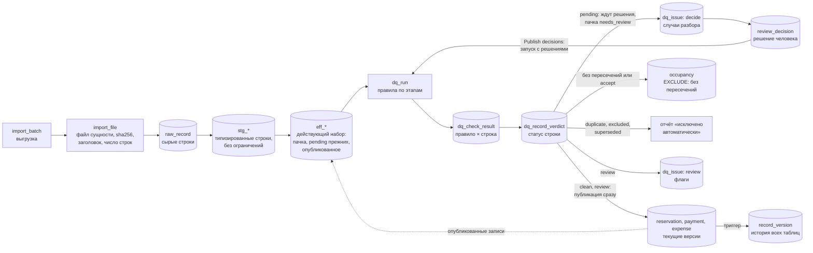

# План модуля проверки данных

Статус: черновик v5 от 2026-10-18 (v3: разбор человеком перед публикацией, раздел 7.5; v4: записи без сомнений публикуются сразу, разбора ждут только случаи, разделы 5 и 7.5; v5: пачка — любой набор файлов, правила идут по действующему набору данных, а не по пачке, разделы 1, 2, 5 и 7.5; v6 от 2026-10-27: денежная модель финального задания — DQ-02 сам выбирает последний снимок по `updated_at` (новое действие `supersede`), DQ-05 делит деньги на «удержано» и «не привязано», DQ-14, 16, 24 считают ожидаемое с PBJT, DQ-17 проверяет каждую ночь и исключает, новое DQ-25 для статуса платежа, соответствие исключениям CLI — 6.1; код правил меняется фазой 6b ROADMAP.md, изменения — в разделе 11). Модуль входит в управление импортом (PLAN.md, раздел 9) и детализирует правила DQ из раздела 6 PLAN.md. Если документы расходятся, действует этот. Список расхождений приведён в разделе 11. **v6.1 от 2026-10-27:** правила сделаны в коде фазой 6b (MONEY_MODEL_PLAN.md); решения автора — DQ-16 `info` и без исключения для OTA, DQ-23 слит в DQ-16, политика пересечения правил `ambiguous` везде (12.9 закрыт).

**Порядок выполнения** — в [ROADMAP.md](ROADMAP.md): единый пофазный план по всем четырём документам; таблица этапов ниже сохранена как справка.

## 1. Требования

1. Каждая проблема проверяется своей функцией: одно правило — одна функция — один файл с тестом.
2. Функция выносит вердикт по **каждой** записи своей области: `pass`, `fail` или `skip` с причиной. Каждый вердикт попадает в журнал.
3. В итоге у каждой записи ровно один статус (`clean`, `review`, `pending`, `excluded`, `duplicate`, `superseded`) и список правил, которые его определили.
4. Пересечения периодов проживания измеряет база данных. Она же не даёт записать пересекающиеся проживания.
5. Выезд и заезд в один день — не пересечение: одни гости уехали, другие в тот же день заехали.
6. Повторный запуск на тех же данных даёт тот же журнал.
7. **Сначала система, потом человек, потом публикация.** Всё, в чём система уверена, она решает сама и окончательно: `duplicate`, `exclude` и `supersede` — прежняя версия брони, когда есть версия с более поздним `updated_at` (ТЗ финального задания, п. 10). Чего система решить не может — пересечения, modified-брони, разные версии одной записи с одинаковым `updated_at` или без него (действие `decide`), — решает человек. **Разбора ждут только эти записи.** Всё остальное (`clean`, `review`) публикуется первым же запуском: сомневаться в нём не в чем. Записи случаев публикует повторный запуск после решений. Флаги `review` публикацию не держат.
8. **Источник правды — входящие данные, мы их не исправляем.** Решение человека выбирает, каким записям верить, но значений не меняет. Решение действует, пока по случаю не пришли новые данные; пришли — случай решается заново, и прав может оказаться как новый источник, так и уже принятая версия. Пока случаи ждут разбора, календарь и цифры считаются по опубликованным записям, а дашборд показывает, сколько броней и денег ждёт решения.
9. **Проверяется весь набор данных, а не пачка** (решено 2026-10-18). Файлы одной выгрузки приходят в разное время: сегодня брони, через неделю платежи, расходы ещё позже, и это обычный случай. Пачка — любой набор файлов, по одному на сущность. Каждый запуск строит действующий набор — строки пачки, затем строки `pending` прежних пачек, затем опубликованные записи, с приоритетом по естественному ключу — и выполняет правила по нему (раздел 2). Платёж находит свою бронь в опубликованном, новая бронь пересекается с уже принятой, долг по DQ-16 закрывается, когда приходит файл платежей.

**Единица данных** — строка источника (`raw_record`), а не ID записи. У полного дубля R0015 две строки с одним ID, и каждая получает свой вердикт.

## 2. Место в импорте



- **Пачка = набор файлов, любой.** `import_batch` — одна загрузка, `import_file` — файл каждой сущности в ней (от одного до пяти, не больше одного на сущность) с sha256, заголовком и числом строк. Файлы одной выгрузки источника приходят в разное время, поэтому пачка из одного `expenses.csv` — обычный случай. Файл — не полный снимок сущности: строк, которых в нём нет, никто не удаляет и не помечает. Файл, чей `(entity, sha256)` уже загружен раньше, получает статус `skipped`, его строки не читаются; пачка из одних таких файлов — `skipped` со ссылкой на пачку-близнеца.
- **Действующий набор** — то, что видят правила: по каждой сущности строки staging текущей пачки, затем строки `pending` прежних пачек, затем опубликованные записи основных таблиц; при совпадении естественного ключа действует первая. **Исключение — брони (v6):** из слоёв берётся версия с наибольшим `updated_at`, а не первая по слою, поэтому поздно пришедшая старая версия не вытесняет опубликованную новую; при равном `updated_at` и разном содержимом в набор входят обе — их разбирает DQ-02. Записи `excluded` и `duplicate` прежних пачек тоже входят в набор (последняя версия ключа) и проверяются заново, но не публикуются: платёж, пришедший раньше своей брони, в первом запуске «не привязан» (DQ-05), а когда файл броней приносит её, следующий запуск принимает его без повторной загрузки платежей. Так же бронь, исключённая DQ-17 за отсутствием ставки, возвращается, когда файл правил приносит ставку. По той же причине R0034 будет принята, если когда-нибудь появится V999. Строка `pending` прежней пачки, которую вытеснила новая версия того же ключа, получает статус `superseded`. Набор строится представлениями `app.eff_*` поверх `stg_*`, последних вердиктов и основных таблиц; у каждой строки есть `origin` (`batch`, `pending`, `published`) и её пачка.
- **Staging (`stg_*`)** принимает всё, что разобралось по типам. Если бы ограничения стояли уже здесь, проблемную запись нельзя было бы сохранить и измерить.
- **Основные таблицы** получают записи `clean` и `review` первым же запуском, независимо от того, есть ли в пачке случаи. Записи `pending` — брони случаев и платежи по ним — в основные таблицы не попадают, пока человек не решит случай; их публикует повторный запуск (раздел 7.5). Бронь, которую человек оставил только в финансах (`finance_only`), публикуется как `review`: деньги по ней реальные, даже если в календарь она не попала. Записи `excluded`, `duplicate` и `superseded` остаются в staging и журнале. Суммы исключённых броней показываются отдельно как «исключено»; исключённые платежи делятся по причине (PLAN.md 7.4): брони нет — «не привязано», бронь исключена — «удержано», ошибка самого платежа — «исключено».
- **История версий** — одна таблица `record_version` на все основные таблицы. Её пишет триггер `capture_record_version`: каждая вставка, изменение и удаление дают новую версию с данными строки целиком, ссылкой на строку источника (`raw_record_id`), запуском (`run_id`) и автором. Правка руками в обход импорта тоже попадает в историю, с `run_id = null`.
- **`occupancy`** — календарь занятости вилл, по строке на каждую допущенную активную бронь. Пересечения на уровне базы запрещены только здесь. В календарь попадают брони без пересечений и брони, выбранные человеком; остальные брони группы видны в финансах с флагом или в «исключено» — по решению.
- **Кто решает.**
  - `duplicate`, `excluded` и `superseded` — окончательные решения системы. Они видны в журнале и в отчёте «исключено автоматически» на `/import/data-quality` (правило, причина, сумма), человеку на разбор не попадают. Отменить их в интерфейсе нельзя: если ошибся источник, строку исправляют в источнике, и следующий импорт её примет; если запись ссылалась на то, что ещё не пришло (платёж на бронь из следующего файла), её примет запуск, который принесёт недостающее.
  - `decide` — решает человек, по случаям (раздел 7.5). Строка без решения получает статус `pending` и ждёт решения сама; остальную пачку она не держит. Платёж по такой брони тоже ждёт (`hold`, DQ-05): в основных таблицах платёж ссылается на бронь.
  - `review` — флаг: запись публикуется с пометкой, проблема видна в списке на `/import/data-quality`, решение по ней можно принять и после публикации.

## 3. Контракт проверки

```ts
type Entity = 'property' | 'commission_rule' | 'reservation' | 'payment' | 'expense' | 'file';
type Outcome = 'pass' | 'fail' | 'skip' | 'error';
type Action = 'duplicate' | 'supersede' | 'exclude' | 'decide' | 'hold' | 'review' | 'info';  // supersede (v6) — есть более поздняя версия той же брони; decide — запись ждёт решения человека; hold — запись ждёт решения по другой записи

interface CheckResult {
  unitId: string;                     // id строки raw_record; для правил уровня файла — import_file.file_id
  recordKey: string;                  // естественный ключ: R0015, P0075 ...
  outcome: Outcome;
  reason?: string;                    // обязателен для skip
  details?: Record<string, unknown>;  // факты: суммы, ставка, интервал пересечения
  relatedKeys?: string[];             // вторая бронь пары, кандидат на исходную бронь, платёж
  amountIdr?: bigint;                 // сумма под вопросом, для сводки; целые IDR, как в lib/calc
}

interface Check {
  id: `DQ-${string}`;
  version: number;                    // увеличивается при изменении логики
  title: string;
  entity: Entity;
  action: Action;                     // что означает fail для статуса строки
  engine: 'ts' | 'sql';
  dependsOn: string[];                // правила, чьи вердикты нужны на входе
  run(ctx: CheckContext): Promise<CheckResult[]>;
  runTs?(ctx: CheckContext): Promise<CheckResult[]>;  // для engine 'sql': та же логика на TS
}

interface CheckContext {
  batchId: string | null;             // null — запуск с решениями без новой пачки (7.5)
  today: string;                      // сегодня по Бали, ISO-дата
  units(entity: Entity): Unit[];      // действующий набор (раздел 2): строки пачки, pending прежних пачек, опубликованные; у строки origin и её пачка
  statusSoFar(unitId: string): Status;// статус после уже выполненных правил и решений человека
  decisions: Decisions;               // действующие решения по случаям (7.5): судьба брони, связь modified, перенос платежей
  policies: CalcPolicies;             // из @/lib/calc (CALCULATION_MODULE.md, 6)
  db?: Sql;                           // есть только в режиме с базой
}
```

Правила контракта:

- **Источник строк и журнал — интерфейсы.** `units()` реализует источник: на уровне 1 — загрузчик CSV (`unitId` = файл и номер строки), на уровне 2 — действующий набор из `app.eff_*` (`unitId` = `raw_record_id`; у опубликованной записи это `raw_record_id` её текущей версии). Журнал — `sinks/memory.ts` или `sinks/postgres.ts`. Правила не читают файлы и не пишут в базу, поэтому уровень 2 меняет два адаптера, а правила и тесты остаются.
- **Функция не пишет в журнал сама.** Она возвращает результаты, раннер проверяет их и записывает. Раннер сверяет, что каждая строка области получила ровно один результат. Если строки не хватает или есть лишняя, правило получает `error`, запуск помечается `failed`, данные не публикуются. Строка, по которой нет вердикта, невозможна по построению, а не по договорённости.
- **`skip` с причиной.** Правило неприменимо к строке: DQ-11 для брони с каналом OTA, DQ-12 для отмены или уже исключённой брони. Причина обязательна, чтобы «не проверяли» отличалось от «проверили, всё в порядке».
- **`details` — факты, а не текст.** Сообщение строит интерфейс, тест сравнивает значения. Само правило интерфейс показывает значком с подсказкой, а не кодом `id` (PLAN.md 8, решение 2026-10-19).
- **Ошибка внутри функции** даёт `error` по всем строкам области, запуск получает статус `failed`.
- **Детерминизм.** Без `Date.now()` и случайности, сегодняшняя дата приходит из `ctx.today`, результаты отсортированы по `unitId`.
- **Решения человека — вход запуска, а не правка журнала.** Правила `decide` решений не читают: пересечение остаётся фактом, `fail` пишется и после решения. Решение применяет раннер при сведении статуса (раздел 4). Правила по платежам (DQ-05, 14, 16, 23) видят его через `statusSoFar` и через перенос платежей при слиянии (`ctx.decisions`). Тот же набор строк и решений даёт тот же журнал.

## 4. Журнал

| Таблица | Что хранит | Ключ |
|---|---|---|
| `dq_run` | запуск: `batch_id` (`null` у запуска с решениями, 7.5), версия кода (git sha), правила с версиями, статус (`running` / `succeeded` / `failed`), время, счётчики | `id` |
| `dq_check_result` | вердикт правила по единице: строке (`raw_record_id`) или файлу (`file_id`, для DQ-90); `outcome`, `action`, `reason`, `details`, `related_keys`, `amount_idr`. Только дописывание | `(run_id, rule_id, raw_record_id)` или `(run_id, rule_id, file_id)` |
| `dq_record_verdict` | итог по строке: статус, причины (`rule_id[]`), решение человека, которое повлияло на статус (`decision_id`), допущена ли в `occupancy`. Только дописывание | `(run_id, raw_record_id)` |
| `dq_issue` | проблема между запусками, для действий `decide` и `review`: `(rule_id, entity, record_key)`, статус `open` / `resolved` / `closed`, первый, последний и закрывший запуск, хэш строки; для `decide` — ключ случая в `details.case_key` | `issue_id`; одна незакрытая на правило и запись |
| `review_decision` | решение человека по брони случая: `accept`, `finance_only`, `exclude`, `keep_published`; `payload` — связь modified (`origin`, `merge`) или пометка исходной (`replaced_by`); ключ случая `case_key`, общий для решений по одному случаю; хэш строки, на которой принято; обязательный комментарий (раздел 7.5). Только дописывание | `decision_id` |

Объём: около 357 строк × 23 правила ≈ 8 тыс. строк журнала на запуск. Для Postgres это немного. Правила идут по всему действующему набору, но строки вне пачки попадают в журнал только тогда, когда их вердикт по правилу отличается от последнего записанного: иначе каждая пачка переписывала бы журнал по всем данным. По строкам пачки пишется каждый вердикт, как и раньше. Повтор на тех же данных даёт тот же журнал (требование 6).

**Итоговый статус строки** выводится из её вердиктов по приоритету:

0. строку `pending` вытеснила новая версия того же ключа из более поздней пачки → `superseded`, правила её не проверяют;
1. есть `fail` с действием `duplicate` → `duplicate`; иначе есть `fail` с `supersede` (v6, DQ-02: у брони есть версия с более поздним `updated_at`) → `superseded`;
2. иначе есть `fail` с `exclude` или решение `exclude` → `excluded`;
3. иначе есть `fail` с `decide` без действующего решения или `fail` с `hold` → `pending`;
4. иначе есть `fail` с `review` или решение `finance_only` → `review`;
5. иначе → `clean`, в том числе после решения `accept` или `keep_published`. Вердикты `info` статус не меняют.

Решение, которое определило статус, пишется в `dq_record_verdict.decision_id`: по журналу видно, где статус поставило правило, а где человек.

Статус одной сущности влияет на другую только через явное правило с `dependsOn`. Пример: DQ-05 исключает платёж, если его бронь исключена. По журналу всегда видно, какое правило изменило статус.

**Жизненный цикл `dq_issue`:**
- правило вернуло `fail` с действием `decide` или `review` впервые — проблема `open`. Вердикты `duplicate`, `supersede` и `exclude` проблему не открывают: это окончательные решения системы. `hold` тоже не открывает: запись ждёт решения по другой записи, и его принимает человек там;
- правило снова вернуло `fail` — проблема остаётся в своём статусе, обновляется последний запуск;
- человек принял решение — проблема `resolved`. Новое решение по той же проблеме заменяет предыдущее, старое остаётся в истории;
- правило вернуло `pass` — проблема `closed` с номером закрывшего запуска;
- решение действует, пока по нему не пришли новые данные: строка та же (`review_decision.row_hash = dq_issue.row_hash`), а для `decide` — и состав случая тот же (`case_key`). Иначе решения снимаются, проблемы снова `open`, прежние решения остаются в истории и показываются человеку, но не подставляются (раздел 7.5);
- по `decide` решение принимается на весь случай сразу: по записи на каждую бронь с общим `case_key`.

## 5. Порядок выполнения

Раннер строит порядок по `dependsOn`, этапы ниже нужны для чтения.

| Этап | Что проверяем | Правила |
|---|---|---|
| 0. Разбор | схема и форматы, полные дубли, один ID с разным содержимым | DQ-03, DQ-01, DQ-02 |
| 1. Справочники | объекты, правила комиссии и их периоды | DQ-22 |
| 2. Брони, построчно | ссылки, валюта, суммы, комиссии, возвраты, modified | DQ-04, 06–11, 13, 17, 18 |
| 3. Брони, между собой (база) | пересечения, вероятные версии modified | DQ-12, DQ-21 |
| 4. Платежи и расходы | ссылки, статус платежа, суммы, даты в будущем, оплата к заезду, confirmed без платежа | DQ-04, 05, 06, 07, 14, 15, 16, 19, 20, 23, 24, 25 |
| 5. Набор целиком | контрольные суммы | DQ-90 |

**Шаги раннера:**

1. Создать `dq_run` со статусом `running`, версией кода и списком правил. «Сегодня» запуска — дата `started_at` по Бали.
2. Построить действующий набор (раздел 2). Строкам `pending` прежних пачек, которые вытеснила новая версия того же ключа, записать `superseded`.
3. Для каждого правила по порядку: вызвать `run` по действующему набору, проверить покрытие, записать результаты пачкой (строки вне пачки — только с изменившимся вердиктом, раздел 4), обновить промежуточные статусы.
4. Свести итоговые статусы с учётом действующих решений и выполнить DQ-90 по файлам пачки.
5. Обновить `dq_issue` по вердиктам `decide` и `review`, включая записи вне пачки: долг по DQ-16 у опубликованной брони закрывается (`closed`), когда файл платежей принёс её оплату; опубликованная бронь, с которой пересеклась новая, получает случай `decide` и остаётся в календаре до решения.
6. Опубликовать данные одной транзакцией с `set local app.run_id` и `app.actor`:
   - записи `clean` и `review` в основные таблицы: обновляется только строка с другим `row_hash`, триггер пишет версию в `record_version`. Бронь с решением `keep_published` не обновляется: в основной таблице остаётся опубликованная версия;
   - записи `pending` не трогаются: в основные таблицы и календарь они не попадают, а если такая запись опубликована раньше в другой версии, опубликованная версия остаётся до решения;
   - записи, опубликованные раньше и получившие в этом запуске `excluded` (решение `exclude`, заменённая исходная бронь с `replaced_by`, платёж такой брони по DQ-05), удаляются из основных таблиц и календаря, удаление попадает в `record_version`;
   - `occupancy`: сначала убрать брони, которые по решениям больше не в календаре (`finance_only`, `exclude`, заменённые modified-бронью) или чья строка изменилась; затем добавить брони без пересечений и выбранные человеком (`accept`, `keep_published`).
7. **Шлюз.** Есть строки `pending` у этой пачки — пачка `needs_review` (IMPORT_PLAN.md, 8): опубликованное остаётся, случаи ждут человека. Нет — пачка `loaded`. Прежние пачки в `needs_review`, у которых строк `pending` не осталось (случаи решены или строки вытеснены), тоже закрываются `loaded`. Запуск с решениями без пачки проверяет так все пачки в `needs_review`.
8. Отметить `dq_run` как `succeeded` и сохранить счётчики: опубликовано, ждёт решения (строк и сумма), исключено.

Журнал (шаги 1–5) и публикация (шаг 6) идут разными транзакциями. Если публикация упала, например на ограничении пересечений, журнал остаётся для разбора, а запуск получает статус `failed`.

**Запуск по пачке и запуск с решениями.** Запуск по пачке публикует всё, что не вызывает сомнений (`clean`, `review`), находит случаи и останавливается на шлюзе: брони случаев и платежи по ним ждут. Случай не принадлежит пачке: в одну группу конфликта попадают новая бронь из этой пачки, бронь `pending` из прошлой и опубликованная бронь, которая уже в календаре. Человек решает случаи (7.5) и нажимает **Publish decisions**. Это запуск без пачки (`batch_id = null`) по тому же действующему набору с решениями на входе: статусы платежей пересчитываются (платёж исключённой брони — «удержано» по DQ-05, при слиянии платёж переходит к новой версии), записи решённых случаев публикуются, нерешённые остаются `pending`. Строки с тем же `row_hash`, опубликованные раньше, этот запуск не трогает, новых версий в `record_version` у них нет. Пачка без случаев закрывается первым же запуском; пачка `needs_review` закрывается, когда у неё не осталось строк `pending`.

## 6. Каталог проверок

«Ожидаем» — результат первичного анализа. Тест на реальных данных фиксирует эти списки (раздел 9).

| ID | Функция | Область, `skip` для | Где | `fail` → | Ожидаем |
|---|---|---|---|---|---|
| DQ-01 | `exactDuplicate` | все строки | TS, хэш нормализованной строки | `duplicate` для второй и следующих копий, первая — `pass` | R0015, P0075 |
| DQ-02 | `conflictingVersions`, v2 | все строки | TS | брони: версия с наибольшим `updated_at` — `pass`, прежние — `supersede` (ТЗ финального задания, п. 10); равный наибольший `updated_at` с разным содержимым — `decide` (случай `version`, 7.5). Платежи, расходы, справочники (`updated_at` нет) — `decide`, как в v1. В `details` — `updated_at` всех версий и какая выбрана | 0 |
| DQ-03 | `schemaAndFormat` | все строки | TS, zod | `exclude` | 0 |
| DQ-04 | `propertyExists` | брони, платежи, расходы, правила комиссии | SQL join со справочником / TS | `exclude` → «исключено»; платежи такой брони — «удержано» по DQ-05 (v6) | R0034 → V999, E0017 → V777 |
| DQ-05 | `paymentReservationValid`, v2 | платежи; `skip` для уже исключённых | TS, после этапа 3 | `exclude`, причина в `details.problem` (значения уже есть в коде v1): `missing` — брони нет, деньги «не привязано» (ТЗ п. 13); `reservation_excluded` — бронь `excluded` / `duplicate` / `superseded`, деньги «удержано». `hold` (`reservation_pending`, `reservation_versions`), если бронь ждёт решения: платёж ждёт вместе с ней, деньги тоже «удержано». В v2 меняется не вердикт, а то, куда `lib/data` кладёт деньги; `superseded`-версия брони в поиске брони не считается живой | `exclude`: P0036 (R0072) — удержано, 0 IDR; P0017 (R0034) исключён раньше DQ-04 (его собственная вилла — V999); `hold`: 42 платежа по броням 35 случаев |
| DQ-06 | `currencyMatchesProperty` | брони, платежи, расходы | TS | `exclude`; в `details` сумма за ночь | R0061: USD 4 280 874 за 4 ночи |
| DQ-07 | `positiveAmountsAndNights` | брони, платежи, расходы | TS | `exclude` | 0 |
| DQ-08 | `otaFeeBounds`: 0 ≤ OTA ≤ GBV | брони | TS | `review` | R0102: −100 000 |
| DQ-09 | `refundConsistent`: возврат ≤ GBV, возврат > 0 только у отмены | брони | TS | `exclude` | R0072 |
| DQ-10 | `otaRateRange`: 0–25% | брони; `skip`, если DQ-08 = `fail` | TS | `review` | 0 |
| DQ-11 | `directBookingOtaFee` | брони; `skip` для канала OTA | TS | `info`: у прямой брони это отчисление в рекламный бюджет, вычитается как комиссия (PLAN.md, 15) | 30 броней (31 строка: R0015 дважды, копия — `duplicate`) |
| DQ-12 | `stayOverlap` | активные брони; `skip` для отмен и уже исключённых | **SQL** | `decide`: случай — группа конфликта (7.5) | 68 пар, 86 броней, 32 группы, 17 вилл |
| DQ-13 | `modifiedWithoutOrigin` | брони; `skip` для статусов, кроме modified | TS | `decide`: каждую modified-бронь принимает человек и вручную связывает с исходной (7.5) | 8 (R0143–R0150): 5 в группах конфликта, 3 отдельными случаями (R0143, R0144, R0147) |
| DQ-14 | `paymentAmountMatches`: = A + PBJT − OTA − возврат (v2; в CSV PBJT = 0) и ≤ A + PBJT | платежи `received` по существующей брони | TS | `review` | P0051: 3 998 667 > GBV 3 898 667 (из-за R0102) |
| DQ-15 | `zeroReceivedPayment` | платежи | TS | `info` | 7 (6 отмен + R0072) |
| DQ-16 | `unpaidAtCheckIn`, v2: заезд ≤ сегодня, сумма полученных (`received`) платежей с датой ≤ дня заезда меньше `A + PBJT − OTA − возврат`; брони OTA тоже (решение автора 2026-10-27) | активные брони; `skip`, если заезд ещё впереди | TS | `info`: долг на дату заезда, статус брони не меняет; вид в `details.kind`: `paid_late` — к заезду не хватало, позже доплачено полностью (`paidOn`, `daysLate`), `unpaid` — не оплачено до сих пор (`outstanding`, долг на сегодня); под вопросом — недостача к заезду или долг на сегодня. v1 — `review`, опоздание каждого платежа — отдельное DQ-23 | 113 броней на 19.10: 51 оплачена позже (на 1–11 дней), 62 без единого платежа |
| DQ-17 | `commissionRuleCovers`, v2: на **каждую** ночь проживания `resolveCommissionRule` находит правило: оно есть и не неоднозначно при политике `commissionRuleOverlap` (через `commissionRulesOn`, как в v1). Смена ставки внутри проживания — `pass` | активные брони | TS | `exclude` (v1 — `review` по дате заезда): без ставки ночи комиссию не посчитать (ТЗ п. 14); в `details` — первая ночь без правила или с двумя правилами и их ставки. Бронь вернётся, когда придёт правило (раздел 2) | 0 |
| DQ-18 | `partialRefundOnCancel` | брони; `skip` для неотменённых | TS | `review` | 0 |
| DQ-19 | `paymentPropertyMatches` | платежи | TS | `review` | 0 |
| DQ-20 | `datedInFuture`: дата позже сегодняшнего дня | платежи `received`, расходы `paid` | TS | `review` | на 19.10: 16 платежей и 22 расхода; на 31.10: 3 платежа; с 05.11 — ни одного |
| DQ-21 | `modifiedLikelyVersion` (новое) | брони; `skip` для статусов, кроме modified | **SQL**, поверх DQ-12 | `info`: кандидаты на исходную бронь с оценкой в `details` — подсказка для связывания, не решение | R0149↔R0150, R0146↔R0027 / R0112, R0148↔R0038, R0145↔R0126 |
| DQ-22 | `commissionRuleOverlap` (новое): периоды правил одного объекта пересекаются | правила комиссии | **SQL** | `review`: флаг на правилах, оба остаются в данных; в `details` второе правило, спорный интервал и какое правило где действует (`inForce`, `null` — никакое). При политике `ambiguous` (по умолчанию с 2026-10-27) на спорных ночах ставки нет и DQ-17 исключает брони с такой ночью; при `latest-start` действует правило с более поздней датой начала (решение 2026-10-18) | 0 |
| ~~DQ-23~~ | `paymentAfterCheckIn` — снято 2026-10-27, слито в DQ-16 v2: опоздание и долг — одно понятие (решение автора); на CSV все 58 платежей DQ-23 — платежи броней, которые DQ-16 помечает как оплаченные позже | — | — | — | было 58 платежей (60 по сырым строкам) |
| DQ-24 | `confirmedWithoutPayment` (новое): бронь `confirmed` без единого полученного (`received`) платежа с суммой > 0 | брони; `skip` для статусов, кроме confirmed (отмены и modified) | TS | `info`: в `details` дата заезда, дней до заезда (меньше нуля — заезд прошёл), ожидаемая выплата и число нулевых платежей; под вопросом — `A + PBJT − OTA − refund` (v2) | 64 брони на 19.10: у 6 заезд впереди, 58 уже в DQ-16 |
| DQ-25 | `paymentStatus` (v6): статус платежа `received` | платежи | TS | `pending` → `info`: ещё не деньги, сумма в «удержано», в поступления и сверку не входит (ТЗ п. 11); незнакомый статус → `exclude`, сумма тоже в «удержано»: известна, но не подтверждена. В CLI финального задания — `PENDING_PAYMENT` и `UNKNOWN_STATUS` | 0: все 76 — `received` |
| DQ-90 | `controlTotals`: по каждому файлу пачки `import_file.row_count` = число строк в `raw_record`, сумма и число строк = clean + review + pending + excluded + duplicate + superseded | файл (`import_file`) | TS + SQL | `error`: запуск `failed` | расхождений 0 |

Пояснения:
- **Строка, которую более раннее правило исключило или признало дублем, остальные правила пропускают** (`skip`, реализация 2026-10-19). Так сумма «под вопросом» по правилу не считает одну строку дважды, а в списках проблем нет копий. Поэтому числа колонки «Ожидаем», посчитанные при первичном анализе по сырым строкам, у DQ-11, DQ-20 и DQ-23 уменьшены на такие строки; остальные совпали. Исключения из этого порядка: DQ-15 и DQ-20 идут до DQ-05, поэтому P0036 (нулевой платёж по исключённой R0072) в DQ-15 виден.
- **Дубль — только DQ-01.** Дубль — та же запись: тот же ID и то же содержимое. Такие строки система исключает сама, человек их не видит. Бронь с теми же датами под другим ID — не дубль: R0033 и R0056 (V008, 25.09–02.10) различаются GBV (14,6 и 5,6 млн IDR), платёж P0028 есть только у R0056. Это группа конфликта, её разбирает человек.
- **DQ-12:** 73 пары и 87 броней из таблицы проблем посчитаны до исключений. После исключения R0034, R0061, R0072 остаётся 68 пар и 86 броней из 135 активных. Обе цифры верны, правило проверяет вторую область. R0102 не исключается (DQ-08 даёт `review`), поэтому остаётся в области и пересекается с пятью бронями: R0017, R0096, R0101, R0103, R0128. В пересечениях находится 64% GBV активных броней (801,6 млн из 1 256,7 млн IDR).
- **DQ-21 предлагает кандидатов, но не склеивает брони.** Пример: R0146 по датам ближе к R0027 (сдвиг на день), а по сумме к R0112 (разница 3%, у R0027 — 82%). Связывание и слияние делает только человек: modified может оказаться версией брони, которую уже отклонили, или не иметь исходной в данных вовсе.
- **DQ-16 — долг на день заезда, справка** (решено 2026-10-18; v2 — 2026-10-27). Вилла оплачивается полностью до заезда, брони OTA тоже: «Букинг должен перечислить в первый день аренды максимум», а пока денег нет на счёте, их нельзя зачислить (решение автора 2026-10-27). В данных ни один платёж не датирован раньше заезда: 9 в день заезда, 60 позже, медиана — на следующий день после выезда; сумма платежа равна `GBV − OTA`. ТЗ финального задания показывает выплату OTA после выезда как обычную (R101), но это пример задания, а не правило бизнеса. Правило — `info`: «ревью не обязательно, т.к. резолвить нечего, но долг и флаг остаются»; деньги в цифрах и так видны (в поступлениях только пришедшее, сверка показывает разрыв). Опоздание платежа и долг — «по сути схожее понятие», поэтому DQ-23 слито в DQ-16 v2: флаг на брони одного из двух видов — `paid_late` (к заезду не хватало, позже доплачено полностью, на сколько дней) или `unpaid` (долг на сегодня). Платёж в день заезда считается внесённым вовремя. Отвергнуто: `skip` «OTA payout» у броней OTA с отдельным правилом срока выплаты OTA; пропуск только DQ-23 у OTA.
- **DQ-24 — пометка, а не долг** (решено 2026-10-19). Бронь подтверждается оплатой, поэтому `confirmed` без единого платежа значит одно из двух: платёж ещё не дошёл до данных или статус поставлен ошибочно. Правило смотрит на любую дату заезда и статус не меняет. После заезда такую бронь DQ-16 уже считает долгом, а до заезда DQ-24 — единственный сигнал. Платёж считается, как в DQ-16: не исключённый и не дубль, флаги самого платежа не важны; нулевой платёж оплатой не считается. Бронь `modified` не проверяется: её платёж может лежать на исходной брони, пока человек их не свяжет (7.5).
- **DQ-20 и DQ-16 зависят от сегодняшнего дня** по Бали (Asia/Makassar). Дата приходит в запуск аргументом, правила часы не читают; на уровне 2 это дата `dq_run.started_at` по Бали (раздел 5, шаг 1).
- **DQ-22 — флаг, а не исключение** (решено 2026-10-18). Правила комиссии меняются постоянно и приходят отдельными файлами: новое правило V001 с 1 ноября придёт, скорее всего, без укороченного старого. Поэтому DQ-22 не исключает правила: оба публикуются, флаг показывает спорный интервал. Ключ правила — вилла и дата начала, поэтому двух правил с одной датой начала не бывает: новое обновляет старое как новую версию. Данные при этом не правим: выбор делает правило расчёта, а не исправление строки. Какая ставка на спорных ночах — политика `commissionRuleOverlap`. **С 2026-10-27 по решению автора — `ambiguous` везде:** на спорной ночи ставки нет, DQ-17 исключает бронь, пока старое правило не закроют (ТЗ п. 14: правило не придумываем); тот же выбор у CLI финального задания. До того в системе действовало `latest-start` — правило с более поздней `effective_from` (решение 2026-10-18), оно осталось значением политики. Ставка проверяется по каждой ночи, поэтому новое правило с 1 ноября касается ровно ноябрьских ночей, а не всей брони, заехавшей в октябре.
- **DQ-02 v2 — последний снимок сам** (решено 2026-10-27, ТЗ финального задания п. 10). Новая версия брони приходит с тем же `reservation_id` и более поздним `updated_at`; в расчёт идёт она, прежние получают `superseded` и остаются в журнале и `record_version` — их видно, но не суммируют. Спорно только равное `updated_at` (п. 14): тогда случай `version`, как в v1. Одинаковое содержимое под разными строками — DQ-01 (`duplicate`), а не версия. В CSV `updated_at` — дата, поэтому две версии из одной выгрузки с разным содержимым по-прежнему идут человеку. На данных первого задания DQ-02 находит 0, числа не меняются.
- **DQ-05 v2 — два вида денег вместо «нераспределено»** (ТЗ п. 13, 4D). Брони нет — «не привязано»: деньги пришли, но непонятно за что. Бронь есть, но исключена или ждёт решения — «удержано»: деньги реальные, вилле не подтверждены. Обе суммы видны рядом с поступлениями (PLAN.md 7.4) и сходятся в контрольных суммах DQ-90.

### 6.1 Соответствие исключениям финального задания

CLI финального задания (`lib/nightly`, FINAL_TEST_PLAN.md 3–4) не ведёт журнал правил: он пишет в отчёт `exceptions` с единственным действием `hold` («сумма не вошла в подтверждённые итоги») и счётчики `dedup`. Каждому коду соответствует правило системы. Коды и отчёт CLI остаются как есть: они — форма вывода по `output_schema.json`, а не второй каталог правил.

| Код CLI | Правило | Действие в системе | Деньги |
|---|---|---|---|
| `dedup.reservation_event_duplicates`, `dedup.payment_duplicates` | DQ-01 | `duplicate` | не учитываются |
| `dedup.superseded_reservation_versions` | DQ-02 | `supersede` | — |
| `AMBIGUOUS_VERSION` | DQ-02 | `decide`, случай `version` | платежи брони — «удержано» |
| `CONFLICTING_EVENT` (один `source_event_id`, разное содержимое) | DQ-02 по ключу события (лента) | `decide` | платежи брони — «удержано» |
| `CONFLICTING_PAYMENT` | DQ-02 | `decide` | ни в один вид: единой суммы нет |
| `UNKNOWN_PROPERTY` | DQ-04 | `exclude` | платежи брони — «удержано» |
| `CURRENCY_MISMATCH` | DQ-06 | `exclude` | платежи брони — «удержано» |
| `INVALID_STAY` | DQ-07 | `exclude` | платежи брони — «удержано» |
| `NO_COMMISSION_RULE`, `AMBIGUOUS_COMMISSION_RULE` | DQ-17 (политика `ambiguous` в CLI и в системе) | `exclude` | платежи брони — «удержано» |
| `UNKNOWN_STATUS` у брони | DQ-03 (статус в CSV — перечисление формата) | `exclude` | платежи брони — «удержано». `cancelled` в CSV — известный статус, в ленте ТЗ — нет |
| `UNKNOWN_STATUS` у платежа | DQ-25 | `exclude` | «удержано» |
| `PENDING_PAYMENT` | DQ-25 | `info` | «удержано» |
| `UNMATCHED_PAYMENT` | DQ-05 `missing` | `exclude` | «не привязано» |
| `PAYMENT_HELD` | DQ-05 `reservation_excluded` или `hold` (`reservation_pending`, `reservation_versions`) | `exclude` / `hold` | «удержано» |
| `OUTSIDE_REPORT_MONTHS` | — | не проверка: окно отчёта CLI. На дашборде период — фильтр, ночь вне его просто не входит в выбранный период | — |

Расхождения, которые остаются сознательно: отрицательная или дробная сумма и невозможная дата в CLI — ошибка формата всего файла (код выхода 1), в системе — исключение строки (DQ-03, DQ-07), потому что у импорта есть журнал строк, а у CLI его нет. CLI держит всю бронь при `CONFLICTING_EVENT`, даже если есть чистая более поздняя версия; система делает то же через случай `decide`.

## 7. Пересечения средствами базы

### 7.1 Интервал проживания

Проживание хранится как `daterange(check_in, check_out, '[)')`: день заезда входит, день выезда нет. Это та же модель «ночь с датой d», что и в PLAN.md (7.1).

```sql
select daterange('2026-09-01', '2026-09-05', '[)') && daterange('2026-09-05', '2026-09-08', '[)');  -- false: выезд и заезд 05.09
select daterange('2026-09-01', '2026-09-05', '[)') && daterange('2026-09-04', '2026-09-08', '[)');  -- true: общая ночь 04.09
```

В данных 16 пар активных броней, где выезд одной совпадает с заездом другой. При закрытых интервалах `[]` они ошибочно считались бы пересечениями: 89 пар вместо 73.

### 7.2 Staging: измерение

```sql
create table app.stg_reservation (
  raw_record_id  bigint primary key,
  batch_id       uuid not null,
  reservation_id text,           -- поля nullable: нераспознанное значение — null, ошибку ловит DQ-03
  property_id    text,
  check_in       date,
  check_out      date,
  status         text,
  -- ... остальные поля брони
  stay daterange generated always as (
    case when check_out > check_in then daterange(check_in, check_out, '[)') end
  ) stored,
  -- строка staging всегда из той же пачки, что и её сырая строка
  foreign key (raw_record_id, batch_id) references app.raw_record (raw_record_id, batch_id)
);

create index stg_reservation_stay on app.stg_reservation using gist (batch_id, property_id, stay);
```

Полная схема — `supabase/schemas/app/tables/stg_reservation.sql`. `case` нужен потому, что `daterange` с выездом раньше заезда вызывает ошибку и строка не вставилась бы. Такую бронь ловит DQ-07, а `stay` у неё остаётся `null`.

Запрос DQ-12:

```sql
-- все пары пересечений в действующем наборе (раздел 2); $1 — пачка запуска (null у запуска с решениями),
-- $2 — строки, уже исключённые на этапах 0–2
with cand as (
  select raw_record_id, reservation_id, property_id, status, stay
  from app.eff_reservation($1)
  where status in ('confirmed', 'modified')
    and stay is not null
    and raw_record_id <> all($2)
)
select a.reservation_id as a_id,
       b.reservation_id as b_id,
       a.property_id,
       a.stay * b.stay                                as overlap,
       upper(a.stay * b.stay) - lower(a.stay * b.stay) as overlap_nights,
       case when a.stay = b.stay                       then 'same_dates'
            when 'modified' in (a.status, b.status)    then 'modified_version'
            else 'partial' end                         as kind
from cand a
join cand b
  on b.property_id = a.property_id
 and b.reservation_id > a.reservation_id
 and b.stay && a.stay;
```

- Пары сводятся в группы (компоненты связности) на TS. Ключ группы — вилла и отсортированный список её броней (`V003:R0017,R0029,…`). Он одинаков в повторных запусках и меняется, когда меняется состав группы. Это и ключ случая разбора (`case_key`, 7.5). Ключ и вид пересечения пишутся в `details`, вторая бронь — в `related_keys`.
- Сейчас 32 группы: 19 по 2 брони, 9 по 3, 2 по 4, 1 по 5, 1 по 8 (V003). На 12 виллах по 2–4 независимые группы, у V008 их четыре.
- Кандидаты — активные брони действующего набора (раздел 2), а не только пачки: к строкам пачки добавляются брони `pending` прежних пачек и опубликованные брони, которых в пачке нет. Так ловится пересечение новой брони и с уже принятой, и с той, что ещё ждёт решения.
- Вид пересечения — подсказка человеку и порядок разбора, а не автоматическое решение: `same_dates` (R0033 и R0056, не дубль) → `modified_version` (6 пар, кандидаты DQ-21) → `partial` (61 пара).

### 7.3 Occupancy: запрет пересечений

```sql
create extension if not exists btree_gist with schema extensions;  -- в Supabase расширения ставятся в схему extensions

create table app.occupancy (
  reservation_id  text primary key,
  property_id     text      not null,
  stay            daterange not null,
  admitted_run_id uuid      not null references app.dq_run,           -- запуск, который допустил бронь
  decision_id     bigint    references app.review_decision,            -- null — допущена автоматически
  admitted_at     timestamptz not null default now(),
  -- вилла и даты всегда совпадают с бронью: изменение брони каскадом обновляет строку и снова проверяется
  foreign key (reservation_id, property_id, stay)
    references app.reservation (reservation_id, property_id, stay)
    on update cascade on delete cascade,
  check (not isempty(stay) and not lower_inf(stay) and not upper_inf(stay)),
  constraint occupancy_no_overlap
    exclude using gist (property_id with =, stay with &&)
);
```

Полная схема — `supabase/schemas/app/tables/occupancy.sql`. Перед вставкой триггер `check_property_availability` выдаёт понятную ошибку с номером конфликтующей брони; гарантию, в том числе при параллельных транзакциях, даёт `EXCLUDE`.

- В `occupancy` попадают активные брони без статуса `excluded` / `duplicate`, которые ни с кем не пересекаются или выбраны в календарь решением по случаю (`accept`, `keep_published`). При отмене брони строка удаляется.
- **Кто допустил бронь** хранится двумя колонками вместо текстового `admitted_by`: `admitted_run_id` — запуск, всегда есть; `decision_id` — внешний ключ на решение человека, `null` при автоматическом допуске. Ссылка проверяется базой, а не договорённостью о формате строки.
- **Валидация решает, ограничение гарантирует.** Публикация не использует `ON CONFLICT DO NOTHING`, потому что он молча проглотил бы конфликт. Если пересечение всё же дошло до вставки, база вернёт `23P01` (exclusion_violation), транзакция публикации откатится, запуск получит статус `failed`.
- **Почему пересечения измеряются запросом, а не попыткой вставки.** Результат вставки зависит от порядка строк, и она сообщает только о первом конфликте. Запрос сразу находит все пары.
- **Кто из группы попадает в календарь** — решает человек (раздел 7.5). Пока решения нет, брони группы в календарь и основные таблицы не попадают; брони без пересечений публикуются сразу. Публикация после решений добавляет выбранные брони в `occupancy` с `decision_id`. В данных 49 броней из 135 попадут в календарь без решения, 86 броней в 32 группах ждут человека. Вариант «допускать первую по порядку» (90 из 135) отклонён: при первой загрузке порядок — это порядок строк в CSV, выбор был бы произвольным, а проблема скрытой.
- **Повторный импорт.** Если новая бронь пересекается с уже допущенной, календарь по этой вилле не меняется, пока случай не разобран; остальная пачка публикуется. Допущенная бронь показывается в одной группе с новой, отмеченная «в календаре с пачки #N», и человек решает заново: прав может быть и уже принятый источник, и новый.
- На `commission_rule` запрета пересечений нет (решено 2026-10-18): правила меняются постоянно и приходят отдельными файлами, новое правило обычно приходит без укороченного старого. Пересечение периодов одной виллы — смена ставки, а не ошибка: на спорных датах действует правило с более поздней `effective_from` (политика `latest-start`), пересечение помечает DQ-22 (`review`, раздел 6). Ключ правила — вилла и дата начала, поэтому двух правил с одной датой начала не бывает: новое обновляет старое как новую версию. Ограничение `commission_rule_no_overlap` из текущей схемы снимается миграцией.
- Drizzle, насколько известно, не описывает `EXCLUDE` в схеме. Ограничения пишем отдельной SQL-миграцией, при реализации проверить по документации Drizzle.

### 7.4 Режим без базы

У правил `engine: 'sql'` есть TS-двойник `runTs` с той же семантикой `[)`. Он работает в режиме CSV (уровень 1). Тест сравнивает списки пар из SQL и TS на реальных данных, так две реализации проверяют друг друга.

### 7.5 Разбор перед публикацией

Брони случаев `decide` и платежи по ним не публикуются, пока человек не решит случай; остальная пачка публикуется первым запуском. К началу разбора система уже убрала дубли и исключила записи с однозначными ошибками (раздел 2, «Кто решает»): R0015, R0034, R0061, R0072 человеку не показываются. Остальное однозначно не решается: выбор зависит от фактов, которых нет в данных, — кто реально заехал, кого переселили, какой договор подписан, какую бронь OTA отменила у себя. Автоматический выбор может отказать гостю, который заплатил: R0096 оплачена (5,96 млн IDR), а пересекающаяся с ней R0017 — нет.

**Почему держим только случаи, а не всю пачку** (решено 2026-10-18, v4). В записи без сомнений сомневаться не в чем: держать её из-за чужого пересечения значит прятать от дашборда то, что система уже проверила. Поэтому первый запуск публикует `clean` и `review`, а ждут только брони случаев и платежи по ним. Дашборд считает по опубликованному и рядом показывает, сколько броней и денег ждёт решения (баннер со ссылкой на `/review`). Цена: пока случаи не разобраны, в цифрах нет их броней и платежей, после разбора цифры вырастут на принятые брони. Это честнее, чем дашборд на прошлой публикации: в первой пачке пересечения держат 86 броней из 135, и целиком она не дала бы ни одной цифры, пока не решены все 35 случаев. Решение меняет и уже опубликованное: исходная бронь, которую заменила modified-бронь, уходит из основных таблиц (раздел 5, шаг 6), её платежи либо переходят к новой версии, либо становятся удержанными (DQ-05 v2).

**Единица разбора — случай.**

| Тип | Правило | Что внутри | В данных |
|---|---|---|---|
| `conflict` | DQ-12 | группа конфликта: брони одной виллы, связанные цепочкой пересечений, вместе с modified-бронями в ней | 32 |
| `modification` | DQ-13 | modified-бронь вне групп конфликта | 3: R0143, R0144, R0147 |
| `version` | DQ-02 | одна запись под одним ID с разным содержимым, которую не упорядочить по `updated_at`: у брони равный наибольший `updated_at`, у платежей, расходов и справочников его нет (v6; более поздняя версия брони вытесняет прежние сама) | 0 |

Ключ случая (`case_key`): для `conflict` — ключ группы (7.2), для `modification` — `M:<reservation_id>`, для `version` — `V:<entity>:<record_key>`. Всего в данных 35 случаев. Экран строится так: вилла → случай → брони.

**Выбирается набор броней, а не одна.** Группа — цепочка пересечений, и верных броней в ней может быть несколько. Самая большая группа, V003 в сентябре:

```
R0039  03–09  ██████
R0096  06–14     ████████
R0017  09–11        ██
R0102  10–14         ████
R0103  12–19           ███████
R0128  13–16            ███
R0101  13–17            ████
R0029  14–20             ██████
```

R0039 (03–09), R0017 (09–11) и R0029 (14–20) друг с другом не пересекаются и могут быть верны одновременно. Правило «выбери одну из восьми» потеряло бы настоящие брони.

**Решение — по каждой брони случая, одно на бронь:**

| Решение | Календарь | Финансы | Когда |
|---|---|---|---|
| `accept` | да | да | бронь верна |
| `finance_only` | нет | да, с флагом | двойное бронирование: деньги реальные, гостя переселили |
| `exclude` | нет | нет, суммы в «исключено» | ошибка источника; исходная бронь, которую заменила modified-бронь |
| `keep_published` | да, опубликованная версия | да, опубликованная версия | только у брони, уже опубликованной в другой версии: прав принятый источник, входящая версия не принимается |

Решение пишется на бронь в случае (`case_key`, `record_key`) и закрывает все её проблемы `decide` в этом случае: у modified-брони в группе — DQ-12 и DQ-13 сразу.

**Решения `correct` нет.** Мы не исправляем входящие данные: исправление у нас разошлось бы с источником, и мы не поняли бы, когда источник пришлёт обновлённые данные. Ошибку исправляют в источнике (выгрузка ниже), следующая пачка приносит новые данные, и случай решается заново.

**modified-брони: связь и слияние — только вручную.** Каждую modified-бронь (8 в данных) человек принимает явно, даже если она ни с чем не пересекается.
- **Связь.** Человек выбирает исходную бронь или отмечает «исходной нет». Кандидаты DQ-21 с оценкой (сдвиг дат, разница GBV) — подсказка. Выбрать можно любую бронь виллы, в том числе исключённую системой или отклонённую человеком раньше: modified может оказаться изменением брони, которая уже не прошла. У такой брони видно, кто, когда и с каким комментарием её отклонил.
- **Исходная бронь заменена.** В том же сохранении она получает `exclude` с `payload.replaced_by`, иначе GBV посчитался бы дважды. Сама modified-бронь получает обычное решение (`accept`, `finance_only`, `exclude`) с `payload.origin`.
- **Слияние** (`payload.merge = true`) — отдельная галочка после связи: платежи исходной брони переходят к новой версии. Без слияния они остаются на исходной и попадают в «удержано» (DQ-05: бронь есть, но исключена). Почему галочка ручная: R0148 и её вероятная исходная R0038 оплачены отдельно (7,16 и 4,65 млн IDR). Слияние даст переплату по R0148, отказ — нераспределённый платёж; что верно, знает только человек. Правило по умолчанию — вопрос финдиректору (12.4).
- **Связь — тоже ребро случая.** Если исходная входит в другой случай, экран объединяет оба случая в один, и они сохраняются вместе. Ключ случая строится по пересечениям и по связям из решений, поэтому следующий запуск получает тот же ключ.
- Случай нельзя сохранить, пока у каждой modified-брони не выбрано «исходная — X» или «исходной нет».

**Новые данные — решение заново.** Решение привязано к содержимому: ключ случая и `row_hash` каждой брони случая.
- Новая пачка не изменила ни одной строки случая и его состав — решение действует, человек этот случай не видит. Повтор той же выгрузки работы не требует.
- Изменилась строка или состав (новая бронь пересеклась с группой, бронь отменили, пришла новая modified) — решения снимаются, случай снова открыт. Прежние решения показываются как история («было: Calendar, Yuri, 18.10»), но не подставляются: человек решает заново.
- У брони, которая уже опубликована в другой версии, видны обе версии, отличия подсвечены. Прав может быть любой источник: входящая версия принимается обычным решением, опубликованная остаётся по `keep_published`. Брони, которые сейчас в календаре, отмечены «в календаре с пачки #N».
- Случай не принадлежит пачке: его брони могут прийти из разных пачек. У каждой брони на экране видна её пачка и состояние: в календаре, ждёт решения, новая. Пачка расходов или платежей, пришедшая во время разбора, случаи не меняет.

**Экран** (`/review`, PLAN.md, этап 12). Пример состояния на группе V003, решения выбраны для иллюстрации:

```
Open 23 · Resolved 12   │ V003 · Villa 03 · Sanur · 3–20 Sep 2026
                        │ 8 bookings · 16 pairs · up to 5 per night · 66.6M IDR
V003                    │
▸ 3–20 Sep      8  ×5   │          GBV  paid   3      10     17   Decision
  6–17 Oct      3       │ R0039  13.7M     —   ██████···········  [Calendar] Finance  Exclude
V008                    │ R0096   7.0M  6.0M   ···▒▒▒▒▒▒▒▒······   Calendar [Finance] Exclude
  3–11 Sep      2       │ R0017  10.2M     —   ······██·········  [Calendar] Finance  Exclude
  18–25 Sep     3       │ R0102   3.9M  4.0M ! ·······▒▒▒▒······   Calendar [Finance] Exclude
  25 Sep–2 Oct  2  same │ R0103  10.2M     —   ·········░░░░░░░·   Calendar  Finance [Exclude]
  22–29 Oct     3       │ R0128   7.7M  6.7M   ··········▒▒▒····   Calendar [Finance] Exclude
V020                    │ R0101   8.6M     —   ··········┈┈┈┈···   ← needs decision
  25 Sep–3 Oct  2       │ R0029   5.3M     —   ···········██████  [Calendar] Finance  Exclude
  4–14 Oct      5       │ booked               11122223235443221
                        │ calendar             ████████···██████   ✓ no overlap · free 11–13
                        │
                        │ Calendar 3 · 14 nights   Finance only 3 · 18.6M   Excluded 1 · 10.2M
                        │ Comment* ___________________________________________
                        │                                   [Resolve case ⏎]  1 row left
```

- Слева — все открытые случаи: вилла → случаи, порядок `same_dates` → с modified → `partial` → отдельные modified; фильтр Open / Resolved; прогресс «решено x из N».
- Строка — бронь, колонка — ночь: таймлайн, а не пивот с числами. Перед полосой — GBV, оплачено, флаги других правил значками (`RuleBadge`, PLAN.md 8; `!` на схеме у R0102 — значки DQ-08 и DQ-14), по клику карточка брони.
- Решение — переключатель на строке: Calendar / Finance only / Exclude, у брони, опубликованной в другой версии, ещё Keep published. Клик по полосе ставит Calendar. У modified — кнопка Link: кандидаты, поиск по вилле, сравнение рядом (даты, GBV, OTA, канал, платежи), галочка Merge payments.
- Строка `calendar` проверяет выбор на ходу: две выбранные брони на одной ночи — ночи красные, сохранить нельзя.
- Под таблицей — влияние на цифры: ночей в календарь, сумма под флагом, сумма в «исключено». Комментарий один на случай, обязателен.
- Клавиатура: ↑↓ — строки, 1–3 — решение, Enter — сохранить и открыть следующий случай.
- Делается на HeroUI (`ListBox` с секциями, `ToggleButtonGroup`, `Popover`, `Modal`, `TextArea`, `ProgressBar`) и своём таймлайне на CSS grid. AG Grid не нужен: группировка строк и пивот в нём только в платной Enterprise, а данных мало — 35 случаев, самый большой 8 броней на 17 ночей.

**Сохранение случая** — одна транзакция, только решения; основные таблицы и календарь не меняются:
1. сверить, что ключ случая и `row_hash` его броней совпадают с последним запуском; не совпали — «случай изменился, обновите»;
2. проверить: решение по каждой брони, выбранные в календарь не пересекаются, у каждой modified выбрана исходная или «исходной нет», комментарий есть;
3. записать `review_decision` на каждую бронь с общим `case_key`, автором и комментарием, перевести проблемы случая в `resolved`.

Случаи не пересекаются друг с другом (компоненты связности), поэтому порядок разбора не важен. Частично решённый случай не сохраняется.

**Publish decisions.** Когда решён хотя бы один открытый случай, страница показывает итог по решённым: сколько броней в календаре, только в финансах, исключено человеком, GBV в расчётах против текущей публикации — и кнопку **Publish decisions**. Она запускает запуск с решениями (раздел 5; IMPORT_PLAN.md, 8): записи решённых случаев публикуются, нерешённые ждут дальше. Ждать, пока решены все, незачем: случаи — компоненты связности и друг от друга не зависят, а новые пачки приносят новые случаи постоянно. Пачка `needs_review` закрывается `loaded`, когда у неё не осталось строк `pending`. Новая пачка во время разбора прежней не мешает: её записи без сомнений публикуются, а если она принесла новую версию строки случая или новую бронь в группу, случай меняется по правилу «новые данные — решение заново».

**Выгрузка для источника.** Нерешённые случаи выгружаются в CSV (вилла, случай, брони, даты, общие ночи, кандидаты на исходную) для того, кто ведёт исходные данные. Исправление в источнике лучше решения у нас: при следующем импорте пересечение пропадёт, и проблема закроется сама (`closed`).

**Уровень 1** (CSV, без базы): решений и публикации нет. Строки `pending` дашборд показывает как `review` — с флагом, а переключатель «включать записи под вопросом» показывает, насколько от них зависят цифры. Случаи видны на `/import/data-quality` списком, без кнопок решения.

**Изменения схемы** (сделано 2026-10-18, миграция `20261018195205_data_model`, схема в `supabase/schemas/app/`):
- `dq_issue`: `dq_issue_action_known` — только `decide` и `review`; у `decide` ключ случая обязателен в `details.case_key` (`dq_issue_decide_has_case`), по нему частичный индекс `dq_issue_case`;
- `dq_check_result`: `dq_check_result_action_known` — добавлены `decide` и `hold`;
- `dq_record_verdict`: статусы `pending` и `superseded`, колонка `decision_id` (FK на `review_decision`, `null` — статус поставило правило). Ограничение `dq_record_verdict_reasons` переформулировано: у `superseded` нет ни правил, ни решения; у `clean` список правил пуст (решение `accept` / `keep_published` видно по `decision_id`); у остальных статусов есть правило или решение;
- `review_decision`: решения `accept`, `finance_only`, `exclude`, `keep_published` (`correct` и `link_origin` убраны, связь — в `payload`); колонки `case_key` и `record_key` (`record_key` обязателен); `issue_id` допускает `null`, но хотя бы одно из `case_key` и `issue_id` задано (`review_decision_target`); `payload` допускается у любого решения и должен быть объектом JSON;
- представление `app.review_case` поверх `dq_issue` (`decide`, не `closed`, группировка по `details->>'case_key'`): брони случая, правила, число проблем и открытых, статус `open` / `resolved`;
- `import_batch.status`: `needs_review` (IMPORT_PLAN.md, 11); `dq_run.batch_id` допускает `null` у запуска с решениями;
- действующий набор (раздел 2) — не представления, а функции с аргументом «пачка запуска»: `app.eff_property(uuid)`, `eff_commission_rule`, `eff_reservation`, `eff_payment`, `eff_expense`, как в запросе DQ-12 (7.2); `null` — запуск с решениями. Колонки: `raw_record_id`, `batch_id`, `origin` (`batch` | `pending` | `published`), `row_hash` и поля сущности. Детали выбора — раздел 11, запись v5;
- `commission_rule`: ограничение `commission_rule_no_overlap` снято (DQ-22 теперь `review`, 7.3); колонка `period` оставлена для запроса DQ-22.

**Изменения схемы для модели финального задания** (v6, фаза 6b ROADMAP.md; сделаны 2026-10-27, миграция `20261027153739_money_model.sql`, к базе не применялась — импорт к ней подключает фаза 7a):
- `dq_check_result_action_known` — добавить `supersede`;
- `dq_record_verdict_reasons` — у `superseded` может быть правило-причина DQ-02 (сейчас у `superseded` правил нет: статус ставил только раннер при вытеснении `pending`);
- `payment_status_known` — `received` и `pending` (сейчас только `received`);
- `reservation.pbjt`, `stg_reservation.pbjt` — `numeric`, `null` у источника без PBJT (CSV); адаптер передаёт расчёту 0;
- `app.eff_reservation(batch_id)` — версия брони по наибольшему `updated_at` среди слоёв, а не первая по слою; одинаковый `row_hash` берётся один раз, из первого слоя; при равном `updated_at` и разном `row_hash` возвращает обе строки (раздел 2). Строку пачки, не вошедшую в набор (есть версия новее), раннер отмечает `superseded`, как вытесненную `pending`;
- лента событий как сущность импорта (`reservation_event` с ключом `source_event_id`, `updated_at timestamptz`) — не в 6b, а пунктом фазы 10.

## 8. Структура кода

В репозитории сейчас `lib/` лежит в корне, без `src/`. Модуль кладём туда же:

```
lib/dq/
├─ types.ts            Check, CheckResult, Outcome, Action
├─ registry.ts         список правил
├─ runner.ts           порядок по dependsOn, проверка покрытия, шлюз, шаги раздела 5
├─ verdict.ts          итоговый статус строки с учётом решений
├─ cases.ts            случаи разбора: группы, modified, версии; case_key с рёбрами связей
├─ decisions.ts        действующие решения: привязка к case_key и row_hash, перенос платежей при слиянии
├─ sinks/
│  ├─ memory.ts        журнал в памяти (режим CSV, тесты)
│  └─ postgres.ts      dq_run, dq_check_result, dq_record_verdict, dq_issue
├─ checks/
│  ├─ dq01-exact-duplicate.ts
│  ├─ dq01-exact-duplicate.test.ts
│  └─ ...              одно правило — один файл и тест
└─ sql/
   ├─ dq12-stay-overlap.sql
   └─ dq21-modified-likely-version.sql
supabase/schemas/app/  декларативная схема: таблицы, функции, триггеры (по файлу на объект)
supabase/migrations/   миграции, сгенерированные из схемы
```

Запуск: `npm run dq` выполняет проверки по CSV и печатает сводку по правилам. В режиме с базой проверки идут внутри `npm run import`. Страница `/import/data-quality` читает `dq_record_verdict` и `dq_check_result`.

## 9. Тесты

1. **Контрактный тест для каждого правила из реестра:** каждая строка области получает ровно один результат, у `skip` есть причина, повторный вызов даёт тот же результат.
2. **Модульные тесты правила** на маленьких наборах: случай `pass`, случай `fail`, граница.
3. **Границы пересечений:**
   - 01–05 и 05–08 — пересечения нет;
   - 01–05 и 04–08 — одна общая ночь (04.09);
   - одинаковые даты — `same_dates`, а не дубль (R0033 и R0056);
   - бронь внутри другой;
   - отменённая бронь не блокирует;
   - разные виллы не пересекаются;
   - вставка пересечения в `occupancy` даёт `23P01`, а соседние брони «выезд = заезд» вставляются;
   - изменение дат брони в `reservation` каскадом доходит до `occupancy` и откатывается, если новые даты конфликтуют.
7. **История версий:** публикация той же пачки не создаёт новых версий в `record_version`; изменённая строка даёт версию `n + 1` с `run_id` запуска; правка руками — версию с `run_id = null`. `UPDATE`/`DELETE` в таблицах «только дописывание» дают ошибку.
4. **Эталон на реальных данных:** списки `fail` по каждому правилу совпадают с колонкой «Ожидаем» в разделе 6. Если данные изменятся, тест покажет разницу.
5. **Инварианты:** у каждой строки один итоговый статус, DQ-90 сходится, SQL и TS дают одинаковые пары пересечений.
6. **Повторный запуск** на той же пачке: журналы двух запусков совпадают до строки (кроме `run_id` и времени).
8. **Автоматические решения:** строки `duplicate` и `excluded` не создают `dq_issue`; проблемы открывают только `decide` и `review`.
9. **Шлюз публикации:**
   - запуск со строками `pending` публикует `clean` и `review` в основные таблицы и брони без пересечений в `occupancy`; брони случаев и платежи по ним (`hold`) в основные таблицы не попадают; пачка получает `needs_review`;
   - Publish decisions без единого решённого случая отклоняется; нерешённые случаи публикацию решённых не держат;
   - второй запуск не создаёт версий в `record_version` для строк, опубликованных первым; исходная бронь с `replaced_by`, опубликованная первым запуском, удаляется из основных таблиц, удаление есть в `record_version`;
   - запуск с решениями: `exclude` → `excluded`, платёж этой брони — «удержано» (DQ-05); `finance_only` → `review` и не в `occupancy`; при `merge` платёж исходной брони считается у новой версии;
   - Publish decisions публикует записи решённых случаев, нерешённые остаются `pending`; пачка закрывается `loaded`, когда у неё не осталось `pending`;
   - новая пачка во время разбора: `expenses.csv` отдельной пачкой проходит `loaded`, случаи прежней не меняются; `reservations.csv` с новой версией брони случая — старая строка `superseded`, случай снова `open`, решения не подставляются.
11. **Действующий набор:**
   - пачка из одного `payments.csv`: платежи находят брони, опубликованные прошлой пачкой (DQ-05 `pass`), долг DQ-16 по оплаченным броням закрывается (`closed`) без повторной загрузки броней;
   - `payments.csv` раньше `reservations.csv`: платежи `excluded` («не привязано»); после файла броней они `clean` и опубликованы, платежи без загрузки не повторялись;
   - v6: `reservations.csv` с версией брони, у которой `updated_at` новее опубликованной, — опубликованная обновляется (версия `n + 1`), прежняя строка `superseded`; с `updated_at` старше — входящая строка `superseded`, основная таблица не меняется; с тем же `updated_at` и другим содержимым — случай `version`;
   - v6: бронь, исключённая DQ-17 за отсутствием правила на ночь, после пачки из одного `commission_rules.csv` с нужным периодом принята без повторной загрузки броней, её платежи переходят из «удержано» в поступления;
   - бронь из новой пачки, пересекающаяся с опубликованной, даёт случай с обеими, календарь не меняется;
   - `commission_rules.csv` с периодом поверх опубликованного правила — DQ-22 `review` у обоих, оба опубликованы, на спорных датах расчёт берёт правило с более поздней датой начала; правило с той же датой начала обновляет старое как новую версию, флага нет;
   - строки вне пачки попадают в журнал только с изменившимся вердиктом; повтор пачки даёт тот же журнал.
10. **Решение по случаю:**
   - набор с пересекающимися бронями не сохраняется;
   - случай без решения по каждой брони не сохраняется и остаётся `open`;
   - modified без выбора «исходная — X» или «исходной нет» не сохраняется; исходной можно выбрать исключённую бронь;
   - связь с бронью из другого случая объединяет случаи, следующий запуск даёт тот же `case_key`;
   - случай без новых данных сохраняет решение; изменение строки или состава снимает решения, и экран не подставляет прежние;
   - `keep_published`: основная таблица остаётся на опубликованной версии; та же входящая строка в следующей пачке — решение действует, другая — случай открыт.

12. **Модель финального задания (v6), без базы:**
   - DQ-02: три версии одной брони с разными `updated_at` в любом порядке строк — `pass` у поздней, `supersede` у двух прежних; равный наибольший `updated_at` с разным содержимым — `decide`; одинаковое содержимое — DQ-01, DQ-02 молчит; `…T09:00:00Z` и `…T13:00:00+04:00` — один момент;
   - DQ-17: правило кончается 30.11, бронь 29.11–03.12 → `exclude` с первой ночью без правила (01.12); правила 17 % и 20 % стыком 30.11 / 01.12 → `pass`; два правила с разными датами начала на ночь → `pass` при `latest-start`, `exclude` при `ambiguous`;
   - DQ-05: платёж на несуществующую бронь — `exclude` с `missing`, на исключённую или вытесненную — с `reservation_excluded`; DQ-25: `pending` → `info`, `refunded` → `exclude`;
   - DQ-14, DQ-16: P101 финального задания (4 180 000 при A 4 400 000, PBJT 440 000, OTA 660 000) — `pass`; `pending`-платёж долг не закрывает;
   - деньги: каждый платёж ровно в одном виде — поступило, удержано, не привязано, исключено, дубль; на `case_public.json`, переведённом в строки, — 6 380 000 / 50 000 / 100 000 / 0 / один дубль P101, как в `results_public.json`.

Тесты с базой выполняются на PGlite с расширением btree_gist (поддержку проверить при реализации) или в отдельной тестовой схеме Supabase.

## 10. Этапы

Порядок (решено 2026-10-18): уровень 1 — всё на TS с журналом в памяти, это часть сквозного пути CSV → проверки → расчёт → дашборд (PLAN.md, 12). SQL-правила, журнал в Postgres и разбор перед публикацией — уровень 2, после сдачи.

| # | Этап | Уровень | Оценка | Факт |
|---|---|---|---|---|
| 1 | Контракт, раннер (порядок по `dependsOn`, проверка покрытия), итоговый статус, журнал в памяти, контрактный тест | 1 | 40 мин | готово 2026-10-19, ≈ 10 мин (ROADMAP.md, фаза 2) |
| 2 | Правила этапов 0–2 на TS с тестами (DQ-01…11, 13, 17, 18) | 1 | 45 мин | готово 2026-10-19 (ROADMAP.md, фаза 3) |
| 3 | Схема базы: `import_file`, `dq_*`, `stg_*`, `record_version` с триггером, `daterange`, GiST, `occupancy` с `EXCLUDE` | 2 | 30 мин | готово (миграция `20261018195205_data_model`) |
| 4 | DQ-12 на TS (двойник `runTs`, группы конфликтов, тесты границ 9.3) | 1 | 25 мин | готово 2026-10-19 |
| 5 | Этапы 4–5 на TS: DQ-04, 05, 06, 07, 14, 15, 16, 19, 20, 23; DQ-90 как инвариант; эталонный тест по колонке «Ожидаем» | 1 | 40 мин | готово 2026-10-19; фаза 3 целиком ≈ 35 мин |
| | **Итого уровень 1** | | **≈ 2 ч 30 мин** | |
| 5b | Модель финального задания в правилах (v6): DQ-02 v2 с `supersede`, DQ-05 v2 с причинами, DQ-14/16/24 с PBJT и только `received`, DQ-17 v2 по ночам с `exclude`, DQ-25; итоговый статус и DQ-90 с `superseded`; тесты 9.12; изменения схемы v6 (7.5). Идёт до этапов 6–8 (ROADMAP.md, фаза 6b) | 1 | 70 мин | |
| 6 | DQ-12, DQ-21, DQ-22 на SQL; тест «SQL и TS дают одни пары» | 2 | 30 мин | |
| 7 | Журнал в Postgres, действующий набор (`app.eff_*`, журнал строк вне пачки только по изменившимся вердиктам), жизненный цикл `dq_issue`, встраивание в импорт, публикация, проверка повторного запуска | 2 | 65 мин | |
| 8 | Разбор случаев: случаи и `case_key` (с рёбрами связей), действие `decide` и статус `pending`, `hold` для платежей броней случаев, решения на входе раннера, публикация записей без сомнений первым запуском, шлюз и второй запуск, удаление из основных таблиц записей, исключённых решением, сохранение случая одной транзакцией, связь и слияние modified, `keep_published`, снятие решений при новых данных, выгрузка CSV, миграция. Экран — PLAN.md, этап 12 | 2 | 70 мин | |

## 11. Расхождения с PLAN.md

PLAN.md обновлён по пунктам ниже, кроме открытого вопроса о дате среза. Список оставлен как журнал изменений.

- **DQ-08 (R0102):** было `excluded`, стало `review` по новой таблице проблем. Поэтому платёж P0051 больше не исключается правилом DQ-05, его ловит DQ-14 (платёж больше суммы брони), а R0102 остаётся в области DQ-12.
- **DQ-12:** уточнён интервал `[check_in, check_out)`. Приведены цифры до исключений (73 / 87) и после (68 / 86; R0102 больше не исключается).
- **Новые правила:** DQ-20 (событие после даты среза), DQ-21 (вероятная версия modified), DQ-22 (пересечение периодов правил комиссии), DQ-90 (контрольные суммы как правило журнала).
- **Новые таблицы:** `stg_*`, `dq_run`, `dq_check_result`, `dq_record_verdict`, `occupancy`.
- **Пачка — набор файлов:** `import_batch` описывает выгрузку целиком (источник, дата среза, статус), а файлы, sha256 и заголовки вынесены в `import_file`. Было: одна пачка на один файл.
- **История версий:** вместо отдельных таблиц `*_version` с `valid_from` / `valid_to` — одна общая `record_version`, которую пишет триггер. Версия действует от своего `recorded_at` до следующей версии той же записи.
- **`occupancy`:** текстовая колонка `admitted_by` (`'auto'` или id решения) заменена на `admitted_run_id` и `decision_id` с внешними ключами.
- **Очередь только для `review`:** было — `dq_issue` открывается на любой `fail`, стало — только на `review`. `duplicate` и `excluded` — окончательные решения системы, видны в отчёте «исключено автоматически».
- **`same_dates` — не дубль:** было «вероятный дубль», стало — обычная группа конфликта. Дубль только DQ-01: тот же ID и то же содержимое.
- **Пересечения:** решение принимается по группе конфликта, человек выбирает набор броней для календаря. Новое решение `finance_only`, новая колонка `review_decision.conflict_group`.
- **DQ-16:** было «нет платежа по завершённому проживанию» (по выезду, без суммы), стало «не оплачено к дню заезда» (по заезду, с суммой). Новое правило DQ-23 помечает платежи с датой позже заезда.
- **Дата среза:** в PLAN.md (7.1) было — последняя дата событий (2026-11-05), при ней DQ-20 ничего не находит. Принято 2026-10-15 (последний `updated_at`), PLAN.md исправлен 2026-10-18. Вопрос финдиректору остаётся (12.2).
- **v3, публикация ждёт разбора:** было — `clean` и `review` публикуются сразу, человек разбирает группы после, решения сразу меняют `occupancy`. Стало — новое действие `decide` (DQ-02, DQ-12, DQ-13) и статус `pending`; пачка с `pending` не публикуется целиком; решения — вход второго запуска, публикует он (разделы 5, 7.5).
- **v3, решения:** `correct` убран — входящие данные не исправляем; `link_origin` как отдельное решение убран — связь modified и слияние платежей лежат в `payload`, у исходной брони `exclude` с `replaced_by`; добавлен `keep_published`. `conflict_group` переименован в `case_key`: случай — не только группа конфликта, но и modified вне групп и разные версии одной записи.
- **v3, новые данные:** было — решения по изменившейся группе подставляются заново. Стало — решения снимаются и не подставляются, человек решает заново и может оставить опубликованную версию.
- **v3, DQ-21:** было `review`, стало `info` — подсказка для ручной связи.
- **v4, публикация не ждёт всю пачку** (решено 2026-10-18): было (v3) — пачка с `pending` не публикуется целиком. Стало — `clean` и `review` публикуются первым запуском, ждут только брони случаев и платежи по ним (новое действие `hold` у DQ-05); второй запуск публикует записи случаев и удаляет из основных таблиц то, что решение исключило (разделы 5, 7.5).
- **v5, проверяется весь набор, а не пачка** (решено 2026-10-18): было — пачка = полная выгрузка всех пяти файлов, правила идут по staging пачки, новая пачка переводит прежнюю `needs_review` в `superseded`, Publish batch после разбора всех случаев пачки. Стало — пачка = любой набор файлов, файлы одной выгрузки приходят в разное время; правила идут по действующему набору (пачка → `pending` прежних пачек → опубликованное); случай не принадлежит пачке; статуса пачки `superseded` нет, появился статус строки `superseded`; **Publish decisions** публикует решённые случаи, не дожидаясь остальных; дата среза по умолчанию — по всему набору (разделы 1, 2, 5, 7.5).
- **v5, DQ-22 — флаг** (решено 2026-10-18): было — пересечение периодов правил одной виллы → `exclude`, в базе `EXCLUDE`. Стало — `review`, на спорных датах действует правило с более поздней датой начала, ограничение `commission_rule_no_overlap` снимается (разделы 6, 7.3). Сделано: миграция `20261018195205_data_model`, `resolveCommissionRule` в `lib/calc/commission.ts` выбирает позднее правило, `AMBIGUOUS_COMMISSION_RULE` — только при одинаковой самой поздней дате начала.
- **v5, схема приведена к плану** (2026-10-18, миграция `20261018195205_data_model`; список — 7.5). Решения при реализации, которых в тексте плана не было:
  - `eff_*` — функции `app.eff_<entity>(p_batch_id uuid)`, а не представления: у представления нет параметра «текущая пачка», а запрос DQ-12 в 7.2 уже написан как `app.eff_reservation($1)`.
  - Слой `pending` функций `eff_*` включает строки прежних пачек с последним вердиктом `pending`, `excluded` или `duplicate` (раздел 2: исключённые тоже проверяются заново), `origin` у всех трёх — `pending`. По ключу берутся строки самой поздней такой пачки (две версии одного ID из одной пачки, случай DQ-02, остаются вместе), и только если эта пачка позже пачки опубликованной записи: иначе вторая копия R0015 (`duplicate`) заслонила бы свою опубликованную первую копию.
  - Последний вердикт строки берётся по запускам со статусом, кроме `failed`: публикация такого запуска не состоялась, строки его пачки возвращаются в набор повторным запуском по этой пачке. Строки пачки, у которой ни один запуск не завершился, в набор других пачек не попадают.
  - `reservation.origin_reservation_id` остался в схеме с комментарием про `payload.origin`, но по 7.5 исходная бронь при связи уходит из основной таблицы как заменённая, поэтому внешний ключ на `app.reservation` в неё не ляжет. Нужно решить: убрать колонку (связь хранится в `review_decision.payload`) или снять с неё внешний ключ. Открытый вопрос 12.8.
  - `import_file.status` в урезанной версии — только `loaded` и `skipped`; `row_count` у пропущенного файла тоже заполнен (файл всё равно читается целиком ради sha256), DQ-90 сверяет только `loaded`.
- **v6, денежная модель финального задания** (решено 2026-10-27, PLAN.md 7 и журнал): 
  - DQ-02: было — любая вторая версия под одним ID идёт человеку, поздний `updated_at` только подсказка. Стало — у брони версия с наибольшим `updated_at` действует сама, прежние `superseded` (новое действие `supersede`, приоритет 1 в разделе 4); человеку — только равный `updated_at` и сущности без него;
  - действующий набор (раздел 2): было — по ключу первая строка по слою (пачка → `pending` → опубликованное). Стало — у броней версия по `updated_at`;
  - DQ-05: было — `exclude` → «нераспределено» и для «брони нет», и для «бронь исключена». Стало — по причине в `details.problem` (`missing` или остальные) деньги «не привязано» или «удержано»;
  - DQ-14, DQ-16, DQ-24: ожидаемое `A + PBJT − OTA − возврат`; учитываются только `received`-платежи. На CSV числа те же: PBJT = 0, все платежи `received`;
  - DQ-17: было — `review`, правило на дату заезда, смена ставки внутри проживания — `fail`. Стало — `exclude`, правило на каждую ночь, смена ставки — `pass`;
  - DQ-22: флаг тот же; на спорных ночах ставки нет — политика `ambiguous` по умолчанию (решение автора 2026-10-27), `latest-start` осталось значением политики;
  - DQ-16 v2: `info` вместо `review`, брони OTA без исключения, вид флага `paid_late` / `unpaid`; DQ-23 снято и слито в DQ-16 (решения автора 2026-10-27). На CSV 49 строк, которые держали под вопросом только эти два правила (34 брони и 15 платежей на 19.10), стали `clean`;
  - новое DQ-25 `paymentStatus`;
  - соответствие кодам исключений CLI — раздел 6.1; изменения схемы — 7.5.

## 12. Открытые вопросы

1. **Пересечения и modified — решено 2026-10-18, уточнено в v3 и v4.** Брони случаев `decide` и платежи по ним не публикуются, пока человек не решит случай; остальная пачка публикуется сразу. Разбор — по случаям: человек выбирает набор броней для календаря, связывает и сливает modified вручную, при новых данных решает заново (раздел 7.5).
2. **Платежи и расходы с датами в будущем.** В выгрузке есть платежи «получен» и оплаченные расходы с датами позже сегодняшнего дня, вплоть до 05.11 (DQ-20). Это ошибка в датах или плановые операции, записанные как совершённые?
3. **Порог похожести для DQ-21:** предлагаю такой — тот же объект, пересечение периодов, сдвиг дат (наибольший из сдвигов заезда и выезда) не больше 2 дней или разница GBV не больше 5%. Кандидаты ранжируются по оценке. При этом пороге R0045 для R0148 кандидатом не считается: сдвиг 3 дня, разница GBV 18%.
4. **Платежи заменённой брони:** переносить к новой версии или оставлять на исходной? Пример: R0148 (новая версия) и R0038 (исходная) оплачены отдельно, 7,16 и 4,65 млн IDR. В v3 это решает человек в каждом случае галочкой Merge payments (7.5); у финдиректора спрашиваем правило по умолчанию (PLAN.md, 14, вопрос 6).
5. **Даты платежей:** при правиле «100% до заезда» в payments.csv нет ни одного платежа до заезда. Это даты выплат OTA (тогда в файле не оплата гостя, а поступление от канала) или ошибка выгрузки? До ответа DQ-16 считает долгом всё, что не внесено к дню заезда. ТЗ финального задания говорит за выплаты OTA — решение по правилам в 12.9.
6. **Какие правила держат публикацию.** Сейчас `decide` — только DQ-02, DQ-12, DQ-13. Остальные `review` (DQ-08, 11, 14, 16, 20, 23 …) — флаги: их сотни (DQ-16 — 109 броней), и держать ими публикацию значило бы не публиковать никогда. Если какое-то из них должно держать публикацию, оно меняет действие на `decide`, код раннера не меняется.
7. **Ранее опубликованная запись, которую правило исключило в новой пачке.** По разделу 5 она удаляется из основных таблиц: источник правды — входящие данные. Но если источник прислал испорченную строку взамен хорошей, бронь молча исчезнет из цифр. Вариант: исключение по правилу ранее опубликованной записи считать случаем `decide` (версия против версии, как DQ-02). Пока удаляем; решить при первой реальной повторной выгрузке.
8. **`reservation.origin_reservation_id`.** Колонка с внешним ключом на `app.reservation` противоречит 7.5: связанная исходная бронь исключается и уходит из основной таблицы, ссылка на неё в основной таблице невозможна. Связь уже хранится в `review_decision.payload.origin`. Предлагаю убрать колонку при реализации этапа 8; решение за автором плана.
9. **DQ-16 и DQ-23 у броней OTA** (появился 2026-10-27, **закрыт в тот же день решением автора**). Исключений для OTA нет: канал перечисляет деньги не позже первого дня аренды, пока денег нет на счёте — это долг. DQ-16 стал `info` (решать человеку нечего), DQ-23 слит в него (12, DQ-16). Отвергнуты: (б) `skip` «OTA payout» и правило срока выплаты OTA; (в) пропуск только DQ-23 у OTA.
