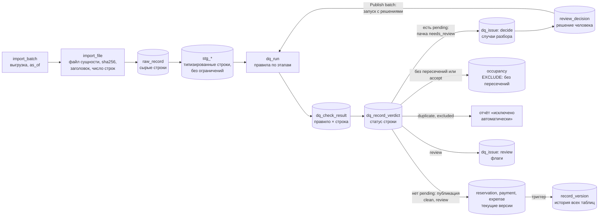

# План модуля проверки данных

Статус: черновик v3 от 2026-10-18 (v3: публикация ждёт разбора человеком, раздел 7.5). Модуль входит в управление импортом (PLAN.md, раздел 9) и детализирует правила DQ из раздела 6 PLAN.md. Если документы расходятся, действует этот. Список расхождений приведён в разделе 11.

## 1. Требования

1. Каждая проблема проверяется своей функцией: одно правило — одна функция — один файл с тестом.
2. Функция выносит вердикт по **каждой** записи своей области: `pass`, `fail` или `skip` с причиной. Каждый вердикт попадает в журнал.
3. В итоге у каждой записи ровно один статус (`clean`, `review`, `pending`, `excluded`, `duplicate`) и список правил, которые его определили.
4. Пересечения периодов проживания измеряет база данных. Она же не даёт записать пересекающиеся проживания.
5. Выезд и заезд в один день — не пересечение: одни гости уехали, другие в тот же день заехали.
6. Повторный запуск на тех же данных даёт тот же журнал.
7. **Сначала система, потом человек, потом публикация.** Всё, в чём система уверена, она решает сама и окончательно: `duplicate` и `exclude`. Чего система решить не может — пересечения, modified-брони, разные версии одной записи (действие `decide`), — решает человек. Пачка не публикуется целиком, пока не решён каждый такой случай. Флаги `review` публикацию не держат.
8. **Источник правды — входящие данные, мы их не исправляем.** Решение человека выбирает, каким записям верить, но значений не меняет. Решение действует, пока по случаю не пришли новые данные; пришли — случай решается заново, и прав может оказаться как новый источник, так и уже принятая версия. Пока пачка ждёт разбора, календарь и цифры остаются от прошлой публикации.

**Единица данных** — строка источника (`raw_record`), а не ID записи. У полного дубля R0015 две строки с одним ID, и каждая получает свой вердикт.

## 2. Место в импорте



- **Пачка = набор файлов.** `import_batch` — одна выгрузка источника на дату среза, `import_file` — файл каждой сущности в ней (не больше одного на сущность) с sha256, заголовком и числом строк. Если все файлы совпадают по sha256 с последней загруженной пачкой, новая пачка получает статус `skipped` со ссылкой на ту пачку, строки не читаются.
- **Staging (`stg_*`)** принимает всё, что разобралось по типам. Если бы ограничения стояли уже здесь, проблемную запись нельзя было бы сохранить и измерить.
- **Основные таблицы** получают записи `clean` и `review`, и только из запуска без `pending`: пока хоть один случай не решён, пачка не публикует ничего (раздел 7.5). Бронь, которую человек оставил только в финансах (`finance_only`), публикуется как `review`: деньги по ней реальные, даже если в календарь она не попала. Записи `excluded` и `duplicate` остаются в staging и журнале, их суммы показываются отдельно как «исключено / нераспределено».
- **История версий** — одна таблица `record_version` на все основные таблицы. Её пишет триггер `capture_record_version`: каждая вставка, изменение и удаление дают новую версию с данными строки целиком, ссылкой на строку источника (`raw_record_id`), запуском (`run_id`) и автором. Правка руками в обход импорта тоже попадает в историю, с `run_id = null`.
- **`occupancy`** — календарь занятости вилл, по строке на каждую допущенную активную бронь. Пересечения на уровне базы запрещены только здесь. В календарь попадают брони без пересечений и брони, выбранные человеком; остальные брони группы видны в финансах с флагом или в «исключено» — по решению.
- **Кто решает.**
  - `duplicate` и `excluded` — окончательные решения системы. Они видны в журнале и в отчёте «исключено автоматически» на `/data-quality` (правило, причина, сумма), человеку на разбор не попадают. Отменить их в интерфейсе нельзя: если ошибся источник, строку исправляют в источнике, и следующий импорт её примет.
  - `decide` — решает человек до публикации, по случаям (раздел 7.5). Строка без решения получает статус `pending` и держит публикацию всей пачки.
  - `review` — флаг: запись публикуется с пометкой, проблема видна в списке на `/data-quality`, решение по ней можно принять и после публикации.

## 3. Контракт проверки

```ts
type Entity = 'property' | 'commission_rule' | 'reservation' | 'payment' | 'expense' | 'file';
type Outcome = 'pass' | 'fail' | 'skip' | 'error';
type Action = 'duplicate' | 'exclude' | 'decide' | 'review' | 'info';  // decide — держит публикацию до решения человека

interface CheckResult {
  unitId: string;                     // id строки raw_record; для правил уровня файла — import_file.file_id
  recordKey: string;                  // естественный ключ: R0015, P0075 ...
  outcome: Outcome;
  reason?: string;                    // обязателен для skip
  details?: Record<string, unknown>;  // факты: суммы, ставка, интервал пересечения
  relatedKeys?: string[];             // вторая бронь пары, кандидат на исходную бронь, платёж
  amountIdr?: bigint;                 // сумма под вопросом, для сводки; целые IDR, как в lib/calc
}

interface Check {
  id: `DQ-${string}`;
  version: number;                    // увеличивается при изменении логики
  title: string;
  entity: Entity;
  action: Action;                     // что означает fail для статуса строки
  engine: 'ts' | 'sql';
  dependsOn: string[];                // правила, чьи вердикты нужны на входе
  run(ctx: CheckContext): Promise<CheckResult[]>;
  runTs?(ctx: CheckContext): Promise<CheckResult[]>;  // для engine 'sql': та же логика на TS
}

interface CheckContext {
  batchId: string;
  asOf: string;                       // дата среза пачки, ISO-дата
  units(entity: Entity): Unit[];      // строки пачки с типизированными полями
  statusSoFar(unitId: string): Status;// статус после уже выполненных правил и решений человека
  decisions: Decisions;               // действующие решения по случаям (7.5): судьба брони, связь modified, перенос платежей
  policies: CalcPolicies;             // из @/lib/calc (CALCULATION_MODULE.md, 7)
  db?: Sql;                           // есть только в режиме с базой
}
```

Правила контракта:

- **Источник строк и журнал — интерфейсы.** `units()` реализует источник: на уровне 1 — загрузчик CSV (`unitId` = файл и номер строки), на уровне 2 — выборка из `stg_*` (`unitId` = `raw_record_id`). Журнал — `sinks/memory.ts` или `sinks/postgres.ts`. Правила не читают файлы и не пишут в базу, поэтому уровень 2 меняет два адаптера, а правила и тесты остаются.
- **Функция не пишет в журнал сама.** Она возвращает результаты, раннер проверяет их и записывает. Раннер сверяет, что каждая строка области получила ровно один результат. Если строки не хватает или есть лишняя, правило получает `error`, запуск помечается `failed`, данные не публикуются. Строка, по которой нет вердикта, невозможна по построению, а не по договорённости.
- **`skip` с причиной.** Правило неприменимо к строке: DQ-11 для брони с каналом OTA, DQ-12 для отмены или уже исключённой брони. Причина обязательна, чтобы «не проверяли» отличалось от «проверили, всё в порядке».
- **`details` — факты, а не текст.** Сообщение строит интерфейс, тест сравнивает значения.
- **Ошибка внутри функции** даёт `error` по всем строкам области, запуск получает статус `failed`.
- **Детерминизм.** Без `Date.now()` и случайности, дата среза приходит из `ctx.asOf`, результаты отсортированы по `unitId`.
- **Решения человека — вход запуска, а не правка журнала.** Правила `decide` решений не читают: пересечение остаётся фактом, `fail` пишется и после решения. Решение применяет раннер при сведении статуса (раздел 4). Правила по платежам (DQ-05, 14, 16, 23) видят его через `statusSoFar` и через перенос платежей при слиянии (`ctx.decisions`). Тот же набор строк и решений даёт тот же журнал.

## 4. Журнал

| Таблица | Что хранит | Ключ |
|---|---|---|
| `dq_run` | запуск: `batch_id`, `as_of`, версия кода (git sha), правила с версиями, статус (`running` / `succeeded` / `failed`), время, счётчики | `id` |
| `dq_check_result` | вердикт правила по единице: строке (`raw_record_id`) или файлу (`file_id`, для DQ-90); `outcome`, `action`, `reason`, `details`, `related_keys`, `amount_idr`. Только дописывание | `(run_id, rule_id, raw_record_id)` или `(run_id, rule_id, file_id)` |
| `dq_record_verdict` | итог по строке: статус, причины (`rule_id[]`), решение человека, которое повлияло на статус (`decision_id`), допущена ли в `occupancy`. Только дописывание | `(run_id, raw_record_id)` |
| `dq_issue` | проблема между запусками, для действий `decide` и `review`: `(rule_id, entity, record_key)`, статус `open` / `resolved` / `closed`, первый, последний и закрывший запуск, хэш строки; для `decide` — ключ случая в `details.case_key` | `issue_id`; одна незакрытая на правило и запись |
| `review_decision` | решение человека по брони случая: `accept`, `finance_only`, `exclude`, `keep_published`; `payload` — связь modified (`origin`, `merge`) или пометка исходной (`replaced_by`); ключ случая `case_key`, общий для решений по одному случаю; хэш строки, на которой принято; обязательный комментарий (раздел 7.5). Только дописывание | `decision_id` |

Объём: около 357 строк × 22 правила ≈ 8 тыс. строк журнала на запуск. Для Postgres это немного.

**Итоговый статус строки** выводится из её вердиктов по приоритету:

1. есть `fail` с действием `duplicate` → `duplicate`;
2. иначе есть `fail` с `exclude` или решение `exclude` → `excluded`;
3. иначе есть `fail` с `decide` без действующего решения → `pending`;
4. иначе есть `fail` с `review` или решение `finance_only` → `review`;
5. иначе → `clean`, в том числе после решения `accept` или `keep_published`. Вердикты `info` статус не меняют.

Решение, которое определило статус, пишется в `dq_record_verdict.decision_id`: по журналу видно, где статус поставило правило, а где человек.

Статус одной сущности влияет на другую только через явное правило с `dependsOn`. Пример: DQ-05 исключает платёж, если его бронь исключена. По журналу всегда видно, какое правило изменило статус.

**Жизненный цикл `dq_issue`:**
- правило вернуло `fail` с действием `decide` или `review` впервые — проблема `open`. Вердикты `duplicate` и `exclude` проблему не открывают: это окончательные решения системы;
- правило снова вернуло `fail` — проблема остаётся в своём статусе, обновляется последний запуск;
- человек принял решение — проблема `resolved`. Новое решение по той же проблеме заменяет предыдущее, старое остаётся в истории;
- правило вернуло `pass` — проблема `closed` с номером закрывшего запуска;
- решение действует, пока по нему не пришли новые данные: строка та же (`review_decision.row_hash = dq_issue.row_hash`), а для `decide` — и состав случая тот же (`case_key`). Иначе решения снимаются, проблемы снова `open`, прежние решения остаются в истории и показываются человеку, но не подставляются (раздел 7.5);
- по `decide` решение принимается на весь случай сразу: по записи на каждую бронь с общим `case_key`.

## 5. Порядок выполнения

Раннер строит порядок по `dependsOn`, этапы ниже нужны для чтения.

| Этап | Что проверяем | Правила |
|---|---|---|
| 0. Разбор | схема и форматы, полные дубли, один ID с разным содержимым | DQ-03, DQ-01, DQ-02 |
| 1. Справочники | объекты, правила комиссии и их периоды | DQ-22 |
| 2. Брони, построчно | ссылки, валюта, суммы, комиссии, возвраты, modified | DQ-04, 06–11, 13, 17, 18 |
| 3. Брони, между собой (база) | пересечения, вероятные версии modified | DQ-12, DQ-21 |
| 4. Платежи и расходы | ссылки, суммы, даты после среза, оплата к заезду | DQ-04, 05, 06, 07, 14, 15, 16, 19, 20, 23 |
| 5. Набор целиком | контрольные суммы | DQ-90 |

**Шаги раннера:**

1. Создать `dq_run` со статусом `running`, датой среза, версией кода и списком правил.
2. Для каждого правила по порядку: вызвать `run`, проверить покрытие, записать результаты пачкой, обновить промежуточные статусы.
3. Свести итоговые статусы с учётом действующих решений и выполнить DQ-90.
4. Обновить `dq_issue` по вердиктам `decide` и `review`.
5. **Шлюз.** Есть строки `pending` — публикации нет: запуск `succeeded`, пачка `needs_review` (IMPORT_PLAN.md, 8), шаг 6 пропускается.
6. Опубликовать данные одной транзакцией с `set local app.run_id` и `app.actor`:
   - записи `clean` и `review` в основные таблицы: обновляется только строка с другим `row_hash`, триггер пишет версию в `record_version`. Бронь с решением `keep_published` не обновляется: в основной таблице остаётся опубликованная версия;
   - `occupancy`: сначала убрать брони, которые по решениям больше не в календаре (`finance_only`, `exclude`, заменённые modified-бронью) или чья строка изменилась; затем добавить брони без пересечений и выбранные человеком (`accept`, `keep_published`).
7. Отметить `dq_run` как `succeeded` и сохранить счётчики.

Журнал (шаги 1–4) и публикация (шаг 6) идут разными транзакциями. Если публикация упала, например на ограничении пересечений, журнал остаётся для разбора, а запуск получает статус `failed`.

**Два запуска на пачку со случаями.** Первый находит случаи и останавливается на шлюзе. Человек решает каждый случай (7.5) и нажимает **Publish batch**. Второй запуск идёт по тем же строкам с решениями на входе: статусы платежей пересчитываются (платёж исключённой брони — «нераспределено» по DQ-05, при слиянии платёж переходит к новой версии), `pending` нет, данные публикуются. Пачка без случаев публикуется первым же запуском.

## 6. Каталог проверок

«Ожидаем» — результат первичного анализа. Тест на реальных данных фиксирует эти списки (раздел 9).

| ID | Функция | Область, `skip` для | Где | `fail` → | Ожидаем |
|---|---|---|---|---|---|
| DQ-01 | `exactDuplicate` | все строки | TS, хэш нормализованной строки | `duplicate` для второй и следующих копий, первая — `pass` | R0015, P0075 |
| DQ-02 | `conflictingVersions` | все строки | TS | `decide`: какая версия верна, решает человек (случай `version`, 7.5); поздний `updated_at` — только подсказка | 0 |
| DQ-03 | `schemaAndFormat` | все строки | TS, zod | `exclude` | 0 |
| DQ-04 | `propertyExists` | брони, платежи, расходы, правила комиссии | SQL join со справочником / TS | `exclude` → «нераспределено» | R0034 → V999, E0017 → V777 |
| DQ-05 | `paymentReservationValid` | платежи | TS, после этапа 3 | `exclude` → «нераспределено», если брони нет или она `excluded` / `duplicate` | P0017 (R0034), P0036 (R0072) |
| DQ-06 | `currencyMatchesProperty` | брони, платежи, расходы | TS | `exclude`; в `details` сумма за ночь | R0061: USD 4 280 874 за 4 ночи |
| DQ-07 | `positiveAmountsAndNights` | брони, платежи, расходы | TS | `exclude` | 0 |
| DQ-08 | `otaFeeBounds`: 0 ≤ OTA ≤ GBV | брони | TS | `review` | R0102: −100 000 |
| DQ-09 | `refundConsistent`: возврат ≤ GBV, возврат > 0 только у отмены | брони | TS | `exclude` | R0072 |
| DQ-10 | `otaRateRange`: 0–25% | брони; `skip`, если DQ-08 = `fail` | TS | `review` | 0 |
| DQ-11 | `directBookingOtaFee` | брони; `skip` для канала OTA | TS | `review`, вопрос финдиректору | 31 |
| DQ-12 | `stayOverlap` | активные брони; `skip` для отмен и уже исключённых | **SQL** | `decide`: случай — группа конфликта (7.5) | 68 пар, 86 броней, 32 группы, 17 вилл |
| DQ-13 | `modifiedWithoutOrigin` | брони; `skip` для статусов, кроме modified | TS | `decide`: каждую modified-бронь принимает человек и вручную связывает с исходной (7.5) | 8 (R0143–R0150): 5 в группах конфликта, 3 отдельными случаями (R0143, R0144, R0147) |
| DQ-14 | `paymentAmountMatches`: = GBV − OTA − возврат и ≤ GBV | платежи по существующей брони | TS | `review` | P0051: 3 998 667 > GBV 3 898 667 (из-за R0102) |
| DQ-15 | `zeroReceivedPayment` | платежи | TS | `info` | 7 (6 отмен + R0072) |
| DQ-16 | `unpaidAtCheckIn`: заезд ≤ даты среза, сумма платежей с датой ≤ дня заезда меньше `GBV − OTA − возврат` | активные брони; `skip`, если заезд после среза | TS | `review`: долг на дату заезда; в `details` ожидалось, внесено к заезду, внесено позже, недостача | 109 / 126 / 126 при срезе 15.10 / 31.10 / 05.11; из них без единого платежа 58 / 68 / 68 |
| DQ-17 | `commissionRuleCovers`: правило на дату заезда, ставка не меняется внутри проживания | брони | TS | `review` | 0 |
| DQ-18 | `partialRefundOnCancel` | брони; `skip` для неотменённых | TS | `review` | 0 |
| DQ-19 | `paymentPropertyMatches` | платежи | TS | `review` | 0 |
| DQ-20 | `eventAfterAsOf` (новое) | платежи `received`, расходы `paid` | TS | `review` | при срезе 15.10: 23 платежа и 30 расходов; при 31.10: 3 платежа |
| DQ-21 | `modifiedLikelyVersion` (новое) | брони; `skip` для статусов, кроме modified | **SQL**, поверх DQ-12 | `info`: кандидаты на исходную бронь с оценкой в `details` — подсказка для связывания, не решение | R0149↔R0150, R0146↔R0027 / R0112, R0148↔R0038, R0145↔R0126 |
| DQ-22 | `commissionRuleOverlap` (новое): периоды правил одного объекта не пересекаются | правила комиссии | **SQL** | `exclude` | 0 |
| DQ-23 | `paymentAfterCheckIn` (новое): дата платежа позже дня заезда | платежи с суммой > 0 по существующей брони; `skip` для нулевых и для платежей по исключённой брони | TS | `review`; в `details` дней после заезда и после выезда | 60 из 69 |
| DQ-90 | `controlTotals`: по каждому файлу пачки `import_file.row_count` = число строк в `raw_record`, сумма и число строк = clean + review + pending + excluded + duplicate | файл (`import_file`) | TS + SQL | `error`: запуск `failed` | расхождений 0 |

Пояснения:
- **Дубль — только DQ-01.** Дубль — та же запись: тот же ID и то же содержимое. Такие строки система исключает сама, человек их не видит. Бронь с теми же датами под другим ID — не дубль: R0033 и R0056 (V008, 25.09–02.10) различаются GBV (14,6 и 5,6 млн IDR), платёж P0028 есть только у R0056. Это группа конфликта, её разбирает человек.
- **DQ-12:** 73 пары и 87 броней из таблицы проблем посчитаны до исключений. После исключения R0034, R0061, R0072 остаётся 68 пар и 86 броней из 135 активных. Обе цифры верны, правило проверяет вторую область. R0102 не исключается (DQ-08 даёт `review`), поэтому остаётся в области и пересекается с пятью бронями: R0017, R0096, R0101, R0103, R0128. В пересечениях находится 64% GBV активных броней (801,6 млн из 1 256,7 млн IDR).
- **DQ-21 предлагает кандидатов, но не склеивает брони.** Пример: R0146 по датам ближе к R0027 (сдвиг на день), а по сумме к R0112 (разница 3%, у R0027 — 82%). Связывание и слияние делает только человек: modified может оказаться версией брони, которую уже отклонили, или не иметь исходной в данных вовсе.
- **DQ-16 и DQ-23 — одна проблема с двух сторон.** Вилла оплачивается полностью до заезда (решение 2026-10-18): всё, что не внесено к дню заезда, — долг. В данных ни один платёж не датирован раньше заезда: 9 в день заезда, 60 позже, медиана — на следующий день после выезда. Сумма платежа при этом равна `GBV − OTA`, то есть похожа на выплату канала, а не на деньги гостя. Либо в файле даты выплат OTA вместо дат оплаты, либо это ошибка выгрузки. Правила помечают, README задаёт вопрос финдиректору. Платёж в день заезда считается внесённым вовремя.
- **DQ-20 и DQ-16 зависят от даты среза.** Она задаётся в `import_batch.as_of`. Если дата не задана, берётся последний `updated_at` пачки (2026-10-15), а в `dq_run` записывается, что дата выбрана по умолчанию.

## 7. Пересечения средствами базы

### 7.1 Интервал проживания

Проживание хранится как `daterange(check_in, check_out, '[)')`: день заезда входит, день выезда нет. Это та же модель «ночь с датой d», что и в PLAN.md (7.1).

```sql
select daterange('2026-09-01', '2026-09-05', '[)') && daterange('2026-09-05', '2026-09-08', '[)');  -- false: выезд и заезд 05.09
select daterange('2026-09-01', '2026-09-05', '[)') && daterange('2026-09-04', '2026-09-08', '[)');  -- true: общая ночь 04.09
```

В данных 16 пар активных броней, где выезд одной совпадает с заездом другой. При закрытых интервалах `[]` они ошибочно считались бы пересечениями: 89 пар вместо 73.

### 7.2 Staging: измерение

```sql
create table app.stg_reservation (
  raw_record_id  bigint primary key,
  batch_id       uuid not null,
  reservation_id text,           -- поля nullable: нераспознанное значение — null, ошибку ловит DQ-03
  property_id    text,
  check_in       date,
  check_out      date,
  status         text,
  -- ... остальные поля брони
  stay daterange generated always as (
    case when check_out > check_in then daterange(check_in, check_out, '[)') end
  ) stored,
  -- строка staging всегда из той же пачки, что и её сырая строка
  foreign key (raw_record_id, batch_id) references app.raw_record (raw_record_id, batch_id)
);

create index stg_reservation_stay on app.stg_reservation using gist (batch_id, property_id, stay);
```

Полная схема — `supabase/schemas/app/tables/stg_reservation.sql`. `case` нужен потому, что `daterange` с выездом раньше заезда вызывает ошибку и строка не вставилась бы. Такую бронь ловит DQ-07, а `stay` у неё остаётся `null`.

Запрос DQ-12:

```sql
-- все пары пересечений в пачке; $3 — строки, уже исключённые на этапах 0–2
with cand as (
  select raw_record_id, reservation_id, property_id, status, stay
  from app.stg_reservation
  where batch_id = $1
    and status in ('confirmed', 'modified')
    and stay is not null
    and raw_record_id <> all($3)
)
select a.reservation_id as a_id,
       b.reservation_id as b_id,
       a.property_id,
       a.stay * b.stay                                as overlap,
       upper(a.stay * b.stay) - lower(a.stay * b.stay) as overlap_nights,
       case when a.stay = b.stay                       then 'same_dates'
            when 'modified' in (a.status, b.status)    then 'modified_version'
            else 'partial' end                         as kind
from cand a
join cand b
  on b.property_id = a.property_id
 and b.reservation_id > a.reservation_id
 and b.stay && a.stay;
```

- Пары сводятся в группы (компоненты связности) на TS. Ключ группы — вилла и отсортированный список её броней (`V003:R0017,R0029,…`). Он одинаков в повторных запусках и меняется, когда меняется состав группы. Это и ключ случая разбора (`case_key`, 7.5). Ключ и вид пересечения пишутся в `details`, вторая бронь — в `related_keys`.
- Сейчас 32 группы: 19 по 2 брони, 9 по 3, 2 по 4, 1 по 5, 1 по 8 (V003). На 12 виллах по 2–4 независимые группы, у V008 их четыре.
- Если пачка неполная, кандидаты дополняются бронями из `occupancy`, которых нет в этой пачке. Так ловится пересечение новой брони с уже принятой.
- Вид пересечения — подсказка человеку и порядок разбора, а не автоматическое решение: `same_dates` (R0033 и R0056, не дубль) → `modified_version` (6 пар, кандидаты DQ-21) → `partial` (61 пара).

### 7.3 Occupancy: запрет пересечений

```sql
create extension if not exists btree_gist with schema extensions;  -- в Supabase расширения ставятся в схему extensions

create table app.occupancy (
  reservation_id  text primary key,
  property_id     text      not null,
  stay            daterange not null,
  admitted_run_id uuid      not null references app.dq_run,           -- запуск, который допустил бронь
  decision_id     bigint    references app.review_decision,            -- null — допущена автоматически
  admitted_at     timestamptz not null default now(),
  -- вилла и даты всегда совпадают с бронью: изменение брони каскадом обновляет строку и снова проверяется
  foreign key (reservation_id, property_id, stay)
    references app.reservation (reservation_id, property_id, stay)
    on update cascade on delete cascade,
  check (not isempty(stay) and not lower_inf(stay) and not upper_inf(stay)),
  constraint occupancy_no_overlap
    exclude using gist (property_id with =, stay with &&)
);
```

Полная схема — `supabase/schemas/app/tables/occupancy.sql`. Перед вставкой триггер `check_property_availability` выдаёт понятную ошибку с номером конфликтующей брони; гарантию, в том числе при параллельных транзакциях, даёт `EXCLUDE`.

- В `occupancy` попадают активные брони без статуса `excluded` / `duplicate`, которые ни с кем не пересекаются или выбраны в календарь решением по случаю (`accept`, `keep_published`). При отмене брони строка удаляется.
- **Кто допустил бронь** хранится двумя колонками вместо текстового `admitted_by`: `admitted_run_id` — запуск, всегда есть; `decision_id` — внешний ключ на решение человека, `null` при автоматическом допуске. Ссылка проверяется базой, а не договорённостью о формате строки.
- **Валидация решает, ограничение гарантирует.** Публикация не использует `ON CONFLICT DO NOTHING`, потому что он молча проглотил бы конфликт. Если пересечение всё же дошло до вставки, база вернёт `23P01` (exclusion_violation), транзакция публикации откатится, запуск получит статус `failed`.
- **Почему пересечения измеряются запросом, а не попыткой вставки.** Результат вставки зависит от порядка строк, и она сообщает только о первом конфликте. Запрос сразу находит все пары.
- **Кто из группы попадает в календарь** — решает человек (раздел 7.5). Пока решения нет, пачка не публикуется вовсе. Публикация добавляет выбранные брони в `occupancy` с `decision_id`. В данных 49 броней из 135 попадут в календарь без решения, 86 броней в 32 группах ждут человека. Вариант «допускать первую по порядку» (90 из 135) отклонён: при первой загрузке порядок — это порядок строк в CSV, выбор был бы произвольным, а проблема скрытой.
- **Повторный импорт.** Если новая бронь пересекается с уже допущенной, календарь не меняется, пока пачка не разобрана. Допущенная бронь показывается в одной группе с новой, отмеченная «в календаре с пачки #N», и человек решает заново: прав может быть и уже принятый источник, и новый.
- То же ограничение стоит на `commission_rule`: `exclude using gist (property_id with =, daterange(effective_from, effective_to, '[]') with &&)`. `effective_to` включается в период, поэтому интервал закрытый. Это DQ-22.
- Drizzle, насколько известно, не описывает `EXCLUDE` в схеме. Ограничения пишем отдельной SQL-миграцией, при реализации проверить по документации Drizzle.

### 7.4 Режим без базы

У правил `engine: 'sql'` есть TS-двойник `runTs` с той же семантикой `[)`. Он работает в режиме CSV (уровень 1). Тест сравнивает списки пар из SQL и TS на реальных данных, так две реализации проверяют друг друга.

### 7.5 Разбор перед публикацией

Пачка со случаями `decide` не публикуется, пока человек не решит каждый случай. К началу разбора система уже убрала дубли и исключила записи с однозначными ошибками (раздел 2, «Кто решает»): R0015, R0034, R0061, R0072 человеку не показываются. Остальное однозначно не решается: выбор зависит от фактов, которых нет в данных, — кто реально заехал, кого переселили, какой договор подписан, какую бронь OTA отменила у себя. Автоматический выбор может отказать гостю, который заплатил: R0096 оплачена (5,96 млн IDR), а пересекающаяся с ней R0017 — нет.

**Почему держим всю публикацию, а не только календарь.** Решение меняет не только календарь, но и деньги: исключённая бронь уходит из GBV и дебиторки, её платёж становится нераспределённым, при слиянии платёж переходит к другой брони. Если опубликовать финансы до решений, цифры на дашборде поменяются после разбора, а между ними будет смешанное состояние. Поэтому каждая публикация целиком решена: дашборд показывает либо прошлую публикацию, либо новую. Цена: пока пачка не разобрана, дашборд показывает прошлую публикацию, а первая пачка не публикуется, пока не решены все 35 случаев.

**Единица разбора — случай.**

| Тип | Правило | Что внутри | В данных |
|---|---|---|---|
| `conflict` | DQ-12 | группа конфликта: брони одной виллы, связанные цепочкой пересечений, вместе с modified-бронями в ней | 32 |
| `modification` | DQ-13 | modified-бронь вне групп конфликта | 3: R0143, R0144, R0147 |
| `version` | DQ-02 | одна запись под одним ID с разным содержимым | 0 |

Ключ случая (`case_key`): для `conflict` — ключ группы (7.2), для `modification` — `M:<reservation_id>`, для `version` — `V:<entity>:<record_key>`. Всего в данных 35 случаев. Экран строится так: вилла → случай → брони.

**Выбирается набор броней, а не одна.** Группа — цепочка пересечений, и верных броней в ней может быть несколько. Самая большая группа, V003 в сентябре:

```
R0039  03–09  ██████
R0096  06–14     ████████
R0017  09–11        ██
R0102  10–14         ████
R0103  12–19           ███████
R0128  13–16            ███
R0101  13–17            ████
R0029  14–20             ██████
```

R0039 (03–09), R0017 (09–11) и R0029 (14–20) друг с другом не пересекаются и могут быть верны одновременно. Правило «выбери одну из восьми» потеряло бы настоящие брони.

**Решение — по каждой брони случая, одно на бронь:**

| Решение | Календарь | Финансы | Когда |
|---|---|---|---|
| `accept` | да | да | бронь верна |
| `finance_only` | нет | да, с флагом | двойное бронирование: деньги реальные, гостя переселили |
| `exclude` | нет | нет, суммы в «исключено» | ошибка источника; исходная бронь, которую заменила modified-бронь |
| `keep_published` | да, опубликованная версия | да, опубликованная версия | только у брони, уже опубликованной в другой версии: прав принятый источник, входящая версия не принимается |

Решение пишется на бронь в случае (`case_key`, `record_key`) и закрывает все её проблемы `decide` в этом случае: у modified-брони в группе — DQ-12 и DQ-13 сразу.

**Решения `correct` нет.** Мы не исправляем входящие данные: исправление у нас разошлось бы с источником, и мы не поняли бы, когда источник пришлёт обновлённые данные. Ошибку исправляют в источнике (выгрузка ниже), следующая пачка приносит новые данные, и случай решается заново.

**modified-брони: связь и слияние — только вручную.** Каждую modified-бронь (8 в данных) человек принимает явно, даже если она ни с чем не пересекается.
- **Связь.** Человек выбирает исходную бронь или отмечает «исходной нет». Кандидаты DQ-21 с оценкой (сдвиг дат, разница GBV) — подсказка. Выбрать можно любую бронь виллы, в том числе исключённую системой или отклонённую человеком раньше: modified может оказаться изменением брони, которая уже не прошла. У такой брони видно, кто, когда и с каким комментарием её отклонил.
- **Исходная бронь заменена.** В том же сохранении она получает `exclude` с `payload.replaced_by`, иначе GBV посчитался бы дважды. Сама modified-бронь получает обычное решение (`accept`, `finance_only`, `exclude`) с `payload.origin`.
- **Слияние** (`payload.merge = true`) — отдельная галочка после связи: платежи исходной брони переходят к новой версии. Без слияния они остаются на исходной и попадают в «нераспределено» (DQ-05). Почему галочка ручная: R0148 и её вероятная исходная R0038 оплачены отдельно (7,16 и 4,65 млн IDR). Слияние даст переплату по R0148, отказ — нераспределённый платёж; что верно, знает только человек. Правило по умолчанию — вопрос финдиректору (12.4).
- **Связь — тоже ребро случая.** Если исходная входит в другой случай, экран объединяет оба случая в один, и они сохраняются вместе. Ключ случая строится по пересечениям и по связям из решений, поэтому следующий запуск получает тот же ключ.
- Случай нельзя сохранить, пока у каждой modified-брони не выбрано «исходная — X» или «исходной нет».

**Новые данные — решение заново.** Решение привязано к содержимому: ключ случая и `row_hash` каждой брони случая.
- Новая пачка не изменила ни одной строки случая и его состав — решение действует, человек этот случай не видит. Повтор той же выгрузки работы не требует.
- Изменилась строка или состав (новая бронь пересеклась с группой, бронь отменили, пришла новая modified) — решения снимаются, случай снова открыт. Прежние решения показываются как история («было: Calendar, Yuri, 18.10»), но не подставляются: человек решает заново.
- У брони, которая уже опубликована в другой версии, видны обе версии, отличия подсвечены. Прав может быть любой источник: входящая версия принимается обычным решением, опубликованная остаётся по `keep_published`. Брони, которые сейчас в календаре, отмечены «в календаре с пачки #N».

**Экран** (`/review`, PLAN.md, этап 12). Пример состояния на группе V003, решения выбраны для иллюстрации:

```
Open 23 · Resolved 12   │ V003 · Villa 03 · Sanur · 3–20 Sep 2026
                        │ 8 bookings · 16 pairs · up to 5 per night · 66.6M IDR
V003                    │
▸ 3–20 Sep      8  ×5   │          GBV  paid   3      10     17   Decision
  6–17 Oct      3       │ R0039  13.7M     —   ██████···········  [Calendar] Finance  Exclude
V008                    │ R0096   7.0M  6.0M   ···▒▒▒▒▒▒▒▒······   Calendar [Finance] Exclude
  3–11 Sep      2       │ R0017  10.2M     —   ······██·········  [Calendar] Finance  Exclude
  18–25 Sep     3       │ R0102   3.9M  4.0M ! ·······▒▒▒▒······   Calendar [Finance] Exclude
  25 Sep–2 Oct  2  same │ R0103  10.2M     —   ·········░░░░░░░·   Calendar  Finance [Exclude]
  22–29 Oct     3       │ R0128   7.7M  6.7M   ··········▒▒▒····   Calendar [Finance] Exclude
V020                    │ R0101   8.6M     —   ··········┈┈┈┈···   ← needs decision
  25 Sep–3 Oct  2       │ R0029   5.3M     —   ···········██████  [Calendar] Finance  Exclude
  4–14 Oct      5       │ booked               11122223235443221
                        │ calendar             ████████···██████   ✓ no overlap · free 11–13
                        │
                        │ Calendar 3 · 14 nights   Finance only 3 · 18.6M   Excluded 1 · 10.2M
                        │ Comment* ___________________________________________
                        │                                   [Resolve case ⏎]  1 row left
```

- Слева — случаи пачки: вилла → случаи, порядок `same_dates` → с modified → `partial` → отдельные modified; фильтр Open / Resolved; прогресс «решено x из N».
- Строка — бронь, колонка — ночь: таймлайн, а не пивот с числами. Перед полосой — GBV, оплачено, флаги других правил (`!` у R0102 — DQ-08 и DQ-14, по клику карточка брони).
- Решение — переключатель на строке: Calendar / Finance only / Exclude, у брони, опубликованной в другой версии, ещё Keep published. Клик по полосе ставит Calendar. У modified — кнопка Link: кандидаты, поиск по вилле, сравнение рядом (даты, GBV, OTA, канал, платежи), галочка Merge payments.
- Строка `calendar` проверяет выбор на ходу: две выбранные брони на одной ночи — ночи красные, сохранить нельзя.
- Под таблицей — влияние на цифры: ночей в календарь, сумма под флагом, сумма в «исключено». Комментарий один на случай, обязателен.
- Клавиатура: ↑↓ — строки, 1–3 — решение, Enter — сохранить и открыть следующий случай.
- Делается на HeroUI (`ListBox` с секциями, `ToggleButtonGroup`, `Popover`, `Modal`, `TextArea`, `ProgressBar`) и своём таймлайне на CSS grid. AG Grid не нужен: группировка строк и пивот в нём только в платной Enterprise, а данных мало — 35 случаев, самый большой 8 броней на 17 ночей.

**Сохранение случая** — одна транзакция, только решения; основные таблицы и календарь не меняются:
1. сверить, что ключ случая и `row_hash` его броней совпадают с последним запуском пачки; не совпали — «случай изменился, обновите»;
2. проверить: решение по каждой брони, выбранные в календарь не пересекаются, у каждой modified выбрана исходная или «исходной нет», комментарий есть;
3. записать `review_decision` на каждую бронь с общим `case_key`, автором и комментарием, перевести проблемы случая в `resolved`.

Случаи не пересекаются друг с другом (компоненты связности), поэтому порядок разбора не важен. Частично решённый случай не сохраняется.

**Publish batch.** Когда решены все случаи пачки, страница показывает итог: сколько броней в календаре, только в финансах, исключено человеком, GBV в расчётах против прошлой публикации — и кнопку **Publish batch**. Она запускает второй запуск с решениями и публикацию (раздел 5; IMPORT_PLAN.md, 8). Если пока пачка ждала, пришла новая, старая получает `superseded` и не публикуется. Решения при этом не теряются: они привязаны к содержимому строк и действуют в новой пачке для тех же строк.

**Выгрузка для источника.** Нерешённые случаи выгружаются в CSV (вилла, случай, брони, даты, общие ночи, кандидаты на исходную) для того, кто ведёт исходные данные. Исправление в источнике лучше решения у нас: при следующем импорте пересечение пропадёт, и проблема закроется сама (`closed`).

**Уровень 1** (CSV, без базы): решений и публикации нет. Строки `pending` дашборд показывает как `review` — с флагом, а переключатель «включать записи под вопросом» показывает, насколько от них зависят цифры. Случаи видны на `/data-quality` списком, без кнопок решения.

**Изменения схемы** (миграция при реализации):
- `dq_issue`: `dq_issue_action_known` — `decide` и `review`;
- `dq_record_verdict`: статус `pending`, колонка `decision_id`;
- `review_decision`: решения `accept`, `finance_only`, `exclude`, `keep_published` (`correct` и `link_origin` убираются, связь — в `payload`); колонки `case_key` и `record_key`; `issue_id` допускает `null` (заполнен у решений по флагам `review`); `payload` допускается у любого решения;
- представление `app.review_case` поверх `dq_issue` (`decide`, группировка по `details->>'case_key'`): список случаев и прогресс без новой таблицы;
- `import_batch.status`: `needs_review`, `superseded` (IMPORT_PLAN.md, 11).

## 8. Структура кода

В репозитории сейчас `lib/` лежит в корне, без `src/`. Модуль кладём туда же:

```
lib/dq/
├─ types.ts            Check, CheckResult, Outcome, Action
├─ registry.ts         список правил
├─ runner.ts           порядок по dependsOn, проверка покрытия, шлюз, шаги раздела 5
├─ verdict.ts          итоговый статус строки с учётом решений
├─ cases.ts            случаи разбора: группы, modified, версии; case_key с рёбрами связей
├─ decisions.ts        действующие решения: привязка к case_key и row_hash, перенос платежей при слиянии
├─ sinks/
│  ├─ memory.ts        журнал в памяти (режим CSV, тесты)
│  └─ postgres.ts      dq_run, dq_check_result, dq_record_verdict, dq_issue
├─ checks/
│  ├─ dq01-exact-duplicate.ts
│  ├─ dq01-exact-duplicate.test.ts
│  └─ ...              одно правило — один файл и тест
└─ sql/
   ├─ dq12-stay-overlap.sql
   └─ dq21-modified-likely-version.sql
supabase/schemas/app/  декларативная схема: таблицы, функции, триггеры (по файлу на объект)
supabase/migrations/   миграции, сгенерированные из схемы
```

Запуск: `npm run dq` выполняет проверки по CSV и печатает сводку по правилам. В режиме с базой проверки идут внутри `npm run import`. Страница `/data-quality` читает `dq_record_verdict` и `dq_check_result`.

## 9. Тесты

1. **Контрактный тест для каждого правила из реестра:** каждая строка области получает ровно один результат, у `skip` есть причина, повторный вызов даёт тот же результат.
2. **Модульные тесты правила** на маленьких наборах: случай `pass`, случай `fail`, граница.
3. **Границы пересечений:**
   - 01–05 и 05–08 — пересечения нет;
   - 01–05 и 04–08 — одна общая ночь (04.09);
   - одинаковые даты — `same_dates`, а не дубль (R0033 и R0056);
   - бронь внутри другой;
   - отменённая бронь не блокирует;
   - разные виллы не пересекаются;
   - вставка пересечения в `occupancy` даёт `23P01`, а соседние брони «выезд = заезд» вставляются;
   - изменение дат брони в `reservation` каскадом доходит до `occupancy` и откатывается, если новые даты конфликтуют.
7. **История версий:** публикация той же пачки не создаёт новых версий в `record_version`; изменённая строка даёт версию `n + 1` с `run_id` запуска; правка руками — версию с `run_id = null`. `UPDATE`/`DELETE` в таблицах «только дописывание» дают ошибку.
4. **Эталон на реальных данных:** списки `fail` по каждому правилу совпадают с колонкой «Ожидаем» в разделе 6. Если данные изменятся, тест покажет разницу.
5. **Инварианты:** у каждой строки один итоговый статус, DQ-90 сходится, SQL и TS дают одинаковые пары пересечений.
6. **Повторный запуск** на той же пачке: журналы двух запусков совпадают до строки (кроме `run_id` и времени).
8. **Автоматические решения:** строки `duplicate` и `excluded` не создают `dq_issue`; проблемы открывают только `decide` и `review`.
9. **Шлюз публикации:**
   - запуск со строками `pending` не меняет основные таблицы и `occupancy`, пачка получает `needs_review`;
   - Publish batch при нерешённом случае отклоняется;
   - запуск с решениями: `exclude` → `excluded`, платёж этой брони — «нераспределено» (DQ-05); `finance_only` → `review` и не в `occupancy`; при `merge` платёж исходной брони считается у новой версии;
   - новая пачка переводит прежнюю `needs_review` в `superseded`; решения по неизменным строкам действуют в новой пачке.
10. **Решение по случаю:**
   - набор с пересекающимися бронями не сохраняется;
   - случай без решения по каждой брони не сохраняется и остаётся `open`;
   - modified без выбора «исходная — X» или «исходной нет» не сохраняется; исходной можно выбрать исключённую бронь;
   - связь с бронью из другого случая объединяет случаи, следующий запуск даёт тот же `case_key`;
   - случай без новых данных сохраняет решение; изменение строки или состава снимает решения, и экран не подставляет прежние;
   - `keep_published`: основная таблица остаётся на опубликованной версии; та же входящая строка в следующей пачке — решение действует, другая — случай открыт.

Тесты с базой выполняются на PGlite с расширением btree_gist (поддержку проверить при реализации) или в отдельной тестовой схеме Supabase.

## 10. Этапы

Порядок (решено 2026-10-18): уровень 1 — всё на TS с журналом в памяти, это часть сквозного пути CSV → проверки → расчёт → дашборд (PLAN.md, 12). SQL-правила, журнал в Postgres и разбор перед публикацией — уровень 2, после сдачи.

| # | Этап | Уровень | Оценка | Факт |
|---|---|---|---|---|
| 1 | Контракт, раннер (порядок по `dependsOn`, проверка покрытия), итоговый статус, журнал в памяти, контрактный тест | 1 | 40 мин | |
| 2 | Правила этапов 0–2 на TS с тестами (DQ-01…11, 13, 17, 18) | 1 | 45 мин | |
| 3 | Схема базы: `import_file`, `dq_*`, `stg_*`, `record_version` с триггером, `daterange`, GiST, `occupancy` с `EXCLUDE` | 2 | 30 мин | готово (миграция `20261018155954_data_model`) |
| 4 | DQ-12 на TS (двойник `runTs`, группы конфликтов, тесты границ 9.3) | 1 | 25 мин | |
| 5 | Этапы 4–5 на TS: DQ-04, 05, 06, 07, 14, 15, 16, 19, 20, 23; DQ-90 как инвариант; эталонный тест по колонке «Ожидаем» | 1 | 40 мин | |
| | **Итого уровень 1** | | **≈ 2 ч 30 мин** | |
| 6 | DQ-12, DQ-21, DQ-22 на SQL; тест «SQL и TS дают одни пары» | 2 | 30 мин | |
| 7 | Журнал в Postgres, жизненный цикл `dq_issue`, встраивание в импорт, публикация, проверка повторного запуска | 2 | 50 мин | |
| 8 | Разбор перед публикацией: случаи и `case_key` (с рёбрами связей), действие `decide` и статус `pending`, решения на входе раннера, шлюз и второй запуск, сохранение случая одной транзакцией, связь и слияние modified, `keep_published`, снятие решений при новых данных, выгрузка CSV, миграция. Экран — PLAN.md, этап 12 | 2 | 70 мин | |

## 11. Расхождения с PLAN.md

PLAN.md обновлён по пунктам ниже, кроме открытого вопроса о дате среза. Список оставлен как журнал изменений.

- **DQ-08 (R0102):** было `excluded`, стало `review` по новой таблице проблем. Поэтому платёж P0051 больше не исключается правилом DQ-05, его ловит DQ-14 (платёж больше суммы брони), а R0102 остаётся в области DQ-12.
- **DQ-12:** уточнён интервал `[check_in, check_out)`. Приведены цифры до исключений (73 / 87) и после (68 / 86; R0102 больше не исключается).
- **Новые правила:** DQ-20 (событие после даты среза), DQ-21 (вероятная версия modified), DQ-22 (пересечение периодов правил комиссии), DQ-90 (контрольные суммы как правило журнала).
- **Новые таблицы:** `stg_*`, `dq_run`, `dq_check_result`, `dq_record_verdict`, `occupancy`.
- **Пачка — набор файлов:** `import_batch` описывает выгрузку целиком (источник, дата среза, статус), а файлы, sha256 и заголовки вынесены в `import_file`. Было: одна пачка на один файл.
- **История версий:** вместо отдельных таблиц `*_version` с `valid_from` / `valid_to` — одна общая `record_version`, которую пишет триггер. Версия действует от своего `recorded_at` до следующей версии той же записи.
- **`occupancy`:** текстовая колонка `admitted_by` (`'auto'` или id решения) заменена на `admitted_run_id` и `decision_id` с внешними ключами.
- **Очередь только для `review`:** было — `dq_issue` открывается на любой `fail`, стало — только на `review`. `duplicate` и `excluded` — окончательные решения системы, видны в отчёте «исключено автоматически».
- **`same_dates` — не дубль:** было «вероятный дубль», стало — обычная группа конфликта. Дубль только DQ-01: тот же ID и то же содержимое.
- **Пересечения:** решение принимается по группе конфликта, человек выбирает набор броней для календаря. Новое решение `finance_only`, новая колонка `review_decision.conflict_group`.
- **DQ-16:** было «нет платежа по завершённому проживанию» (по выезду, без суммы), стало «не оплачено к дню заезда» (по заезду, с суммой). Новое правило DQ-23 помечает платежи с датой позже заезда.
- **Дата среза:** в PLAN.md (7.1) было — последняя дата событий (2026-11-05), при ней DQ-20 ничего не находит. Принято 2026-10-15 (последний `updated_at`), PLAN.md исправлен 2026-10-18. Вопрос финдиректору остаётся (12.2).
- **v3, публикация ждёт разбора:** было — `clean` и `review` публикуются сразу, человек разбирает группы после, решения сразу меняют `occupancy`. Стало — новое действие `decide` (DQ-02, DQ-12, DQ-13) и статус `pending`; пачка с `pending` не публикуется целиком; решения — вход второго запуска, публикует он (разделы 5, 7.5).
- **v3, решения:** `correct` убран — входящие данные не исправляем; `link_origin` как отдельное решение убран — связь modified и слияние платежей лежат в `payload`, у исходной брони `exclude` с `replaced_by`; добавлен `keep_published`. `conflict_group` переименован в `case_key`: случай — не только группа конфликта, но и modified вне групп и разные версии одной записи.
- **v3, новые данные:** было — решения по изменившейся группе подставляются заново. Стало — решения снимаются и не подставляются, человек решает заново и может оставить опубликованную версию.
- **v3, DQ-21:** было `review`, стало `info` — подсказка для ручной связи.

## 12. Открытые вопросы

1. **Пересечения и modified — решено 2026-10-18, уточнено в v3.** Пачка со случаями `decide` не публикуется целиком, пока человек не решит каждый случай. Разбор — по случаям: человек выбирает набор броней для календаря, связывает и сливает modified вручную, при новых данных решает заново (раздел 7.5).
2. **Дата среза для этих данных — принято по умолчанию 2026-10-15** (последний `updated_at`, похоже на дату выгрузки). Альтернативы: 2026-10-31 (последний расход), 2026-11-05 (последнее событие). От неё зависят DQ-16, DQ-20 и долг на дату заезда. Вопрос финдиректору остаётся.
3. **Порог похожести для DQ-21:** предлагаю такой — тот же объект, пересечение периодов, сдвиг дат (наибольший из сдвигов заезда и выезда) не больше 2 дней или разница GBV не больше 5%. Кандидаты ранжируются по оценке. При этом пороге R0045 для R0148 кандидатом не считается: сдвиг 3 дня, разница GBV 18%.
4. **Платежи заменённой брони:** переносить к новой версии или оставлять на исходной? Пример: R0148 (новая версия) и R0038 (исходная) оплачены отдельно, 7,16 и 4,65 млн IDR. В v3 это решает человек в каждом случае галочкой Merge payments (7.5); у финдиректора спрашиваем правило по умолчанию (PLAN.md, 14, вопрос 6).
5. **Даты платежей:** при правиле «100% до заезда» в payments.csv нет ни одного платежа до заезда. Это даты выплат OTA (тогда в файле не оплата гостя, а поступление от канала) или ошибка выгрузки? До ответа DQ-16 считает долгом всё, что не внесено к дню заезда.
6. **Какие правила держат публикацию.** Сейчас `decide` — только DQ-02, DQ-12, DQ-13. Остальные `review` (DQ-08, 11, 14, 16, 20, 23 …) — флаги: их сотни (DQ-16 — 109 броней), и держать ими публикацию значило бы не публиковать никогда. Если какое-то из них должно держать публикацию, оно меняет действие на `decide`, код раннера не меняется.
